[](https://github.com/everton-dgn/solidjs_base/actions/workflows/ci.yml)
[](https://www.npmjs.com/package/@evertondgn/solid-tooling)
[](https://www.npmjs.com/package/@evertondgn/solid-runtime)
[](LICENSE)

# Solid Base

<picture>
  <source media="(prefers-color-scheme: dark)" srcset="docs/assets/readme/hero-dark.webp" />
  <source media="(prefers-color-scheme: light)" srcset="docs/assets/readme/hero-light.webp" />
  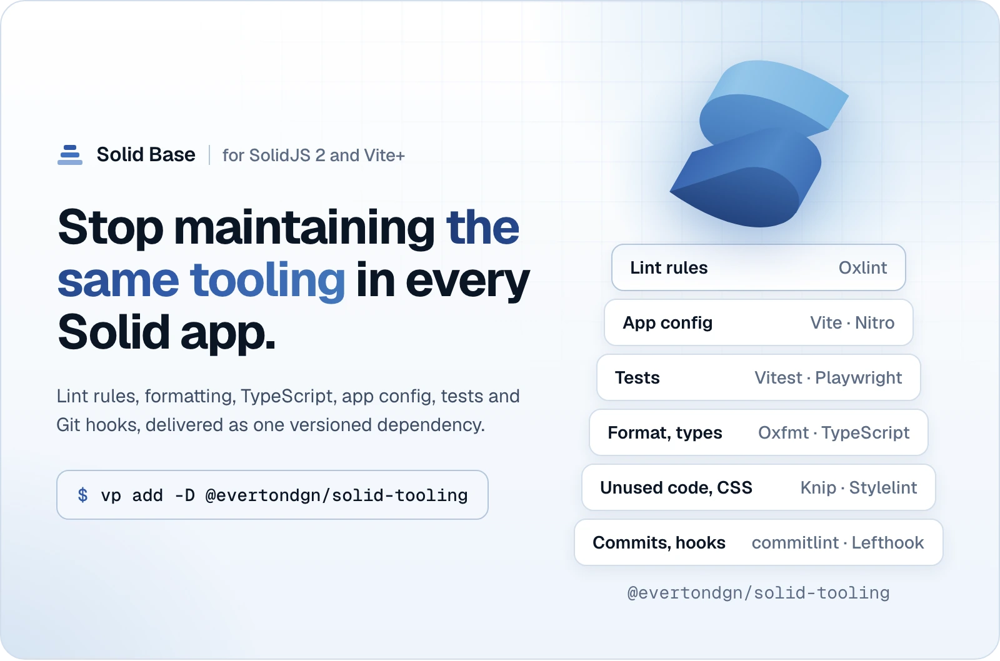
</picture>

Build your Solid app. Keep the shared foundation in packages.

Solid Base supplies the application config and runtime for SolidJS 2 with
[Vite+](https://viteplus.dev/guide/): translations, light and dark theme, server
protection, SEO, validated environment values, icons and fonts, alongside lint
rules, tests and Git hooks. Fix the shared code once, then update the packages
in each application.

Translations follow your configured locale list. Theme behavior comes from one
factory. Both are optional: an app without translations or a theme switcher
writes no configuration for them. A client-only or desktop renderer can start
with `ssr: false`, without a server or site URL.

Built for the
[boilerplate_solidjs](https://github.com/everton-dgn/boilerplate_solidjs) layout
and tested with the SolidJS 2 release candidate pinned in the package manifests.
Your pages, content, UI and deployment remain yours.

[Quick start](#quick-start) · [Choose your features](#only-what-you-use) ·
[Languages](#i18n-from-your-locale-list) ·
[Theme](#light-dark-or-system-without-a-flash) ·
[Server protection](#middleware-and-security-policies) ·
[SEO](#seo-from-pages-to-sitemaps) ·
[Dependency savings](#fewer-libraries-to-maintain) ·
[Documentation](#documentation)

## Quick start

In an application with Vite+ and the matching Solid dependencies installed:

```bash
vp add -D @evertondgn/solid-tooling
vp add @evertondgn/solid-runtime
```

Use the versions and layout in the
[requirements](docs/tooling/limits.md#requirements). The
[client-only fixture](fixtures/apps/client-only),
[SSR fixture](fixtures/apps/ssr-plain) and
[translated SSR fixture](fixtures/apps/ssr-i18n) are complete examples.

A client-only `vite.config.ts` needs only:

```ts
import { defineSolidApp } from '@evertondgn/solid-tooling/vite'

export default defineSolidApp({ root: import.meta.dirname, ssr: false })
```

For SSR, provide the static header policy and your middleware entry:

```ts
import { SECURITY_HEADERS } from '@evertondgn/solid-runtime/middleware/security-headers/constants'
import { defineSolidApp } from '@evertondgn/solid-tooling/vite'

export default defineSolidApp({
  root: import.meta.dirname,
  securityHeaders: SECURITY_HEADERS,
  middleware: './src/middleware.ts'
})
```

Create that file with the
[middleware example below](#middleware-and-security-policies). The preset
supplies build plugins, lint, formatting and test projects. You keep the
application entries, Router, App and Document. The
[application config guide](docs/tooling/app-config.md) covers the integration.

## Only what you use

<picture>
  <source media="(prefers-color-scheme: dark)" srcset="docs/assets/readme/only-what-you-use-dark.webp" />
  <source media="(prefers-color-scheme: light)" srcset="docs/assets/readme/only-what-you-use-light.webp" />
  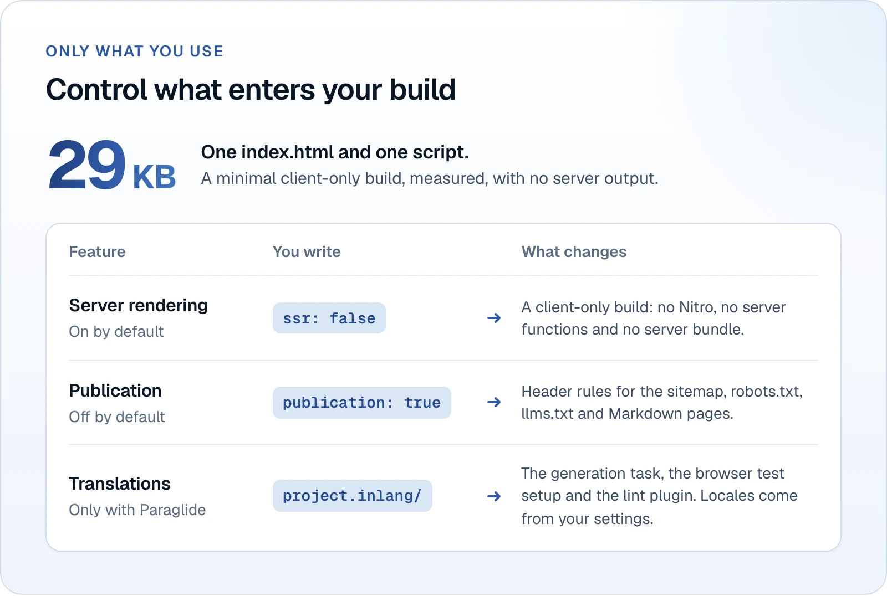
</picture>

| Feature             | How it enters your app                                                    | If you do not need it                                               |
| ------------------- | ------------------------------------------------------------------------- | ------------------------------------------------------------------- |
| SSR                 | Enabled by default, with your header policy                               | Set `ssr: false`; no Nitro or server bundle                         |
| Translations        | Add `project.inlang/settings.json`, catalogs and translation dependencies | Omit the project; no generator or translation provider in the build |
| Theme               | Import `theme/define-theme` and connect your Document and UI              | Omit theme imports; no theme modules in the build                   |
| Env validation      | Add `env.ts` and use the validated virtual modules                        | Omit the file; no preset variables become required                  |
| Fonts               | Pass `fonts` to the preset                                                | Omit it; no generated font CSS or assets                            |
| SEO and publication | Import selected runtime entries, install explicit routes and set `seo`    | Omit their imports, routes and preset options                       |

The [installed scenarios](docs/ADRs/0021-installed-application-scenarios.md)
audit disabled features in actual bundles. A desktop renderer uses the
client-only build; desktop packaging stays in your application. The tooling
still installs its shared tools when a feature is unused. See the
[installation tradeoff](#fewer-libraries-to-maintain).

## I18n from your locale list

<picture>
  <source media="(prefers-color-scheme: dark)" srcset="docs/assets/readme/i18n-dark.webp" />
  <source media="(prefers-color-scheme: light)" srcset="docs/assets/readme/i18n-light.webp" />
  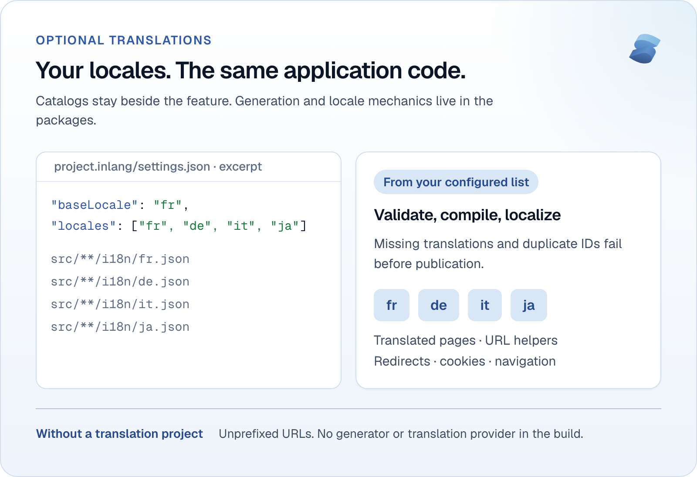
</picture>

Choose the locales your product needs, with no hard-coded locale count or
pt/en/es list. The installed example uses `fr`, `de`, `it` and `ja`:

```json
{
  "baseLocale": "fr",
  "locales": ["fr", "de", "it", "ja"],
  "modules": ["./node_modules/@inlang/plugin-message-format/dist/index.js"],
  "plugin.inlang.messageFormat": {
    "pathPattern": "./.paraglide/messages/{locale}.json"
  }
}
```

Keep messages beside their feature at `src/**/i18n/<locale>.json`. The tooling
discovers catalogs, checks missing translations, duplicate IDs and message
parameters, then compiles Paraglide in development, builds and tests. Your app
keeps the
[compiler settings](fixtures/apps/ssr-i18n/project.inlang/paraglide.config.ts)
and translation dependencies. No copied generator or manual plugin is needed.

The runtime supplies locale-aware URLs, redirects, cookie persistence,
navigation guards and language tags. `createMiddleware` selects request
localization when the project exists. Your switcher and link UI stay in the app.
Without the project, the same locale helpers use `language` (default `en`) and
preserve unprefixed URLs.

There is no fixed locale set, but generation reads all catalogs and has an 8 MiB
aggregate byte limit. More locales increase generation work and output. See
[catalog limits](docs/tooling/limits.md#known-limits), the
[installed example](fixtures/apps/ssr-i18n) and the
[navigation API](packages/solid-runtime/README.md#navigation-and-language-tags).

## Light, dark or system without a flash

<picture>
  <source media="(prefers-color-scheme: dark)" srcset="docs/assets/readme/theme-dark.webp" />
  <source media="(prefers-color-scheme: light)" srcset="docs/assets/readme/theme-light.webp" />
  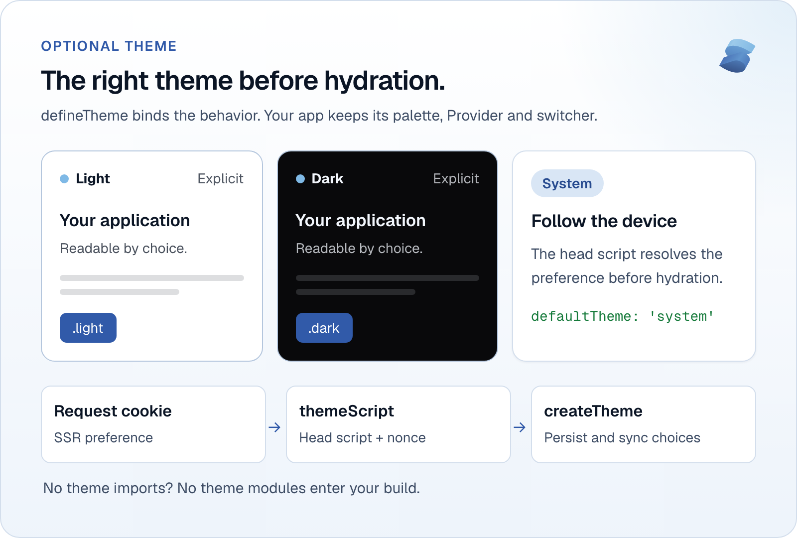
</picture>

Configure behavior once, then use the returned helpers in your Document and
Provider:

```ts
import { defineTheme } from '@evertondgn/solid-runtime/theme/define-theme'

export const theme = defineTheme({
  cookieName: 'app-theme',
  cookieMaxAge: 31_536_000,
  colors: { light: '#ffffff', dark: '#09090b' },
  defaultTheme: 'system'
})
```

Read the cookie for SSR, render `themeScript` in the head with the request
nonce, and call `createTheme` in your Provider. The early script applies the
explicit or system preference before hydration, avoiding a light-theme flash on
a dark page. The primitive persists choices in a cookie and synchronizes tabs
and system changes. This example keeps the cookie for 31,536,000 seconds, as the
[copy does](apps/boilerplate/src/constants/theme.ts).

You own the palette, `.light`/`.dark` CSS, Provider and switcher. An app without
theme switching needs none of these imports or settings. See the
[theme API](packages/solid-runtime/README.md#optional-theme) and the
[Document integration](apps/boilerplate/src/Document.tsx).

## Middleware and security policies

<picture>
  <source media="(prefers-color-scheme: dark)" srcset="docs/assets/readme/middleware-dark.webp" />
  <source media="(prefers-color-scheme: light)" srcset="docs/assets/readme/middleware-light.webp" />
  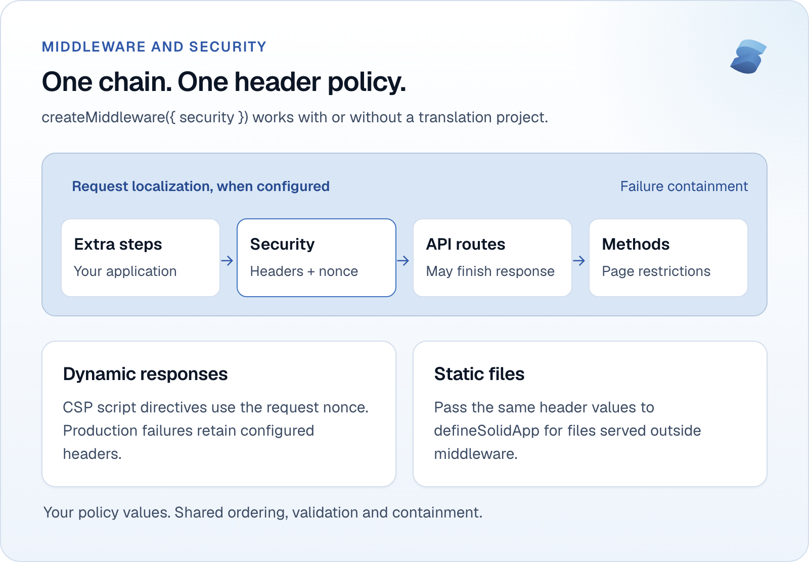
</picture>

Use a shared chain with a shared security policy:

```ts
import { createMiddleware } from '@evertondgn/solid-runtime/middleware/create-middleware'
import { createSecurityHeaders } from '@evertondgn/solid-runtime/middleware/security-headers'

const security = createSecurityHeaders()
export default createMiddleware({ security })
```

The chain composes request localization, extra application steps, security
headers, API routes and page-method restrictions. Security runs before API
handlers can finish the response. Production containment returns public failures
with the configured headers, including when middleware throws.

The package builds CSP script directives from a request nonce. You choose other
directives and header values; invalid header shapes and conflicting script
directives fail during setup. Pass the same static header values to
`defineSolidApp` for files served outside middleware. An optional `document`
callback wraps the chain for application-specific response handling.

See [chain composition](packages/solid-runtime/README.md#building-the-chain) and
[security options](packages/solid-runtime/README.md#security-headers).
Containment covers the middleware call; errors while sending a body after the
Response returns remain outside that window.

## Keep server errors private

<picture>
  <source media="(prefers-color-scheme: dark)" srcset="docs/assets/readme/server-errors-dark.webp" />
  <source media="(prefers-color-scheme: light)" srcset="docs/assets/readme/server-errors-light.webp" />
  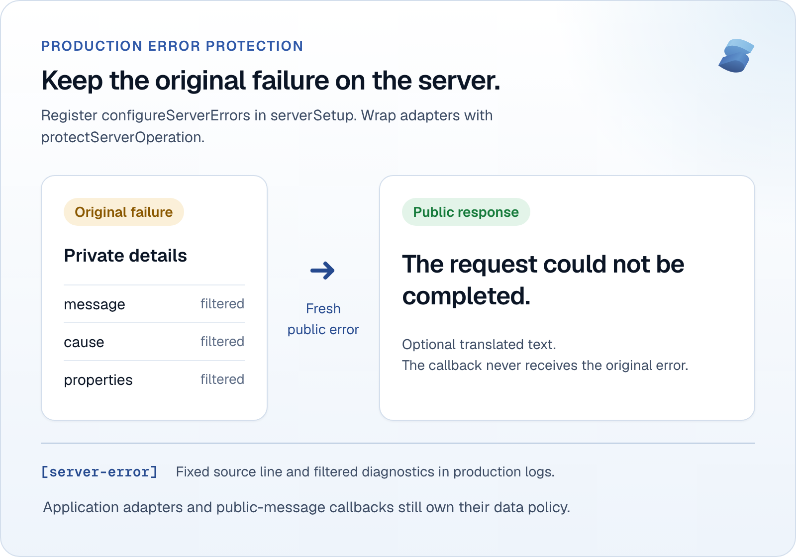
</picture>

Register protection in `src/infra/server/configureServerErrors/index.ts`, and
point the preset's `serverSetup` option at that file:

```ts
import { configureServerErrors } from '@evertondgn/solid-runtime/server/configure-server-errors'

configureServerErrors()
```

The runtime wraps server-function invocations and observes render errors.
Production failures become fresh public errors: the original message, cause and
properties are not forwarded. The default response is
`The request could not be completed.`. Logs retain a fixed `[server-error]`
source line with filtered diagnostics. Development keeps original diagnostics.

Wrap database or SDK adapters with `protectServerOperation({ run })`. Lint
restricts privileged imports, and used `server-only` imports in client code fail
the build. Public messages can be translated through a synchronous callback that
never receives the original error.

Your adapters still choose public fields, and your callback must return public
text. The package cannot detect a secret deliberately embedded in a string. See
the
[protection contract](packages/solid-runtime/README.md#server-error-protection).

## SEO from pages to sitemaps

<picture>
  <source media="(prefers-color-scheme: dark)" srcset="docs/assets/readme/seo-dark.webp" />
  <source media="(prefers-color-scheme: light)" srcset="docs/assets/readme/seo-light.webp" />
  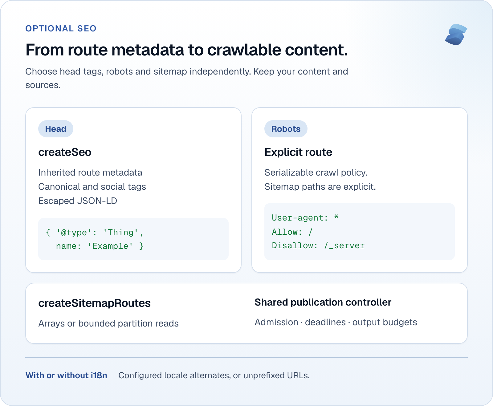
</picture>

`createSeo` merges route metadata and publishes head tags, canonical links,
social metadata and escaped JSON-LD. Supply your site and page content; author,
organization and social profiles are optional. For custom structured data, call
this inside a Solid owner:

```ts
import { createSeo } from '@evertondgn/solid-runtime/seo/create-seo'

export function registerStructuredData() {
  createSeo({ structuredData: () => ({ '@type': 'Thing', name: 'Example' }) })
}
```

Robots uses serializable preset data and an explicit route:

```ts
export { GET } from '@evertondgn/solid-runtime/seo/robots-route'
```

`createSitemapRoutes` takes your site URL, source registry and shared
publication controller. Small sources can return arrays; partitioned sources
receive a read limit and cancellation signal. With i18n, XML includes the
configured locales and `x-default`. Without it, URLs remain unprefixed. Routes,
robots announcements and `seo.sitemap` header rules are explicit choices.

Publication has bounded admission, output budgets and deadlines. Quotas and
caches are local to a process; database adapters must honor limits and
cancellation. See [SEO](packages/solid-runtime/README.md#optional-seo) and
[sitemap APIs and bounds](packages/solid-runtime/README.md#sitemap-and-publication).
A meta-only app can provide its URL directly. An app without SEO needs no site
URL or SEO imports.

### Markdown pages and llms.txt

Turn on a Markdown copy of your pages and an `llms.txt` index with preset data:

```ts
import { defineSolidApp } from '@evertondgn/solid-tooling/vite'

export default defineSolidApp({
  root: import.meta.dirname,
  seo: {
    markdown: { static: true },
    llms: {},
    llmsFull: {}
  }
})
```

A page opts in with `route.info.markdown`. The runtime derives the Markdown from
the settled HTML of the same page, so there is no second copy of the content.
`createMarkdownContent` goes into the `document` slot of `createMiddleware` and
shares the publication controller with the sitemap. The build writes static
`.md` files when `markdown.static` is on; `markdown: {}` converts per request
only. `createLlms` returns the `GET` handler of `llms.txt`, and your app chooses
the notes and pages it lists. Each feature is independent: leave one out and its
routes, modules, header rules and `Link` announcements stay out of the build.
Without i18n, the files are served without a locale prefix.

Conversion has input and output byte budgets and a deadline, and the indexes
fail the build instead of being truncated when they pass their budget. The
runtime uses the published `@mdream/js`; the
[Markdown guide](apps/boilerplate/docs/seo/markdown.md) lists the conversion
differences that the complete application fixes with a patch, and how to apply
it. See the [publication guide](apps/boilerplate/docs/seo/publication.md).

## Validated environment values

<picture>
  <source media="(prefers-color-scheme: dark)" srcset="docs/assets/readme/env-dark.webp" />
  <source media="(prefers-color-scheme: light)" srcset="docs/assets/readme/env-light.webp" />
  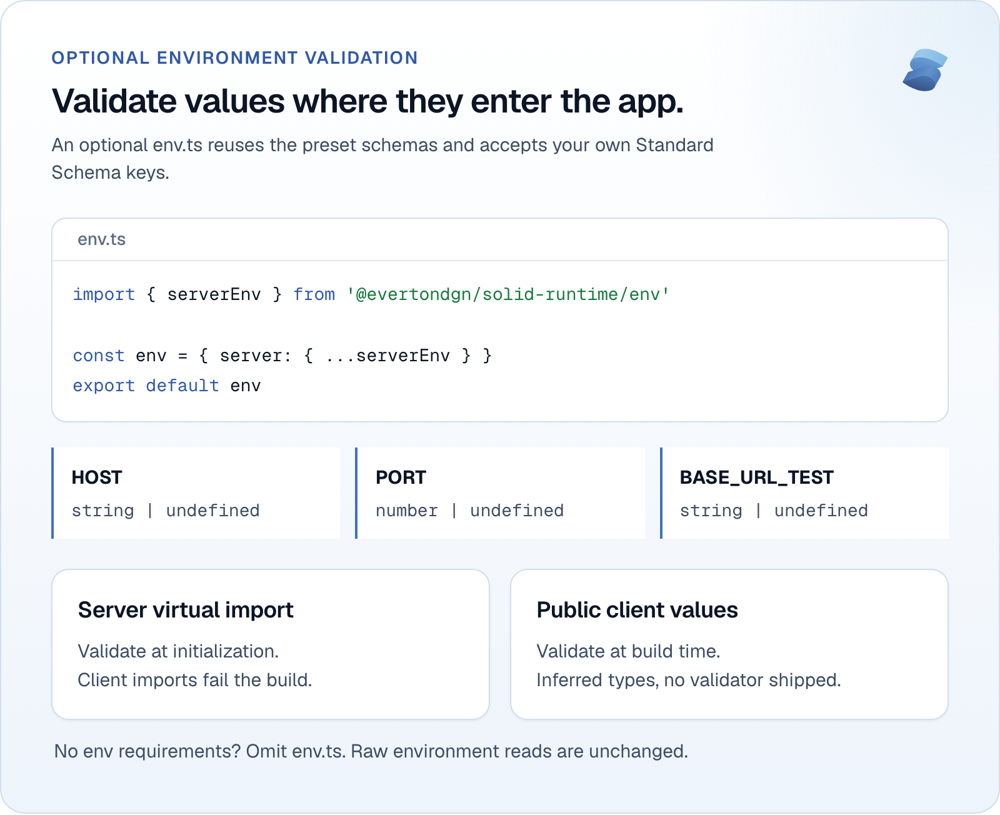
</picture>

Reuse preset validators and add application keys through Standard Schema:

```ts
import { serverEnv } from '@evertondgn/solid-runtime/env'

const env = { server: { ...serverEnv } }

export default env
```

`HOST`, `PORT` and `BASE_URL_TEST` stay optional. `PORT` produces a number.
Import `virtual:solid-env/server` from server code to validate when the module
loads; raw env reads are unchanged. Public client values use
`virtual:solid-env/client` and validate at build time. Generated declarations
carry the inferred types. The build rejects server env imports in client code.

The runtime supplies Valibot for its fragment. Declare a validator library
yourself only when your code imports it. An app without env requirements can
omit `env.ts`. See
[environment validation](docs/tooling/app-config.md#optional-environment-validation).

## Icons from collections or your own SVGs

<picture>
  <source media="(prefers-color-scheme: dark)" srcset="docs/assets/readme/icons-dark.webp" />
  <source media="(prefers-color-scheme: light)" srcset="docs/assets/readme/icons-light.webp" />
  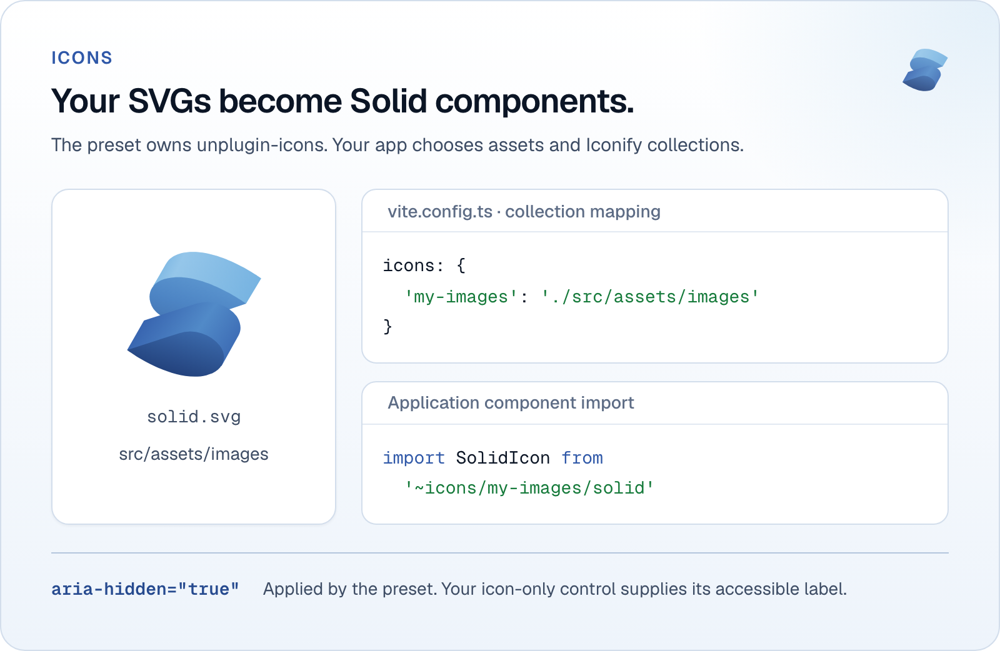
</picture>

The preset configures `unplugin-icons` for Solid. Install the Iconify
collections you use, or map your own SVG folder:

```ts
import { defineSolidApp } from '@evertondgn/solid-tooling/vite'

export default defineSolidApp({
  root: import.meta.dirname,
  ssr: false,
  icons: { 'my-images': './src/assets/images' }
})
```

The copy's [Solid SVG](apps/boilerplate/src/assets/images/solid.svg) is
available as `~icons/my-images/solid`. Icons compile to Solid components and
receive `aria-hidden`; give icon-only controls an accessible label. The plugin
belongs to the tooling package. Your assets and selected collections belong to
your app. See the [plugin configuration](docs/tooling/app-config.md).

## Fonts with matching CSS and preloads

<picture>
  <source media="(prefers-color-scheme: dark)" srcset="docs/assets/readme/fonts-dark.webp" />
  <source media="(prefers-color-scheme: light)" srcset="docs/assets/readme/fonts-light.webp" />
  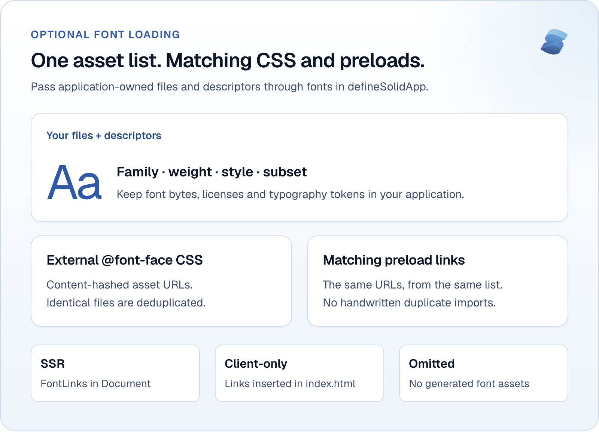
</picture>

Pass a `fonts` array with your files and face descriptors to `defineSolidApp`.
The preset emits external `@font-face` CSS and derives preload URLs from the
same asset list. Identical files are deduplicated, and font bytes stay external,
compatible with the default stylesheet CSP.

SSR renders `FontLinks` in the Document head:

```tsx
import { FontLinks } from '@evertondgn/solid-runtime/fonts/font-links'

export function FontHead() {
  return <FontLinks />
}
```

Client-only apps receive the links in `index.html` automatically. Without
`fonts`, nothing is generated and no runtime font import is needed. You keep
files, licenses and typography tokens. See the
[complete font configuration](docs/tooling/fonts.md) and the
[copy's descriptors](apps/boilerplate/fonts.ts).

## Fewer libraries to maintain

<picture>
  <source media="(prefers-color-scheme: dark)" srcset="docs/assets/readme/libraries-dark.webp" />
  <source media="(prefers-color-scheme: light)" srcset="docs/assets/readme/libraries-light.webp" />
  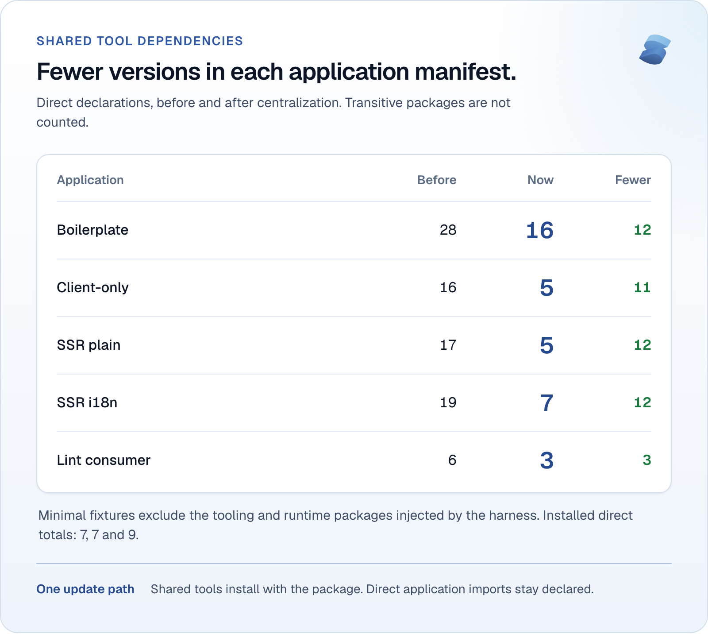
</picture>

Update build, test, type-check and hook tools through the tooling package.
Applications retain libraries their own source imports, plus Vite+ and its Vite
alias. The packages supply the tools they call and resolve their binaries from
their own installation, including with Bun's isolated linker.

| Application                                           | Direct declarations before | Current manifest | Fewer declarations |
| ----------------------------------------------------- | -------------------------: | ---------------: | -----------------: |
| [Boilerplate copy](apps/boilerplate/package.json)     |                         28 |               16 |                 12 |
| [Client-only](fixtures/apps/client-only/package.json) |                         16 |                5 |                 11 |
| [SSR plain](fixtures/apps/ssr-plain/package.json)     |                         17 |                5 |                 12 |
| [SSR i18n](fixtures/apps/ssr-i18n/package.json)       |                         19 |                7 |                 12 |
| [Lint consumer](fixtures/consumer/package.json)       |                          6 |                3 |                  3 |

Counts combine `dependencies` and `devDependencies`, excluding overrides and
transitive packages. The installed harness adds `solid-tooling` and
`solid-runtime` to each minimal app, so their installed direct totals are 7, 7
and 9. The original installed totals were 18, 19 and 21. Both sides of the table
exclude those injected entries. The copy and lint consumer already declare their
package dependencies.

The [dependency decision](docs/ADRs/0027-packaged-tool-dependencies.md) records
the original measurements. Fewer declarations do not mean a smaller install: the
tooling installs tools for optional features too. Build audits check that
development tools stay out of application bundles. A library your app imports
directly still needs its own declaration.

## Before and after

<picture>
  <source media="(prefers-color-scheme: dark)" srcset="docs/assets/readme/before-after-dark.webp" />
  <source media="(prefers-color-scheme: light)" srcset="docs/assets/readme/before-after-light.webp" />
  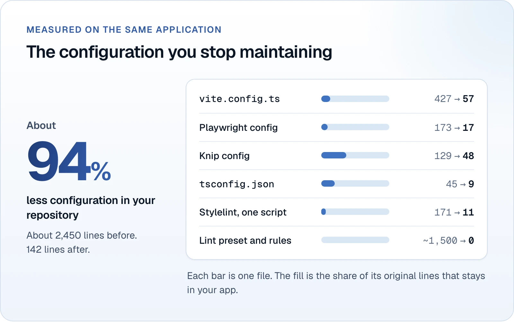
</picture>

Across these five configuration areas, the copy keeps 136 lines instead of 945,
about 86% fewer. Counts include blank lines and comments. The Stylelint
replacement is an application script calling the packaged policy.

| Configuration                                             | Original lines | Current copy |
| --------------------------------------------------------- | -------------: | -----------: |
| [Vite](apps/boilerplate/vite.config.ts)                   |            427 |           59 |
| [Playwright](apps/boilerplate/playwright.config.ts)       |            173 |           17 |
| [Knip](apps/boilerplate/tooling/knip.ts)                  |            129 |           40 |
| [TypeScript](apps/boilerplate/tsconfig.json)              |             45 |            9 |
| [Stylelint caller](apps/boilerplate/tooling/css/check.ts) |            171 |           11 |

The baseline is the
[original starter at 6145493](https://github.com/everton-dgn/boilerplate_solidjs/tree/61454937472d0faa1b4fab985fd7c5da968aa9a6).
The shared implementation remains in the package. Current fixture configs have
19 lines for [client-only with fonts](fixtures/apps/client-only/vite.config.ts),
30 for [SSR with fonts and SEO](fixtures/apps/ssr-plain/vite.config.ts), and 11
for [translated SSR](fixtures/apps/ssr-i18n/vite.config.ts). These fixtures
exercise different features, so their lengths are not a size comparison.

## Fix the base once

<picture>
  <source media="(prefers-color-scheme: dark)" srcset="docs/assets/readme/fix-once-dark.webp" />
  <source media="(prefers-color-scheme: light)" srcset="docs/assets/readme/fix-once-light.webp" />
  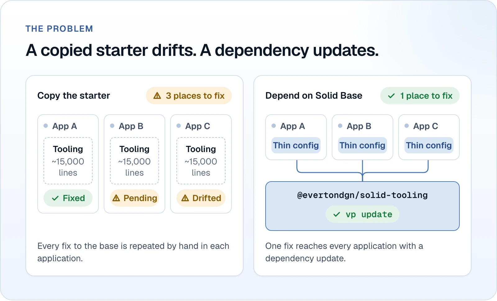
</picture>

Both packages carry shared fixes across applications with `vp update`. Keep
tested versions aligned and review release notes when updating.

| The packages maintain                                                           | Your application owns                                      |
| ------------------------------------------------------------------------------- | ---------------------------------------------------------- |
| Lint, formatting, TypeScript, Vitest, Playwright, Knip, Stylelint and Git hooks | Code, tests, paths and overrides                           |
| Locale mechanics, catalog generation and theme behavior                         | Messages, locale selection, UI and palette                 |
| Middleware, error protection and publication admission                          | Header policy, public text, backend adapters and data      |
| SEO factories, icon integration and font loading                                | Editorial metadata, source registries, assets and licenses |

### Start with lint and formatting

You can adopt only the presets in an existing Vite+ config, preserving its
plugins and other settings:

```ts
import { fmt } from '@evertondgn/solid-tooling/fmt'
import { lint } from '@evertondgn/solid-tooling/lint'
import { defineConfig } from 'vite-plus'

export default defineConfig({ fmt, lint })
```

The rule below reports `export { example }` on line 3 of
`src/helpers/export-list.ts`. Replace it with `export const example = 1`:

```ts
const example = 1

export { example }
```

<picture>
  <source media="(prefers-color-scheme: dark)" srcset="docs/assets/readme/first-result-dark.webp" />
  <source media="(prefers-color-scheme: light)" srcset="docs/assets/readme/first-result-light.webp" />
  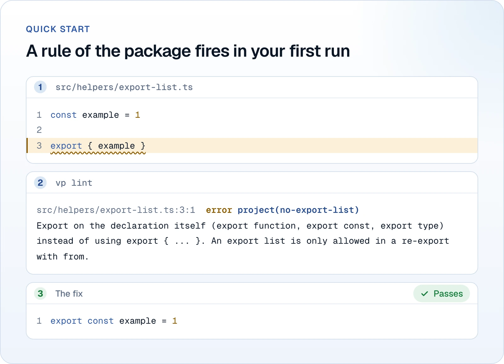
</picture>

The figure shows three steps: write the example, run `vp lint`, then export on
the declaration. See
[all package rules](docs/tooling/lint.md#rules-of-this-package) and
[TypeScript setup](docs/tooling/typescript-and-format.md).

## How it is verified

<picture>
  <source media="(prefers-color-scheme: dark)" srcset="docs/assets/readme/verified-dark.webp" />
  <source media="(prefers-color-scheme: light)" srcset="docs/assets/readme/verified-light.webp" />
  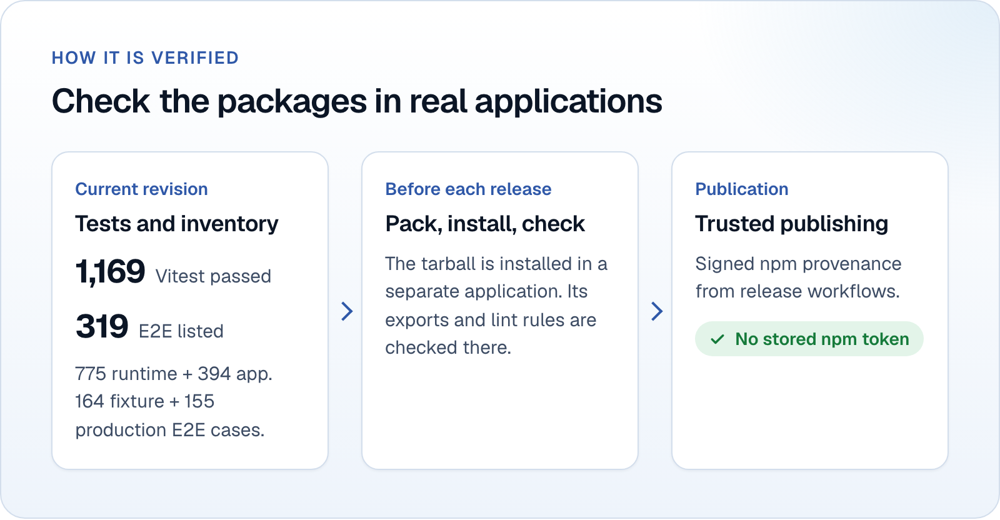
</picture>

At this revision, the runtime and application passed 775 and 394 Vitest tests,
respectively, 1,169 combined. The current Playwright inventory contains 164
fixture E2E cases and 155 production E2E cases, 319 total. Enumeration records
the inventory; those E2E cases were not run for this documentation update.

Release gates also build installed tarballs outside the workspace with Bun's
`hoisted` and `isolated` linkers, check exports and lint rules, and audit
disabled features and server boundaries. CI selects jobs by changed paths;
documentation-only changes do not imply every suite runs.

See [CI coverage](docs/development.md#ci),
[installed scenarios](docs/ADRs/0021-installed-application-scenarios.md) and the
[release process](docs/releasing.md). Release workflows use npm trusted
publishing with signed provenance; the runtime's first publish follows the
[new-package procedure](docs/releasing.md#new-package).

## Packages and roadmap

| Available package                                                        | What it provides                                                                                          |
| ------------------------------------------------------------------------ | --------------------------------------------------------------------------------------------------------- |
| [`@evertondgn/solid-tooling`](packages/solid-tooling/README.md)          | Config, build tools, catalog generation, icons, fonts, lint, tests and hooks                              |
| [`@evertondgn/solid-runtime`](packages/solid-runtime/README.md), `0.1.0` | Locale and theme behavior, middleware, server errors, env validators, SEO, sitemap, Markdown and llms.txt |

### Roadmap

| Planned work                      | Scope                               |
| --------------------------------- | ----------------------------------- |
| Reusable CI and release workflows | Shared automation for applications  |
| `vp create` template              | New applications using the packages |

## Documentation

| Guide                                                 | What you will find                           |
| ----------------------------------------------------- | -------------------------------------------- |
| [Tooling reference](docs/tooling/README.md)           | Presets, configuration and limits            |
| [Runtime reference](packages/solid-runtime/README.md) | Independent feature APIs and integration     |
| [Development](docs/development.md)                    | Workspace setup, tests and CI                |
| [Architecture](docs/architecture.md)                  | Package boundaries and application ownership |
| [Releasing](docs/releasing.md)                        | Versions, publishing and recovery            |
| [ADRs](docs/ADRs/README.md)                           | Decisions and measured tradeoffs             |

Read the [contributing guide](CONTRIBUTING.md) before opening an issue or pull
request. Report security problems privately as [SECURITY.md](SECURITY.md)
explains. The [documentation index](docs/README.md) links to all guides.

## License

[MIT](LICENSE)
