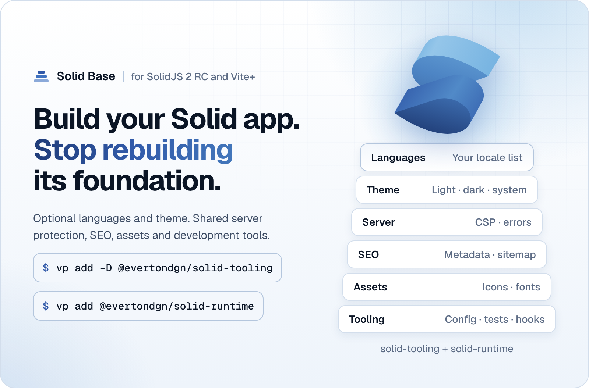

[](https://github.com/everton-dgn/solidjs_base/actions/workflows/ci.yml)
[](https://www.npmjs.com/package/@evertondgn/solid-tooling)
[](https://www.npmjs.com/package/@evertondgn/solid-runtime)
[](https://www.npmjs.com/package/@evertondgn/vite-plugin-solid-icons)
[](LICENSE)

# Solid Base

<picture>
  <source media="(prefers-color-scheme: dark)" srcset="docs/assets/readme/hero-dark.webp" />
  <source media="(prefers-color-scheme: light)" srcset="docs/assets/readme/hero-light.webp" />
  
</picture>

**Build your Solid app. Stop rebuilding its foundation.**

Solid Base started as a starter app,
[boilerplate_solidjs](https://github.com/everton-dgn/boilerplate_solidjs). Each
new SolidJS app copied it, with its Vite config, lint rules, test setup, Git
hooks, security headers and SEO code:
[945 lines of configuration in five files](https://github.com/everton-dgn/boilerplate_solidjs/tree/61454937472d0faa1b4fab985fd7c5da968aa9a6).
Then the copies drifted. A fix to the base had to be made again by hand in every
app.

Solid Base turns that base into three npm packages. A
[copy of the starter](apps/boilerplate/README.md) in this repository takes its
config, lint, tests and runtime features from them, so a change that breaks a
real app fails CI before it ships. That copy keeps 129 lines of configuration
where the starter had 945. A fix now lands once, in a package version, and each
app takes it by [updating both packages together](#update-the-packages).

<details>
<summary>How the lines were counted</summary>

Both counts come from `wc -l`, blank lines and comments included, over the same
five areas: the Vite, Playwright, Knip, TypeScript and Stylelint configs of the
[starter at `6145493`](https://github.com/everton-dgn/boilerplate_solidjs/tree/61454937472d0faa1b4fab985fd7c5da968aa9a6),
and their counterparts in the copy:
[`vite.config.ts`](apps/boilerplate/vite.config.ts),
[`playwright.config.ts`](apps/boilerplate/playwright.config.ts),
[`tooling/knip.ts`](apps/boilerplate/tooling/knip.ts),
[`tsconfig.json`](apps/boilerplate/tsconfig.json) and
[`tooling/css/check.ts`](apps/boilerplate/tooling/css/check.ts).

</details>

> [!IMPORTANT]
> SolidJS 2 is still a release candidate, and the three packages are `0.x`:
> below 1.0.0, a breaking change raises the minor version
> ([versions](docs/tooling/limits.md#versions)). The packages pin the versions
> they are tested with, so update them together and read the release notes
> first.

## Three packages and the app that tests them

- [`@evertondgn/solid-tooling`](packages/solid-tooling/README.md): the whole
  `vite.config.ts`, lint rules, test projects and Git hooks of a SolidJS 2 app,
  as one dev dependency.
- [`@evertondgn/solid-runtime`](packages/solid-runtime/README.md): security
  headers with a nonce CSP, private server errors, links that keep the language,
  a theme set before hydration, and SEO and Markdown publication for a SolidJS 2
  app, one import at a time.
- [`@evertondgn/vite-plugin-solid-icons`](packages/vite-plugin-solid-icons/README.md):
  every icon of an Iconify collection or of your own SVG folder, imported by
  name as a typed SolidJS 2 component, with only the icons you use in the
  bundle.
- [`apps/boilerplate`](apps/boilerplate/README.md): a complete SolidJS 2 app
  built on the packages. It is never published or deployed.

In the CI run of the 0.8.0 release pull request
([run 43975952604](https://github.com/everton-dgn/solidjs_base/actions/runs/43975952604)),
the app's 185 Vitest tests passed in its node, dom and browser projects
([job](https://github.com/everton-dgn/solidjs_base/actions/runs/43975952604/job/133680119099)),
and 164 end-to-end cases passed against its E2E build
([job](https://github.com/everton-dgn/solidjs_base/actions/runs/43975952604/job/133680119082)).
`playwright test --list` counts 155 more cases for the production build, which
CI does not run.

## See it work

Both runs below used the 0.8.0 packages from npm, on 2026-11-17, in copies of
the [fixtures](#start-a-new-app-from-a-fixture). File paths are shortened.

### A typo in an icon name stops the build

Icons are imported by name, and the name is checked when the app builds and when
it type-checks:

```ts
// src/typo.ts
import { Githb } from 'icon:hugeicons'

export const icon = Githb
```

```text
$ vp build
[plugin vite-plugin-solid-icons] src/typo.ts:1:9
RolldownError: "Githb" is not an icon of 'icon:hugeicons'. Did you mean Github?
1: import { Githb } from 'icon:hugeicons'
            ^

$ vp check
  x typescript(TS2724): '"icon:hugeicons"' has no exported member named 'Githb'. Did you mean 'Github'?
```

The
[icons plugin](packages/vite-plugin-solid-icons/README.md#build-errors-that-name-the-icon)
lists the other errors that name the icon.

### Every page response gets security headers and a new nonce

The [SSR fixture](fixtures/apps/ssr-plain) passes the runtime's header policy to
`defineSolidApp` and builds. Its production preview answers with eight security
headers and a content security policy whose script nonce changes on every
request. Two lines that come from the fixture and the preview server are cut
from the output:

```text
$ curl -sI http://127.0.0.1:4417/
HTTP/1.1 200
content-security-policy: default-src 'self'; style-src 'self'; object-src 'none'; base-uri 'self'; form-action 'self'; frame-ancestors 'none'; script-src 'nonce-2Dq3lGgPyraw4bycVilbMw==' 'strict-dynamic'
content-type: text/html; charset=utf-8
cross-origin-embedder-policy: require-corp
cross-origin-opener-policy: same-origin
cross-origin-resource-policy: same-origin
permissions-policy: camera=(), microphone=(), geolocation=()
referrer-policy: strict-origin-when-cross-origin
strict-transport-security: max-age=63072000; includeSubDomains
x-content-type-options: nosniff
x-frame-options: DENY
```

A second request got another nonce (policy shortened):

```text
content-security-policy: ... script-src 'nonce-+tZMQ1+pW8MBtfSu71btKA==' 'strict-dynamic'
```

The [runtime](packages/solid-runtime/README.md#security-headers) explains each
header and how the nonce reaches the scripts of the page.

## Who it fits

- You start SolidJS 2 apps on Vite+ and want the config, lint, tests and hooks
  of the boilerplate_solidjs layout without copying them.
- You maintain several Solid apps and want to fix their base once.
- You want only the
  [lint and format presets](#add-the-packages-to-an-existing-app) in an existing
  Vite+ config.
- You want only the [icons plugin](packages/vite-plugin-solid-icons/README.md)
  in a Vite+ app with SolidJS 2.

## Who it does not fit yet

- Your app needs the full preset with another folder layout. The test presets,
  Knip and the CSS policy expect the boilerplate layout
  ([known limits](docs/tooling/limits.md#known-limits)).
- Your server build must target a host other than Vercel's output format. Nitro
  always uses the `vercel` preset
  ([known limits](docs/tooling/limits.md#known-limits)). A client-only build
  (`ssr: false`) writes a static `dist/` with no server
  ([applications with no server](docs/tooling/no-server.md)).
- You cannot pin exact versions. `vite-plus` 1.6.0 and `@solidjs/web`
  2.0.0-rc.23 are exact peers in the
  [tooling](packages/solid-tooling/package.json) and
  [runtime](packages/solid-runtime/package.json) manifests, and SolidJS 2 is a
  release candidate.
- You run Node older than 26.13.1, the `engines.node` floor of each package
  ([tooling manifest](packages/solid-tooling/package.json)).
- Install size matters more than fewer declarations. The tooling installs the
  tools of features you do not use: 8.41% more `node_modules` with Bun's hoisted
  linker, in the measurement recorded in
  [ADR 0027](docs/ADRs/0027-packaged-tool-dependencies.md).

## Quick start

Install the global [Vite+](https://viteplus.dev/guide/) CLI (`vp`) first, then
pick one of three paths.

### See the complete app

```bash
git clone https://github.com/everton-dgn/solidjs_base.git
cd solidjs_base
vp install
vp run build
cd apps/boilerplate
vp run dev
```

Open `http://127.0.0.1:3000/`: the copy's `.env` sets that host and port. The
figure shows its home page at `/en`, captured from the production build:

<picture>
  <source media="(prefers-color-scheme: dark)" srcset="docs/assets/readme/app-home-dark.webp" />
  <source media="(prefers-color-scheme: light)" srcset="docs/assets/readme/app-home-light.webp" />
  
</picture>

The [boilerplate app section](#what-the-boilerplate-app-shows) lists what else
it shows.

### Start a new app from a fixture

The three fixtures are minimal apps that CI installs from the packed tarballs:
[client-only](fixtures/apps/client-only), [SSR](fixtures/apps/ssr-plain) and
[translated SSR](fixtures/apps/ssr-i18n). Copy the folder of the closest one to
a new project outside this repository. They are test harnesses, so a copy takes
three to five changes. These are the changes we made on 2026-11-17 to copies of
client-only and SSR with the 0.8.0 packages. The translated SSR fixture was not
tried this way yet.

1. Add a `build` script: `"scripts": { "build": "vp build" }`. The SSR copy also
   takes `"start": "vp preview"`.
2. Remove the `fonts` block from `vite.config.ts`, or point it to a real font
   file: the harness creates `src/assets/scenario.woff2` during its run. In the
   SSR copy, also remove `FontLinks` from `src/App.tsx`.
3. Add a `.gitignore` with `node_modules`, `dist`, `src/icon-collections.d.ts`
   and `src/@types/routes.d.ts`, so `vp check` skips generated files. The SSR
   copy also lists `.vercel`, `.nitro` and `.output`.
4. SSR only: create `.env` with `VITE_SITE_URL=https://example.com`, or remove
   `seo` from `vite.config.ts`. Without either, the build fails with
   `Error: Missing site origin: VITE_SITE_URL`.
5. Delete `src/helpers/probe/`, which holds the harness tests.

Then install the packages and build:

```bash
vp add -D @evertondgn/solid-tooling
vp add @evertondgn/solid-runtime
vp run build
```

With changes 1 to 4, `vp run build` passed in both copies, and the SSR build
wrote `.vercel/output`. The client-only copy also passed `vp check`, before and
after change 5. Its build, with Node 26.13.1 and vp 1.6.0 on macOS:

```text
$ vp build ⊘ cache disabled
transforming...
✓ 93 modules transformed.
rendering chunks...
computing gzip size...
dist/index.html                 0.19 kB │ gzip:  0.16 kB
dist/assets/index-CrSh0w8D.js  67.84 kB │ gzip: 26.22 kB

✓ built in 429ms
```

Its whole `vite.config.ts` is the fixture's file without the `fonts` block:

```ts
import { defineSolidApp } from '@evertondgn/solid-tooling/vite'

export default defineSolidApp({
  root: import.meta.dirname,
  icons: { scenario: './src/assets/icons' },
  ssr: false
})
```

With `ssr: false`, the build writes `dist/index.html` and one JavaScript file,
with no Nitro or server bundle.

Before you build your app on the copy, replace the harness scaffolding: the
package name, the `scenario` icon collection and `src/assets/icons/mark.svg`,
the probe `App.tsx`, the `<27` upper bound in `engines.node`, and
`@iconify-json/hugeicons` if your app does not use that collection. The SSR copy
also has the `x-scenario-env` header in `src/middleware.ts`, the scenario labels
in `env.ts`, a `src/infra/server/renderServerError/` that throws on purpose, the
example site in `src/seo-site.ts` and the example `articles`, `catalog` and
`sitemaps` routes.

### Add the packages to an existing app

With Vite+ and the Solid dependencies your app imports already installed, add
the tooling for development and the runtime for the app:

```bash
vp add -D @evertondgn/solid-tooling
vp add @evertondgn/solid-runtime
```

Use the versions and layout in the
[requirements](docs/tooling/limits.md#requirements). Write `vite.config.ts` with
`defineSolidApp`, as in the [client-only copy](#start-a-new-app-from-a-fixture).
For SSR, the
[SSR fixture's `vite.config.ts`](fixtures/apps/ssr-plain/vite.config.ts) adds
the header policy, the server error setup, the middleware and SEO. The
[application config guide](docs/tooling/app-config.md) covers each option.

To adopt only the lint and format presets, install only the tooling
(`vp add -D @evertondgn/solid-tooling`) and add two keys to your Vite+ config.
This is the whole config of the
[lint consumer fixture](fixtures/consumer/vite.config.ts):

```ts
import { fmt } from '@evertondgn/solid-tooling/fmt'
import { lint } from '@evertondgn/solid-tooling/lint'
import { defineConfig } from 'vite-plus'

export default defineConfig({ fmt, lint })
```

To add only the icons plugin to a Vite+ app with SolidJS 2, follow the
[plugin's install and setup steps](packages/vite-plugin-solid-icons/README.md#install).
Apps on the tooling skip that step: `defineSolidApp` already loads the plugin.

### Update the packages

Raise both packages in one command. The icons plugin comes with the tooling, at
the same version:

```bash
vp update -L @evertondgn/solid-tooling @evertondgn/solid-runtime
```

`-L` is needed while the packages are `0.x`: a range such as `^0.7.0` stops
below 0.8.0. In a copy of the client-only fixture pinned to 0.7.0, the command
rewrote both ranges to `^0.8.0` and installed the icons plugin 0.8.0 with them:

```text
^ @evertondgn/solid-tooling 0.7.0 -> 0.8.0
^ @evertondgn/solid-runtime 0.7.0 -> 0.8.0
```

Then align the versions the packages were tested with. The runtime and the
tooling declare them as exact peers:

```bash
npm view @evertondgn/solid-runtime peerDependencies
npm view @evertondgn/solid-tooling peerDependencies
```

- Set `solid-js`, `@solidjs/web` and the `@solidjs/signals` and
  `@solidjs/compiler` overrides to the runtime's `@solidjs/web` version.
- Set `vite-plus` to the tooling's version.
- Set `@inlang/paraglide-js` too if your app has translations; that peer is
  optional.

`@solidjs/router` and the `vite` and `vitest` overrides have no peer to read.
The fixtures hold the whole set that CI installs with each version: compare your
manifest with the closest fixture's `package.json` at the tag of the new
version, such as
[client-only at `solid-tooling@0.8.0`](https://github.com/everton-dgn/solidjs_base/blob/solid-tooling@0.8.0/fixtures/apps/client-only/package.json).
The [release notes](https://github.com/everton-dgn/solidjs_base/releases) list
the other breaking changes, such as a new Node version. Do not raise `solid-js`
with `-L`: the newest release candidate can be newer than the one the packages
were tested with.

## What you get

| You need                                                                                         | Solid Base gives you                                                                                                                                                   | From                                                 |
| ------------------------------------------------------------------------------------------------ | ---------------------------------------------------------------------------------------------------------------------------------------------------------------------- | ---------------------------------------------------- |
| An app config                                                                                    | `vite.config.ts` in one call: plugins, build, SSR, lint, formatting, test projects and `vp run` tasks                                                                  | `solid-tooling`                                      |
| [Security headers](#every-response-behind-one-security-policy)                                   | Eight security headers by default, a nonce CSP in production builds and one middleware chain                                                                           | `solid-runtime`                                      |
| [Private server errors](#server-errors-stay-on-the-server)                                       | A fresh public error in production, with the original message kept on the server                                                                                       | `solid-runtime`                                      |
| [Languages](#languages-from-your-locale-list)                                                    | Your own locale list, validated catalogs, localized URLs, redirects, cookies and navigation                                                                            | `solid-tooling` and `solid-runtime`                  |
| [A theme](#light-dark-or-system-without-a-flash)                                                 | Light, dark or system, applied before hydration and kept in sync across tabs                                                                                           | `solid-runtime`                                      |
| [SEO and publication](#seo-from-route-metadata-to-sitemaps)                                      | Metadata, JSON-LD, robots, sitemaps, [Markdown copies of your pages and `llms.txt`](#markdown-pages-and-llmstxt), [within budgets](#publication-stays-inside-a-budget) | `solid-runtime`, configured through `solid-tooling`  |
| [Icons](#icons-by-name-checked-by-the-build)                                                     | Iconify collections and your own SVG folders as typed Solid components                                                                                                 | `vite-plugin-solid-icons`, loaded by `solid-tooling` |
| [Fonts](#fonts-with-matching-css-and-preloads) and [env](#environment-values-checked-at-startup) | Font CSS with matching preloads, and validated environment values                                                                                                      | `solid-tooling` and `solid-runtime`                  |
| [Quality rules](#quality-rules-you-inherit)                                                      | Layer rules, backend restrictions, CSS tokens, dead code detection, commit format and a secret scan                                                                    | `solid-tooling`                                      |
| [Tests](#tests-already-wired)                                                                    | Node, DOM and browser Vitest projects, and a Playwright config that checks the server log                                                                              | `solid-tooling`                                      |
| [A running app](#what-the-boilerplate-app-shows)                                                 | Five pages, three locales, SEO routes, outdated-page recovery and 319 Playwright cases to learn from                                                                   | [`apps/boilerplate`](apps/boilerplate/README.md)     |

## Only what you use

<picture>
  <source media="(prefers-color-scheme: dark)" srcset="docs/assets/readme/only-what-you-use-dark.webp" />
  <source media="(prefers-color-scheme: light)" srcset="docs/assets/readme/only-what-you-use-light.webp" />
  
</picture>

| Feature             | How it enters your app                                                    | If you do not need it                                               |
| ------------------- | ------------------------------------------------------------------------- | ------------------------------------------------------------------- |
| SSR                 | Enabled by default, with your header policy                               | Set `ssr: false`; no Nitro or server bundle                         |
| Translations        | Add `project.inlang/settings.json`, catalogs and translation dependencies | Omit the project; no generator or translation provider in the build |
| Theme               | Import `theme/define-theme` and connect your Document and UI              | Omit theme imports; no theme modules in the build                   |
| Env validation      | Add `env.ts` and use the validated virtual modules                        | Omit the file; no preset variables become required                  |
| Fonts               | Pass `fonts` to the preset                                                | Omit it; no generated font CSS or assets                            |
| SEO and publication | Import selected runtime entries, install explicit routes and set `seo`    | Omit their imports, routes and preset options                       |

The [installed scenarios](docs/ADRs/0021-installed-application-scenarios.md)
check this on real bundles. A case fails when a disabled theme or translation
setup leaves its modules in the bundle, or when a client-only build loads Nitro.
All 14 application cases passed in the CI run of the 0.8.0 release pull request
([job 133680118978](https://github.com/everton-dgn/solidjs_base/actions/runs/43975952604/job/133680118978)).
A desktop renderer uses the client-only build; desktop packaging stays in your
application. The tooling still installs the tools of a feature you leave out:
they stay out of the bundle and stay in `node_modules`
([the measured cost](#fewer-libraries-to-maintain)).

## Questions before you adopt it

**I do not deploy to Vercel.** The SSR build writes `.vercel/output`, because
the preset always uses Nitro's `vercel` preset. A client-only build
(`ssr: false`) writes a static `dist/` with no server, and the
[no-server guide](docs/tooling/no-server.md) covers static hosts, folders and
app shells. Another SSR host is not supported by the preset today.

**My project has another layout.** Start with the
[lint and format presets](#add-the-packages-to-an-existing-app). They need no
folder layout, but a few rules follow the boilerplate's conventions, such as
`project/test-filename`, which expects each test in `__tests__` next to its
module. You can turn such a rule off in `lint.overrides`. The full
`defineSolidApp` preset, the test presets, Knip and the CSS policy expect the
boilerplate layout ([known limits](docs/tooling/limits.md#known-limits)).

**What happens when a new Solid release candidate ships?** The packages pin
Solid, Nitro, the router and the icons plugin to versions tested together. Wait
for a package version tested with the new release, then
[update the packages](#update-the-packages). Do not raise `solid-js` alone.

**How heavy is the install?** Heavier than the manifest suggests: 8.41% more
`node_modules` with Bun's hoisted linker and 8.69% with the isolated one, in the
measurement recorded in [ADR 0027](docs/ADRs/0027-packaged-tool-dependencies.md)
for a fresh client-only app. The installed scenarios check that none of these
tools reach the app bundles.

**How do I leave?** There is no eject command. Each runtime feature is a
separate import, so you can replace one at a time with your own code. For the
config, the starter's original
[427-line `vite.config.ts`](https://github.com/everton-dgn/boilerplate_solidjs/blob/61454937472d0faa1b4fab985fd7c5da968aa9a6/vite.config.ts)
shows what `defineSolidApp` replaces.

**Can I use only part of it?** Yes for the lint and format presets, and for the
[icons plugin](packages/vite-plugin-solid-icons/README.md) in a Vite+ app with
SolidJS 2. The runtime is built and tested under the tooling preset: 27 of its
64 entries read `virtual:solid-app/*` modules that only `defineSolidApp` serves,
among them `createMiddleware`, the public errors, the language helpers and SEO.
The theme and the security headers read none, but no entry was run without the
preset
([what each entry reads](packages/solid-runtime/README.md#import-only-what-you-use)).

## Every response behind one security policy

`createSecurityHeaders()` puts eight security headers on every page response
and, in production builds, a Content Security Policy whose `script-src` holds a
nonce that changes on each request. `createMiddleware` runs request
localization, your extra steps, the headers, the API routes and the page-method
restrictions in one chain. A failure inside the chain is contained, and in
production its response keeps the configured headers. The
[demo above](#every-page-response-gets-security-headers-and-a-new-nonce) shows a
real response. `createSecurityHeaders` checks the directive names and the shape
of each item when the app starts. It does not check the values, so
`'unsafe-inline'` in `style-src` passes. A failure after the Response body was
returned stays outside the containment. The runtime explains
[the policy and the chain](packages/solid-runtime/README.md#every-response-behind-one-security-policy).

## Server errors stay on the server

<picture>
  <source media="(prefers-color-scheme: dark)" srcset="docs/assets/readme/server-errors-dark.webp" />
  <source media="(prefers-color-scheme: light)" srcset="docs/assets/readme/server-errors-light.webp" />
  
</picture>

When a server function, an API route or a render fails in production, the
browser receives a fresh public error: `The request could not be completed.`, or
your own translated text. The original message, cause and properties stay on the
server, and the log keeps a fixed `[server-error]` source line with filtered
diagnostics. You register the protection once, in the setup file the preset
points to, and wrap each database or SDK adapter in
`protectServerOperation({ run })`. The lint allows `fetch` only in
`requestJson`. In the boilerplate app, the BackendError and OutsideError
Playwright areas cover this part in the E2E build, whose 164 cases passed in CI
([job 133680119082](https://github.com/everton-dgn/solidjs_base/actions/runs/43975952604/job/133680119082),
[areas by part](apps/boilerplate/README.md#what-each-page-and-feature-shows)).
Your adapters still choose the fields they return, and a translated message
callback must return public text: the package cannot detect a secret
deliberately embedded in a string. See
[server failures](packages/solid-runtime/README.md#server-failures-stay-on-the-server)
and the app's [server error guide](apps/boilerplate/docs/server-errors.md).

## Languages from your locale list

<picture>
  <source media="(prefers-color-scheme: dark)" srcset="docs/assets/readme/i18n-dark.webp" />
  <source media="(prefers-color-scheme: light)" srcset="docs/assets/readme/i18n-light.webp" />
  
</picture>

Your translation project sets the locales, with no fixed list. The
[translated SSR fixture](fixtures/apps/ssr-i18n/project.inlang/settings.json)
uses `fr`, `de`, `it` and `ja`, with `fr` as the base locale, and its 2
installed cases passed in CI
([job 133680118978](https://github.com/everton-dgn/solidjs_base/actions/runs/43975952604/job/133680118978)).
The tooling finds the catalogs next to each feature, fails on a missing
translation, a duplicate ID or an invalid message, and compiles Paraglide for
development, builds and tests. The runtime keeps the language in links,
redirects, cookies and client navigation. Without a translation project, the
same calls give one unprefixed language. Generation reads every catalog, their
sum is limited to 8 MiB, and there is no incremental generation
([known limits](docs/tooling/limits.md#known-limits)). See
[links that keep the language](packages/solid-runtime/README.md#links-redirects-and-navigation-that-keep-the-language)
and the tooling's
[translation setup](packages/solid-tooling/README.md#translations-icons-and-fonts-as-data).

## Light, dark or system without a flash

<picture>
  <source media="(prefers-color-scheme: dark)" srcset="docs/assets/readme/theme-dark.webp" />
  <source media="(prefers-color-scheme: light)" srcset="docs/assets/readme/theme-light.webp" />
  
</picture>

`defineTheme` binds the theme once. The server reads the choice from a cookie, a
head script with the request nonce applies the explicit or system choice before
hydration, and `createTheme` keeps open tabs in sync. Your app keeps its
palette, the `.light` and `.dark` rules, the Provider and the switcher. An app
with a fixed theme imports none of it, and the installed scenarios fail when a
disabled theme leaves its modules in the bundle. The head script needs a server
and its nonce. With `storage: 'local-storage'` and SSR, the server cannot read
the choice, so the page shows the default theme until `createTheme` applies it.
See
[the right theme before hydration](packages/solid-runtime/README.md#the-right-theme-before-hydration).

## SEO from route metadata to sitemaps

<picture>
  <source media="(prefers-color-scheme: dark)" srcset="docs/assets/readme/seo-dark.webp" />
  <source media="(prefers-color-scheme: light)" srcset="docs/assets/readme/seo-light.webp" />
  
</picture>

`createSeo` turns route metadata into the title, description, canonical link,
language alternates, social tags and JSON-LD. The boilerplate app's `robots.txt`
route is one line,
`export { GET } from '@evertondgn/solid-runtime/seo/robots-route'`.
`createSitemapRoutes` publishes a sitemap index and its parts from sources you
declare, with locale alternates when the app has translations. Author,
organization and social fields appear only when you pass them. Setting `seo` in
the preset makes the site origin required: the
[SSR fixture copy](#start-a-new-app-from-a-fixture) stopped its build with
`Error: Missing site origin: VITE_SITE_URL` until `.env` set it. See
[head tags and robots.txt](packages/solid-runtime/README.md#head-tags-and-robotstxt-from-route-metadata)
and [sitemaps](packages/solid-runtime/README.md#sitemaps-with-bounded-work).

## Markdown pages and llms.txt

<picture>
  <source media="(prefers-color-scheme: dark)" srcset="docs/assets/readme/markdown-llms-dark.webp" />
  <source media="(prefers-color-scheme: light)" srcset="docs/assets/readme/markdown-llms-light.webp" />
  
</picture>

A page that opts in also answers as Markdown, at its `.md` URL or with
`Accept: text/markdown`. The runtime converts the HTML that the same page
rendered, so there is no second copy of the content to keep in sync, and
`llms.txt` and `llms-full.txt` list those pages for agents. On 2026-11-17, the
Markdown response of the app's `/en/about` carried
`content-type: text/markdown; charset=utf-8`,
`link: </llms.txt>; rel="describedby"` and a policy with `script-src 'none'`
([the full run](apps/boilerplate/README.md#see-it-work)). The runtime converts
with the published `@mdream/js`. The patch that the app applies to it is not
shipped in the package, and the
[Markdown guide](apps/boilerplate/docs/seo/markdown.md) lists the conversions
that differ. See
[each page as Markdown](packages/solid-runtime/README.md#each-page-as-markdown-plus-llmstxt).

## Publication stays inside a budget

<picture>
  <source media="(prefers-color-scheme: dark)" srcset="docs/assets/readme/publication-limits-dark.webp" />
  <source media="(prefers-color-scheme: light)" srcset="docs/assets/readme/publication-limits-light.webp" />
  
</picture>

Dynamic sitemap and Markdown responses go through a publication controller, with
admission slots, deadlines and byte budgets. By default, it admits 4
publications at once with 2 per kind and 4 source reads with 2 per source, and
reserves 16 MiB of output across 4 live outputs. A sitemap response gets 10
seconds and 4 MiB. Markdown gets 2 MiB of HTML in, 2 MiB of Markdown out and 15
seconds. `llms.txt` and `llms-full.txt` fail the build above 1 MiB and 10 MiB
instead of being truncated. These quotas belong to one server process, with no
global quota across processes. A source that ignores cancellation keeps its slot
until it settles, and a process cache is not persistent storage. The
[runtime's table](packages/solid-runtime/README.md#sitemaps-with-bounded-work)
lists every default.

## Environment values checked at startup

<picture>
  <source media="(prefers-color-scheme: dark)" srcset="docs/assets/readme/env-dark.webp" />
  <source media="(prefers-color-scheme: light)" srcset="docs/assets/readme/env-light.webp" />
  
</picture>

An optional `env.ts` spreads the runtime's `serverEnv` schemas and adds your own
keys through Standard Schema. Server values are validated when the server
starts, public values at build time, and a server value imported from client
code fails the build. In the CI run of the 0.8.0 release pull request, an
installed SSR case with an invalid `PORT` stopped at boot, as the case expects:
`Expected boot failure: server env validation failed at boot`
([job 133680118978](https://github.com/everton-dgn/solidjs_base/actions/runs/43975952604/job/133680118978)).
With nothing to validate, skip `env.ts`: the preset requires none of its
variables. Object spread in `env.ts` can override the keys of the preset, so
keeping their validators is the app's job. See
[environment values](packages/solid-runtime/README.md#environment-values-checked-at-startup)
and
[environment validation](docs/tooling/app-config.md#optional-environment-validation).

## Icons by name, checked by the build

[`@evertondgn/vite-plugin-solid-icons`](packages/vite-plugin-solid-icons/README.md)
is a package of its own. Apps on the tooling get it through `defineSolidApp`,
and any Vite+ app with SolidJS 2 can add it alone. Each icon of an installed
Iconify collection, or of your own SVG folder, is a Solid component imported by
name, and a generated declaration file types every name. A typo stops the build
and the type check with the closest name, as the
[demo above](#a-typo-in-an-icon-name-stops-the-build) shows. An import by path,
as in `icon:hugeicons/githb`, passes the type check and stops only at the build.
Only the icons you import reach the bundle: the
[client-only copy](#start-a-new-app-from-a-fixture) has the `hugeicons`
collection installed and an icon of its own folder, and its whole client build
was one 67.84 kB JavaScript file. The build stops on SVG markup that runs code,
such as a `<script>` or an event handler attribute. These checks do not make an
untrusted SVG safe, so an SVG that users upload needs a sanitizer. See
[only the icons you import](packages/vite-plugin-solid-icons/README.md#only-the-icons-you-import-reach-the-bundle).

## Fonts with matching CSS and preloads

<picture>
  <source media="(prefers-color-scheme: dark)" srcset="docs/assets/readme/fonts-dark.webp" />
  <source media="(prefers-color-scheme: light)" srcset="docs/assets/readme/fonts-light.webp" />
  
</picture>

Pass your font files and face descriptors to `defineSolidApp` in `fonts`. The
preset writes external `@font-face` CSS and the preload links from the same
asset list, so their URLs match. A server-rendered app renders `FontLinks` in
the Document head, and a client-only app gets the links in `index.html` with no
import. The boilerplate app loads two Inter subsets this way. Without `fonts`,
nothing is generated: the client-only copy without its `fonts` block built to
`dist/index.html` and one JavaScript file. Font files, licenses and typography
tokens stay in your app. See
[fonts with matching preloads](packages/solid-runtime/README.md#fonts-with-matching-preloads)
and the [fonts guide](docs/tooling/fonts.md).

## Quality rules you inherit

The lint preset, the CSS policy, Knip and the Git hooks come with the tooling,
so every app follows the same rules without copying a config. This is one rule
of the package on a file with an export list:

```ts
// src/helpers/export-list.ts
const example = 1

export { example }
```

```text
$ vp lint
src/helpers/export-list.ts:3:1: error project(no-export-list): Export on the declaration itself (export function, export const, export type) instead of using export { ... }. An export list is only allowed in a re-export with from.
```

We recorded this output on 2026-11-17 with the 0.8.0 tooling from npm, in a copy
of the client-only fixture, and the
[tarball test](packages/solid-tooling/src/tarball/__tests__/tarball.test.ts)
checks the same rule before each release. The preset also:

- Keeps imports pointing down the layers. An atom cannot import a molecule, and
  production code cannot import tests or `tooling/`.
- Allows `fetch` only in `requestJson` and refuses `console` in `src/`.
- Requires colors, radii, shadows, font sizes and `z-index` to come from CSS
  tokens outside `src/theme/`. The boilerplate app defines 36 color, 11 font, 7
  shadow, 6 grid, 5 radius and 3 z-index custom properties in
  `src/theme/tokens/`.
- Fails the push on an unused file, export or dependency, through Knip.
- Checks commit messages against Conventional Commits with a header of at most
  100 characters, fixes the staged files before each commit and scans them for
  secrets with `kingfisher` when it is installed.

Knip and the CSS policy expect the boilerplate layout, a few lint rules follow
its conventions, and some rule messages point to `docs/architecture.md` and
`AGENTS.md` of an app created from boilerplate_solidjs
([known limits](docs/tooling/limits.md#known-limits)). See the
[lint rules](packages/solid-tooling/README.md#lint-rules-that-know-your-project),
the [CSS policy](packages/solid-tooling/README.md#a-css-policy-built-on-tokens),
[unused code](packages/solid-tooling/README.md#unused-files-exports-and-dependencies)
and the
[Git hooks](packages/solid-tooling/README.md#commit-messages-and-git-hooks).

## Tests already wired

<picture>
  <source media="(prefers-color-scheme: dark)" srcset="docs/assets/readme/vitest-projects-dark.webp" />
  <source media="(prefers-color-scheme: light)" srcset="docs/assets/readme/vitest-projects-light.webp" />
  
</picture>

Name a test after its environment and it runs in the right one: `.node.test` in
Node, `.dom.test` in happy-dom and `.browser.test` in Chromium. The preset sets
coverage thresholds of 80% for lines, functions and statements and 75% for
branches. `definePlaywrightConfig` builds the app, starts the preview and, when
the suite ends, fails the run if a private marker reached the server log. In the
boilerplate app, the three projects ran 68, 87 and 30 tests in 12, 13 and 7
files, and all passed in CI
([job 133680119099](https://github.com/everton-dgn/solidjs_base/actions/runs/43975952604/job/133680119099)).
The test presets expect the boilerplate's test names and folders. See
[tests](packages/solid-tooling/README.md#tests-in-the-environment-each-one-needs)
and
[end-to-end tests](packages/solid-tooling/README.md#end-to-end-tests-against-a-real-build).

## What the boilerplate app shows

<picture>
  <source media="(prefers-color-scheme: dark)" srcset="docs/assets/readme/app-locales-dark.webp" />
  <source media="(prefers-color-scheme: light)" srcset="docs/assets/readme/app-locales-light.webp" />
  
</picture>

[`apps/boilerplate`](apps/boilerplate/README.md) is a copy of
boilerplate_solidjs at `6145493` that takes its config, lint, tests and runtime
features from the packages. It is their test bench: CI runs its checks and its
E2E suite on every pull request that touches a package, so a change that breaks
a real app fails before it becomes a version. It is not a template or a UI kit.
To start an app, [copy a fixture](#start-a-new-app-from-a-fixture). Read the app
to see the features wired together:

- Five pages in Portuguese, English and Spanish, with the locale in the URL, a
  language switcher and a theme switcher.
- `robots.txt`, `sitemap.xml`, partitioned `sitemaps/`, `llms.txt` and a
  Markdown copy of each opted-in page.
- One exit for backend HTTP calls, `requestJson`, which the lint enforces.
- 319 Playwright cases in 15 areas, enumerated with `playwright test --list`. CI
  runs the 164 of the E2E build; the 155 of the production build run locally.

### Outdated pages recover after a deploy

<picture>
  <source media="(prefers-color-scheme: dark)" srcset="docs/assets/readme/outdated-page-dark.webp" />
  <source media="(prefers-color-scheme: light)" srcset="docs/assets/readme/outdated-page-light.webp" />
  
</picture>

A tab opened before a release keeps the JavaScript of the previous build. When
it asks for a chunk or a server function that the new build no longer has, the
app marks the page and loads a fresh document on the next navigation. A page
with unsaved changes stays put, and a refused form shows a notice that offers
the reload. This recovery is code of the app, which you can copy; no package
ships it. Its OutdatedPage area runs in the E2E build that CI runs, and the
[recovery guide](apps/boilerplate/docs/server-errors/recovery.md#outdated-page-after-a-deploy)
covers every case.

## Fewer libraries to maintain

The tooling installs the build, test, type-check and hook tools it calls, at the
versions it tests, and runs them from its own installation, including with Bun's
isolated linker. Your manifest keeps the libraries your code imports, plus Vite+
and its Vite alias. The client-only fixture went from 16 direct declarations to
6, ten fewer, and the boilerplate copy from 28 to 14. With the two tarballs that
the installed harness adds, the client-only, SSR and translated SSR fixtures
declare 8, 7 and 9, where they declared 18, 19 and 21 before. The
[tooling README](packages/solid-tooling/README.md#fewer-tool-versions-in-each-manifest)
has the table for each app, and
[ADR 0027](docs/ADRs/0027-packaged-tool-dependencies.md) the measurement before.

Fewer declarations do not mean a smaller install: the tooling installs the tools
of optional features too, 8.41% more `node_modules` with Bun's hoisted linker in
the ADR 0027 measurement. Build audits check that these tools stay out of the
app bundles. A library your app imports directly still needs its own
declaration.

## Before and after

The copy's [`vite.config.ts`](apps/boilerplate/vite.config.ts) has 52 lines,
where the
[starter's](https://github.com/everton-dgn/boilerplate_solidjs/blob/61454937472d0faa1b4fab985fd7c5da968aa9a6/vite.config.ts)
had 427. Across the five configuration areas (Vite, Playwright, Knip, TypeScript
and Stylelint), the copy keeps 129 lines where the starter had 945, about 86%
fewer, counted with `wc -l`, blank lines and comments included. The shared code
lives in the tooling package, and its README has
[the table by area](packages/solid-tooling/README.md#the-configuration-you-stop-maintaining).

The fixture apps show the config of a smaller app. The `vite.config.ts` of
[client-only](fixtures/apps/client-only/vite.config.ts) has 20 lines,
[SSR](fixtures/apps/ssr-plain/vite.config.ts) 30 and
[translated SSR](fixtures/apps/ssr-i18n/vite.config.ts) 11. They turn on
different features, so their lengths are not a size comparison.

## Fix the base once

<picture>
  <source media="(prefers-color-scheme: dark)" srcset="docs/assets/readme/fix-once-dark.webp" />
  <source media="(prefers-color-scheme: light)" srcset="docs/assets/readme/fix-once-light.webp" />
  
</picture>

The three packages hold the code that every app on them shares. A fix lands
once, in a package version, and each app takes it when it
[updates the packages](#update-the-packages) and aligns the versions they were
tested with.

| The packages maintain                                                           | Your application owns                                      |
| ------------------------------------------------------------------------------- | ---------------------------------------------------------- |
| Lint, formatting, TypeScript, Vitest, Playwright, Knip, Stylelint and Git hooks | Code, tests, paths and overrides                           |
| Locale mechanics, catalog generation and theme behavior                         | Messages, locale selection, UI and palette                 |
| Middleware, error protection and publication admission                          | Header policy, public text, backend adapters and data      |
| SEO factories, the icons plugin and font loading                                | Editorial metadata, source registries, assets and licenses |

When the defaults do not fit, `defineSolidApp` takes extra plugins through
`extend`, replaces tasks by name through `tasks`, and accepts route rules,
public assets and static paths, without forking the preset. See the
[application config guide](docs/tooling/app-config.md).

## How it is verified

The counts below come from the CI run of the 0.8.0 release pull request
([run 43975952604](https://github.com/everton-dgn/solidjs_base/actions/runs/43975952604)).
Its Packages job ran `vp run validate`, the same checks as the publish job
([job 133680118978](https://github.com/everton-dgn/solidjs_base/actions/runs/43975952604/job/133680118978)).

| Suite                             | Result                                                                                                                                                         | Details                                                                     |
| --------------------------------- | -------------------------------------------------------------------------------------------------------------------------------------------------------------- | --------------------------------------------------------------------------- |
| Tooling package                   | 368 `node --test` tests passed in CI, from 43 test files counted in the source tree                                                                            | [Tooling](packages/solid-tooling/README.md#how-it-is-tested)                |
| Runtime package                   | 1,047 Vitest tests in 104 files passed in CI, with 97.46% of statements covered                                                                                | [Runtime](packages/solid-runtime/README.md#how-it-is-tested)                |
| Icons plugin                      | 194 tests in 39 suites passed in CI                                                                                                                            | [Icons plugin](packages/vite-plugin-solid-icons/README.md#how-it-is-tested) |
| Packed tarballs                   | 3 tooling, 6 runtime and 8 icons plugin tests passed in CI                                                                                                     | The same three READMEs                                                      |
| Installed application scenarios   | 14 application cases passed in CI: 3 client-only, 9 SSR and 2 translated SSR, with Bun's `hoisted` and `isolated` linkers; their test file ran 22 tests in all | [Tooling](packages/solid-tooling/README.md#how-it-is-tested)                |
| Release automation                | 164 tests passed in CI                                                                                                                                         | [Releasing](docs/releasing.md)                                              |
| Boilerplate app, Vitest           | 185 tests in 32 files passed in CI ([job](https://github.com/everton-dgn/solidjs_base/actions/runs/43975952604/job/133680119099))                              | [App](apps/boilerplate/README.md#how-it-is-tested)                          |
| Boilerplate app, E2E build        | 164 Playwright cases passed in CI ([job](https://github.com/everton-dgn/solidjs_base/actions/runs/43975952604/job/133680119082))                               | [App](apps/boilerplate/README.md#how-it-is-tested)                          |
| Boilerplate app, production build | 155 Playwright cases, enumerated with `playwright test --list` and run only locally                                                                            | [App](apps/boilerplate/README.md#how-it-is-tested)                          |

The installed scenarios pack the three packages and install them in the
[fixture apps](fixtures/apps), outside the workspace. A case fails when a
disabled feature leaves its modules in the bundle, when a client-only build
loads Nitro, or when a packaged development tool reaches an emitted module.
Negative probes, run by hand with `SCENARIO_MUTATION`, inject a regression into
a temporary copy and must make their case fail
([ADR 0021](docs/ADRs/0021-installed-application-scenarios.md)). CI picks jobs
by changed paths, so a documentation-only change does not run every suite
([CI coverage](docs/development.md#ci)).

The release workflow publishes through npm trusted publishing, with no stored
npm token. Each version it publishes carries npm provenance (an SLSA v1
provenance statement) that names the commit and the workflow run that built it.
The statement shows where a tarball came from and says nothing about bugs in the
code. The first version of each package was published by hand and has none
([security policy](SECURITY.md)). On 2026-11-17, in a copy of the client-only
fixture with the 0.8.0 packages, `npm audit signatures` checked every installed
package, these three among them:

```text
$ npm audit signatures
314 packages have verified registry signatures

133 packages have verified attestations
(use --json --include-attestations to view attestation details)
```

The attestations of the three 0.8.0 packages name
`.github/workflows/release.yml` on `refs/heads/main` and commit `11626d7`. A new
package follows the [new-package procedure](docs/releasing.md#new-package).

## Packages and roadmap

| Package                                                                             | What it provides                                                                                          |
| ----------------------------------------------------------------------------------- | --------------------------------------------------------------------------------------------------------- |
| [`@evertondgn/solid-tooling`](packages/solid-tooling/README.md)                     | Config, build tools, catalog generation, fonts, lint, tests and hooks, and it loads the icons plugin      |
| [`@evertondgn/solid-runtime`](packages/solid-runtime/README.md)                     | Locale and theme behavior, middleware, server errors, env validators, SEO, sitemap, Markdown and llms.txt |
| [`@evertondgn/vite-plugin-solid-icons`](packages/vite-plugin-solid-icons/README.md) | The icons plugin that the tooling loads, also usable on its own in a Vite+ application                    |

The three packages share one version number: a release of one raises the others
to the same version. The runtime is published as TypeScript source, split into
64 entry points, so your app imports only the features it uses: `seo` has 15,
`middleware` and `server` 12 each, `theme` 11, `i18n` 10, `routing` 2, and `env`
and `fonts` 1 each
([the list](packages/solid-runtime/README.md#import-only-what-you-use)).

### Roadmap

The work below is planned, with no version or date set yet.

| Planned work                      | Scope                               |
| --------------------------------- | ----------------------------------- |
| Reusable CI and release workflows | Shared automation for applications  |
| `vp create` template              | New applications using the packages |

## Documentation

| Guide                                                      | What you will find                                                      |
| ---------------------------------------------------------- | ----------------------------------------------------------------------- |
| [Tooling package](packages/solid-tooling/README.md)        | The preset, its rules, tests and tasks, and the reference of each entry |
| [Runtime package](packages/solid-runtime/README.md)        | Each production feature and the reference of each entry                 |
| [Icons plugin](packages/vite-plugin-solid-icons/README.md) | Collections, typed names, what happens to your SVG files, and limits    |
| [Boilerplate app](apps/boilerplate/README.md)              | The test bench, what each page shows, and its guides                    |
| [Tooling guides](docs/tooling/README.md)                   | Config, lint, tests, Knip, CSS, hooks, fonts and limits, by task        |
| [Development](docs/development.md)                         | Workspace setup, tests and CI                                           |
| [Architecture](docs/architecture.md)                       | Package boundaries and application ownership                            |
| [Releasing](docs/releasing.md)                             | Versions, publishing and recovery                                       |
| [ADRs](docs/ADRs/README.md)                                | Decisions and measured tradeoffs                                        |

The [documentation index](docs/README.md) maps each task to its page. Read the
[contributing guide](CONTRIBUTING.md) before opening an issue or pull request,
and report security problems privately as [SECURITY.md](SECURITY.md) explains.

## License

[MIT](LICENSE)
