[](https://github.com/everton-dgn/solidjs_base/actions/workflows/ci.yml)
[](https://www.npmjs.com/package/@evertondgn/solid-tooling)
[](https://www.npmjs.com/package/@evertondgn/solid-runtime)
[](LICENSE)

# Solid Base

<picture>
  <source media="(prefers-color-scheme: dark)" srcset="docs/assets/readme/hero-dark.webp" />
  <source media="(prefers-color-scheme: light)" srcset="docs/assets/readme/hero-light.webp" />
  
</picture>

**Build your Solid app. Stop rebuilding its foundation.**

Every SolidJS app needs the same groundwork before its first real page: a Vite
config, lint rules, test projects, Git hooks, translations, a theme that does
not flash, security headers, server errors that stay private and SEO. Solid Base
ships that groundwork as two npm packages for SolidJS 2 and
[Vite+](https://viteplus.dev/guide/). You write the app. A fix to the foundation
is made once, in the packages, and reaches each app with `vp update`.

> [!IMPORTANT]
> SolidJS 2 is still a release candidate, and both packages are `0.x`. They are
> tested with the release candidate pinned in the package manifests, such as the
> [runtime's peer dependency](packages/solid-runtime/package.json). Keep tested
> versions aligned and read the release notes before you update.

Here is the boilerplate app of this repository, running on both packages,
captured from its production build at 750 px wide:

<picture>
  <source media="(prefers-color-scheme: dark)" srcset="docs/assets/readme/app-home-dark.webp" />
  <source media="(prefers-color-scheme: light)" srcset="docs/assets/readme/app-home-light.webp" />
  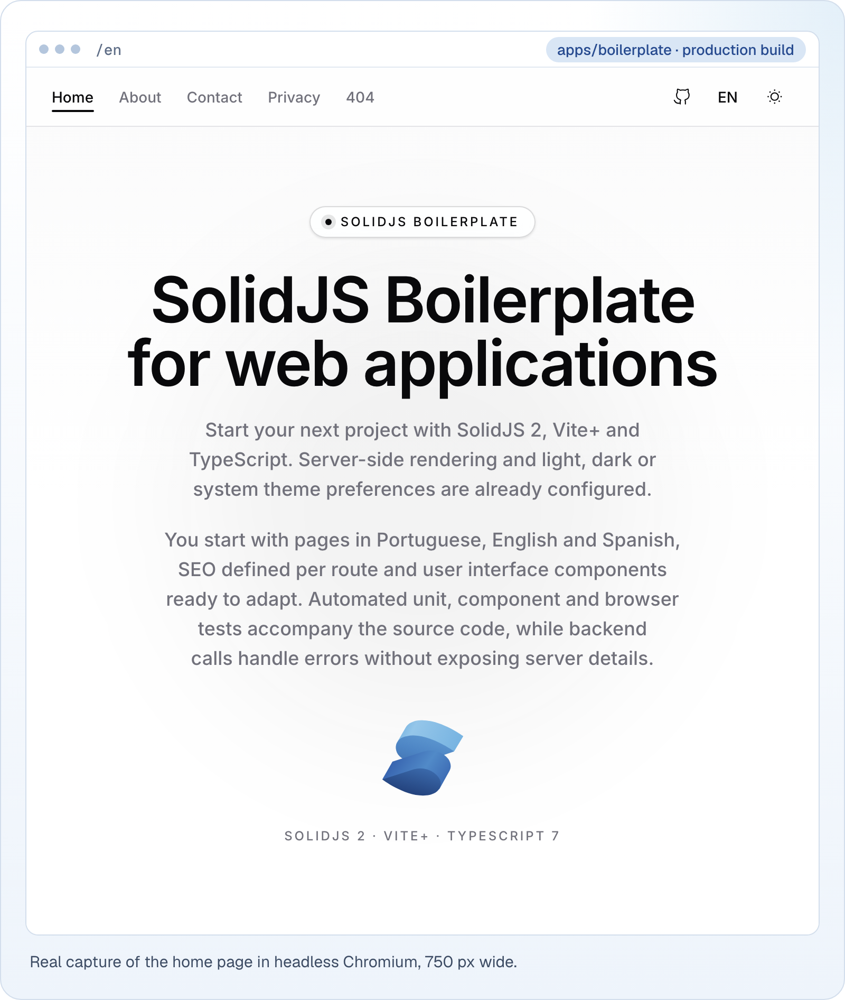
</picture>

Translations follow your configured locale list, and theme behavior comes from
one factory. Skip either one and you write no configuration for it. A
client-only or desktop renderer can start with `ssr: false`, without a server or
site URL.

Built for the
[boilerplate_solidjs](https://github.com/everton-dgn/boilerplate_solidjs)
layout. Your pages, content, UI and deployment remain yours.

[Quick start](#quick-start) · [What you get](#what-you-get) ·
[The boilerplate app](#a-complete-app-to-start-from) ·
[Languages](#i18n-from-your-locale-list) ·
[Theme](#light-dark-or-system-without-a-flash) ·
[Server protection](#middleware-and-security-policies) ·
[SEO](#seo-from-pages-to-sitemaps) · [Quality rules](#quality-rules-you-inherit)
· [Tests](#tests-already-wired) ·
[Dependency savings](#fewer-libraries-to-maintain) ·
[Proof](#how-it-is-verified) · [Documentation](#documentation)

## Quick start

See the complete app first. With the global [Vite+](https://viteplus.dev/guide/)
CLI (`vp`) installed:

```bash
git clone https://github.com/everton-dgn/solidjs_base.git
cd solidjs_base
vp install
vp run build
cd apps/boilerplate
vp run dev
```

Open `http://127.0.0.1:3000/`: the copy's `.env` sets that host and port. You
get the home page above, in English, Portuguese or Spanish, with the light, dark
or system theme. The [boilerplate app section](#a-complete-app-to-start-from)
lists what else it shows.

To add the packages to your own application, with Vite+ and the matching Solid
dependencies installed:

```bash
vp add -D @evertondgn/solid-tooling
vp add @evertondgn/solid-runtime
```

Use the versions and layout in the
[requirements](docs/tooling/limits.md#requirements). The
[client-only fixture](fixtures/apps/client-only),
[SSR fixture](fixtures/apps/ssr-plain) and
[translated SSR fixture](fixtures/apps/ssr-i18n) are complete examples.

A client-only `vite.config.ts` needs only:

```ts
import { defineSolidApp } from '@evertondgn/solid-tooling/vite'

export default defineSolidApp({ root: import.meta.dirname, ssr: false })
```

For SSR, provide the static header policy and your middleware entry:

```ts
import { SECURITY_HEADERS } from '@evertondgn/solid-runtime/middleware/security-headers/constants'
import { defineSolidApp } from '@evertondgn/solid-tooling/vite'

export default defineSolidApp({
  root: import.meta.dirname,
  securityHeaders: SECURITY_HEADERS,
  middleware: './src/middleware.ts'
})
```

Create that file with the
[middleware example below](#middleware-and-security-policies). The preset
supplies build plugins, lint, formatting and test projects. The SSR build uses
Nitro with the `vercel` preset and writes `.vercel/output`. You keep the
application entries, Router, App and Document. The
[application config guide](docs/tooling/app-config.md) covers the integration.

## What you get

| You need            | Solid Base gives you                                                                                                | From                                             |
| ------------------- | ------------------------------------------------------------------------------------------------------------------- | ------------------------------------------------ |
| An app config       | `vite.config.ts` in one call: plugins, build, SSR, lint, formatting, test projects and `vp run` tasks               | `solid-tooling`                                  |
| Languages           | Your own locale list, validated catalogs, localized URLs, redirects, cookies and navigation                         | Both packages                                    |
| A theme             | Light, dark or system without a flash, kept in sync across tabs                                                     | `solid-runtime`                                  |
| Server protection   | Eight security headers by default, a nonce CSP in production builds, one middleware chain and private server errors | `solid-runtime`                                  |
| SEO and publication | Metadata, escaped JSON-LD, robots, sitemaps, Markdown copies of your pages and `llms.txt`, within budgets           | `solid-runtime`                                  |
| Assets and env      | Icons from Iconify or your SVGs, fonts with matching preloads, validated environment values                         | Both packages                                    |
| Quality rules       | Layer rules, backend restrictions, CSS tokens, dead code detection, commit format and a secret scan                 | `solid-tooling`                                  |
| Tests               | Node, DOM and browser Vitest projects, and a Playwright config that checks the server log                           | `solid-tooling`                                  |
| A running app       | Five pages, three locales, SEO routes, outdated-page recovery and 319 E2E cases to learn from                       | [`apps/boilerplate`](apps/boilerplate/README.md) |

## Only what you use

<picture>
  <source media="(prefers-color-scheme: dark)" srcset="docs/assets/readme/only-what-you-use-dark.webp" />
  <source media="(prefers-color-scheme: light)" srcset="docs/assets/readme/only-what-you-use-light.webp" />
  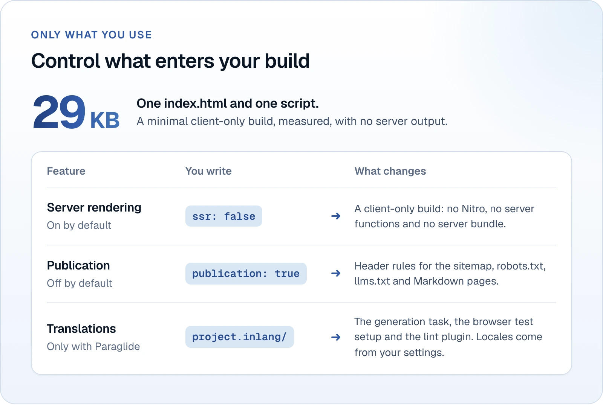
</picture>

| Feature             | How it enters your app                                                    | If you do not need it                                               |
| ------------------- | ------------------------------------------------------------------------- | ------------------------------------------------------------------- |
| SSR                 | Enabled by default, with your header policy                               | Set `ssr: false`; no Nitro or server bundle                         |
| Translations        | Add `project.inlang/settings.json`, catalogs and translation dependencies | Omit the project; no generator or translation provider in the build |
| Theme               | Import `theme/define-theme` and connect your Document and UI              | Omit theme imports; no theme modules in the build                   |
| Env validation      | Add `env.ts` and use the validated virtual modules                        | Omit the file; no preset variables become required                  |
| Fonts               | Pass `fonts` to the preset                                                | Omit it; no generated font CSS or assets                            |
| SEO and publication | Import selected runtime entries, install explicit routes and set `seo`    | Omit their imports, routes and preset options                       |

The [installed scenarios](docs/ADRs/0021-installed-application-scenarios.md)
audit disabled features in actual bundles. A desktop renderer uses the
client-only build; desktop packaging stays in your application. The tooling
still installs its shared tools when a feature is unused. See the
[installation tradeoff](#fewer-libraries-to-maintain).

## A complete app to start from

[`apps/boilerplate`](apps/boilerplate/README.md) is a copy of
boilerplate_solidjs that runs on both packages. It exists to catch a package
change that breaks a real application before that change becomes a version, and
it doubles as a reference for wiring the features together. Open it, click
through it, then read the code you would otherwise write yourself.

<picture>
  <source media="(prefers-color-scheme: dark)" srcset="docs/assets/readme/app-locales-dark.webp" />
  <source media="(prefers-color-scheme: light)" srcset="docs/assets/readme/app-locales-light.webp" />
  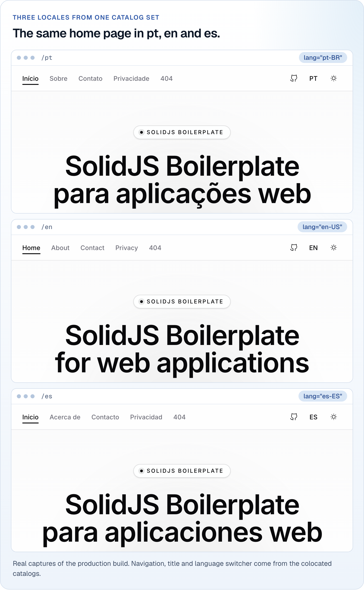
</picture>

- Five pages: home, about, contact, privacy and a 404, with a top bar, a
  language switcher, a theme switcher, `LocalizedLink` for links that keep the
  locale, and an error page for failures that reach the root.
- Portuguese, English and Spanish from colocated catalogs, with English as the
  base locale and the locale in the URL.
- Ready SEO routes: `robots.txt`, `sitemap.xml`, partitioned `sitemaps/` and
  `llms.txt`, plus a Markdown copy of each opted-in page.
- One exit for backend HTTP calls, `requestJson`, which the lint enforces.

### Outdated pages recover after a deploy

<picture>
  <source media="(prefers-color-scheme: dark)" srcset="docs/assets/readme/outdated-page-dark.webp" />
  <source media="(prefers-color-scheme: light)" srcset="docs/assets/readme/outdated-page-light.webp" />
  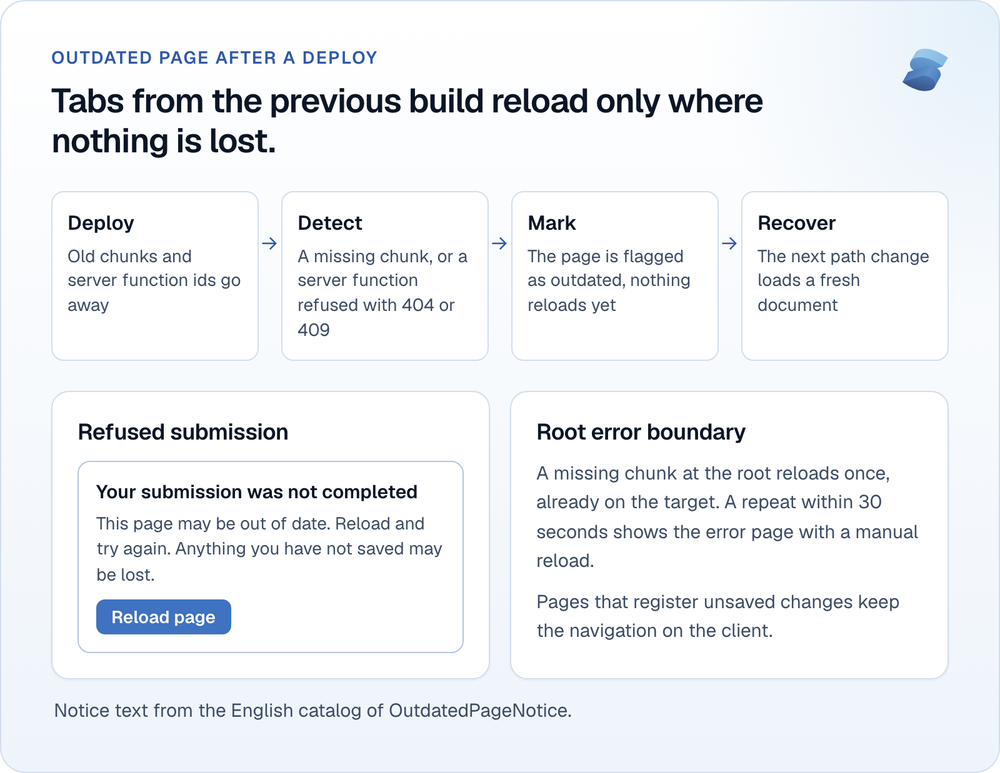
</picture>

A tab opened before a release keeps the JavaScript of the previous build. When
it asks for a chunk or a server function the new build no longer has, the app
marks the page and moves to a fresh document on the next navigation. It only
reloads by itself where nothing would be lost: a page with unsaved changes stays
put, and a refused form shows a notice that offers the reload. A server function
refused with 404 or 409 counts as a sign of a new build. If a reload at the root
fails again within 30 seconds, the error page appears with a manual reload. The
[recovery guide](apps/boilerplate/docs/server-errors/recovery.md#outdated-page-after-a-deploy)
covers every case.

## I18n from your locale list

<picture>
  <source media="(prefers-color-scheme: dark)" srcset="docs/assets/readme/i18n-dark.webp" />
  <source media="(prefers-color-scheme: light)" srcset="docs/assets/readme/i18n-light.webp" />
  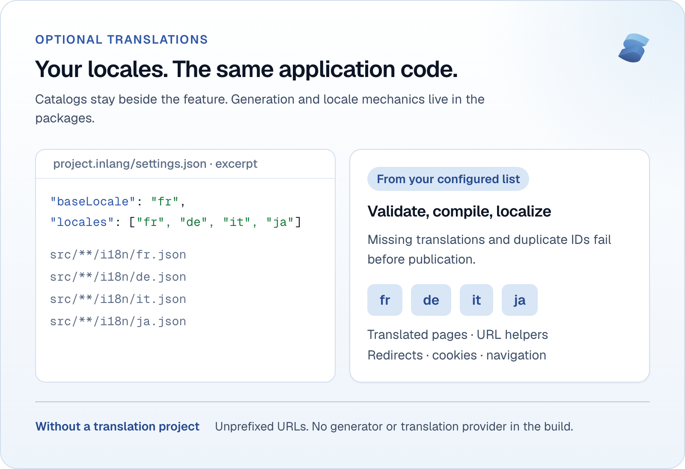
</picture>

Choose the locales your product needs, with no hard-coded locale count or
pt/en/es list. The installed example uses `fr`, `de`, `it` and `ja`:

```json
{
  "baseLocale": "fr",
  "locales": ["fr", "de", "it", "ja"],
  "modules": ["./node_modules/@inlang/plugin-message-format/dist/index.js"],
  "plugin.inlang.messageFormat": {
    "pathPattern": "./.paraglide/messages/{locale}.json"
  }
}
```

Keep messages beside their feature at `src/**/i18n/<locale>.json`. The tooling
discovers catalogs, checks missing translations, duplicate IDs and message
parameters, then compiles Paraglide in development, builds and tests. Your app
keeps the
[compiler settings](fixtures/apps/ssr-i18n/project.inlang/paraglide.config.ts)
and translation dependencies. No copied generator or manual plugin is needed.

The runtime supplies locale-aware URLs, redirects, cookie persistence,
navigation guards and language tags. `createMiddleware` selects request
localization when the project exists. Your switcher and link UI stay in the app.
Without the project, the same locale helpers use `language` (default `en`) and
preserve unprefixed URLs.

There is no fixed locale set, but generation reads all catalogs and has an 8 MiB
aggregate byte limit. More locales increase generation work and output. See
[catalog limits](docs/tooling/limits.md#known-limits), the
[installed example](fixtures/apps/ssr-i18n) and the
[navigation API](packages/solid-runtime/README.md#navigation-and-language-tags).

## Light, dark or system without a flash

<picture>
  <source media="(prefers-color-scheme: dark)" srcset="docs/assets/readme/theme-dark.webp" />
  <source media="(prefers-color-scheme: light)" srcset="docs/assets/readme/theme-light.webp" />
  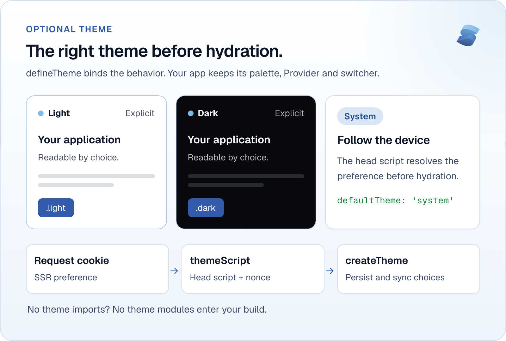
</picture>

Configure behavior once, then use the returned helpers in your Document and
Provider:

```ts
import { defineTheme } from '@evertondgn/solid-runtime/theme/define-theme'

export const theme = defineTheme({
  cookieName: 'app-theme',
  cookieMaxAge: 31_536_000,
  colors: { light: '#ffffff', dark: '#09090b' },
  defaultTheme: 'system'
})
```

Read the cookie for SSR, render `themeScript` in the head with the request
nonce, and call `createTheme` in your Provider. The early script applies the
explicit or system preference before hydration, avoiding a light-theme flash on
a dark page. The primitive persists choices in a cookie and synchronizes tabs
and system changes. This example keeps the cookie for 31,536,000 seconds, as the
[copy does](apps/boilerplate/src/constants/theme.ts).

You own the palette, `.light`/`.dark` CSS, Provider and switcher. A fixed-theme
app leaves all of it out. See the
[theme API](packages/solid-runtime/README.md#optional-theme) and the
[Document integration](apps/boilerplate/src/Document.tsx).

## Middleware and security policies

<picture>
  <source media="(prefers-color-scheme: dark)" srcset="docs/assets/readme/security-headers-dark.webp" />
  <source media="(prefers-color-scheme: light)" srcset="docs/assets/readme/security-headers-light.webp" />
  
</picture>

In a production build, `createSecurityHeaders()` with no options puts eight
security headers and a Content Security Policy on every page response. The
development server sends the eight headers without the CSP, because hot module
replacement injects inline styles. `script-src` is built from a nonce that
changes on each request, so only the scripts that carry it, and the modules they
load, can run. The six other directives keep resources, styles, base URLs and
form targets on the same origin, and block plugins and framing. Change a value
by spreading `SECURITY_HEADERS` or `CSP_DIRECTIVES` and passing the result to
`createSecurityHeaders`, as the
[copy does](apps/boilerplate/src/middleware/securityHeaders/constants.ts).

| Header                         | Default value                                                                                                                                 |
| ------------------------------ | --------------------------------------------------------------------------------------------------------------------------------------------- |
| `strict-transport-security`    | `max-age=63072000; includeSubDomains`, two years                                                                                              |
| `x-frame-options`              | `DENY`                                                                                                                                        |
| `x-content-type-options`       | `nosniff`                                                                                                                                     |
| `referrer-policy`              | `strict-origin-when-cross-origin`                                                                                                             |
| `permissions-policy`           | `camera=(), microphone=(), geolocation=()`                                                                                                    |
| `cross-origin-opener-policy`   | `same-origin`                                                                                                                                 |
| `cross-origin-embedder-policy` | `require-corp`                                                                                                                                |
| `cross-origin-resource-policy` | `same-origin`                                                                                                                                 |
| `content-security-policy`      | `default-src 'self'; style-src 'self'; object-src 'none'; base-uri 'self'; form-action 'self'; frame-ancestors 'none'`, plus the `script-src` |

The values above come from `curl -sI` on the production preview of the copy,
which keeps the package defaults.

<picture>
  <source media="(prefers-color-scheme: dark)" srcset="docs/assets/readme/middleware-dark.webp" />
  <source media="(prefers-color-scheme: light)" srcset="docs/assets/readme/middleware-light.webp" />
  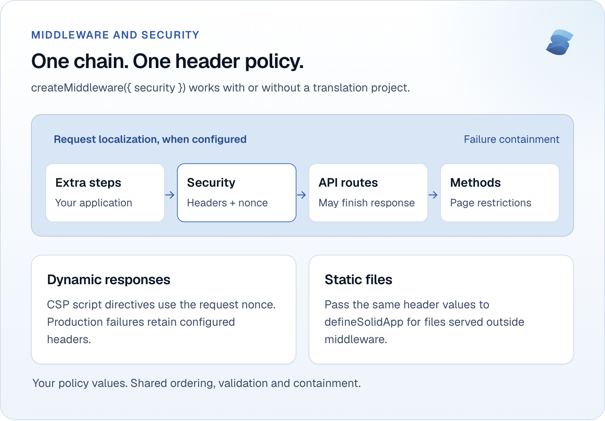
</picture>

Use a shared chain with a shared security policy:

```ts
import { createMiddleware } from '@evertondgn/solid-runtime/middleware/create-middleware'
import { createSecurityHeaders } from '@evertondgn/solid-runtime/middleware/security-headers'

const security = createSecurityHeaders()
export default createMiddleware({ security })
```

The chain composes request localization, extra application steps, security
headers, API routes and page-method restrictions. Security runs before API
handlers can finish the response. Production containment returns public failures
with the configured headers, including when middleware throws.

The package builds CSP script directives from a request nonce. You choose other
directives and header values; invalid header shapes and conflicting script
directives fail during setup. Pass the same static header values to
`defineSolidApp` for files served outside middleware. An optional `document`
callback wraps the chain for application-specific response handling.

See [chain composition](packages/solid-runtime/README.md#building-the-chain),
[security options](packages/solid-runtime/README.md#security-headers) and the
copy's [security guide](apps/boilerplate/docs/security.md). Containment covers
the middleware call; errors while sending a body after the Response returns
remain outside that window.

## Keep server errors private

<picture>
  <source media="(prefers-color-scheme: dark)" srcset="docs/assets/readme/server-errors-dark.webp" />
  <source media="(prefers-color-scheme: light)" srcset="docs/assets/readme/server-errors-light.webp" />
  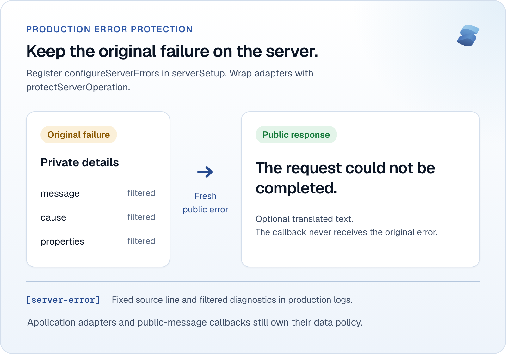
</picture>

Register protection in `src/infra/server/configureServerErrors/index.ts`, and
point the preset's `serverSetup` option at that file:

```ts
import { configureServerErrors } from '@evertondgn/solid-runtime/server/configure-server-errors'

configureServerErrors()
```

The runtime wraps server-function invocations and observes render errors.
Production failures become fresh public errors: the original message, cause and
properties are not forwarded. The default response is
`The request could not be completed.`. Logs retain a fixed `[server-error]`
source line with filtered diagnostics. Development keeps original diagnostics.

One call in `entry-server.tsx` keeps a failed render from being published.
`createRenderOptions()` forwards the request nonce and the abort signal and
records whether the render completed without errors; the Markdown publisher
refuses a page whose render did not. In the client entry,
`prepareClientLocale()` reloads before hydration when the loaded locale does not
match the URL.

Wrap database or SDK adapters with `protectServerOperation({ run })`. Lint
restricts privileged imports, and used `server-only` imports in client code fail
the build. Public messages can be translated through a synchronous callback that
never receives the original error.

Your adapters still choose public fields, and your callback must return public
text. The package cannot detect a secret deliberately embedded in a string. See
the
[protection contract](packages/solid-runtime/README.md#server-error-protection)
and the copy's [server error guide](apps/boilerplate/docs/server-errors.md).

## SEO from pages to sitemaps

<picture>
  <source media="(prefers-color-scheme: dark)" srcset="docs/assets/readme/seo-dark.webp" />
  <source media="(prefers-color-scheme: light)" srcset="docs/assets/readme/seo-light.webp" />
  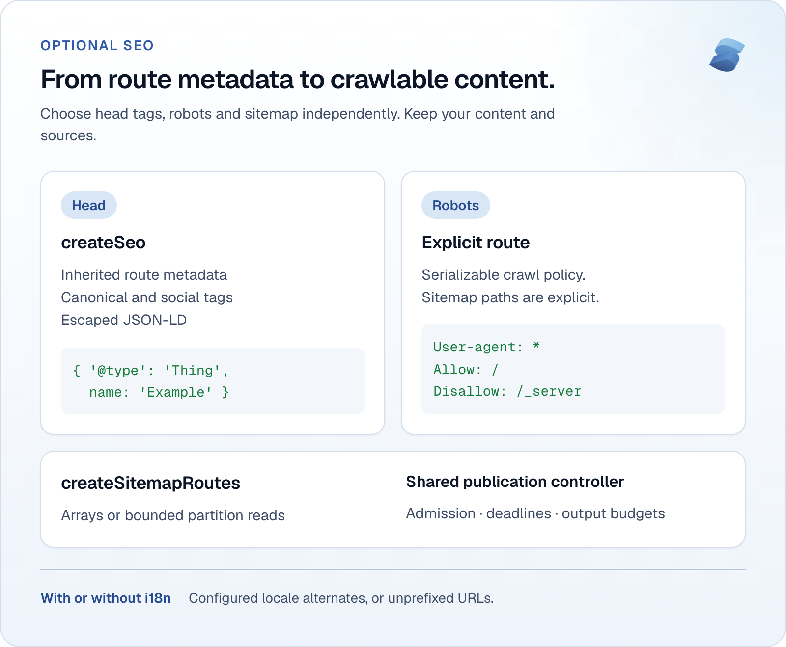
</picture>

`createSeo` merges route metadata and publishes head tags, canonical links,
social metadata and escaped JSON-LD. Supply your site and page content; author,
organization and social profiles are optional. For custom structured data, call
this inside a Solid owner:

```ts
import { createSeo } from '@evertondgn/solid-runtime/seo/create-seo'

export function registerStructuredData() {
  createSeo({ structuredData: () => ({ '@type': 'Thing', name: 'Example' }) })
}
```

Robots uses serializable preset data and an explicit route:

```ts
export { GET } from '@evertondgn/solid-runtime/seo/robots-route'
```

`createSitemapRoutes` takes your site URL, source registry and shared
publication controller. Small sources can return arrays; partitioned sources
receive a read limit and cancellation signal. With i18n, XML includes the
configured locales and `x-default`. Without it, URLs remain unprefixed. Routes,
robots announcements and `seo.sitemap` header rules are explicit choices.

A meta-only app can pass its URL directly. Leave SEO out and there is no site
URL to set. See [SEO](packages/solid-runtime/README.md#optional-seo),
[sitemap APIs and bounds](packages/solid-runtime/README.md#sitemap-and-publication)
and the copy's [SEO guide](apps/boilerplate/docs/seo.md).

### Markdown pages and llms.txt

<picture>
  <source media="(prefers-color-scheme: dark)" srcset="docs/assets/readme/markdown-llms-dark.webp" />
  <source media="(prefers-color-scheme: light)" srcset="docs/assets/readme/markdown-llms-light.webp" />
  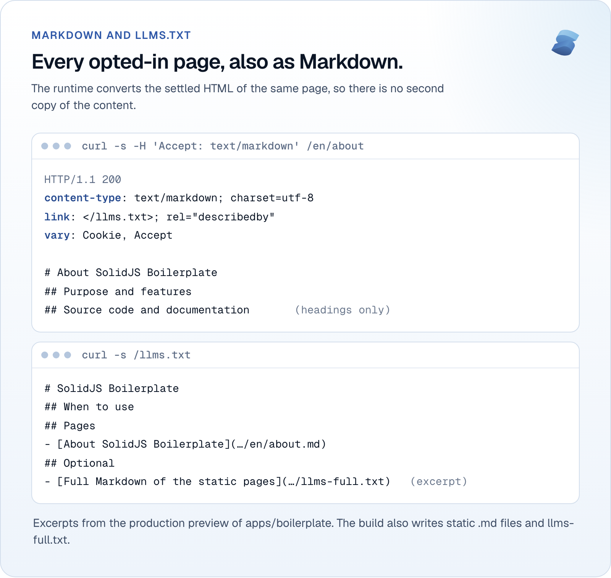
</picture>

Give crawlers and agents a clean text version of your pages without writing it
twice. Turn on a Markdown copy of your pages and an `llms.txt` index with preset
data, next to the SSR options from the [quick start](#quick-start):

```ts
import { SECURITY_HEADERS } from '@evertondgn/solid-runtime/middleware/security-headers/constants'
import { defineSolidApp } from '@evertondgn/solid-tooling/vite'

export default defineSolidApp({
  root: import.meta.dirname,
  securityHeaders: SECURITY_HEADERS,
  middleware: './src/middleware.ts',
  seo: {
    markdown: { static: true },
    llms: {},
    llmsFull: {}
  }
})
```

With `seo` set, the preset reads your site origin from `VITE_SITE_URL` and stops
with `Missing site origin` when the variable is empty.

A page opts in with `route.info.markdown`. A request for the `.md` URL, or for
the page with `Accept: text/markdown`, gets the Markdown, and the response links
`llms.txt` as `rel="describedby"`. The runtime derives the Markdown from the
settled HTML of the same page, so there is no second copy of the content.
`createMarkdownContent` goes into the `document` slot of `createMiddleware` and
shares the publication controller with the sitemap. The build writes static
`.md` files when `markdown.static` is on; `markdown: {}` converts per request
only. `createLlms` returns the `GET` handler of `llms.txt`, and your app chooses
the notes and pages it lists. Pick the parts you want: a feature you leave out
keeps its routes, modules, header rules and `Link` announcements out of the
build. `llmsFull` is the one with prerequisites, since the full file is built
from the static Markdown: it needs `llms` and `markdown: { static: true }`, and
the config fails to load without them. Without i18n, the files are served
without a locale prefix.

Conversion has input and output byte budgets and a deadline, and the indexes
fail the build instead of being truncated when they pass their budget. The
runtime uses the published `@mdream/js`; the
[Markdown guide](apps/boilerplate/docs/seo/markdown.md) lists the conversion
differences that the complete application fixes with a patch, and how to apply
it. See the [publication guide](apps/boilerplate/docs/seo/publication.md).

### Publication stays inside a budget

<picture>
  <source media="(prefers-color-scheme: dark)" srcset="docs/assets/readme/publication-limits-dark.webp" />
  <source media="(prefers-color-scheme: light)" srcset="docs/assets/readme/publication-limits-light.webp" />
  
</picture>

Sitemap and Markdown publication run under quotas, deadlines and byte budgets in
each server process. The controller quotas and the sitemap deadline and byte
budget are options; the 50,000-URL and 2,048-character protocol bounds are
fixed. Overload answers `503` with `Retry-After: 1` instead of a partial
sitemap. Quotas and caches are local to a process; database adapters must honor
limits and cancellation.
[Sitemap and publication](packages/solid-runtime/README.md#sitemap-and-publication)
lists every bound.

| Limit                       | Default                                             |
| --------------------------- | --------------------------------------------------- |
| Publications at once        | 4, with 2 per kind: sitemap and Markdown            |
| Source reads                | 4 at once, 2 per source                             |
| Reserved output             | 16,777,216 bytes (16 MiB) across 4 live outputs     |
| Sitemap deadline            | 10,000 ms                                           |
| Sitemap response budget     | 4,194,304 bytes (4 MiB)                             |
| Sitemap protocol bounds     | 50,000 URLs, 2,048 characters per location          |
| Markdown                    | 2 MiB of HTML in, 2 MiB of Markdown out, 15 seconds |
| `llms.txt`, `llms-full.txt` | 1 MiB and 10 MiB; the build fails above them        |

## Validated environment values

<picture>
  <source media="(prefers-color-scheme: dark)" srcset="docs/assets/readme/env-dark.webp" />
  <source media="(prefers-color-scheme: light)" srcset="docs/assets/readme/env-light.webp" />
  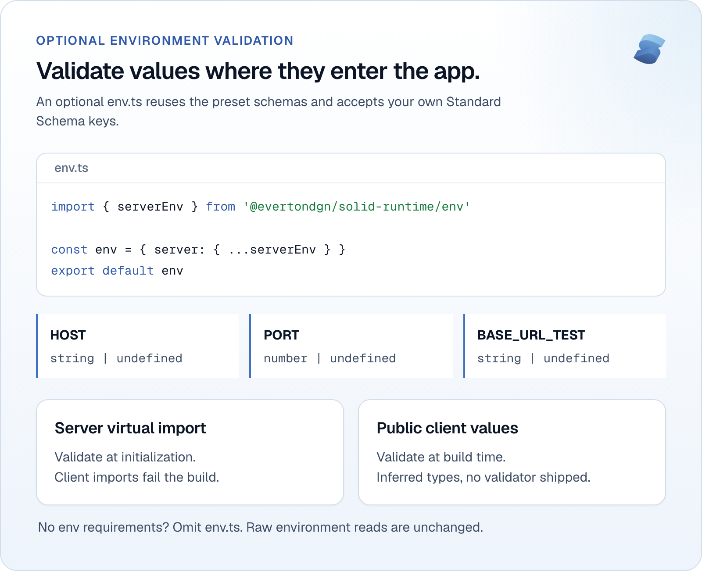
</picture>

Reuse preset validators and add application keys through Standard Schema:

```ts
import { serverEnv } from '@evertondgn/solid-runtime/env'

const env = { server: { ...serverEnv } }

export default env
```

`HOST`, `PORT` and `BASE_URL_TEST` stay optional. `PORT` produces a number.
Import `virtual:solid-env/server` from server code to validate when the module
loads; raw env reads are unchanged. Public client values use
`virtual:solid-env/client` and validate at build time. Generated declarations
carry the inferred types. The build rejects server env imports in client code.

The runtime supplies Valibot for its fragment. Declare a validator library
yourself only when your code imports it. With nothing to validate, skip
`env.ts`: the preset requires none of its variables. See
[environment validation](docs/tooling/app-config.md#optional-environment-validation).

## Icons from collections or your own SVGs

<picture>
  <source media="(prefers-color-scheme: dark)" srcset="docs/assets/readme/icons-dark.webp" />
  <source media="(prefers-color-scheme: light)" srcset="docs/assets/readme/icons-light.webp" />
  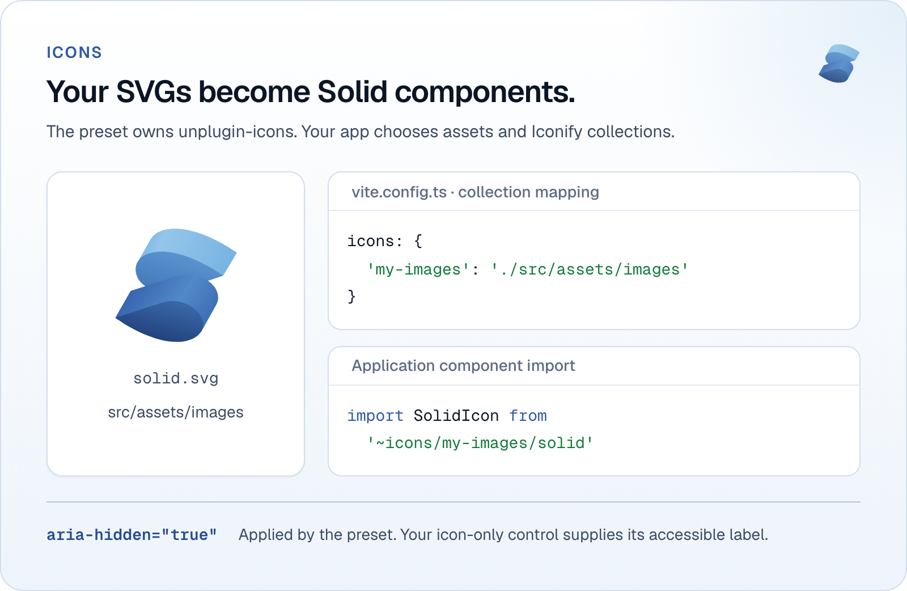
</picture>

The preset configures `unplugin-icons` for Solid. Install the Iconify
collections you use, or map your own SVG folder:

```ts
import { defineSolidApp } from '@evertondgn/solid-tooling/vite'

export default defineSolidApp({
  root: import.meta.dirname,
  ssr: false,
  icons: { 'my-images': './src/assets/images' }
})
```

The copy's [Solid SVG](apps/boilerplate/src/assets/images/solid.svg) is
available as `~icons/my-images/solid`. Icons compile to Solid components and
receive `aria-hidden`; give icon-only controls an accessible label. The plugin
belongs to the tooling package. Your assets and selected collections belong to
your app. See the [plugin configuration](docs/tooling/app-config.md).

## Fonts with matching CSS and preloads

<picture>
  <source media="(prefers-color-scheme: dark)" srcset="docs/assets/readme/fonts-dark.webp" />
  <source media="(prefers-color-scheme: light)" srcset="docs/assets/readme/fonts-light.webp" />
  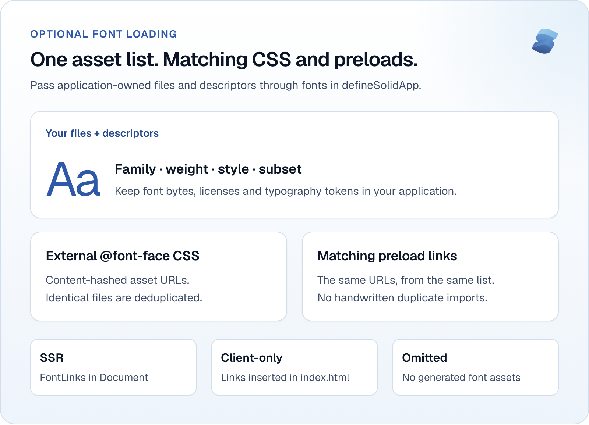
</picture>

Pass a `fonts` array with your files and face descriptors to `defineSolidApp`.
The preset emits external `@font-face` CSS and derives preload URLs from the
same asset list. Identical files are deduplicated, and font bytes stay external,
compatible with the default stylesheet CSP.

SSR renders `FontLinks` in the Document head:

```tsx
import { FontLinks } from '@evertondgn/solid-runtime/fonts/font-links'

export function FontHead() {
  return <FontLinks />
}
```

Client-only apps receive the links in `index.html` automatically. No `fonts`
option means no generated files and no runtime import. You keep files, licenses
and typography tokens. See the
[complete font configuration](docs/tooling/fonts.md) and the
[copy's descriptors](apps/boilerplate/fonts.ts).

## Quality rules you inherit

The lint preset, the CSS policy and the Git hooks come with the tooling package,
so every app follows the same rules without copying a config. When a rule
changes, it changes in one place.

### Start with lint and formatting

You can adopt only the presets in an existing Vite+ config, preserving its
plugins and other settings:

```ts
import { fmt } from '@evertondgn/solid-tooling/fmt'
import { lint } from '@evertondgn/solid-tooling/lint'
import { defineConfig } from 'vite-plus'

export default defineConfig({ fmt, lint })
```

The rule below reports `export { example }` on line 3 of
`src/helpers/export-list.ts`. Replace it with `export const example = 1`:

```ts
const example = 1

export { example }
```

<picture>
  <source media="(prefers-color-scheme: dark)" srcset="docs/assets/readme/first-result-dark.webp" />
  <source media="(prefers-color-scheme: light)" srcset="docs/assets/readme/first-result-light.webp" />
  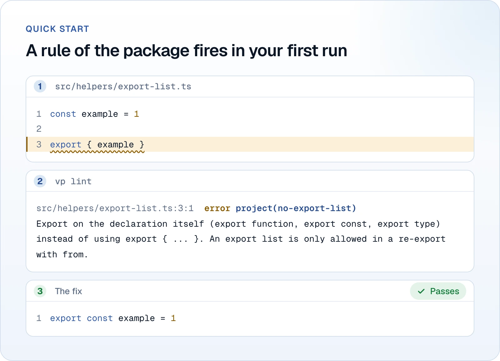
</picture>

The figure shows three steps: write the example, run `vp lint`, then export on
the declaration. See
[all package rules](docs/tooling/lint.md#rules-of-this-package) and
[TypeScript setup](docs/tooling/typescript-and-format.md).

### Layers that keep imports pointing down

<picture>
  <source media="(prefers-color-scheme: dark)" srcset="docs/assets/readme/layers-dark.webp" />
  <source media="(prefers-color-scheme: light)" srcset="docs/assets/readme/layers-light.webp" />
  
</picture>

`architecture/layer-imports` stops an atom from importing a molecule, a helper
from importing a component and production code from importing tests or
`tooling/`. The structure you start with stays readable as the app grows. The
[component layers](apps/boilerplate/docs/architecture.md#component-layers)
explain where a new component goes.

Five more rules of the package keep files predictable: a CSS Module is named
`styles.module.css` and imported as `S`, a test sits in `__tests__` named after
its module and environment, exports sit on the declaration, and a route's
`seo.ts` holds only metadata.

The preset also restricts what application code can reach. `console` is not
allowed in `src/`, `fetch` is allowed only in `requestJson`, the Node transports
and `node_modules` paths cannot be imported, and a relative import goes up at
most three levels. See the
[backend restrictions](docs/tooling/lint.md#backend-restrictions).

### CSS from tokens

<picture>
  <source media="(prefers-color-scheme: dark)" srcset="docs/assets/readme/css-tokens-dark.webp" />
  <source media="(prefers-color-scheme: light)" srcset="docs/assets/readme/css-tokens-light.webp" />
  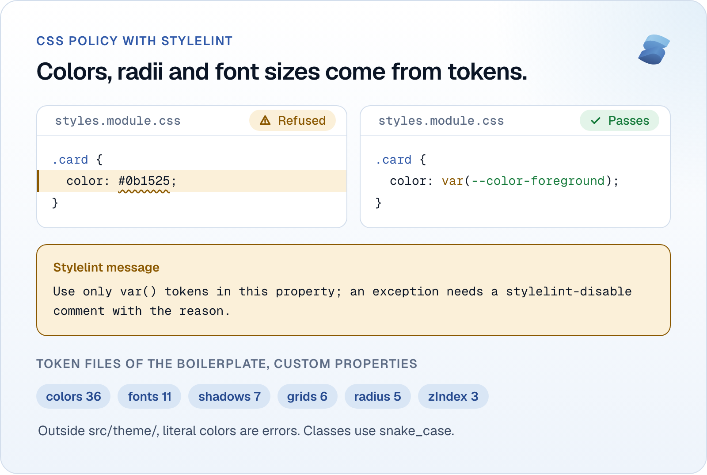
</picture>

`checkCss` runs Stylelint with the boilerplate CSS policy. The boilerplate
defines 36 color, 11 font, 7 shadow, 6 grid, 5 radius and 3 z-index custom
properties in `src/theme/tokens/`. Outside `src/theme/`, colors, gradients,
radii, shadows, font sizes, weights and `z-index` must come from tokens, so a
palette change happens in one folder. Classes use snake_case and nesting stays
at most two levels deep. An exception needs a `stylelint-disable` comment with
its reason. See the [CSS lint](docs/tooling/knip-and-css.md#css-lint). The
preset also turns on Lightning CSS, which transpiles nesting and `light-dark()`
for the default browser targets and names CSS Module classes by content hash.

### Dead code caught before the push

<picture>
  <source media="(prefers-color-scheme: dark)" srcset="docs/assets/readme/dead-code-dark.webp" />
  <source media="(prefers-color-scheme: light)" srcset="docs/assets/readme/dead-code-light.webp" />
  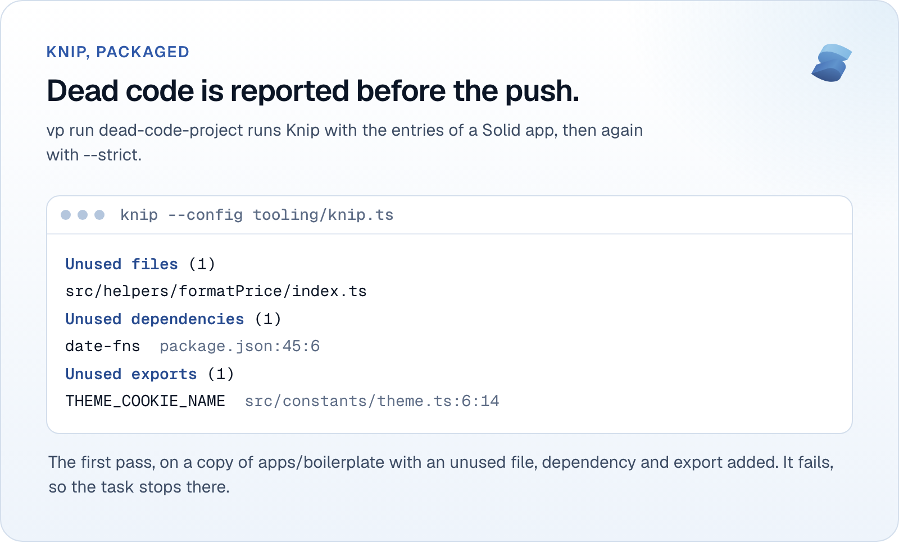
</picture>

A helper nobody calls, an export nobody imports or a dependency nobody uses
fails the push instead of piling up. Knip comes packaged and already knows the
entries of a Solid app: the server and client entries, the middleware, `env.ts`
and every route that file-system routing finds. `vp run dead-code-project` runs
it, then again with `--strict` for production code, and the `pre-push` hook runs
it through `vp run dead-code`. See [Knip](docs/tooling/knip-and-css.md#knip).

### Git hooks that run the right checks

<picture>
  <source media="(prefers-color-scheme: dark)" srcset="docs/assets/readme/git-hooks-dark.webp" />
  <source media="(prefers-color-scheme: light)" srcset="docs/assets/readme/git-hooks-light.webp" />
  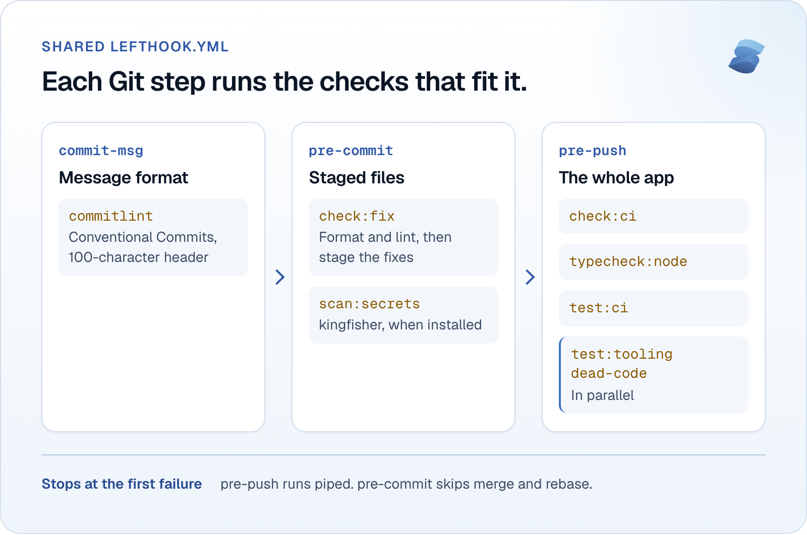
</picture>

Commit messages follow Conventional Commits with a header of at most 100
characters, staged files are formatted and fixed before each commit, staged
changes are scanned for secrets with `kingfisher` when it is installed, and a
push runs the full checks first. Extend the shared config from `.lefthook.yml`
and run `vp run lefthook install`; no direct `lefthook` or `commitlint`
dependency is needed. See
[commits and hooks](docs/tooling/commits-and-hooks.md).

## Tests already wired

<picture>
  <source media="(prefers-color-scheme: dark)" srcset="docs/assets/readme/vitest-projects-dark.webp" />
  <source media="(prefers-color-scheme: light)" srcset="docs/assets/readme/vitest-projects-light.webp" />
  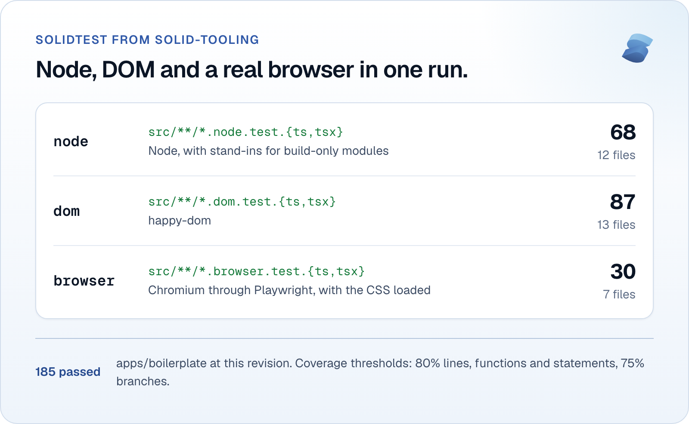
</picture>

Name a test after its environment and it runs in the right one: Node for server
code, happy-dom for components, a real Chromium for behavior that needs layout
and CSS. In the boilerplate, `vp run test` passed 68 `node`, 87 `dom` and 30
`browser` tests, in 12, 13 and 7 files. Coverage thresholds come with the
preset: 80% for lines, functions and statements, 75% for branches.
`definePlaywrightConfig` builds the app, starts the preview and, when the suite
ends, checks the server log for private markers, so a private detail that
reaches the log fails the run. See [testing](docs/tooling/testing.md).

<picture>
  <source media="(prefers-color-scheme: dark)" srcset="docs/assets/readme/e2e-coverage-dark.webp" />
  <source media="(prefers-color-scheme: light)" srcset="docs/assets/readme/e2e-coverage-light.webp" />
  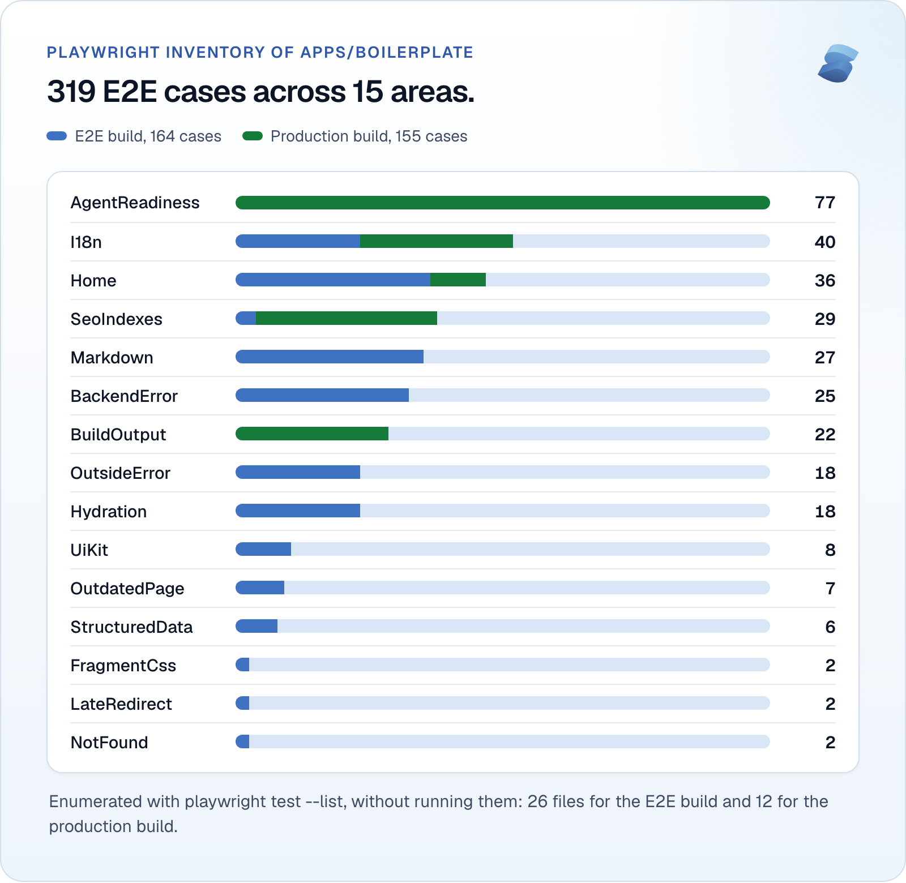
</picture>

The suite doubles as a set of worked examples: CSP and nonce checks, hydration
under a held stream, translated routes, Markdown negotiation, SEO indexes and
outdated-page recovery. Its 319 cases sit in 26 files for the E2E build and 12
for the production build, and the largest area, AgentReadiness, has 77. See the
copy's [testing guide](apps/boilerplate/docs/testing.md).

## Fewer libraries to maintain

<picture>
  <source media="(prefers-color-scheme: dark)" srcset="docs/assets/readme/libraries-dark.webp" />
  <source media="(prefers-color-scheme: light)" srcset="docs/assets/readme/libraries-light.webp" />
  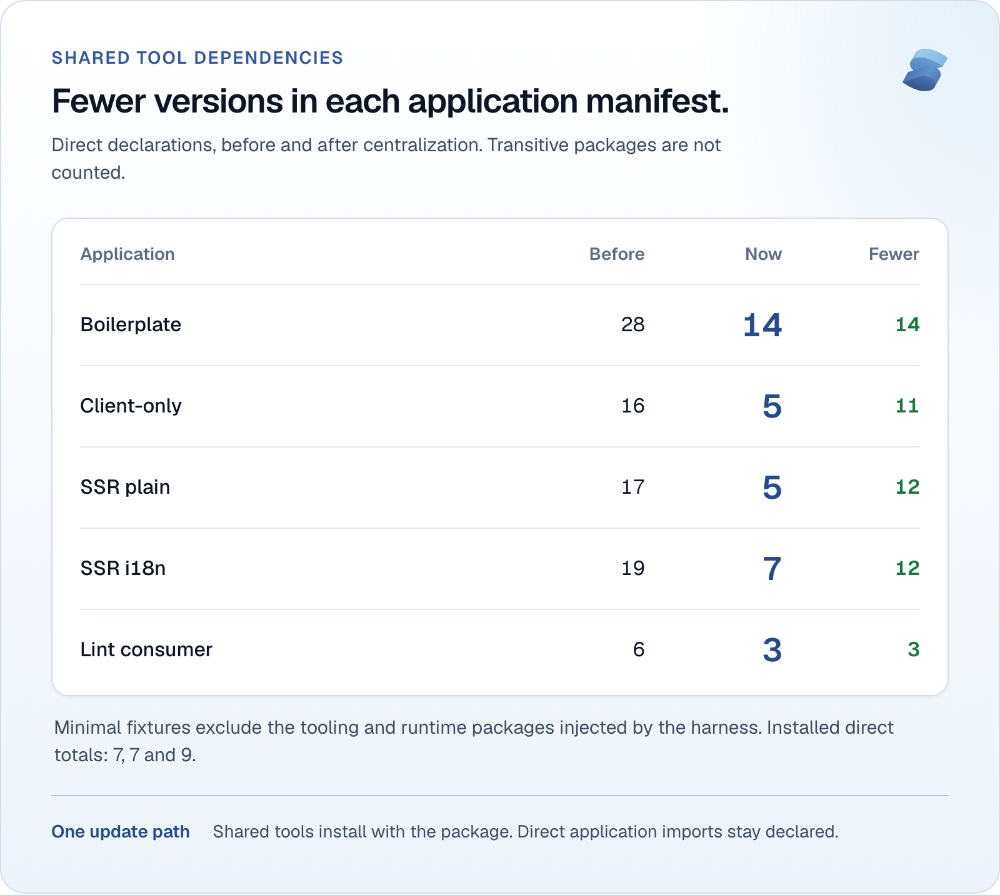
</picture>

Update build, test, type-check and hook tools through the tooling package.
Applications retain libraries their own source imports, plus Vite+ and its Vite
alias. The packages supply the tools they call and resolve their binaries from
their own installation, including with Bun's isolated linker.

| Application                                           | Direct declarations before | Current manifest | Fewer declarations |
| ----------------------------------------------------- | -------------------------: | ---------------: | -----------------: |
| [Boilerplate copy](apps/boilerplate/package.json)     |                         28 |               14 |                 14 |
| [Client-only](fixtures/apps/client-only/package.json) |                         16 |                5 |                 11 |
| [SSR plain](fixtures/apps/ssr-plain/package.json)     |                         17 |                5 |                 12 |
| [SSR i18n](fixtures/apps/ssr-i18n/package.json)       |                         19 |                7 |                 12 |
| [Lint consumer](fixtures/consumer/package.json)       |                          6 |                3 |                  3 |

Counts combine `dependencies` and `devDependencies`, excluding overrides and
transitive packages. The installed harness adds `solid-tooling` and
`solid-runtime` to each minimal app, so their installed direct totals are 7, 7
and 9. The original installed totals were 18, 19 and 21. Both sides of the table
exclude those injected entries. The copy and lint consumer already declare their
package dependencies.

The [dependency decision](docs/ADRs/0027-packaged-tool-dependencies.md) records
the original measurements. Fewer declarations do not mean a smaller install: the
tooling installs tools for optional features too. Build audits check that
development tools stay out of application bundles. A library your app imports
directly still needs its own declaration.

## Before and after

<picture>
  <source media="(prefers-color-scheme: dark)" srcset="docs/assets/readme/before-after-dark.webp" />
  <source media="(prefers-color-scheme: light)" srcset="docs/assets/readme/before-after-light.webp" />
  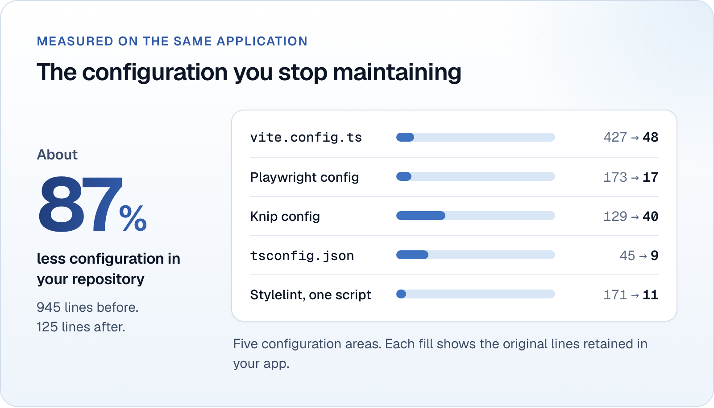
</picture>

Across these five configuration areas, the copy keeps 125 lines instead of 945,
about 87% fewer. Counts include blank lines and comments. The Stylelint
replacement is an application script calling the packaged policy.

| Configuration                                             | Original lines | Current copy |
| --------------------------------------------------------- | -------------: | -----------: |
| [Vite](apps/boilerplate/vite.config.ts)                   |            427 |           48 |
| [Playwright](apps/boilerplate/playwright.config.ts)       |            173 |           17 |
| [Knip](apps/boilerplate/tooling/knip.ts)                  |            129 |           40 |
| [TypeScript](apps/boilerplate/tsconfig.json)              |             45 |            9 |
| [Stylelint caller](apps/boilerplate/tooling/css/check.ts) |            171 |           11 |

The baseline is the
[original starter at 6145493](https://github.com/everton-dgn/boilerplate_solidjs/tree/61454937472d0faa1b4fab985fd7c5da968aa9a6).
The shared implementation remains in the package. Current fixture configs have
19 lines for [client-only with fonts](fixtures/apps/client-only/vite.config.ts),
29 for [SSR with fonts and SEO](fixtures/apps/ssr-plain/vite.config.ts), and 10
for [translated SSR](fixtures/apps/ssr-i18n/vite.config.ts). These fixtures
exercise different features, so their lengths are not a size comparison.

## Fix the base once

<picture>
  <source media="(prefers-color-scheme: dark)" srcset="docs/assets/readme/fix-once-dark.webp" />
  <source media="(prefers-color-scheme: light)" srcset="docs/assets/readme/fix-once-light.webp" />
  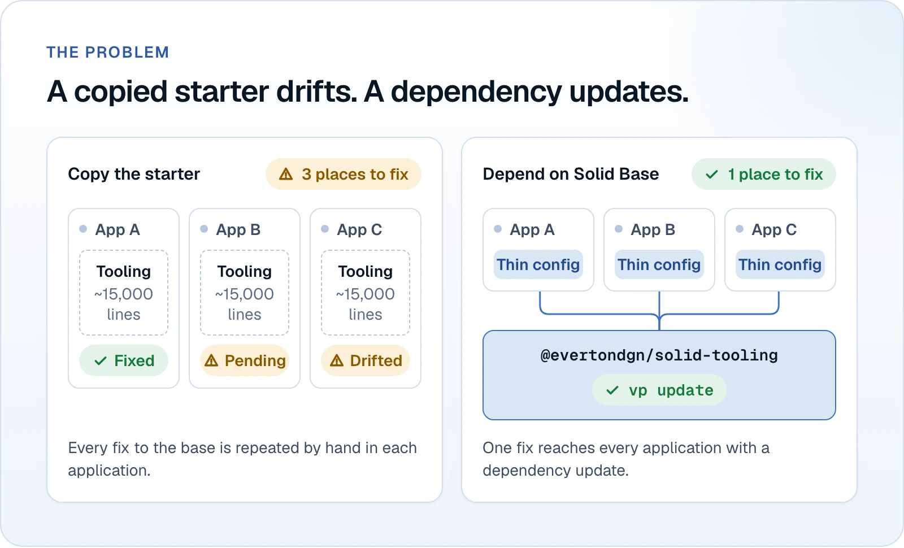
</picture>

Both packages carry shared fixes across applications with `vp update`. Keep
tested versions aligned and review release notes when updating.

| The packages maintain                                                           | Your application owns                                      |
| ------------------------------------------------------------------------------- | ---------------------------------------------------------- |
| Lint, formatting, TypeScript, Vitest, Playwright, Knip, Stylelint and Git hooks | Code, tests, paths and overrides                           |
| Locale mechanics, catalog generation and theme behavior                         | Messages, locale selection, UI and palette                 |
| Middleware, error protection and publication admission                          | Header policy, public text, backend adapters and data      |
| SEO factories, icon integration and font loading                                | Editorial metadata, source registries, assets and licenses |

When the defaults do not fit, `defineSolidApp` takes extra plugins through
`extend`, replaces tasks by name through `tasks`, and accepts route rules,
public assets and static paths, without forking the preset. See the
[application config guide](docs/tooling/app-config.md).

## How it is verified

<picture>
  <source media="(prefers-color-scheme: dark)" srcset="docs/assets/readme/verified-dark.webp" />
  <source media="(prefers-color-scheme: light)" srcset="docs/assets/readme/verified-light.webp" />
  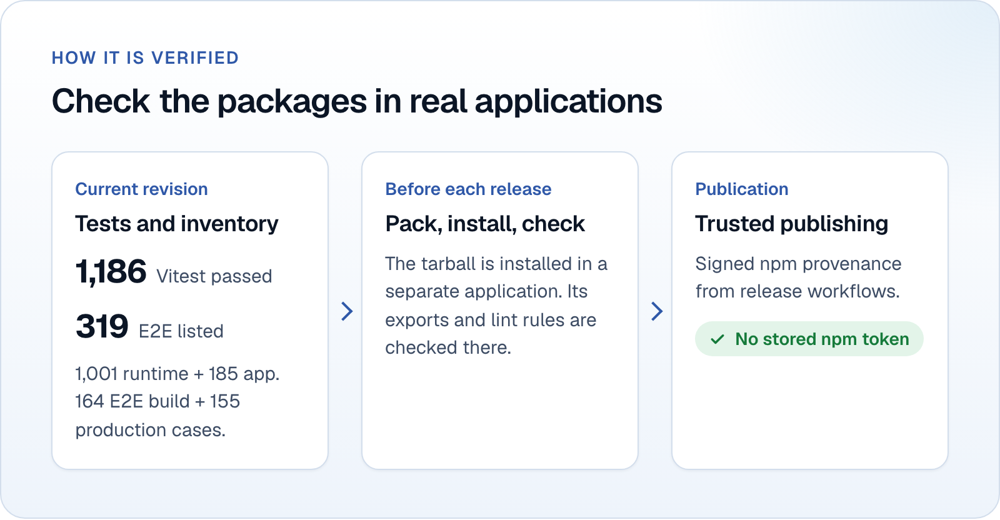
</picture>

At this revision, 1,186 Vitest tests passed: 1,001 in the runtime and 185 in the
boilerplate app. `playwright test --list` counts 319 end-to-end cases on top,
164 against the E2E build and 155 against the production build.

Release gates also build installed tarballs outside the workspace with Bun's
`hoisted` and `isolated` linkers, check exports and lint rules, and audit
disabled features and server boundaries. The installed matrix has fifteen cases,
including the version alignment check. CI selects jobs by changed paths;
documentation-only changes do not imply every suite runs.

See [CI coverage](docs/development.md#ci),
[installed scenarios](docs/ADRs/0021-installed-application-scenarios.md) and the
[release process](docs/releasing.md). Release workflows use npm trusted
publishing with signed provenance; a new package follows the
[new-package procedure](docs/releasing.md#new-package).

## Packages and roadmap

<picture>
  <source media="(prefers-color-scheme: dark)" srcset="docs/assets/readme/runtime-entries-dark.webp" />
  <source media="(prefers-color-scheme: light)" srcset="docs/assets/readme/runtime-entries-light.webp" />
  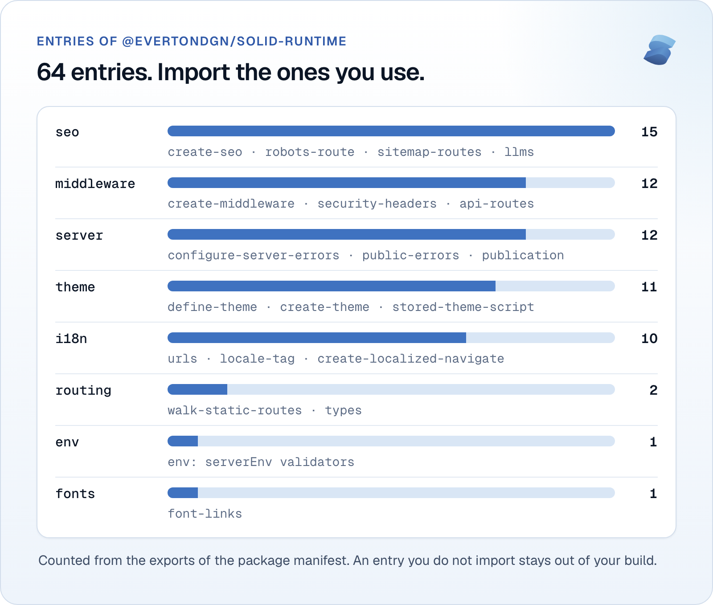
</picture>

| Available package                                               | What it provides                                                                                          |
| --------------------------------------------------------------- | --------------------------------------------------------------------------------------------------------- |
| [`@evertondgn/solid-tooling`](packages/solid-tooling/README.md) | Config, build tools, catalog generation, icons, fonts, lint, tests and hooks                              |
| [`@evertondgn/solid-runtime`](packages/solid-runtime/README.md) | Locale and theme behavior, middleware, server errors, env validators, SEO, sitemap, Markdown and llms.txt |

The runtime is published as TypeScript source, split into 64 entries, so your
app imports only the features it uses: `seo` has 15, `middleware` and `server`
12 each, `theme` 11, `i18n` 10, `routing` 2, and `env` and `fonts` 1 each.

### Roadmap

| Planned work                      | Scope                               |
| --------------------------------- | ----------------------------------- |
| Reusable CI and release workflows | Shared automation for applications  |
| `vp create` template              | New applications using the packages |

## Documentation

| Guide                                                 | What you will find                           |
| ----------------------------------------------------- | -------------------------------------------- |
| [Tooling reference](docs/tooling/README.md)           | Presets, configuration and limits            |
| [Runtime reference](packages/solid-runtime/README.md) | Independent feature APIs and integration     |
| [Boilerplate app](apps/boilerplate/README.md)         | The running app and its guides               |
| [Development](docs/development.md)                    | Workspace setup, tests and CI                |
| [Architecture](docs/architecture.md)                  | Package boundaries and application ownership |
| [Releasing](docs/releasing.md)                        | Versions, publishing and recovery            |
| [ADRs](docs/ADRs/README.md)                           | Decisions and measured tradeoffs             |

Read the [contributing guide](CONTRIBUTING.md) before opening an issue or pull
request. Report security problems privately as [SECURITY.md](SECURITY.md)
explains. The [documentation index](docs/README.md) links to all guides.

## License

[MIT](LICENSE)
