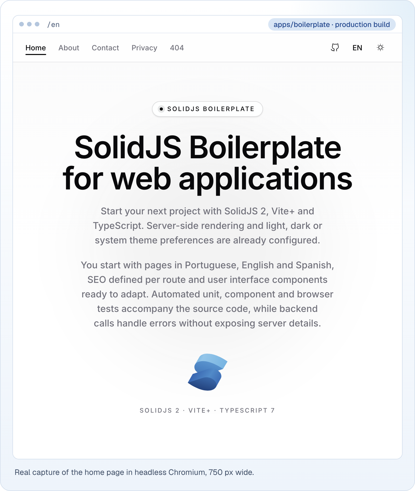
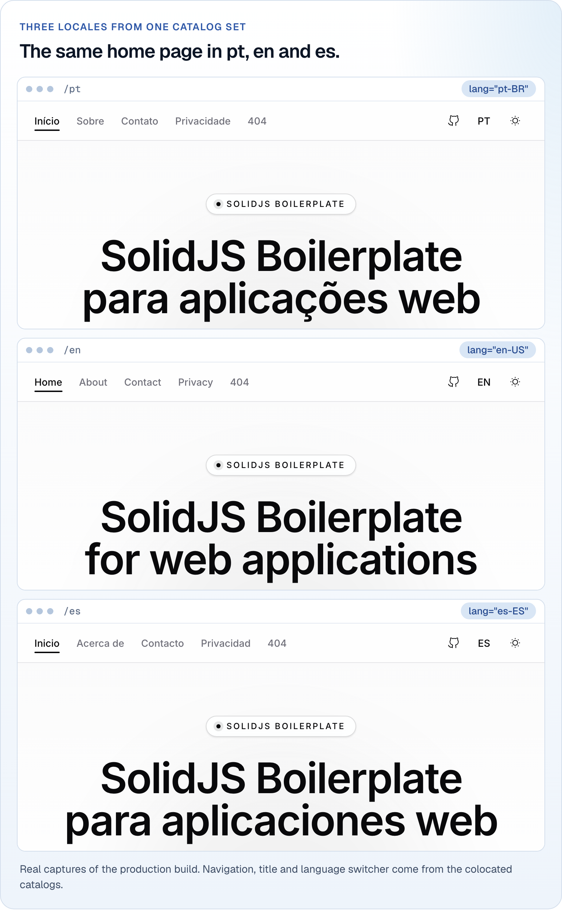
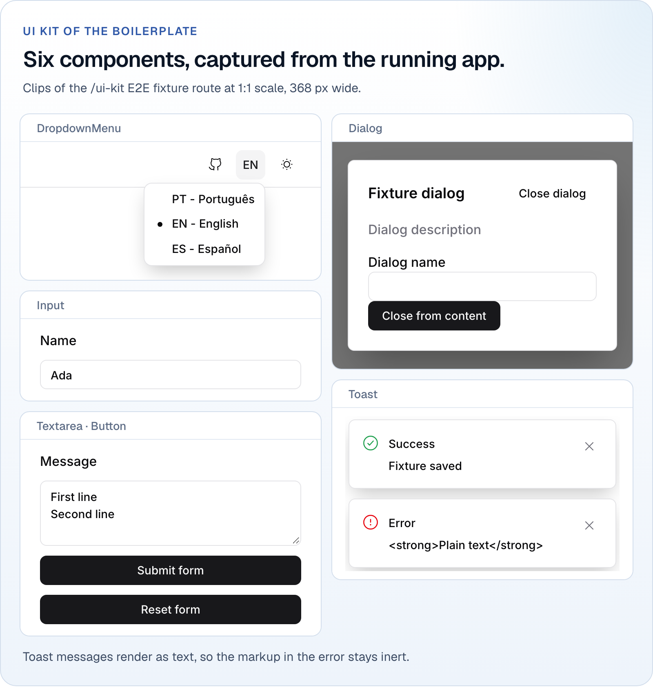
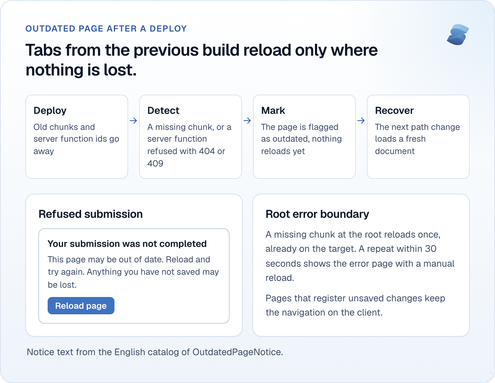
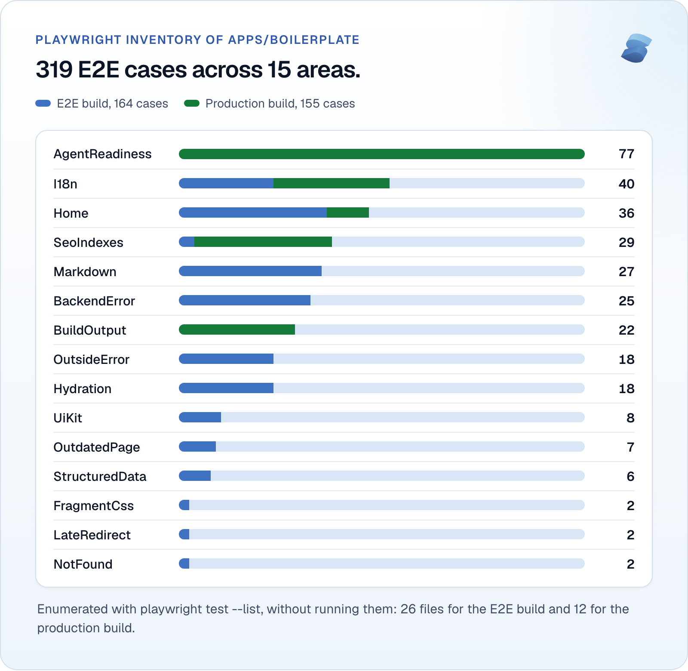

# Boilerplate app

A complete SolidJS 2 application running on `@evertondgn/solid-tooling` and
`@evertondgn/solid-runtime`. Open it to see every package feature working
together in a real app: pages in three languages, a theme without a flash, a UI
kit, security headers, private server errors, SEO routes, Markdown pages and an
E2E suite you can learn from.

> [!IMPORTANT]
> SolidJS 2 is still a release candidate. This app uses the release candidate
> pinned in its [package manifest](package.json), the same one the packages are
> tested with.

The home page, captured from the production build at 750 px wide:

<picture>
  <source media="(prefers-color-scheme: dark)" srcset="../../docs/assets/readme/app-home-dark.webp" />
  <source media="(prefers-color-scheme: light)" srcset="../../docs/assets/readme/app-home-light.webp" />
  
</picture>

It is a copy of
[boilerplate_solidjs](https://github.com/everton-dgn/boilerplate_solidjs) at
commit `6145493`, used to test the packages of this repository in a complete
application. It is never published or deployed. A package change that breaks
this app fails the CI before it becomes a version.
[ADR 0009](../../docs/ADRs/0009-boilerplate-app-in-the-monorepo.md) explains why
the copy exists.

[What comes ready](#what-comes-ready) · [Running it](#running-it) ·
[How it uses the packages](#how-it-uses-the-packages) · [Guides](#guides) ·
[Proof](#proof)

## What comes ready

| Feature           | What you get in this app                                                                                            | Guide                                                                   |
| ----------------- | ------------------------------------------------------------------------------------------------------------------- | ----------------------------------------------------------------------- |
| Pages             | Home, about, contact, privacy and a 404, a top bar, language and theme switchers, `LocalizedLink` and an error page | [Architecture](docs/architecture.md)                                    |
| Three languages   | Portuguese, English and Spanish from colocated catalogs, English as the base locale, the locale in the URL          | [I18n](docs/i18n.md)                                                    |
| Theme             | Light, dark or system, applied before hydration and kept in sync across tabs, with tokens from `light-dark()`       | [UI](docs/ui.md)                                                        |
| UI kit            | `Button`, `Input`, `Textarea`, `Dialog`, toasts and `DropdownMenu`, all in this folder for you to restyle           | [UI](docs/ui.md)                                                        |
| Security headers  | Eight headers from the runtime defaults, three of them also on static files, and a nonce CSP in production          | [Security](docs/security.md)                                            |
| Server errors     | Fresh public errors in production, one HTTP exit (`requestJson`) and wrapped SDK adapters                           | [Server errors](docs/server-errors.md)                                  |
| SEO routes        | `robots.txt`, `sitemap.xml`, partitioned `sitemaps/`, `llms.txt` and a Markdown copy of each opted-in page          | [SEO](docs/seo.md)                                                      |
| Outdated pages    | A tab from the previous build moves to the new one and reloads only where nothing is lost                           | [Recovery](docs/server-errors/recovery.md#outdated-page-after-a-deploy) |
| Env, icons, fonts | Validated `env.ts`, icons as Solid components and two Inter subsets with matching preloads                          | [UI](docs/ui.md#fonts)                                                  |
| Tests             | Node, DOM and browser Vitest projects and 319 Playwright cases across 15 areas                                      | [Testing](docs/testing.md)                                              |

### The same page in three languages

<picture>
  <source media="(prefers-color-scheme: dark)" srcset="../../docs/assets/readme/app-locales-dark.webp" />
  <source media="(prefers-color-scheme: light)" srcset="../../docs/assets/readme/app-locales-light.webp" />
  
</picture>

Every page lives under `/pt`, `/en` or `/es`, with `lang`, the navigation and
the metadata in that language. Messages sit next to the component that uses
them, in `i18n/{pt,en,es}.json`. `vp run i18n:generate`, which `check:ci`,
`lint` and the test scripts call first, fails on a missing translation, a
duplicate ID or a parameter that differs between locales.

### A UI kit to restyle

<picture>
  <source media="(prefers-color-scheme: dark)" srcset="../../docs/assets/readme/ui-kit-dark.webp" />
  <source media="(prefers-color-scheme: light)" srcset="../../docs/assets/readme/ui-kit-light.webp" />
  
</picture>

- `Button` with variants, sizes and a `label` shortcut for text-only buttons.
- `Input` and `Textarea` with native props, the initial value in the server HTML
  and a destructive variant that sets `aria-invalid`.
- `Dialog` on the native `dialog` element: the browser confines the focus and
  returns it to the control that opened it.
- Toasts that queue up to five, pause on hover, focus or a hidden tab, and
  announce by priority, errors in the assertive region. Messages render as plain
  text.
- `DropdownMenu` on the APG menu pattern, behind the language and theme
  switchers of the top bar.

The capture comes from the `/ui-kit` route at 368 px wide, an E2E fixture that
only exists in the `e2e` build (`src/tests/fixtures/e2e/routes/(base)/ui-kit/`).
In your app, the components come from `src/components/`.

### Outdated pages after a deploy

<picture>
  <source media="(prefers-color-scheme: dark)" srcset="../../docs/assets/readme/outdated-page-dark.webp" />
  <source media="(prefers-color-scheme: light)" srcset="../../docs/assets/readme/outdated-page-light.webp" />
  
</picture>

`installOutdatedPageDetection` marks the page when a chunk of the previous build
is gone or a server function answers 404 or 409 with
`X-Server-Function-Unknown`. `createOutdatedPageGuard` turns the next path
change into a document navigation, unless the page registered unsaved changes. A
refused submission shows `OutdatedPageNotice` instead of reloading by itself. At
the root, `ErrorFallback` gives way to a single reload; if the failure comes
back within 30 seconds, the error page appears with a manual reload.

## Running it

From the repository root, with the global [Vite+](https://viteplus.dev/guide/)
CLI (`vp`) installed:

```bash
vp install
vp run build
```

Then, from this folder:

```bash
vp run dev
vp run check:ci
vp run test
vp run test:e2e
```

`vp run dev` serves the app at `http://127.0.0.1:3000/`, from the `HOST` and
`PORT` of the versioned `.env`. The root redirects to a locale, such as `/en`.
Use the language button for `/pt` or `/es`, and the theme button for light, dark
or system. To check the production build with its security headers:

```bash
vp run build
HOST=127.0.0.1 PORT=3000 NODE_ENV=production vp run start
```

`curl -sI http://127.0.0.1:3000/en` then shows the security headers and a CSP
nonce that changes on every request. `/en/about.md`, or `/en/about` with
`Accept: text/markdown`, returns the page as Markdown, and `/llms.txt` lists the
pages. The [scripts table](docs/development.md#scripts) lists every command, and
the [root development guide](../../docs/development.md#the-boilerplate-app)
lists what changed from the original and how to update the copy.

The development scripts include `vp run dev:phone`, to open the app on a phone
in the same network, `vp run test:shuffle`, to find tests that depend on their
order, `vp run detect:duplicates` and `vp run deps:update`. In `vp run dev`, the
first server HTML of a page already carries its route styles, so the page does
not appear unstyled while its JavaScript loads
([styles on the first load](docs/development.md#styles-on-the-first-load-in-development)).

## How it uses the packages

It takes its lint preset, lint rules, formatter settings, TypeScript configs,
Vitest projects, Playwright config, Knip and Stylelint configs and the Vite and
Nitro config (`defineSolidApp`) from `@evertondgn/solid-tooling`, through the
workspace, in place of the copies the original keeps in `tooling/`,
`vite.config.ts` and `tsconfig.json`. Its `vite.config.ts` has 48 lines; the
original had 427.

The package supplies tools that this copy does not import itself. The copy keeps
its Solid libraries, Vite+, Paraglide and message-format, application libraries,
and direct imports of Nitro, filesystem-routing and Playwright Test. Its
`playwright`, `knip` and `tsc` tasks resolve executables from the tooling
package. The inherited tsconfig reads package-owned type references, so no
application declaration of `@types/node` or TypeScript is needed. The manifest
declares 14 direct dependencies, against 28 before the packages.

`env.ts` spreads the runtime package's `serverEnv` validators for `HOST`, `PORT`
and `BASE_URL_TEST`. The SEO preset validates this copy's `VITE_SITE_URL`
origin; it keeps its direct Valibot dependency. `ImportMetaEnv` declares only
the application-owned `PUBLICATION_BUILD_ID`. The runtime is in `dependencies`;
the tooling remains in `devDependencies`, including with Knip's strict
production check. See
[environment and preview](docs/development.md#environment-and-preview).

Bun applies two patches from `patches/`, registered in the root `package.json`:
one fixes conversion differences of `@mdream/js`
([Markdown guide](docs/seo/markdown.md)), and one makes `@solidjs/web` end the
render when the default serializer fails synchronously
([SSR integrity](docs/server-errors/ssr-integrity.md)). The packages do not ship
these patches.

Middleware, security headers, server errors, the theme, locale navigation, SEO,
sitemaps, Markdown and `llms.txt` come from runtime factories. The copy keeps
thin bindings in `src/`: its header values, its public messages, its page
metadata and its content sources.

## Guides

The guides describe this copy. Their sections about releases, CI, Git hooks and
the Vercel deploy describe the original repository.

| Guide                                                           | What you will find                                                    |
| --------------------------------------------------------------- | --------------------------------------------------------------------- |
| [Architecture and conventions](docs/architecture.md)            | Routes, component layers, modules and the import rules between layers |
| [Development and delivery](docs/development.md)                 | Prerequisites, environment, build, preview and every script           |
| [Internationalization](docs/i18n.md)                            | Locales, catalogs, localized links, navigation and redirects          |
| [Security headers and CSP](docs/security.md)                    | Header values, the nonce, static files and known limits               |
| [SEO and site indexes](docs/seo.md)                             | Page metadata, `seo.ts` modules, robots and structured data           |
| [Sitemap and content sources](docs/seo/sitemap.md)              | Array and partitioned sources, alternates and the sitemap index       |
| [Markdown and reading by agents](docs/seo/markdown.md)          | Markdown copies, negotiation and the `@mdream/js` patch               |
| [Editorial indexes, endpoints and cache](docs/seo/indexes.md)   | `llms.txt`, `llms-full.txt` and cache headers                         |
| [Publication artifacts and capacity](docs/seo/publication.md)   | Static artifacts, the shared controller and its limits                |
| [Server errors and backend calls](docs/server-errors.md)        | The public error contract and where each guide fits                   |
| [Backend calls](docs/server-errors/backend.md)                  | `requestJson`, SDK adapters and their use in pages                    |
| [Server failure logging](docs/server-errors/logging.md)         | The `[server-error]` line and what it filters                         |
| [Error validation and recovery](docs/server-errors/recovery.md) | Validation, recovery and the outdated page after a deploy             |
| [SSR integrity](docs/server-errors/ssr-integrity.md)            | Render integrity before publishing converted HTML                     |
| [Solid upgrades](docs/server-errors/solid-upgrades.md)          | What to check in the error contracts when Solid changes               |
| [Components, theme and styles](docs/ui.md)                      | The UI kit, the theme, tokens, CSS rules, icons and fonts             |
| [Tests](docs/testing.md)                                        | Vitest projects, E2E suites, production checks and reports            |

`AGENTS.md` and the guides in `docs/` are in English. The code comments and the
test titles are in Portuguese, as in the original.

## Proof

<picture>
  <source media="(prefers-color-scheme: dark)" srcset="../../docs/assets/readme/e2e-coverage-dark.webp" />
  <source media="(prefers-color-scheme: light)" srcset="../../docs/assets/readme/e2e-coverage-light.webp" />
  
</picture>

At this revision, `vp run test` passed 185 Vitest tests in 32 files: 68 in the
`node` project, 87 in `dom` and 30 in the `browser` project, in Chromium. The
Playwright inventory lists 164 cases in 26 files against the `e2e` build and 155
in 12 files against the production build, 319 in total:

| Area           | E2E build | Production build | Total |
| -------------- | --------: | ---------------: | ----: |
| AgentReadiness |         0 |               77 |    77 |
| I18n           |        18 |               22 |    40 |
| Home           |        28 |                8 |    36 |
| SeoIndexes     |         3 |               26 |    29 |
| Markdown       |        27 |                0 |    27 |
| BackendError   |        25 |                0 |    25 |
| BuildOutput    |         0 |               22 |    22 |
| OutsideError   |        18 |                0 |    18 |
| Hydration      |        18 |                0 |    18 |
| UiKit          |         8 |                0 |     8 |
| OutdatedPage   |         7 |                0 |     7 |
| StructuredData |         6 |                0 |     6 |
| FragmentCss    |         2 |                0 |     2 |
| LateRedirect   |         2 |                0 |     2 |
| NotFound       |         2 |                0 |     2 |

`playwright test --list` gives those counts without running the cases. A
sixteenth area stays out of both: `TEST_PUBLICATION_LOAD=true vp run test:e2e`
runs `PublicationLoad`, 6 cases in 1 file, alone against two servers of the same
build. It fills the publication slots on purpose, checks that normal HTML still
answers and that the second server takes the work the first one refuses, so it
never shares a run with the other suites. See
[publication load](docs/testing.md#publication-load).

The CI runs this app's check, Node type check, dead code, Vitest with coverage,
tooling tests and the E2E suite of the `e2e` build on every pull request that
changes the app, a package, a fixture or the root configuration. Run
`vp run test:e2e:production` locally for the production suite. See
[CI coverage](../../docs/development.md#ci).
