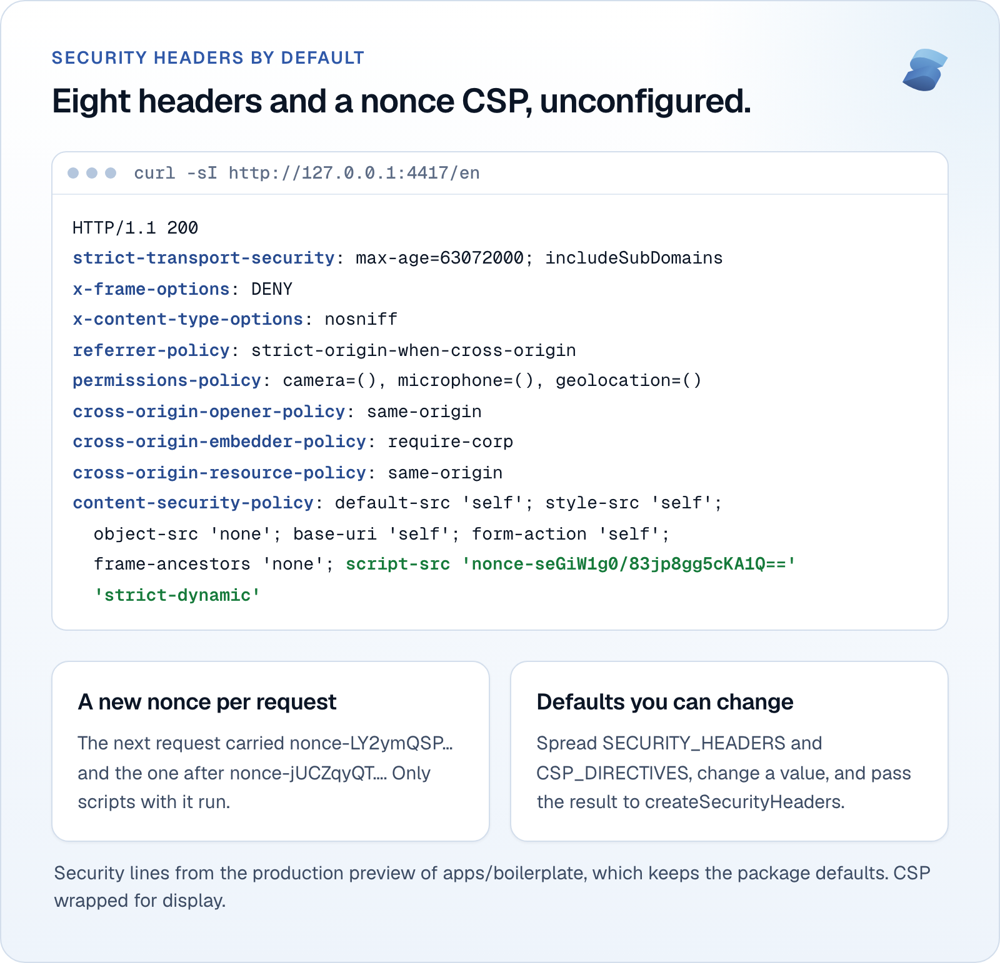
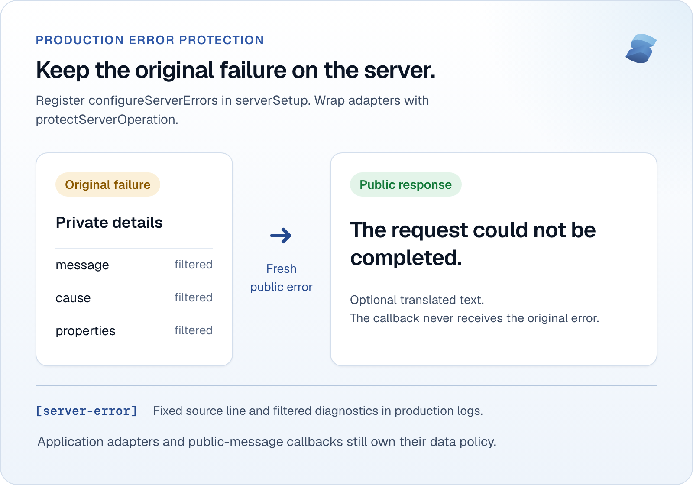
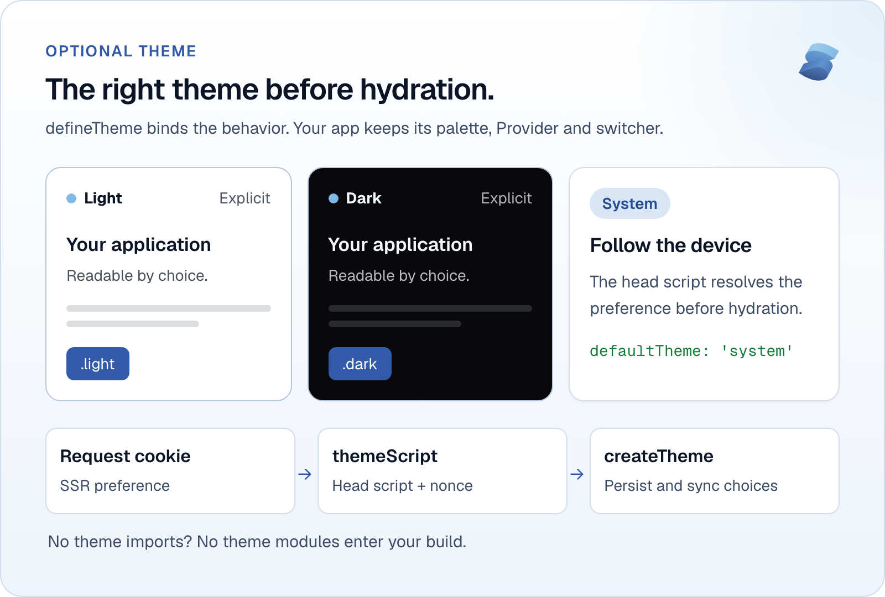
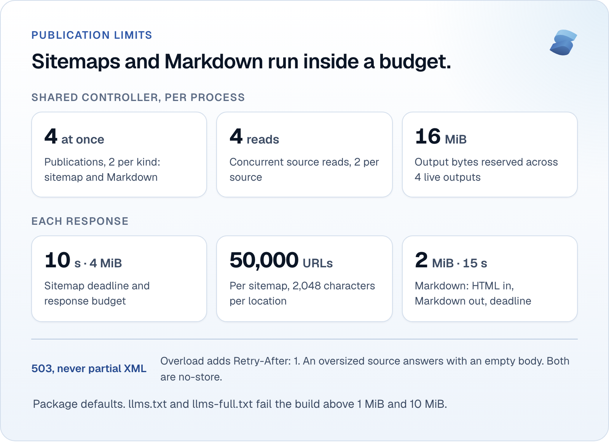
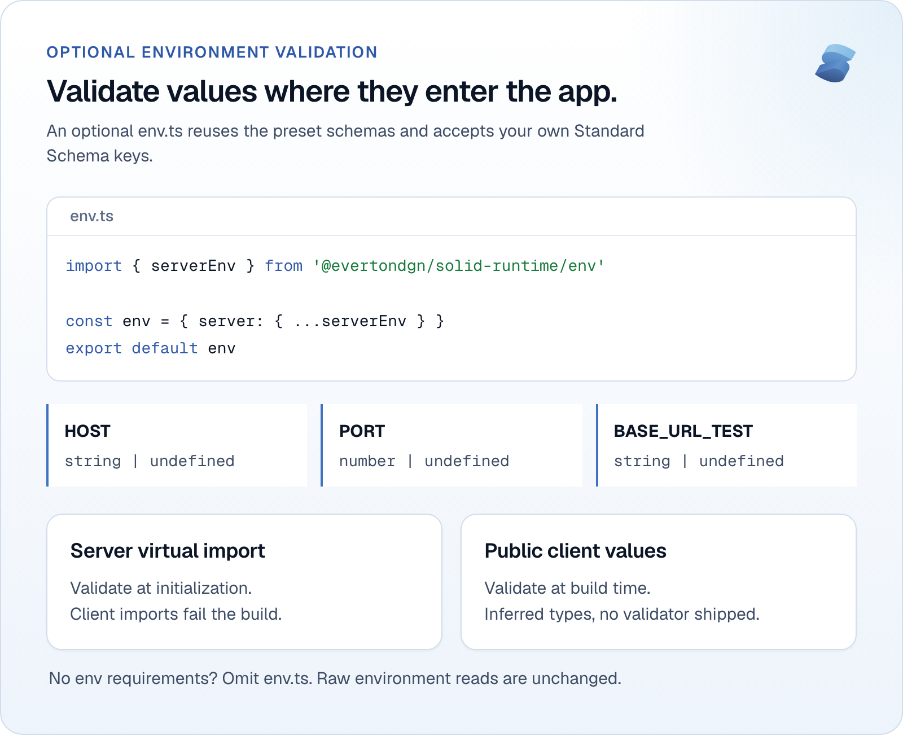

[](https://www.npmjs.com/package/@evertondgn/solid-runtime)
[](https://github.com/everton-dgn/solidjs_base/actions/workflows/ci.yml)
[](https://github.com/everton-dgn/solidjs_base/blob/main/LICENSE)

# @evertondgn/solid-runtime

<picture>
  <source media="(prefers-color-scheme: dark)" srcset="https://raw.githubusercontent.com/everton-dgn/solidjs_base/main/docs/assets/readme/hero-dark.webp" />
  <source media="(prefers-color-scheme: light)" srcset="https://raw.githubusercontent.com/everton-dgn/solidjs_base/main/docs/assets/readme/hero-light.webp" />
  
</picture>

**Security headers with a nonce CSP, private server errors, links that keep the
language, a theme set before hydration, and SEO and Markdown publication for a
SolidJS 2 app, one import at a time.**

The same code comes back in each server-rendered SolidJS app, under its pages: a
Content Security Policy with a nonce, so an injected script without it does not
run, and error responses that keep server details on the server. Many apps also
need links that keep the language, a theme applied before hydration, head tags,
robots.txt and sitemaps for crawlers, and a Markdown copy of each page for
agents. Copied from app to app, that code drifts, and a fix has to be made again
in each one. This package ships it as TypeScript source, in 64 entry points.
Your app imports the ones it uses and keeps its UI, palette, content, messages
and backend adapters.

> SolidJS 2 is still a release candidate. This package is tested with
> `2.0.0-rc.23` and pins its `@solidjs/web` peer dependency to that version, so
> plan to update both together until SolidJS 2 is stable. Below 1.0.0, a
> breaking change raises the minor version.

[Setup](#the-smallest-working-setup) · [Who it fits](#who-it-fits) ·
[Questions](#questions-before-you-adopt-it) ·
[Security](#every-response-behind-one-security-policy) ·
[Server errors](#server-failures-stay-on-the-server) ·
[Languages](#links-redirects-and-navigation-that-keep-the-language) ·
[Theme](#the-right-theme-before-hydration) ·
[SEO](#head-tags-and-robotstxt-from-route-metadata) ·
[Markdown and llms.txt](#each-page-as-markdown-plus-llmstxt) ·
[Sitemaps](#sitemaps-with-bounded-work) ·
[Environment](#environment-values-checked-at-startup) ·
[Fonts](#fonts-with-matching-preloads) ·
[Entry points](#import-only-what-you-use) ·
[How it is tested](#how-it-is-tested) · [Known limits](#known-limits) ·
[Reference](#reference)

## Install

```bash
vp add -D @evertondgn/solid-tooling
vp add @evertondgn/solid-runtime
```

The runtime is built to run under the `defineSolidApp` preset of
[`@evertondgn/solid-tooling`](https://github.com/everton-dgn/solidjs_base/blob/main/packages/solid-tooling/README.md).
The preset sets the `solid` export condition that the TypeScript entries need,
and serves the `virtual:solid-app/*` modules that 27 of the 64 entries read. The
runtime ships TypeScript source, compiled by your application with its own Solid
version, plus plain JavaScript for the entries loaded from Node. See
[Requirements](#requirements).

## The smallest working setup

These two files, trimmed from the
[SSR fixture](https://github.com/everton-dgn/solidjs_base/blob/main/fixtures/apps/ssr-plain/vite.config.ts),
put every response of a server-rendered app behind the default security policy:

```ts
// vite.config.ts
import { SECURITY_HEADERS } from '@evertondgn/solid-runtime/middleware/security-headers/constants'
import { defineSolidApp } from '@evertondgn/solid-tooling/vite'

export default defineSolidApp({
  root: import.meta.dirname,
  middleware: './src/middleware.ts',
  securityHeaders: SECURITY_HEADERS
})
```

```ts
// src/middleware.ts
import { createMiddleware } from '@evertondgn/solid-runtime/middleware/create-middleware'
import { createSecurityHeaders } from '@evertondgn/solid-runtime/middleware/security-headers'

export default createMiddleware({ security: createSecurityHeaders() })
```

This is the production preview of a copy of that fixture, built with
`vp run build` and the 0.8.0 packages from npm on 2026-11-17. The fixture also
turns on icons, SEO, the server error setup and one extra middleware step. Two
lines are cut from the output: `Vary: Origin`, sent by the preview server, and
`x-scenario-env`, written by the fixture's extra step.

```text
$ vp preview --host 127.0.0.1 --port 4417 --strictPort
$ curl -sI http://127.0.0.1:4417/
HTTP/1.1 200
content-security-policy: default-src 'self'; style-src 'self'; object-src 'none'; base-uri 'self'; form-action 'self'; frame-ancestors 'none'; script-src 'nonce-2Dq3lGgPyraw4bycVilbMw==' 'strict-dynamic'
content-type: text/html; charset=utf-8
cross-origin-embedder-policy: require-corp
cross-origin-opener-policy: same-origin
cross-origin-resource-policy: same-origin
permissions-policy: camera=(), microphone=(), geolocation=()
referrer-policy: strict-origin-when-cross-origin
strict-transport-security: max-age=63072000; includeSubDomains
x-content-type-options: nosniff
x-frame-options: DENY
```

A second request got another nonce (policy shortened):

```text
content-security-policy: ... script-src 'nonce-+tZMQ1+pW8MBtfSu71btKA==' 'strict-dynamic'
```

That is eight security headers and a CSP whose `script-src` holds the nonce of
the request, so only the scripts that carry it run. The development server sends
the eight headers without the CSP, so hot module replacement can inject its
styles. The static files that skip the middleware get three of the same values
through `securityHeaders`: `strict-transport-security`, `x-content-type-options`
and `cross-origin-resource-policy`. Everything else on this page is opt-in.

## Who it fits

- You build a SolidJS 2 app with the `defineSolidApp` preset and want its
  responses behind a nonce CSP, starting from the two files above.
- Your server functions and API routes call databases or SDKs whose error
  messages must stay on the server.
- Your app has several languages and must keep the current one in links,
  redirects and client navigation. A single-language app uses the same calls
  with no translation project.
- You publish sitemaps, `llms.txt` or a Markdown copy of your pages, and want
  each response held to a deadline and a byte budget.

## Who it does not fit yet

- Your app does not use the tooling preset. 27 of the 64 entries read
  `virtual:solid-app/*` modules that only `defineSolidApp` serves, among them
  `createMiddleware`, the public errors, the language helpers, `createSeo`, the
  sitemaps and Markdown. The runtime is not tested without the preset;
  [Import only what you use](#import-only-what-you-use) shows what each entry
  reads.
- Your server build must target a host other than Vercel's output format. The
  server features run in the server build of the preset, whose Nitro always uses
  the `vercel` preset
  ([known limits of the tooling](https://github.com/everton-dgn/solidjs_base/blob/main/docs/tooling/limits.md#known-limits)).
  A client-only build (`ssr: false`) writes a static `dist/` with no server.
- You cannot pin `@solidjs/web`. It is an exact peer at `2.0.0-rc.23` in the
  [package manifest](https://github.com/everton-dgn/solidjs_base/blob/main/packages/solid-runtime/package.json),
  and SolidJS 2 is a release candidate.
- You run Node older than 26.13.1, the `engines.node` floor of the same
  manifest.
- You need sitemap and Markdown quotas shared by several server processes. Each
  process has its own quotas, and there is no global quota.

## Questions before you adopt it

**Can I use it without the tooling?** Not as a tested setup: the runtime is
built and tested under the tooling preset. A static read of the import graph of
each entry finds 34 entries that import no virtual module, among them the whole
theme, the security headers, the env fragment, `createRobots` and `convertHtml`.
Three more import only the virtual modules of the routing and Solid plugins, and
27 import the `virtual:solid-app/*` modules that `defineSolidApp` serves. No
entry was run without the preset, and the TypeScript entries still need the
`solid` export condition. [Import only what you use](#import-only-what-you-use)
marks each entry.

**Do I need translations, a theme or SEO?** No. Each one is a separate import. A
single-language app needs no translation project: the language helpers give one
unprefixed language, `en` unless you set `language` in the preset. A theme or
SEO module enters the bundle only when your code imports it, and the installed
scenarios fail when a disabled theme or translation setup leaves its modules in
the bundle ([How it is tested](#how-it-is-tested)).

**Does it work in an app with no server?** In part. A client-only build
(`ssr: false`) can use the theme with `storage: 'local-storage'`, the language
helpers with one unprefixed language, and fonts, which the preset writes into
`index.html`. The middleware, the server errors and SEO need the server build:
the preset rejects `seo` together with `ssr: false`. Translations by URL prefix
need a server too. See
[applications with no server](https://github.com/everton-dgn/solidjs_base/blob/main/docs/tooling/no-server.md).

**What does it add to the production install?** Version 0.8.0 unpacks to 280,495
bytes in 122 files
(`npm view @evertondgn/solid-runtime@0.8.0 dist.unpackedSize dist.fileCount`).
It has four production dependencies, `@mdream/js`, `filesystem-routing`,
`schema-dts` and `valibot`, and the `@solidjs/web` peer. The tarball test fails
when a build or test tool such as `vite`, `vite-plus`, `vitest` or `rolldown`
reaches the `dependencies`, `peerDependencies` or `optionalDependencies` of the
published manifest. It does not follow the dependencies of a dependency.

**How do I update?** Update it together with the tooling, in one command:

```bash
vp update -L @evertondgn/solid-tooling @evertondgn/solid-runtime
```

`-L` is needed while the packages are `0.x`. Then align `solid-js`,
`@solidjs/web` and the Solid overrides with the exact `@solidjs/web` peer of the
runtime, as
[Update the packages](https://github.com/everton-dgn/solidjs_base/blob/main/README.md#update-the-packages)
shows, and read the
[changelog](https://github.com/everton-dgn/solidjs_base/blob/main/packages/solid-runtime/CHANGELOG.md).
Do not raise `solid-js` with `-L`: the newest release candidate can be newer
than the one the packages were tested with.

**How do I leave?** There is no eject command. Each feature is a separate
import, so you can replace one at a time with your own code.

## Every response behind one security policy

<picture>
  <source media="(prefers-color-scheme: dark)" srcset="https://raw.githubusercontent.com/everton-dgn/solidjs_base/main/docs/assets/readme/security-headers-dark.webp" />
  <source media="(prefers-color-scheme: light)" srcset="https://raw.githubusercontent.com/everton-dgn/solidjs_base/main/docs/assets/readme/security-headers-light.webp" />
  
</picture>

In production, only the scripts that carry the nonce run, and `'strict-dynamic'`
lets them load their modules. An injected `<script>` without the nonce does not
run. JSON, text, XML and redirects get `script-src 'none'`. A policy that a
response cannot carry, such as a duplicate directive or a header value with a
line break, fails when the application starts, before any request. That check
covers the directive names and the shape of each item, not the values:
`'unsafe-inline'` in `style-src` passes.

| Header                         | Default                                                                                                                                                                                |
| ------------------------------ | -------------------------------------------------------------------------------------------------------------------------------------------------------------------------------------- |
| `strict-transport-security`    | `max-age=63072000; includeSubDomains`, two years                                                                                                                                       |
| `x-frame-options`              | `DENY`                                                                                                                                                                                 |
| `x-content-type-options`       | `nosniff`                                                                                                                                                                              |
| `referrer-policy`              | `strict-origin-when-cross-origin`                                                                                                                                                      |
| `permissions-policy`           | `camera=(), microphone=(), geolocation=()`                                                                                                                                             |
| `cross-origin-opener-policy`   | `same-origin`                                                                                                                                                                          |
| `cross-origin-embedder-policy` | `require-corp`                                                                                                                                                                         |
| `cross-origin-resource-policy` | `same-origin`                                                                                                                                                                          |
| `content-security-policy`      | `default-src 'self'`, `style-src 'self'`, `object-src 'none'`, `base-uri 'self'`, `form-action 'self'` and `frame-ancestors 'none'`, plus the nonce `script-src`, in production builds |

<picture>
  <source media="(prefers-color-scheme: dark)" srcset="https://raw.githubusercontent.com/everton-dgn/solidjs_base/main/docs/assets/readme/middleware-dark.webp" />
  <source media="(prefers-color-scheme: light)" srcset="https://raw.githubusercontent.com/everton-dgn/solidjs_base/main/docs/assets/readme/middleware-light.webp" />
  
</picture>

`createMiddleware` runs request localization when a translation project exists,
then your `extra` steps, the security headers, the API routes and a `405` for a
method that the page or API route does not accept. Security runs before the API
handlers, which may finish the response. A failure inside the chain is
contained, and in production the failure response keeps the configured headers.
A failure after a Response body was returned stays outside that containment. To
change one value, spread the defaults: see [Security headers](#security-headers)
and [Building the chain](#building-the-chain).

## Server failures stay on the server

<picture>
  <source media="(prefers-color-scheme: dark)" srcset="https://raw.githubusercontent.com/everton-dgn/solidjs_base/main/docs/assets/readme/server-errors-dark.webp" />
  <source media="(prefers-color-scheme: light)" srcset="https://raw.githubusercontent.com/everton-dgn/solidjs_base/main/docs/assets/readme/server-errors-light.webp" />
  
</picture>

When a server function, an API route or a render fails in production, the
browser receives a fresh public error with `The request could not be completed.`
or your own translated text. The message, cause and properties of the original
error are not forwarded, and the production log keeps a fixed source line with
the filtered class and frames. Your adapters still choose the fields they
return, and a translated message callback must return public text: the package
cannot detect a secret deliberately embedded in a string. Register the
protection once, in the setup file that `defineSolidApp` points to:

```ts
// vite.config.ts, inside defineSolidApp
serverSetup: './src/infra/server/configureServerErrors/index.ts'
```

```ts
// src/infra/server/configureServerErrors/index.ts
import { configureServerErrors } from '@evertondgn/solid-runtime/server/configure-server-errors'

configureServerErrors()
```

Wrap each backend adapter in `protectServerOperation({ run })`. The boilerplate
does it in
[`requestJson`](https://github.com/everton-dgn/solidjs_base/blob/main/apps/boilerplate/src/infra/server/requestJson/index.ts),
its only module allowed to call `fetch`. The tooling lint enforces that
boundary: `fetch` outside that file is an error, and the configurator can only
be imported in the setup file. See
[Server error protection](#server-error-protection).

## Links, redirects and navigation that keep the language

<picture>
  <source media="(prefers-color-scheme: dark)" srcset="https://raw.githubusercontent.com/everton-dgn/solidjs_base/main/docs/assets/readme/app-locales-dark.webp" />
  <source media="(prefers-color-scheme: light)" srcset="https://raw.githubusercontent.com/everton-dgn/solidjs_base/main/docs/assets/readme/app-locales-light.webp" />
  
</picture>

Links, redirects, client navigation, alternate links and language tags follow
the locale list of your translation project. Navigation keeps relative paths,
query strings, fragments, router state and replace behavior; a change of locale
uses document navigation, and `prepareClientLocale` reloads before hydration
when the loaded locale does not match the URL. Without a translation project,
the same calls give one unprefixed language, `en` unless you set `language`.

```tsx
import { createLocalizedNavigate } from '@evertondgn/solid-runtime/i18n/create-localized-navigate'
import { localeTag } from '@evertondgn/solid-runtime/i18n/locale-tag'

// Inside a component under the Router:
const navigate = createLocalizedNavigate()
const goToGuide = () => navigate({ href: '/guide?q=1#intro' })
const language = localeTag('fr', { fr: 'fr-CA' }) // fr-CA
```

<picture>
  <source media="(prefers-color-scheme: dark)" srcset="https://raw.githubusercontent.com/everton-dgn/solidjs_base/main/docs/assets/readme/i18n-dark.webp" />
  <source media="(prefers-color-scheme: light)" srcset="https://raw.githubusercontent.com/everton-dgn/solidjs_base/main/docs/assets/readme/i18n-light.webp" />
  
</picture>

With `project.inlang/settings.json`, the middleware also redirects to the
localized URL and keeps the choice in a cookie. The runtime reads your locales
through one seam and never imports a translation provider of its own. See
[Locale support](#locale-support) and
[Navigation and language tags](#navigation-and-language-tags).

## The right theme before hydration

<picture>
  <source media="(prefers-color-scheme: dark)" srcset="https://raw.githubusercontent.com/everton-dgn/solidjs_base/main/docs/assets/readme/app-home-dark.webp" />
  <source media="(prefers-color-scheme: light)" srcset="https://raw.githubusercontent.com/everton-dgn/solidjs_base/main/docs/assets/readme/app-home-light.webp" />
  
</picture>

Light, dark or system. On the server, `readTheme` reads the choice from the
request cookie, and `themeColor` gives the matching `theme-color` for the HTML
class you render. `themeScript`, inside a script with the request nonce,
resolves the system preference before hydration, so it needs a server. A choice
made in one tab reaches the others through BroadcastChannel. The choice stays in
a cookie, which the server reads; an app with no server keeps it in localStorage
instead, as [Optional theme](#optional-theme) shows. With localStorage and SSR,
the server cannot read the choice, so the page shows the default theme until
`createTheme` applies it. One factory, `defineTheme`, binds it all:

```ts
import { defineTheme } from '@evertondgn/solid-runtime/theme/define-theme'

export const { createTheme, readTheme, themeColor, themeScript, defaultTheme, themes } =
  defineTheme({
    cookieName: 'app-theme',
    cookieMaxAge: 31536000,
    colors: { light: '#ffffff', dark: '#09090b' },
    defaultTheme: 'system'
  })
```

<picture>
  <source media="(prefers-color-scheme: dark)" srcset="https://raw.githubusercontent.com/everton-dgn/solidjs_base/main/docs/assets/readme/theme-dark.webp" />
  <source media="(prefers-color-scheme: light)" srcset="https://raw.githubusercontent.com/everton-dgn/solidjs_base/main/docs/assets/readme/theme-light.webp" />
  
</picture>

Your app keeps its palette, the `.light` and `.dark` CSS rules, the Provider and
the switcher. See [Optional theme](#optional-theme).

## Head tags and robots.txt from route metadata

<picture>
  <source media="(prefers-color-scheme: dark)" srcset="https://raw.githubusercontent.com/everton-dgn/solidjs_base/main/docs/assets/readme/seo-dark.webp" />
  <source media="(prefers-color-scheme: light)" srcset="https://raw.githubusercontent.com/everton-dgn/solidjs_base/main/docs/assets/readme/seo-light.webp" />
  
</picture>

`createSeo` turns route metadata into the title, description, canonical link,
language alternates, Open Graph and Twitter tags and JSON-LD. It escapes `<`,
U+2028 and U+2029 before the data reaches the head, so a `</script>` inside a
title cannot close the tag. A `noindex` route publishes only robots, title and
description. robots.txt is one line:

```ts
// src/routes/robots.txt/index.ts
export { GET } from '@evertondgn/solid-runtime/seo/robots-route'
```

Call `createSeo({ route: true, site })` once in the Router's root owner, or
`createSeo({ structuredData })` for JSON-LD alone. The runtime has no example
identities in its defaults: author, organization and social fields appear only
when you pass them. See [Optional SEO](#optional-seo).

## Each page as Markdown, plus llms.txt

<picture>
  <source media="(prefers-color-scheme: dark)" srcset="https://raw.githubusercontent.com/everton-dgn/solidjs_base/main/docs/assets/readme/markdown-llms-dark.webp" />
  <source media="(prefers-color-scheme: light)" srcset="https://raw.githubusercontent.com/everton-dgn/solidjs_base/main/docs/assets/readme/markdown-llms-light.webp" />
  
</picture>

A page that opts in with `info: { markdown: true }` also answers as Markdown, at
its `.md` URL or with `Accept: text/markdown`. The Markdown is converted from
the HTML that the same page rendered, so there is no second copy of the content
to keep in sync. `llms.txt` and `llms-full.txt` give agents an index of those
pages. Each document has a byte budget, and an index over its budget fails
instead of being truncated. The boilerplate binds both factories:

```ts
// vite.config.ts, inside defineSolidApp
seo: { sitemap: { static: true }, markdown: { static: true }, llms: {}, llmsFull: {} }
```

```ts
// src/middleware/markdownContent/index.ts
export const markdownContent = createMarkdownContent({
  publication,
  router: Router,
  siteUrl: resolveSiteUrl('/'),
  applySecurityHeaders,
  notFoundMessage: () => m.notFound_description()
})
```

```ts
// src/routes/(seo)/llms.txt/index.ts
export const GET = createLlms({
  site: SITE,
  router: Router,
  notes: LLMS_NOTES,
  pages: LLMS_USE_CASES,
  cacheControl: SITE_CACHE_CONTROL,
  fullPage: LLMS_FULL_PAGE
})
```

`markdownContent` goes in the `document` slot of `createMiddleware`, and
`publication` is the controller shared with sitemaps. The boilerplate's
[complete bindings](https://github.com/everton-dgn/solidjs_base/blob/main/apps/boilerplate/src/middleware/markdownContent/index.ts)
show the imports. See
[Markdown and editorial indexes](#markdown-and-editorial-indexes).

## Sitemaps with bounded work

<picture>
  <source media="(prefers-color-scheme: dark)" srcset="https://raw.githubusercontent.com/everton-dgn/solidjs_base/main/docs/assets/readme/publication-limits-dark.webp" />
  <source media="(prefers-color-scheme: light)" srcset="https://raw.githubusercontent.com/everton-dgn/solidjs_base/main/docs/assets/readme/publication-limits-light.webp" />
  
</picture>

A sitemap index and its parts come from sources you declare, with one entry per
configured locale and `x-default` for the base locale. Every dynamic sitemap and
Markdown response goes through one publication controller with admission slots,
deadlines and byte budgets. Overload answers `503` with `Retry-After: 1`, and an
oversized source answers an empty `503`; neither sends partial XML. These quotas
belong to one server process: there is no global quota across processes. A
source that ignores cancellation keeps its slot until it settles, and an array
source returns its complete list on each request. This source is complete, from
the SSR fixture:

```ts
// src/infra/server/sitemap/index.ts
import 'server-only'
import { origin } from '@evertondgn/solid-runtime/seo/origin'
import { createSitemapRoutes } from '@evertondgn/solid-runtime/seo/sitemap-routes'
import type { SitemapPartitionSource } from '@evertondgn/solid-runtime/seo/sitemap-types'
import { createPublicationController } from '@evertondgn/solid-runtime/server/publication'

const sources: readonly SitemapPartitionSource[] = [
  {
    id: 'articles',
    routePath: '/articles/:id',
    listPartitions: ({ limit, signal }) => {
      signal.throwIfAborted()
      return Promise.resolve(['first'].slice(0, limit))
    },
    readPartition: ({ id, limit, signal }) => {
      signal.throwIfAborted()
      return Promise.resolve(
        id === 'first'
          ? [{ path: '/articles/42', lastmod: '2026-10-01' }].slice(0, limit)
          : []
      )
    }
  }
]
export const { index, pages, array, source } = createSitemapRoutes({
  publication: createPublicationController(),
  sources,
  siteUrl: origin
})
```

```ts
// src/routes/sitemap.xml/index.ts
export { index as GET } from '@/infra/server/sitemap/index.ts'
```

| Default                           | Value                                                       |
| --------------------------------- | ----------------------------------------------------------- |
| Concurrent publications           | 4 in total, 2 per kind                                      |
| Concurrent source reads           | 4 in total, 2 per source                                    |
| Reserved output                   | 16,777,216 bytes (16 MiB) across 4 live outputs             |
| Deadline of a dynamic sitemap     | 10,000 ms                                                   |
| Sitemap response budget           | 4,194,304 bytes (4 MiB)                                     |
| URLs per sitemap, parts per index | 50,000 each, 2,048 characters per location, protocol limits |
| Markdown                          | 2 MiB of HTML in, 2 MiB of Markdown out, 15 seconds         |
| `llms.txt`, `llms-full.txt`       | 1 MiB and 10 MiB                                            |
| Overload                          | `503` with `no-store` and `Retry-After: 1`                  |

The fixture publishes only sitemaps, so it creates its controller inline. Once
sitemaps and Markdown both publish, share one controller between them, as the
boilerplate does, so the quotas stay where you set them. See
[Sitemap and publication](#sitemap-and-publication).

## Environment values checked at startup

<picture>
  <source media="(prefers-color-scheme: dark)" srcset="https://raw.githubusercontent.com/everton-dgn/solidjs_base/main/docs/assets/readme/env-dark.webp" />
  <source media="(prefers-color-scheme: light)" srcset="https://raw.githubusercontent.com/everton-dgn/solidjs_base/main/docs/assets/readme/env-light.webp" />
  
</picture>

An optional `env.ts` reuses the package schemas and adds your own keys. Server
values are validated when the server starts, public values at build time, and
the types are inferred. A server value imported from client code fails the
build, and neither the schemas nor Valibot reach the client bundle.

```ts
// env.ts
import { serverEnv } from '@evertondgn/solid-runtime/env'

const env = { server: { ...serverEnv } }

export default env
```

`HOST`, `PORT` and `BASE_URL_TEST` are optional, and `PORT` becomes an integer
from 0 through 65535. See
[Optional environment validation](#optional-environment-validation).

## Fonts with matching preloads

<picture>
  <source media="(prefers-color-scheme: dark)" srcset="https://raw.githubusercontent.com/everton-dgn/solidjs_base/main/docs/assets/readme/fonts-dark.webp" />
  <source media="(prefers-color-scheme: light)" srcset="https://raw.githubusercontent.com/everton-dgn/solidjs_base/main/docs/assets/readme/fonts-light.webp" />
  
</picture>

The tooling preset turns the `fonts` list of `defineSolidApp` into external
`@font-face` CSS and preloads with the same URLs. In a server-rendered app,
`FontLinks` renders both in the Document head:

```tsx
// src/App.tsx, in the SSR fixture
import { FontLinks } from '@evertondgn/solid-runtime/fonts/font-links'

// Inside the Document:
<head>
  <FontLinks />
  <title>Scenario application</title>
</head>
```

Client-only apps get the links in `index.html` with no import. Font files,
licenses and typography tokens stay in your app. See
[Optional fonts](#optional-fonts).

## Import only what you use

The package has 64 entry points in 8 groups and no barrel: `seo` 15,
`middleware` 12, `server` 12, `theme` 11, `i18n` 10, `routing` 2, `env` 1 and
`fonts` 1, the keys of `exports` in the
[package manifest](https://github.com/everton-dgn/solidjs_base/blob/main/packages/solid-runtime/package.json).
A single-language app needs no translation project, and a theme or SEO module
enters the bundle only when your code imports it. The installed scenarios check
that on real builds ([How it is tested](#how-it-is-tested)).

The table lists every entry by feature, with the virtual modules in its import
graph. That column comes from a static read of the source at commit `4d2c326`,
following relative imports and the package's `#solid-runtime/*` alias and
skipping type-only imports. No entry was run without the preset. Of the 64
entries, 34 import no virtual module, 3 import only the virtual modules of the
routing and Solid plugins, and 27 import `virtual:solid-app/*` modules, which
only `defineSolidApp` serves. The TypeScript entries also need the `solid`
export condition, and an entry that imports no virtual module can still take an
argument built by one that does.

| Entry point                                                               | `virtual:solid-app/*` modules                                    | Plugin modules           |
| ------------------------------------------------------------------------- | ---------------------------------------------------------------- | ------------------------ |
| [`./middleware/create-middleware`](#building-the-chain)                   | `locale`, `request-middleware`                                   | routes, server functions |
| [`./middleware/security-headers`](#security-headers)                      | None                                                             | None                     |
| [`./middleware/security-headers/constants`](#security-headers)            | None                                                             | None                     |
| [`./middleware/contain-failures`](#building-the-chain)                    | `locale`                                                         | routes, server functions |
| [`./middleware/api-routes`](#middleware-and-security-headers)             | None                                                             | routes                   |
| [`./middleware/restrict-page-methods`](#middleware-and-security-headers)  | None                                                             | routes, server functions |
| [`./middleware/request-classification`](#middleware-and-security-headers) | None                                                             | routes, server functions |
| [`./middleware/negotiate-page-format`](#middleware-and-security-headers)  | None                                                             | None                     |
| [`./middleware/is-html-response`](#middleware-and-security-headers)       | None                                                             | None                     |
| [`./middleware/types`](#middleware-and-security-headers)                  | None                                                             | None                     |
| [`./middleware/append-vary`](#locale-support)                             | None                                                             | None                     |
| [`./middleware/localize-request`](#locale-request-middleware)             | `locale-request`                                                 | routes, server functions |
| [`./server/configure-server-errors`](#server-error-protection)            | `locale`                                                         | None                     |
| [`./server/public-errors`](#server-error-protection)                      | `locale`                                                         | None                     |
| [`./server/protect-server-operation`](#server-error-protection)           | `locale`                                                         | None                     |
| [`./server/log-server-failure`](#server-error-protection)                 | None                                                             | None                     |
| [`./server/is-control-response`](#server-error-protection)                | None                                                             | None                     |
| [`./server/render-integrity`](#server-error-protection)                   | None                                                             | None                     |
| [`./server/publication-scope`](#server-error-protection)                  | `locale`                                                         | None                     |
| [`./server/create-render-options`](#authored-render-entries)              | None                                                             | None                     |
| [`./server/publication`](#sitemap-and-publication)                        | `locale`                                                         | None                     |
| [`./server/publication-types`](#sitemap-and-publication)                  | None                                                             | None                     |
| [`./server/publication-protocol`](#sitemap-and-publication)               | None                                                             | None                     |
| [`./server/publication-phase`](#sitemap-and-publication)                  | None                                                             | None                     |
| [`./i18n/locale`](#locale-support)                                        | `locale`                                                         | None                     |
| [`./i18n/urls`](#locale-support)                                          | `locale`                                                         | None                     |
| [`./i18n/build-locale-alternates`](#locale-support)                       | `locale`                                                         | None                     |
| [`./i18n/create-localized-navigate`](#navigation-and-language-tags)       | `locale`                                                         | None                     |
| [`./i18n/create-locale-navigation-guard`](#navigation-and-language-tags)  | `locale`                                                         | None                     |
| [`./i18n/install-locale-history-guard`](#navigation-and-language-tags)    | `locale`                                                         | None                     |
| [`./i18n/locale-tag`](#navigation-and-language-tags)                      | `locale`                                                         | None                     |
| [`./i18n/prepare-client-locale`](#navigation-and-language-tags)           | `locale`                                                         | None                     |
| [`./i18n/localized-redirect`](#locale-request-middleware)                 | `locale`                                                         | None                     |
| [`./i18n/locale-context`](#markdown-and-editorial-indexes)                | `locale-context`                                                 | None                     |
| [`./theme/define-theme`](#optional-theme)                                 | None                                                             | None                     |
| [`./theme/create-theme`](#optional-theme)                                 | None                                                             | None                     |
| [`./theme/create-theme/types`](#optional-theme)                           | None                                                             | None                     |
| [`./theme/types`](#optional-theme)                                        | None                                                             | None                     |
| [`./theme/is-theme`](#optional-theme)                                     | None                                                             | None                     |
| [`./theme/apply-theme`](#optional-theme)                                  | None                                                             | None                     |
| [`./theme/stored-theme-script`](#optional-theme)                          | None                                                             | None                     |
| [`./theme/theme-storage`](#optional-theme)                                | None                                                             | None                     |
| [`./theme/make-system-theme`](#optional-theme)                            | None                                                             | None                     |
| [`./theme/make-theme-channel`](#optional-theme)                           | None                                                             | None                     |
| [`./theme/make-broadcast-channel`](#optional-theme)                       | None                                                             | None                     |
| [`./seo/create-seo`](#optional-seo)                                       | `locale`                                                         | None                     |
| [`./seo/resolve-route-seo`](#optional-seo)                                | None                                                             | None                     |
| [`./seo/types`](#optional-seo)                                            | None                                                             | None                     |
| [`./seo/origin`](#optional-seo)                                           | `seo-origin`                                                     | None                     |
| [`./seo/create-robots`](#optional-seo)                                    | None                                                             | None                     |
| [`./seo/robots-route`](#optional-seo)                                     | `seo-robots`                                                     | server functions         |
| [`./seo/markdown`](#markdown-and-editorial-indexes)                       | `locale`, `locale-context`, `request-middleware`, `seo-markdown` | routes, server functions |
| [`./seo/markdown-types`](#markdown-and-editorial-indexes)                 | None                                                             | None                     |
| [`./seo/markdown-route`](#markdown-and-editorial-indexes)                 | `locale`                                                         | None                     |
| [`./seo/convert-html`](#markdown-and-editorial-indexes)                   | None                                                             | None                     |
| [`./seo/collect-static-markdown-pages`](#markdown-and-editorial-indexes)  | `locale`                                                         | None                     |
| [`./seo/llms`](#markdown-and-editorial-indexes)                           | `locale`, `locale-context`, `seo-llms`                           | routes                   |
| [`./seo/llms-types`](#markdown-and-editorial-indexes)                     | None                                                             | None                     |
| [`./seo/sitemap-routes`](#sitemap-and-publication)                        | `locale`                                                         | routes                   |
| [`./seo/sitemap-types`](#sitemap-and-publication)                         | None                                                             | None                     |
| [`./routing/walk-static-routes`](#sitemap-and-publication)                | None                                                             | None                     |
| [`./routing/types`](#sitemap-and-publication)                             | None                                                             | None                     |
| [`./env`](#optional-environment-validation)                               | None                                                             | None                     |
| [`./fonts/font-links`](#optional-fonts)                                   | `fonts`                                                          | None                     |

In the second column, `locale` stands for `virtual:solid-app/locale`, and so on.
In the third, routes is `virtual:file-routes`, from `filesystem-routing`, and
server functions is `virtual:solid-server-function-handler`, from
`@solidjs/vite-plugin`.

## How it is tested

In the CI run of the 0.8.0 release pull request
([run 43975952604](https://github.com/everton-dgn/solidjs_base/actions/runs/43975952604)),
the
[Packages job](https://github.com/everton-dgn/solidjs_base/actions/runs/43975952604/job/133680118978)
ran `vp run validate`, the same checks as the publish job. For this package, it
executed:

- 1,047 Vitest tests in 104 files, all passed: 934 tests in 86 files of the
  `node` project, 111 in 17 files of `dom`, with happy-dom, and 2 in 1 file of
  `browser`, with Chromium. Coverage was 97.46% of statements, 94.87% of
  branches, 98.79% of functions and 98.46% of lines.
- 6 tarball tests, all passed. They pack the package, install it in a temporary
  folder and check that the header constants and the stored theme script load in
  plain Node, that every target of `exports` is in the tarball, that no test
  folder is published and that no build tool is in a production section of the
  manifest.
- The installed scenarios, which install the packed tooling, runtime and icons
  plugin in the
  [three fixture applications](https://github.com/everton-dgn/solidjs_base/tree/main/fixtures/apps)
  with Bun's `hoisted` and `isolated` linkers, build them and audit the bundles
  and server boundaries. All 14 application cases passed. They fail when a
  disabled theme or translation setup leaves its modules in the bundle, or when
  a client-only build loads Nitro. In the same log, an SSR case with an invalid
  `PORT` stops at boot, as expected:
  `Expected boot failure: server env validation failed at boot`. The
  [tooling package](https://github.com/everton-dgn/solidjs_base/blob/main/packages/solid-tooling/README.md)
  lists the cases.

The runtime tests use their own de/fr/ja Paraglide project, generated before
each run and left out of the tarball and coverage; the installed scenarios test
the real providers of the fixture applications. The package is also linted as an
application with the lint preset of the tooling package, and Knip checks its
`exports` for unused code. See the
[development guide](https://github.com/everton-dgn/solidjs_base/blob/main/docs/development.md)
and the
[installed scenarios decision](https://github.com/everton-dgn/solidjs_base/blob/main/docs/ADRs/0021-installed-application-scenarios.md).

Version 0.8.0 was published by the release workflow through npm trusted
publishing, with npm provenance (an SLSA v1 provenance statement) that names the
commit and the workflow run that built it. `npm audit signatures`, run in your
application, checks the registry signatures and attestations of the installed
packages. The first version of each package was published by hand and has no
provenance statement
([security policy](https://github.com/everton-dgn/solidjs_base/blob/main/SECURITY.md)).

## Known limits

- `createSecurityHeaders` checks directive names and the shape of each item, not
  the values, and does not refuse a second instance ([Limits](#limits)).
- The package cannot detect a secret deliberately embedded in a public string,
  and a failure after a Response body was returned stays outside the containment
  ([Server error protection](#server-error-protection),
  [Building the chain](#building-the-chain)).
- Publication quotas belong to one process, a source that ignores cancellation
  keeps its slot until it settles, process caches are not persistent storage,
  and an array source returns its complete list
  ([Sitemap and publication](#sitemap-and-publication)).
- `themeScript` needs a server and its nonce. With `storage: 'local-storage'`
  and SSR, the page shows the default theme until `createTheme` applies the
  choice ([Optional theme](#optional-theme)).
- Direct imports of `middleware/localize-request` need a translation project.
  Without one, its functions throw an error that names
  `project.inlang/settings.json`
  ([Locale request middleware](#locale-request-middleware)).
- The package converts Markdown with the published `@mdream/js`. The patch that
  the boilerplate app applies to it is not shipped
  ([Markdown and editorial indexes](#markdown-and-editorial-indexes)).

## Reference

The sections below follow the same order as the features above. Every entry
point listed in `package.json` appears in one of them.

### Requirements

- The application runs on Node 26 or a later line, from the version that
  `engines.node` in the package's `package.json` names.
- The Solid Vite plugin adds the `solid` condition to the application build for
  the TypeScript entries.
- The node project of `solidTest`, from `@evertondgn/solid-tooling/vitest`,
  resolves the package through the same condition, and the `tsconfig.app.json`
  of the tooling package sets it for TypeScript.
- `@solidjs/web` is a peer dependency, pinned to the version the package is
  tested with. `filesystem-routing` is a package dependency: the routing helpers
  resolve from the runtime package. The `StartMiddleware` type copies the one of
  `@solidjs/vite-plugin`, so the plugin, and Vite with it, stays out of the
  production install. Applications retain a direct routing dependency only when
  their own source imports it.
- The published source reads the `nonce` and `renderMode` fields that the Solid
  plugin adds to `RequestEvent`. Your application type-checks them with no
  declaration of its own: they come from `@evertondgn/solid-tooling/app-env`,
  which the `tsconfig.app.json` of the tooling package loads. An application
  with its own TypeScript config keeps `@evertondgn/solid-tooling/app-env` in
  `types`.

Each module has its own entry point, so an application bundles only the modules
it imports. TypeScript entries use the `solid` condition. The env fragment, the
header constants and the publication protocol use `types` and `default` for
plain Node compatibility.

### Middleware and security headers

| Entry point                               | Exports                                                                                                       |
| ----------------------------------------- | ------------------------------------------------------------------------------------------------------------- |
| `./middleware/create-middleware`          | `createMiddleware({ security, extra?, document? })`                                                           |
| `./middleware/security-headers`           | `createSecurityHeaders`, the factory of the security step and its CSP, and `requestNonce`                     |
| `./middleware/security-headers/constants` | `SECURITY_HEADERS` and `CSP_DIRECTIVES`, the default values, as JavaScript, so `vite.config.ts` can read them |
| `./middleware/api-routes`                 | `apiRoutes`, the handler of the API routes in `virtual:file-routes`                                           |
| `./middleware/restrict-page-methods`      | `restrictPageMethods`: 405 for a method that the API route or the page does not accept                        |
| `./middleware/request-classification`     | `isPageRequest`, `isPagePath`, `apiRouteMethods` and `isServerFunctionPath`                                   |
| `./middleware/negotiate-page-format`      | `negotiatePageFormat` and `acceptsMarkdown`                                                                   |
| `./middleware/is-html-response`           | `isHtmlResponse`                                                                                              |
| `./middleware/contain-failures`           | `containFailures({ chain, applySecurityHeaders })`                                                            |
| `./middleware/types`                      | The `Middleware`, `Next` and `StartMiddleware` types                                                          |

`./middleware/append-vary` and `./middleware/localize-request` are listed under
[Locale support](#locale-support).

#### Building the chain

The application supplies one security instance. The same call works with or
without a translation project:

```ts
import { createMiddleware } from '@evertondgn/solid-runtime/middleware/create-middleware'
import { createSecurityHeaders } from '@evertondgn/solid-runtime/middleware/security-headers'

const security = createSecurityHeaders()
export default createMiddleware({ security })
```

With `project.inlang/settings.json` the preset selects request localization.
Without it, the request step passes through directly, with no translation
provider, locale cookie or redirect. The optional
`virtual:solid-app/request-middleware` seam keeps the request provider out of
single-language bundles; direct imports of `middleware/localize-request` still
require a translation project.

The request order is localization, then `extra`, security headers, API routes
and page-method restrictions. Inner containment runs inside the locale context;
outer containment covers locale resolution. API handlers may terminate the
chain, so security must run before them. Development rethrows the original
failure. Production preserves only bodyless controls and produces public
failures with the application's configured headers. `serverFailure` is part of
the runtime's request-locals augmentation; applications must not redeclare it.
The application error boundary consumes it before mounting its Router.

An optional `document` step accepts the Solid plugin event and next callback. It
wraps the localized chain with its own containment. A request replacement made
by that step reaches the locale step and render; a failure before entering the
chain renders its fallback inside the request locale. A failure after the render
never renders a second time. The boilerplate supplies Markdown:

```ts
import { createMiddleware } from '@evertondgn/solid-runtime/middleware/create-middleware'
import { markdownContent } from './markdownContent/index.ts'
import { securityHeaders, applySecurityHeaders } from './securityHeaders/index.ts'

export default createMiddleware({
  security: { securityHeaders, applySecurityHeaders },
  document: markdownContent
})
```

Omitting `document` avoids that adapter and its extra containment layer. The
factory does not configure the global error hook: retain the application's
`serverSetup` registration. Custom chains can call
`containFailures({ chain, applySecurityHeaders })` directly with the same
security instance. Failures after returning a Response body remain outside the
containment window. See
[ADR 0029](https://github.com/everton-dgn/solidjs_base/blob/main/docs/ADRs/0029-runtime-middleware-chain.md).

#### Security headers

The application calls `createSecurityHeaders` once, in its own module, and every
step that writes a response imports `securityHeaders` or `applySecurityHeaders`
from there, so all responses carry the same values. `requestNonce` comes from
the package. The options are `headers` and `cspDirectives`; each one replaces
the whole default set, so spread the defaults to change one value. The
boilerplate copy keeps the values in a data-only module, which `vite.config.ts`
also reads. In this example, the application changes one header and adds one
directive; the copy itself keeps the defaults:

```ts
// src/middleware/securityHeaders/constants.ts
import {
  CSP_DIRECTIVES as PACKAGE_CSP_DIRECTIVES,
  SECURITY_HEADERS as PACKAGE_SECURITY_HEADERS
} from '@evertondgn/solid-runtime/middleware/security-headers/constants'

export const SECURITY_HEADERS = {
  ...PACKAGE_SECURITY_HEADERS,
  'x-frame-options': 'SAMEORIGIN'
}

export const CSP_DIRECTIVES = [
  ...PACKAGE_CSP_DIRECTIVES,
  "img-src 'self' https://images.example"
]
```

```ts
// src/middleware/securityHeaders/index.ts
import { createSecurityHeaders } from '@evertondgn/solid-runtime/middleware/security-headers'

import { CSP_DIRECTIVES, SECURITY_HEADERS } from './constants.ts'

export const { securityHeaders, applySecurityHeaders } = createSecurityHeaders({
  headers: SECURITY_HEADERS,
  cspDirectives: CSP_DIRECTIVES
})
```

`vite.config.ts` passes the same header values to `defineSolidApp`, which writes
three of them on the static files:

```ts
import { SECURITY_HEADERS } from './src/middleware/securityHeaders/constants.ts'
```

`createSecurityHeaders` throws when `cspDirectives` has a `script-src`,
`script-src-elem` or `script-src-attr` directive, which the package builds from
the request nonce; two directives with the same name; or an item that does not
hold exactly one directive. It also throws when `headers` has a
`content-security-policy` key, in any case: the package builds the CSP. A header
name, a header value or a directive that a response cannot carry, such as one
with a line break or another control character, fails the same way, when the
application starts.

The development server sends the fixed headers without a CSP, because hot module
replacement uses inline styles; the production policy allows only external style
sheets. Only HTML documents run scripts: text, XML, JSON and redirects get
`script-src 'none'`.

#### Limits

- `createSecurityHeaders` checks the directive names and the shape of each item,
  not the values: a host in `img-src` or `'unsafe-inline'` in `style-src`
  passes.
- Nothing refuses a second `createSecurityHeaders` call in the application. Two
  instances with different values would send different headers from two call
  sites.

### Server error protection

The server entries use the `solid` condition and retain `server-only`. A used
import from a client entry fails the build. There is no barrel.

| Entry                               | Exports                                                                                                       |
| ----------------------------------- | ------------------------------------------------------------------------------------------------------------- |
| `./server/configure-server-errors`  | `configureServerErrors`                                                                                       |
| `./server/public-errors`            | `createPublicError`, `isPublicError`, `publicErrorMessage`                                                    |
| `./server/protect-server-operation` | `protectServerOperation`                                                                                      |
| `./server/log-server-failure`       | `logServerFailure`                                                                                            |
| `./server/is-control-response`      | `isControlResponse`                                                                                           |
| `./server/render-integrity`         | `createRenderIntegrity`, `markRenderFailure`, `observeRenderFailures`                                         |
| `./server/publication-scope`        | `withPublicationScope`, `assertPublicationActive`, `isPublicationCancellation`, `observePublicationOperation` |
| `./server/create-render-options`    | `createRenderOptions`, described in [Authored render entries](#authored-render-entries)                       |

Point `defineSolidApp` at the application's privileged setup path:

```ts
serverSetup: './src/infra/server/configureServerErrors/index.ts'
```

Without translations, that file only registers the protection:

```ts
import { configureServerErrors } from '@evertondgn/solid-runtime/server/configure-server-errors'

configureServerErrors()
```

With translations, the same file passes its own synchronous public text:

```ts
import { configureServerErrors } from '@evertondgn/solid-runtime/server/configure-server-errors'
import { m } from '@paraglide/messages.js'
import { isLocale } from '@paraglide/runtime.js'

configureServerErrors({
  publicMessage: locale => {
    if (!isLocale(locale)) throw new Error('Unsupported public message locale')
    return m.configureServerErrors_message({}, { locale })
  }
})
```

`publicMessage?: (locale: string) => string` receives the request locale from
`i18n/locale`. The runtime does not import the application's translation
provider. With no callback, failed locale resolution, a throwing callback or an
invalid callback result, the message is `The request could not be completed.`.
Failures do not log or reuse the callback error. A callback has no access to the
original error and must return only public text. Calling the configurator again
replaces the callback and hooks; setup should call it once.

`protectServerOperation({ run })` preserves synchronous and asynchronous return
shapes while checking plain public data. It creates a fresh public error for
failures, even when the previous error was already public. The public type
rejects `allowControl` when the field is present in the argument's static type,
including variables and spreads. A value narrowed to `{ run: () => T }` can
retain that extra field without a type diagnostic; the wrapper still forwards
only `run` and discards extra options. Only the private global registration
variant enables framework controls. Neither that variant nor the message setter
has a subpath. The application keeps `requestJson`, the shared controller
instance and source registries, its document adapter and authored render trees.
The runtime owns middleware containment and the shared entry helpers. Production
logs contain only the fixed source line and filtered class/frames; development
diagnostics retain the existing original-error behavior.

The tooling lint reserves the configurator and `observeRenderFailures` for
`src/infra/server/configureServerErrors/index.ts`, which must not export
anything in applications. Production imports cannot contain a `node_modules`
path segment; consumers use the package's public exports. Backend import
restrictions normalize dot segments and repeated separators before matching
paths. Installed SSR scenarios check bodies and drained preview logs with both
Bun linkers, German messages, callback fallback and the client build barrier.
See
[ADR 0028](https://github.com/everton-dgn/solidjs_base/blob/main/docs/ADRs/0028-runtime-server-errors.md).

#### Authored render entries

Two calls keep your own entries safe to publish and to hydrate. A render that
failed halfway never becomes Markdown, and a tab that loaded a locale other than
the one in its URL reloads before it hydrates.

`server/create-render-options` exports `createRenderOptions()`. Call it before
rendering and spread the returned options into `renderToStream` alongside the
application manifest. It installs the render-integrity state, forwards the event
nonce and cancellation signal, and completes the state through `onCompleteAll`.
It never supplies `onError`, which would override the global error policy. Keep
that completion callback when adding options.

`i18n/prepare-client-locale` exports `prepareClientLocale({ reload? })`. Before
hydration it compares the loaded navigation locale with the current URL. A
mismatch reloads and returns `shouldHydrate: false`. Otherwise it installs the
history guard and returns `shouldHydrate: true` and `dispose()`. Register that
cleanup in the entry's existing HMR callback. It also works with the
single-language provider. Both entries are inert until called.

The application retains its client/server entry pair, identical authored tree,
Document's literal `/src/entry-client.tsx`, hydration instrumentation and
outdated-page policy. See
[ADR 0029](https://github.com/everton-dgn/solidjs_base/blob/main/docs/ADRs/0029-runtime-middleware-chain.md).

### Locale support

The entries `./i18n/locale`, `./i18n/urls`, `./i18n/build-locale-alternates` and
`./middleware/append-vary` provide the locale contract, URL helpers, alternate
links and Vary header merging.

`./i18n/locale` exports `locales`, `baseLocale`, `getLocale`, `setLocale`,
`extractLocaleFromUrl`, `localizeHref` and `deLocalizeUrl`, with locales typed
as strings. Its `localizeHref(href, options?)` follows the provider contract;
the URL helper entry takes `localizeHref({ href, locale })` and preserves
external links. There is no production translation dependency in this package.

The preset supplies `virtual:solid-app/locale` in builds, development and all
three Vitest projects. With an application translation project it forwards the
generated runtime. Otherwise the single locale is `language` (default `en`),
links and URLs remain unprefixed, and URL locale extraction returns undefined.
`setLocale(locale, { reload? })` forwards the generated provider; without a
translation project it does nothing, never reloads and keeps `language`.
Applications using the preset need no locale setup. The tooling app tsconfig
loads the virtual module declarations.

#### Navigation and language tags

Each entry is independent, with no barrel:

| Entry point                             | Export                               |
| --------------------------------------- | ------------------------------------ |
| `./i18n/create-localized-navigate`      | `createLocalizedNavigate()`          |
| `./i18n/create-locale-navigation-guard` | `createLocaleNavigationGuard()`      |
| `./i18n/install-locale-history-guard`   | `installLocaleHistoryGuard(reload?)` |
| `./i18n/locale-tag`                     | `localeTag(locale?, overrides?)`     |
| `./i18n/prepare-client-locale`          | `prepareClientLocale({ reload? })`   |

Call `createLocalizedNavigate` under the application's Router. Its returned
function takes `{ href, locale?, shouldLocalize?, ...navigateOptions }` and
preserves relative paths, query strings, fragments, state and replace behavior.
An explicit different locale, an external URL or `shouldLocalize: false` uses
document navigation. Router state and scroll options apply only to SPA
navigation. Call `createLocaleNavigationGuard` at the Router root to cover
action and query redirects, and install the history guard before mounting the
Router. Dispose its returned listener cleanup on teardown or HMR.

`localeTag()` reads the provider on each call. It uses `Intl.Locale` to
canonicalize a BCP 47 tag, preserving scripts, regions and extensions without
guessing a region or maintaining a locale list. Pass a map keyed by locale to
override specific tags; missing entries use the locale itself. Invalid tags
throw the native `RangeError`. Without translations, the default is the preset's
`language`, or `en` when omitted.

The application keeps its link component, regional overrides and locale
switcher. Navigation modules read only the locale seam, with no direct
translation imports. `@solidjs/router` and `solid-js` come from your
application.

#### Locale request middleware

Applications with `project.inlang/settings.json` can import
`createLocalizeRequest` from `./middleware/localize-request` and
`localizedRedirect` from `./i18n/localized-redirect`. Construct the step with
`createLocalizeRequest({ applySecurityHeaders })`, using the application's
security header instance. Cookie persistence stays internal to that entry. The
runtime declares `RequestEventLocals.localizedPageBase`.

The preset supplies `virtual:solid-app/locale-request` from the application's
generated runtime and server modules, including in the Node Vitest project.
Without a translation project its functions throw an error naming
`project.inlang/settings.json`. Applications that do not import these entries do
not load the request provider.

`./i18n/locale-context` is server-only and serves the Markdown publication; see
[Markdown and editorial indexes](#markdown-and-editorial-indexes).

### Optional theme

Import `@evertondgn/solid-runtime/theme/define-theme` explicitly and call
`defineTheme` once, as in
[The right theme before hydration](#the-right-theme-before-hydration). There is
no preset option: theme modules enter the bundle only through that import.

Read the request cookie with `readTheme(cookieHeader) ?? defaultTheme`. Use an
explicit light/dark preference as the HTML class and `themeColor(theme)` as the
meta color. Render `themeScript(theme)` inside your own script with the request
nonce. Keep the `.light` and `.dark` color-scheme CSS rules in the application.
The factory validates `cookieName` and a positive integer `cookieMaxAge`, or a
nonempty `storageKey`, plus nonempty `colors.light`, `colors.dark` and
`defaultTheme`, and copies the configuration. Colors remain application-owned
CSS values; validation does not parse CSS. `readTheme` returns `null` for absent
or invalid preferences and `undefined` for blocked access. `themeColor` uses
light for system during SSR; the script resolves the actual system preference
before hydration.

Call createTheme once per provider tree. It applies choices before persistence,
names its BroadcastChannel after the cookie name, or the storage key of the
local form below, and reconciles focus, pageshow and visibility changes. The
cookie is the default storage and the only one a server can read.

An application with no server, such as a static site, a page served by another
backend or an app shell like Electron, Tauri or Capacitor, can pass
`storage: 'local-storage'` and a `storageKey` instead of `cookieName` and
`cookieMaxAge`. Each file opened by `file://` keeps no cookie, and a static host
never reads one. With that storage, `readTheme` reads `localStorage` and ignores
the cookie header, `createTheme` saves there with the same `isPersisted` check,
and BroadcastChannel uses the storage key. `themeScript` still needs a server
and its nonce.

```ts
export const { createTheme, defaultTheme, themes } = defineTheme({
  storage: 'local-storage',
  storageKey: 'app-theme',
  colors: { light: '#ffffff', dark: '#09090b' },
  defaultTheme: 'system'
})
```

To paint the first frame in the stored theme, `storedThemeScript` from
`@evertondgn/solid-runtime/theme/stored-theme-script` returns the code of a
classic script that reads the same key and applies the class, `color-scheme` and
`theme-color`, with the system preference as fallback. A `theme-color` meta that
follows the script in `<head>` gets the color once the parser adds it. That
entry is plain JavaScript with types, so `vite.config.ts` can import it from
Node. Emit the code as an external file loaded at the start of `<head>`, so it
needs no nonce and runs from `file://`; the
[no-server guide](https://github.com/everton-dgn/solidjs_base/blob/main/docs/tooling/no-server.md)
has a plugin for that.

Separate entries also expose `theme/types`, `theme/is-theme`,
`theme/apply-theme`, `theme/stored-theme-script`, `theme/theme-storage`,
`theme/make-system-theme`, `theme/make-theme-channel`,
`theme/make-broadcast-channel`, `theme/create-theme` and
`theme/create-theme/types`. Storage, theme channel and primitive take
ThemeConfig, which is ThemeOptions for the cookie or LocalStorageThemeOptions,
as their first argument. The factory binds those options for normal application
use.

`solid-js` comes from your application.

### Optional SEO

SEO entries use the `solid` condition and have no shared server barrel:

| Entry                     | API                                                                                                                                                   |
| ------------------------- | ----------------------------------------------------------------------------------------------------------------------------------------------------- |
| `./seo/create-seo`        | `createSeo({ route: true, site, localeTagOverrides?, markdownHref? })` or `createSeo({ structuredData })`                                             |
| `./seo/resolve-route-seo` | `resolveRouteSeo({ metadata, site })` merges parent-to-child metadata                                                                                 |
| `./seo/types`             | `SeoSite`, `SeoRouteInfo`, `SeoMetadata`, `SeoImage`, `SeoArticle`, `RouteSeoOptions`, `RobotsGroup`, `RobotsOptions` and the router SEO augmentation |
| `./seo/origin`            | `origin`, the normalized configured HTTP(S) origin                                                                                                    |
| `./seo/create-robots`     | `createRobots({ groups, sitemaps?, cacheControl? })` returns a GET handler                                                                            |
| `./seo/robots-route`      | `GET`, bound to the preset's robots data                                                                                                              |

In an SSR application, enable the optional preset configuration and define
`VITE_SITE_URL=https://example.com` in its environment:

```ts
export default defineSolidApp({
  root: import.meta.dirname,
  securityHeaders: SECURITY_HEADERS,
  seo: { robots: { groups: [{ userAgents: ['ExampleBot'], disallow: ['/private'] }] } }
})
```

The robots route is one line:

```ts
export { GET } from '@evertondgn/solid-runtime/seo/robots-route'
```

The preset route prepends the wildcard group allowing `/` and disallowing the
Solid server-function endpoint. The route supports GET and router-provided HEAD
with the same headers. It caches text in production with
`public, max-age=0, s-maxage=3600, stale-if-error=86400`; development defaults
to `no-store`. Set `cacheControl` to replace that policy. The preset's
`sitemapPaths` resolves explicit paths against the origin; with no paths there
are no `Sitemap:` lines. The separate sitemap factory below generates sitemap
responses.

Pass editorial values explicitly, then call the primitive once in the Router's
root owner:

```ts
import { getLocale } from '@evertondgn/solid-runtime/i18n/locale'
import { createSeo } from '@evertondgn/solid-runtime/seo/create-seo'
import { origin } from '@evertondgn/solid-runtime/seo/origin'
import type { SeoSite } from '@evertondgn/solid-runtime/seo/types'

const site = {
  title: 'Example',
  description: 'Example application',
  url: origin,
  get locale(): string { return getLocale() },
  image: { path: '/cover.png', width: 1200, height: 630, alt: 'Example cover' }
} satisfies SeoSite

function registerRouteSeo(): void {
  createSeo({ route: true, site })
}
```

Without i18n, the locale seam uses `language` (default `en`) and keeps paths
unprefixed. With an Inlang project the same API reads its generated provider;
use message getters for translated editorial values and `localeTagOverrides` for
regional tags. No runtime SEO module imports Paraglide directly.

For meta and JSON-LD only, omit the preset's `seo` option and the robots route,
replace the `origin` import with an explicit `site.url`, and keep the same
`createSeo` call. No environment origin is required. A structured-data-only call
does not need a site or a Router:

```ts
createSeo({ structuredData: () => ({ '@type': 'Thing', name: 'Example' }) })
```

Client-only applications can omit all SEO imports and the `seo` option. The
installed matrix checks that no SEO module enters that profile. The preset
rejects `seo` together with `ssr: false`, as it does other SSR options.

The origin entry and enabled preset option require an HTTP(S) origin with no
path, query, fragment or credentials. `originEnv` selects another environment
key. Omitting SEO or setting it to `false` leaves unused origin values alone;
importing the origin entry still validates it. The virtual modules contain only
serialized origin and robots data, never application module paths or imports.

Site title, description, URL, locale and image are required. Author,
organization, logo and social fields are optional. Omitted organization removes
the Organization node and publisher references; omitted author removes Person
and its social tag. There are no example identities in runtime defaults.
`resolveRouteSeo` is public so index consumers can share inheritance rules
without importing the head publisher. Page types and augmentation travel through
type-only imports.

Both route graphs and custom data escape `<`, U+2028 and U+2029 before reaching
`useHead`. This preserves JSON values while preventing script delimiters from
appearing literally. `noindex` routes publish only robots, title and
description; explicit structured-data calls remain independent. `markdownHref`
only supplies an optional alternate URL; Markdown rendering and publication stay
in the app. `schema-dts` is a type dependency supplied by the runtime; declare
it directly when application code imports its types.

### Markdown and editorial indexes

| Entry                                 | API                                                                                                                           |
| ------------------------------------- | ----------------------------------------------------------------------------------------------------------------------------- |
| `./seo/markdown`                      | `createMarkdownContent`, the middleware `document` step                                                                       |
| `./seo/markdown-types`                | Types of the Markdown route metadata                                                                                          |
| `./seo/markdown-route`                | `hasMarkdownOptIn`, `isMarkdownRoute` and `markdownPath`, pure path and metadata helpers                                      |
| `./seo/convert-html`                  | `convertHtml({ response, url, signal, maxBytes? })`, which reads an HTML response within its byte budget and returns Markdown |
| `./seo/collect-static-markdown-pages` | `collectStaticMarkdownPages(routes)`, the localized paths of opted-in static pages; parameterized routes stay dynamic         |
| `./seo/llms`                          | `createLlms`, the GET handler of `llms.txt`                                                                                   |
| `./seo/llms-types`                    | Types of the llms route metadata and pages                                                                                    |
| `./i18n/locale-context`               | Server-only locale context for publication, with or without a translation project                                             |

Bind `createMarkdownContent` from `seo/markdown` to the middleware `document`
slot with
`{ publication, router, siteUrl, applySecurityHeaders, notFoundMessage? }`. Use
the same controller as sitemap, described in
[Sitemap and publication](#sitemap-and-publication). Bind `createLlms` from
`seo/llms` to the llms GET route with
`{ site, router, notes?, pages?, fullPage?, cacheControl? }`. The copy's
wrappers show the complete binding; editorial data stays in the app. Route
metadata types come from `seo/markdown-types` and `seo/llms-types`.
`seo/markdown-route` supplies pure path and metadata helpers. A route opts in
with `info: { markdown: true }`, or `'dynamic'` for request-time conversion
only.

Enable generation with
`seo: { markdown: { static: true }, llms: {}, llmsFull: {} }` in
`defineSolidApp`. Omitted or false features stay disabled. Dynamic Markdown uses
`markdown: {}`; llms alone links to HTML. Remove disabled route bindings and
document discovery links. The runtime refuses an imported disabled service. The
server-only `i18n/locale-context` runs with the generated locale context or
directly for a single-language application. It does not relax `locale-request`.

Defaults are 2 MiB HTML, 2 MiB Markdown and 15 seconds, with the shared
controller's admission limits. llms and its aggregate default to 1 MiB and 10
MiB. Full publication requires llms and static Markdown. These are bounded
documents, while route inventories and editorial selection grow with the entire
site.
[ADR 0034](https://github.com/everton-dgn/solidjs_base/blob/main/docs/ADRs/0034-runtime-markdown-publication.md)
records all options, no-i18n behavior, scaling costs and the optional mdream
patch. Published tarballs use published mdream; the boilerplate's root patch is
not shipped in this package.

### Sitemap and publication

| Entry                           | API                                                                                                                                |
| ------------------------------- | ---------------------------------------------------------------------------------------------------------------------------------- |
| `./server/publication`          | `createPublicationController(limits?)`                                                                                             |
| `./server/publication-types`    | `PublicationController`, `PublicationLimits`, `PublicationMetrics`, `PublicationOptions`, `PublicationContext` and `SourceOptions` |
| `./seo/sitemap-routes`          | `createSitemapRoutes`, which returns the `index`, `pages`, `source` and `array` handlers                                           |
| `./seo/sitemap-types`           | `SitemapEntry`, `SitemapPartitionSource`, `SitemapRouteInfo`, `SitemapMetadata` and the `RouteInfo.sitemap` augmentation           |
| `./server/publication-protocol` | Shared publication constants, as plain JavaScript with handwritten declarations                                                    |
| `./server/publication-phase`    | `readPublicationPhase()`: `direct`, `prerender` or `artifact`                                                                      |
| `./routing/walk-static-routes`  | `walkStaticRoutes`, which visits the static routes of the router                                                                   |
| `./routing/types`               | `StaticRoute`, `WalkStaticRoutesOptions` and `WalkFrame`                                                                           |

`@evertondgn/solid-runtime/server/publication` exports
`createPublicationController(limits?)`. Create one instance per application in a
server-only module and inject it into sitemap and Markdown. Creating a separate
instance for each handler doubles the intended local quotas. `getMetrics()`
returns a snapshot; the application decides where to expose observability.

```ts
// src/infra/server/publication/index.ts
import 'server-only'
import { createPublicationController } from '@evertondgn/solid-runtime/server/publication'

export const publication = createPublicationController()
export const { runPublication, getMetrics: getPublicationMetrics } = publication
```

Bind explicit application sources to the factory. Take the sources of
[Sitemaps with bounded work](#sitemaps-with-bounded-work) and pass this shared
controller instead of a new one. Their in-memory catalog is only an example:
replace the read inside the server-only source with an adapter that honors the
requested limit and signal.

```ts
// src/infra/server/sitemap/index.ts, with the sources of the example above
import { publication } from '../publication/index.ts'

export const { index, pages, source, array } = createSitemapRoutes({
  sources, publication, siteUrl: origin
})
```

Re-export these handlers as `GET` in `/sitemap.xml`,
`/sitemaps/pages/[part].xml`, `/sitemaps/[source]/[part].xml` and
`/sitemaps/array.xml`, respectively. The page route `/articles/[id]` must exist
and be indexable. `HEAD` preserves status and headers with no body. A missing
`.xml` suffix or missing part returns an empty 404 with `no-store`.

A small dynamic route may instead declare an array source. Importing its type
includes the `RouteInfo.sitemap` augmentation without importing a server module.
Its route metadata must cross a server function before reaching private data:

```ts
// src/routes/catalog/[id]/listCatalog.ts
import type { SitemapEntry } from '@evertondgn/solid-runtime/seo/sitemap-types'

export async function listCatalog(signal: AbortSignal): Promise<SitemapEntry[]> {
  'use server'
  signal.throwIfAborted()
  return await Promise.resolve([{ path: '/catalog/42', lastmod: '2026-10-02' }])
}
```

The page declares `export const route = { info: { sitemap: listCatalog } }`. Do
not register an array and partitioned source for the same route. Array sources
return complete lists; for larger data sets use partitions whose query itself
applies `limit`. Validation after allocation cannot bound a bad query.

Both examples work without `project.inlang`: one unprefixed URL per entry, no
language alternates, no Paraglide dependency. With the existing i18n setup, the
same API emits every configured locale and `x-default` for the base locale. Keep
each locale group together within one part.

In `defineSolidApp`,
`seo: { sitemap: true, robots: { sitemapPaths: ['/sitemap.xml'] } }` enables the
static sitemap header rules and advertises the root. Routes are explicit
application files. To disable sitemap, remove those routes, their server binding
and array metadata; omit `seo.sitemap` and the robots `sitemapPaths`. Robots can
remain installed. No sitemap service is imported by the ordinary SEO or robots
entries.

| Option                                                      | Default and constraint                                                                         |
| ----------------------------------------------------------- | ---------------------------------------------------------------------------------------------- |
| `createPublicationController({ total, sitemap, markdown })` | 4 total, 2 per kind; positive safe integers                                                    |
| `sources`, `perSource`                                      | 4 concurrent source reads, 2 per source object                                                 |
| `outputs`, `reservedBytes`                                  | 4 live outputs, 16,777,216 reserved bytes                                                      |
| `createSitemapRoutes({ timeoutMs })`                        | 10,000 ms for the full dynamic operation; integer from 1 to 2,147,483,647                      |
| `byteBudget`                                                | 4,194,304 bytes; at most 52,428,800 uncompressed XML bytes                                     |
| `cacheControl`                                              | Production: `public, max-age=0, s-maxage=3600, stale-if-error=86400`; development: `no-store`  |
| `usesArtifacts`                                             | `false`; set `true` with `seo.sitemap: { static: true }` and the compiled artifact integration |

The route factory and `runPublication` reject timeouts outside that range with
`RangeError` before scheduling work. This prevents a timer overflow from turning
a large configured deadline into a 1 ms timeout. Direct page parts use the same
admission and output reservations as the other dynamic sitemap responses;
production artifacts remain served by the file layer.

A sitemap has at most 50,000 localized URLs, a location has at most 2,048
characters, and an index has at most 50,000 parts. These protocol bounds are not
application tunables. `listPartitions` receives the remaining index capacity
plus one; `readPartition` receives `floor(50000 / locales.length) + 1` to detect
overflow. Both receive the publication `AbortSignal`. Oversized sources fail
with empty 503 `no-store`, never partial successful XML. Overload also carries
`Retry-After: 1`. No internal queue or retry is added.

Route collection, matching and the partition registry scale with the complete
route/source set and are cached per factory in production. Direct mode retains
that route inventory in memory. The index enumerates partition IDs within its
count/byte budget and reads complete array sources on each request. A part reads
only its selected source and bounded batch; XML construction still holds that
batch and its string/encoded body. The controller reserves output bytes, not
every allocation made by the application or database driver. Each process has
independent quotas. A source ignoring cancellation occupies its slot until
settlement; recycle a stuck instance using the host's procedure after fixing the
adapter. Process caches are neither persistent storage nor global quotas.

The copy's artifact path persists static XML and generation-bound manifests. Its
reader loads identities only for array-source collision checks and refuses
missing, oversized or mismatched artifacts without rebuilding on a request.
`inventory` is a fifth handler restricted to prerender, used by that build
integration. The compiled tooling owns publication artifacts and Markdown
prerender. It shares the plain-JavaScript `server/publication-protocol` entry
with the server reader, so the build and the server agree on every path, file
name and byte budget; a regression test ties the handwritten literal
declarations to the values.

Two more entries help an application write its own publisher.
`readPublicationPhase()` from `server/publication-phase` tells server code
whether it runs in development (`direct`), in the build's prerender worker
(`prerender`) or in the production server, next to the built artifacts
(`artifact`). The build sets that phase in the worker environment, so a request
header cannot fake it. `walkStaticRoutes` from `routing/walk-static-routes` is
the route walk behind the sitemap, `llms.txt` and the static Markdown list, so a
publisher built on it sees the same pages they do.

### Optional environment validation

| Entry   | Exports                                                                                           |
| ------- | ------------------------------------------------------------------------------------------------- |
| `./env` | `serverEnv`: optional `HOST`, `PORT` and `BASE_URL_TEST` schemas, as JavaScript with declarations |

An SSR application can add the `env.ts` shown in
[Environment values checked at startup](#environment-values-checked-at-startup).
All three keys are optional; `PORT` converts decimal digits to an integer from 0
through 65535. Spread the fragment into the plugin's `server` map and add
application keys to `server` or `client`. With nothing to validate, leave the
file out. The separate SEO option validates `VITE_SITE_URL` only when enabled or
when the origin entry is imported.

The entry is plain JavaScript with a handwritten declaration, without the
`solid` condition. It loads in Node and Vite's module runner and enters the
server bundle when `virtual:solid-env/server` is imported. Contract tests bind
the declaration to the runtime outputs. The runtime supplies Valibot; only an
application that imports Valibot itself needs a direct dependency. The tooling
stays in `devDependencies`, outside production-only installations. Env
validation adds neither the fragment nor Valibot to the client bundle. See the
[environment guide](https://github.com/everton-dgn/solidjs_base/blob/main/docs/tooling/app-config.md#optional-environment-validation)
for extension examples, boot validation and type generation.

### Optional fonts

`@evertondgn/solid-runtime/fonts/font-links` exports `FontLinks` under the
`solid` condition. With `fonts` configured in `defineSolidApp`, render it once
inside the SSR Document head, in both client and server trees. It renders an
external stylesheet and anonymous font preloads from the preset's shared URL
data. No inline styles, typography tokens or font binaries belong to the
runtime. Client-only HTML receives links from the preset automatically. Omit the
import and component when fonts are not configured.

See
[application fonts](https://github.com/everton-dgn/solidjs_base/blob/main/docs/tooling/fonts.md)
for the full configuration, SSR and client-only examples, asset behavior and
migration.

## Versions and license

The package follows semantic versioning. Below 1.0.0, a breaking change raises
the minor version. Read the
[changelog](https://github.com/everton-dgn/solidjs_base/blob/main/packages/solid-runtime/CHANGELOG.md)
for each release, and the
[Solid Base overview](https://github.com/everton-dgn/solidjs_base/blob/main/README.md)
for the three packages together.

[MIT](https://github.com/everton-dgn/solidjs_base/blob/main/LICENSE)
