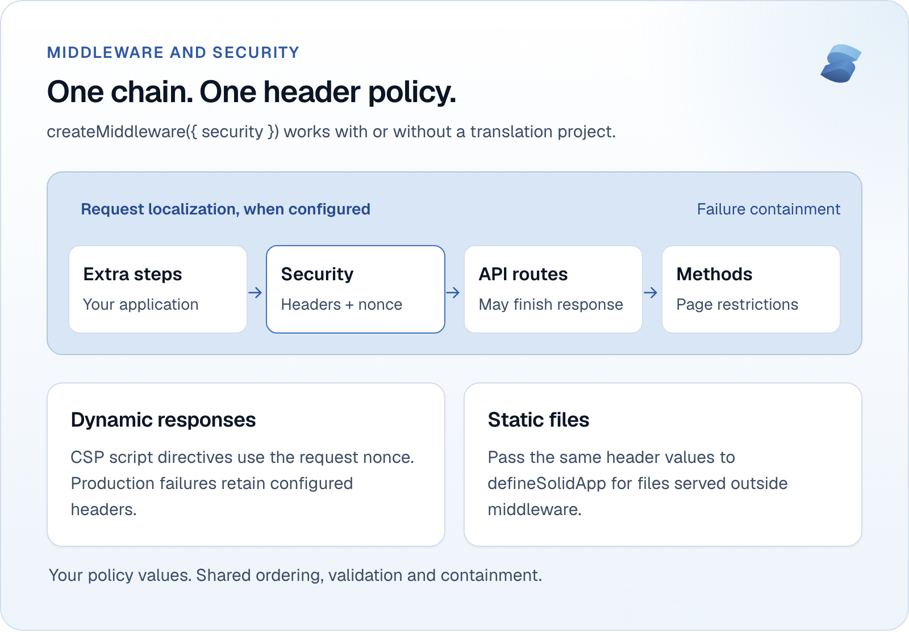
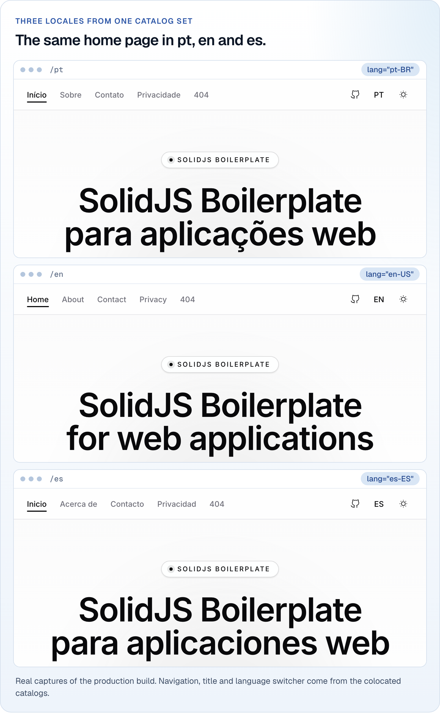
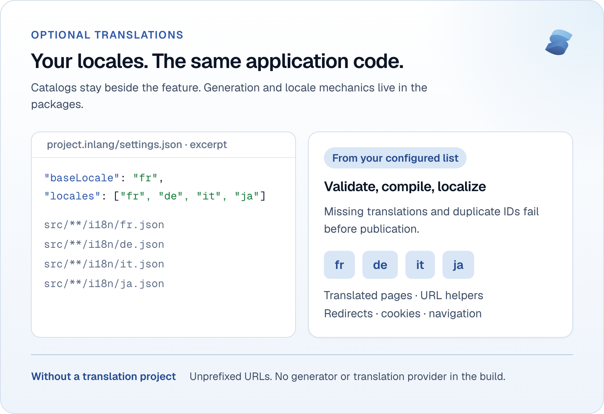
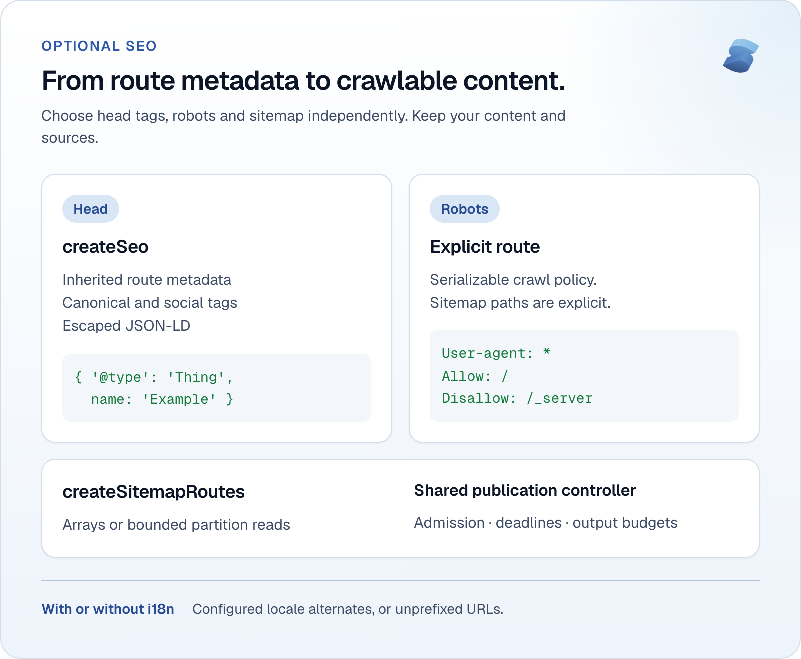
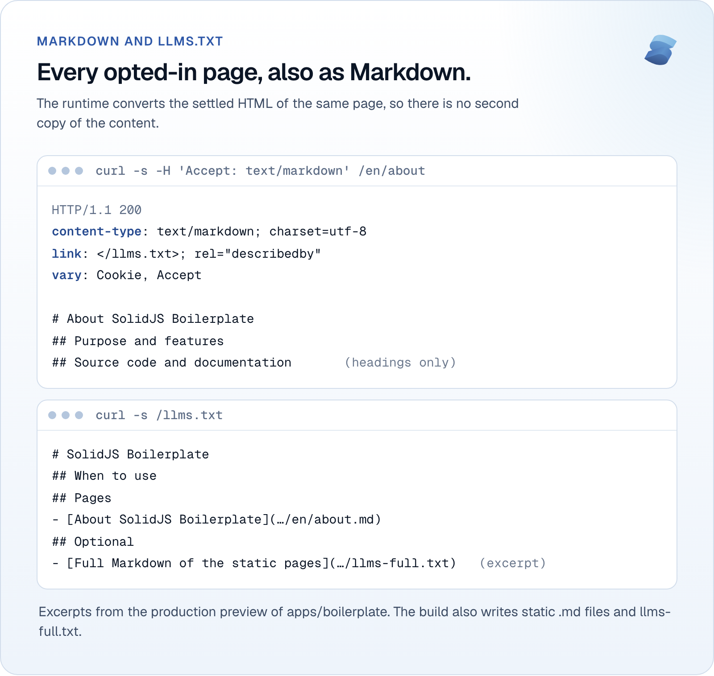
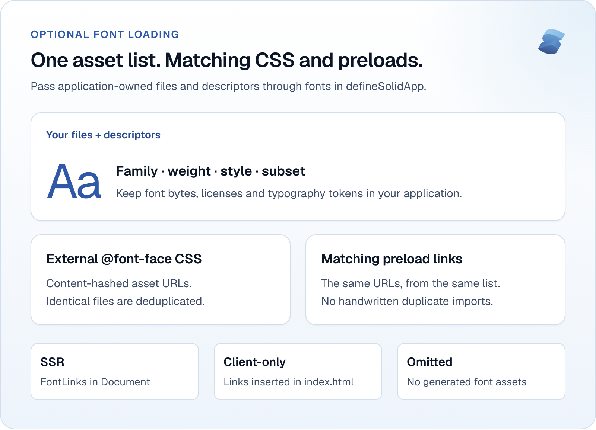

[](https://www.npmjs.com/package/@evertondgn/solid-runtime)
[](https://github.com/everton-dgn/solidjs_base/actions/workflows/ci.yml)
[](docs/entry-points.md#requirements)
[](https://github.com/everton-dgn/solidjs_base/blob/main/LICENSE)

# @evertondgn/solid-runtime

**Security headers with a nonce CSP, private server errors, links that keep the
language, a theme set before hydration, and SEO and Markdown publication for a
SolidJS 2 app, one import at a time.**

The same code comes back in each server-rendered SolidJS app, under its pages: a
Content Security Policy with a nonce, so an injected script without it does not
run, and error responses that keep server details on the server. Many apps also
need links that keep the language, a theme applied before hydration, head tags,
robots.txt and sitemaps for crawlers, and a Markdown copy of each page for
agents. Copied from app to app, that code drifts, and a fix has to be made again
in each one. This package ships it as TypeScript source, in 64 entry points.
Your app imports the ones it uses and keeps its UI, palette, content, messages
and backend adapters.

> The runtime runs under `defineSolidApp`, the preset of
> [`@evertondgn/solid-tooling`](https://github.com/everton-dgn/solidjs_base/blob/main/packages/solid-tooling/README.md):
> 27 of its 64 entries read modules that only the preset serves, and it is not
> tested without it. It pins its `@solidjs/web` peer dependency to the version
> it is tested with, so update both together. Below 1.0.0, a breaking change
> raises the minor version.

## Requirements

| You need       | Solid Base expects                                                                                                                                                                                                            |
| -------------- | ----------------------------------------------------------------------------------------------------------------------------------------------------------------------------------------------------------------------------- |
| Node           | The range in `engines.node` of the [package manifest](package.json), shown by the Node badge above                                                                                                                            |
| The tooling    | `@evertondgn/solid-tooling` as a dev dependency, at the same version: its `defineSolidApp` sets the `solid` export condition and serves the `virtual:solid-app/*` modules ([requirements](docs/entry-points.md#requirements)) |
| Solid          | `@solidjs/web` at the exact version of the `peerDependencies` in the manifest, with `solid-js` and `@solidjs/router` at the same version                                                                                      |
| A host for SSR | Vercel's output format for the server features: the preset's Nitro always uses its `vercel` preset. A client-only build (`ssr: false`) writes a static `dist/` with no server                                                 |

## Install

```bash
vp add -D @evertondgn/solid-tooling
vp add @evertondgn/solid-runtime
```

The runtime ships TypeScript source, compiled by your app with its own Solid
version, plus plain JavaScript for the entries loaded from Node.

## See it work

These two files, trimmed from the
[SSR fixture](https://github.com/everton-dgn/solidjs_base/blob/main/fixtures/apps/ssr-plain/vite.config.ts),
set up the default header policy of the middleware and the headers the preset
gives the static files:

```ts
// vite.config.ts
import { SECURITY_HEADERS } from '@evertondgn/solid-runtime/middleware/security-headers/constants'
import { defineSolidApp } from '@evertondgn/solid-tooling/vite'

export default defineSolidApp({
  root: import.meta.dirname,
  middleware: './src/middleware.ts',
  securityHeaders: SECURITY_HEADERS
})
```

```ts
// src/middleware.ts
import { createMiddleware } from '@evertondgn/solid-runtime/middleware/create-middleware'
import { createSecurityHeaders } from '@evertondgn/solid-runtime/middleware/security-headers'

export default createMiddleware({ security: createSecurityHeaders() })
```

This is the production preview of a copy of that fixture, built with
`vp run build` and the 0.8.0 packages from npm on 2026-11-17. The fixture also
turns on icons, SEO, the server error setup and one extra middleware step. Two
lines are cut from the output: `Vary: Origin`, sent by the preview server, and
`x-scenario-env`, written by the fixture's extra step.

```text
$ vp preview --host 127.0.0.1 --port 4417 --strictPort
$ curl -sI http://127.0.0.1:4417/
HTTP/1.1 200
content-security-policy: default-src 'self'; style-src 'self'; object-src 'none'; base-uri 'self'; form-action 'self'; frame-ancestors 'none'; script-src 'nonce-2Dq3lGgPyraw4bycVilbMw==' 'strict-dynamic'
content-type: text/html; charset=utf-8
cross-origin-embedder-policy: require-corp
cross-origin-opener-policy: same-origin
cross-origin-resource-policy: same-origin
permissions-policy: camera=(), microphone=(), geolocation=()
referrer-policy: strict-origin-when-cross-origin
strict-transport-security: max-age=63072000; includeSubDomains
x-content-type-options: nosniff
x-frame-options: DENY
```

A second request got another nonce (policy shortened):

```text
content-security-policy: ... script-src 'nonce-+tZMQ1+pW8MBtfSu71btKA==' 'strict-dynamic'
```

That is eight security headers and a CSP whose `script-src` holds the nonce of
the request. A script in the page runs only if it carries that nonce; with
`'strict-dynamic'`, the scripts that a nonce-bearing script loads run too. The
development server sends the eight headers without the CSP, so hot module
replacement can inject its styles. The static files that skip the middleware get
three of the same values through `securityHeaders`: `strict-transport-security`,
`x-content-type-options` and `cross-origin-resource-policy`. Everything else on
this page is opt-in.

## What you can import

Each feature is a separate entry. A module enters your bundle only when your
code imports it.

| Your app needs                                          | Import from `@evertondgn/solid-runtime/`                            | Section                                                                                |
| ------------------------------------------------------- | ------------------------------------------------------------------- | -------------------------------------------------------------------------------------- |
| Security headers and a nonce CSP on page responses      | `middleware/create-middleware`, `middleware/security-headers`       | [Every response behind one header policy](#every-response-behind-one-header-policy)    |
| Server failures that keep their details on the server   | `server/configure-server-errors`, `server/protect-server-operation` | [Server failures stay on the server](#server-failures-stay-on-the-server)              |
| Links, redirects and navigation that keep the language  | `i18n/create-localized-navigate`, `i18n/localized-redirect`         | [Links that keep the language](#links-redirects-and-navigation-that-keep-the-language) |
| Light, dark or system theme, set before hydration       | `theme/define-theme`                                                | [The right theme before hydration](#the-right-theme-before-hydration)                  |
| Head tags, JSON-LD and `robots.txt` from route metadata | `seo/create-seo`, `seo/robots-route`                                | [Head tags and robots.txt](#head-tags-and-robotstxt-from-route-metadata)               |
| Each page as Markdown, plus `llms.txt`                  | `seo/markdown`, `seo/llms`                                          | [Each page as Markdown](#each-page-as-markdown-plus-llmstxt)                           |
| Sitemaps held to a deadline and a byte budget           | `seo/sitemap-routes`, `server/publication`                          | [Sitemaps with bounded work](#sitemaps-with-bounded-work)                              |
| Environment values checked at startup                   | `env`                                                               | [Environment values](#environment-values-checked-at-startup)                           |
| Fonts with matching preloads                            | `fonts/font-links`                                                  | [Fonts with matching preloads](#fonts-with-matching-preloads)                          |

[Entry points and requirements](docs/entry-points.md) lists all 64 entries and
the virtual modules each one reads.

## Who it fits

- You build a SolidJS 2 app with the `defineSolidApp` preset and want its
  responses behind a nonce CSP, starting from the two files above.
- Your server functions and API routes call databases or SDKs whose error
  messages must stay on the server.
- Your app has several languages and must keep the current one in links,
  redirects and client navigation. A single-language app uses the same calls
  with no translation project.
- You publish sitemaps, `llms.txt` or a Markdown copy of your pages, and want
  each response held to a deadline and a byte budget.

## Who it does not fit yet

- Your app does not use the tooling preset. 27 of the 64 entries read
  `virtual:solid-app/*` modules that only `defineSolidApp` serves, and the
  runtime is not tested without the preset
  ([what each entry reads](docs/entry-points.md#entry-points)).
- Your server build must target a host other than Vercel's output format. The
  server features run in the server build of the preset, whose Nitro always uses
  the `vercel` preset
  ([known limits of the tooling](https://github.com/everton-dgn/solidjs_base/blob/main/packages/solid-tooling/docs/limits.md#known-limits)).
  A client-only build (`ssr: false`) writes a static `dist/` with no server.
- You cannot pin `@solidjs/web`. It is an exact peer in the
  [package manifest](package.json).
- You run Node older than the `engines.node` floor of the same manifest.
- You need sitemap and Markdown quotas shared by several server processes. Each
  process has its own quotas, and there is no global quota.

## Questions before you adopt it

**Can I use it without the tooling?** Not as a tested setup: the runtime is
built and tested under the tooling preset. A static read of the import graph of
each entry finds 34 entries that import no virtual module, among them the whole
theme, the security headers, the env fragment, `createRobots` and `convertHtml`.
Three more import only the virtual modules of the routing and Solid plugins, and
27 import the `virtual:solid-app/*` modules that `defineSolidApp` serves. No
entry was run without the preset, and the TypeScript entries still need the
`solid` export condition. [Entry points](docs/entry-points.md#entry-points)
marks each entry.

**Do I need translations, a theme or SEO?** No. Each one is a separate import. A
single-language app needs no translation project: the language helpers give one
unprefixed language, `en` unless you set `language` in the preset. A theme or
SEO module enters the bundle only when your code imports it, and the installed
scenarios fail when a disabled theme or translation setup leaves its modules in
the bundle ([How it is tested](#how-it-is-tested)).

**Does it work in an app with no server?** In part. A client-only build
(`ssr: false`) can use the theme with `storage: 'local-storage'`, the language
helpers with one unprefixed language, and fonts, which the preset writes into
`index.html`. The middleware and the server errors need the server build, and
the preset refuses its `seo` option (robots, sitemaps, Markdown and editorial
indexes) together with `ssr: false`. `createSeo` writes head tags and JSON-LD
through `useHead`, and its DOM tests check that output in happy-dom, but no
installed scenario runs it in a client-only build, and a crawler that does not
run JavaScript sees only tags rendered by a server. Translations by URL prefix
need a server too. See
[applications with no server](https://github.com/everton-dgn/solidjs_base/blob/main/docs/tooling/no-server.md).

**What does it add to the production install?** Four production dependencies,
`@mdream/js`, `filesystem-routing`, `schema-dts` and `valibot`, and the
`@solidjs/web` peer. The tarball test fails when a build or test tool such as
`vite`, `vite-plus`, `vitest` or `rolldown` reaches the `dependencies`,
`peerDependencies` or `optionalDependencies` of the published manifest. It does
not follow the dependencies of a dependency.

**How do I update?** Together with the tooling, in one command, as
[Update the packages](#update-the-packages) shows.

**How do I leave?** There is no eject command. Each feature is a separate
import, so you can replace one at a time with your own code.

## Every response behind one header policy

In production, only the scripts that carry the nonce run, and `'strict-dynamic'`
lets them load their modules. An injected `<script>` without the nonce does not
run. JSON, text, XML and redirects get `script-src 'none'`. A policy that a
response cannot carry, such as a duplicate directive or a header value with a
line break, fails when the application starts, before any request. That check
covers the directive names, the shape of each item and whether the policy can be
sent as a header. The application chooses the permitted sources, so
`'unsafe-inline'` in `style-src` passes.

| Header                         | Default                                                                                                                                                                                |
| ------------------------------ | -------------------------------------------------------------------------------------------------------------------------------------------------------------------------------------- |
| `strict-transport-security`    | `max-age=63072000; includeSubDomains`, two years                                                                                                                                       |
| `x-frame-options`              | `DENY`                                                                                                                                                                                 |
| `x-content-type-options`       | `nosniff`                                                                                                                                                                              |
| `referrer-policy`              | `strict-origin-when-cross-origin`                                                                                                                                                      |
| `permissions-policy`           | `camera=(), microphone=(), geolocation=()`                                                                                                                                             |
| `cross-origin-opener-policy`   | `same-origin`                                                                                                                                                                          |
| `cross-origin-embedder-policy` | `require-corp`                                                                                                                                                                         |
| `cross-origin-resource-policy` | `same-origin`                                                                                                                                                                          |
| `content-security-policy`      | `default-src 'self'`, `style-src 'self'`, `object-src 'none'`, `base-uri 'self'`, `form-action 'self'` and `frame-ancestors 'none'`, plus the nonce `script-src`, in production builds |

<picture>
  <source media="(prefers-color-scheme: dark)" srcset="https://raw.githubusercontent.com/everton-dgn/solidjs_base/main/docs/assets/readme/middleware-dark.webp" />
  <source media="(prefers-color-scheme: light)" srcset="https://raw.githubusercontent.com/everton-dgn/solidjs_base/main/docs/assets/readme/middleware-light.webp" />
  
</picture>

`createMiddleware` runs request localization when a translation project exists,
then your `extra` steps, the security headers, the API routes and a `405` for a
method that the page or API route does not accept. Security runs before the API
handlers, which may finish the response. A failure inside the chain is
contained, and in production the failure response keeps the configured headers.
A failure after a Response body was returned stays outside that containment. To
change one value, spread the defaults: see
[Security headers](docs/middleware.md#security-headers) and
[Building the chain](docs/middleware.md#building-the-chain).

## Server failures stay on the server

<picture>
  <source media="(prefers-color-scheme: dark)" srcset="https://raw.githubusercontent.com/everton-dgn/solidjs_base/main/docs/assets/readme/server-errors-dark.webp" />
  <source media="(prefers-color-scheme: light)" srcset="https://raw.githubusercontent.com/everton-dgn/solidjs_base/main/docs/assets/readme/server-errors-light.webp" />
  
</picture>

When a server function, an API route or a render fails in production, the
browser receives a fresh public error with `The request could not be completed.`
or your own translated text. The message, cause and properties of the original
error are not forwarded, and the production log keeps a fixed source line with
the filtered class and frames. Your adapters still choose the fields they
return, and a translated message callback must return public text: the package
cannot detect a secret deliberately embedded in a string. Register the
protection once, in the setup file that `defineSolidApp` points to:

```ts
// vite.config.ts, inside defineSolidApp
serverSetup: './src/infra/server/configureServerErrors/index.ts'
```

```ts
// src/infra/server/configureServerErrors/index.ts
import { configureServerErrors } from '@evertondgn/solid-runtime/server/configure-server-errors'

configureServerErrors()
```

Wrap each backend adapter in `protectServerOperation({ run })`. The boilerplate
app does it in
[`requestJson`](https://github.com/everton-dgn/solidjs_base/blob/main/apps/boilerplate/src/infra/server/requestJson/index.ts),
its only module allowed to call `fetch`. The tooling lint enforces that
boundary: `fetch` outside that file is an error, and the configurator can only
be imported in the setup file. See
[Server error protection](docs/server-errors.md).

## Links, redirects and navigation that keep the language

<picture>
  <source media="(prefers-color-scheme: dark)" srcset="https://raw.githubusercontent.com/everton-dgn/solidjs_base/main/docs/assets/readme/app-locales-dark.webp" />
  <source media="(prefers-color-scheme: light)" srcset="https://raw.githubusercontent.com/everton-dgn/solidjs_base/main/docs/assets/readme/app-locales-light.webp" />
  
</picture>

Links, redirects, client navigation, alternate links and language tags follow
the locale list of your translation project. Navigation keeps relative paths,
query strings, fragments, router state and replace behavior; a change of locale
uses document navigation, and `prepareClientLocale` reloads before hydration
when the loaded locale does not match the URL. Without a translation project,
the same calls give one unprefixed language, `en` unless you set `language`.

```tsx
import { createLocalizedNavigate } from '@evertondgn/solid-runtime/i18n/create-localized-navigate'
import { localeTag } from '@evertondgn/solid-runtime/i18n/locale-tag'

// Inside a component under the Router:
const navigate = createLocalizedNavigate()
const goToGuide = () => navigate({ href: '/guide?q=1#intro' })
const language = localeTag('fr', { fr: 'fr-CA' }) // fr-CA
```

<picture>
  <source media="(prefers-color-scheme: dark)" srcset="https://raw.githubusercontent.com/everton-dgn/solidjs_base/main/docs/assets/readme/i18n-dark.webp" />
  <source media="(prefers-color-scheme: light)" srcset="https://raw.githubusercontent.com/everton-dgn/solidjs_base/main/docs/assets/readme/i18n-light.webp" />
  
</picture>

With `project.inlang/settings.json`, the middleware also redirects to the
localized URL and keeps the choice in a cookie. The runtime reads your locales
through one seam and never imports a translation provider of its own. See
[Locale support](docs/i18n.md) and
[Navigation and language tags](docs/i18n.md#navigation-and-language-tags).

## The right theme before hydration

Light, dark or system. On the server, `readTheme` reads the choice from the
request cookie, and `themeColor` gives the matching `theme-color` for the HTML
class you render. `themeScript` returns the browser code that applies the theme
you pass it and resolves the system preference before hydration; render it
inside a script with the request nonce, which the nonce CSP requires. A choice
made in one tab reaches the others through BroadcastChannel. The choice stays in
a cookie, which the server reads; an app with no server keeps it in localStorage
instead and paints the first frame with `storedThemeScript`, as
[Optional theme](docs/theme.md) shows. With localStorage and SSR, the server
cannot read the choice, so the page shows the default theme until `createTheme`
applies it. One factory, `defineTheme`, binds it all:

```ts
import { defineTheme } from '@evertondgn/solid-runtime/theme/define-theme'

export const { createTheme, readTheme, themeColor, themeScript, defaultTheme, themes } =
  defineTheme({
    cookieName: 'app-theme',
    colors: { light: '#ffffff', dark: '#09090b' }
  })
```

The cookie lasts one year and the default theme is `system`, unless you pass
`cookieMaxAge` or `defaultTheme`.

<picture>
  <source media="(prefers-color-scheme: dark)" srcset="https://raw.githubusercontent.com/everton-dgn/solidjs_base/main/docs/assets/readme/theme-dark.webp" />
  <source media="(prefers-color-scheme: light)" srcset="https://raw.githubusercontent.com/everton-dgn/solidjs_base/main/docs/assets/readme/theme-light.webp" />
  
</picture>

Your app keeps its palette, the `.light` and `.dark` CSS rules, the Provider and
the switcher. See [Optional theme](docs/theme.md).

## Head tags and robots.txt from route metadata

<picture>
  <source media="(prefers-color-scheme: dark)" srcset="https://raw.githubusercontent.com/everton-dgn/solidjs_base/main/docs/assets/readme/seo-dark.webp" />
  <source media="(prefers-color-scheme: light)" srcset="https://raw.githubusercontent.com/everton-dgn/solidjs_base/main/docs/assets/readme/seo-light.webp" />
  
</picture>

`createSeo` turns route metadata into the title, description, canonical link,
language alternates, Open Graph and Twitter tags and JSON-LD. It escapes `<`,
U+2028 and U+2029 before the data reaches the head, so a `</script>` inside a
title cannot close the tag. A `noindex` route publishes only robots, title and
description. robots.txt is one line:

```ts
// src/routes/robots.txt/index.ts
export { GET } from '@evertondgn/solid-runtime/seo/robots-route'
```

Call `createSeo({ route: true, site })` once in the Router's root owner, or
`createSeo({ structuredData })` for JSON-LD alone. The runtime has no example
identities in its defaults: author, organization and social fields appear only
when you pass them. See [Optional SEO](docs/seo.md).

Each page declares its metadata in `route.info.seo`. `title`, `description` and
`image.alt` take a string or a message function, which the runtime calls each
time it resolves the metadata, so `title: m.about_title` follows the locale of
the request without a getter.

## Each page as Markdown, plus llms.txt

<picture>
  <source media="(prefers-color-scheme: dark)" srcset="https://raw.githubusercontent.com/everton-dgn/solidjs_base/main/docs/assets/readme/markdown-llms-dark.webp" />
  <source media="(prefers-color-scheme: light)" srcset="https://raw.githubusercontent.com/everton-dgn/solidjs_base/main/docs/assets/readme/markdown-llms-light.webp" />
  
</picture>

A page that opts in with `info: { markdown: true }` also answers as Markdown, at
its `.md` URL or with `Accept: text/markdown`. The Markdown is converted from
the HTML that the same page rendered, so there is no second copy of the content
to keep in sync. `llms.txt` and `llms-full.txt` give agents an index of those
pages. Each document has a byte budget, and an index over its budget fails
instead of being truncated. The boilerplate app binds both factories:

```ts
// vite.config.ts, inside defineSolidApp
seo: { sitemap: { static: true }, markdown: { static: true }, llms: {}, llmsFull: {} }
```

```ts
// src/middleware/markdownContent/index.ts
export const markdownContent = createMarkdownContent({
  publication,
  router: Router,
  siteUrl: resolveSiteUrl('/'),
  applySecurityHeaders,
  notFoundMessage: () => m.notFound_description()
})
```

```ts
// src/routes/(seo)/llms.txt/index.ts
export const GET = createLlms({
  site: SITE,
  router: Router,
  notes: LLMS_NOTES,
  pages: LLMS_USE_CASES,
  cacheControl: SITE_CACHE_CONTROL,
  fullPage: LLMS_FULL_PAGE
})
```

`markdownContent` goes in the `document` slot of `createMiddleware`, and
`publication` is the controller shared with sitemaps. The boilerplate app's
[complete bindings](https://github.com/everton-dgn/solidjs_base/blob/main/apps/boilerplate/src/middleware/markdownContent/index.ts)
show the imports. See [Markdown and editorial indexes](docs/markdown.md).

## Sitemaps with bounded work

A sitemap index and its parts come from sources you declare, with one entry per
configured locale and `x-default` for the base locale. Every dynamic sitemap and
Markdown response goes through one publication controller with admission slots,
deadlines and byte budgets. Overload answers `503` with `Retry-After: 1`, and an
oversized source answers an empty `503`; neither sends partial XML. These quotas
belong to one server process: there is no global quota across processes. A
source that ignores cancellation keeps its slot until it settles, and an array
source returns its complete list on each request. This source is complete, from
the SSR fixture:

```ts
// src/infra/server/sitemap/index.ts
import 'server-only'
import { origin } from '@evertondgn/solid-runtime/seo/origin'
import { createSitemapRoutes } from '@evertondgn/solid-runtime/seo/sitemap-routes'
import type { SitemapPartitionSource } from '@evertondgn/solid-runtime/seo/sitemap-types'
import { createPublicationController } from '@evertondgn/solid-runtime/server/publication'

const sources: readonly SitemapPartitionSource[] = [
  {
    id: 'articles',
    routePath: '/articles/:id',
    listPartitions: ({ limit, signal }) => {
      signal.throwIfAborted()
      return Promise.resolve(['first'].slice(0, limit))
    },
    readPartition: ({ id, limit, signal }) => {
      signal.throwIfAborted()
      return Promise.resolve(
        id === 'first'
          ? [{ path: '/articles/42', lastmod: '2026-10-01' }].slice(0, limit)
          : []
      )
    }
  }
]
export const { index, pages, array, source } = createSitemapRoutes({
  publication: createPublicationController(),
  sources,
  siteUrl: origin
})
```

```ts
// src/routes/sitemap.xml/index.ts
export { index as GET } from '@/infra/server/sitemap/index.ts'
```

| Default                           | Value                                                       |
| --------------------------------- | ----------------------------------------------------------- |
| Concurrent publications           | 4 in total, 2 per kind                                      |
| Concurrent source reads           | 4 in total, 2 per source                                    |
| Reserved output                   | 16,777,216 bytes (16 MiB) across 4 live outputs             |
| Deadline of a dynamic sitemap     | 10,000 ms                                                   |
| Sitemap response budget           | 4,194,304 bytes (4 MiB)                                     |
| URLs per sitemap, parts per index | 50,000 each, 2,048 characters per location, protocol limits |
| Markdown                          | 2 MiB of HTML in, 2 MiB of Markdown out, 15 seconds         |
| `llms.txt`, `llms-full.txt`       | 1 MiB and 10 MiB                                            |
| Overload                          | `503` with `no-store` and `Retry-After: 1`                  |

The fixture publishes only sitemaps, so it creates its controller inline. Once
sitemaps and Markdown both publish, share one controller between them, as the
boilerplate app does, so the quotas stay where you set them. See
[Sitemap and publication](docs/sitemaps-and-publication.md).

## Environment values checked at startup

An optional `env.ts` reuses the package schemas and adds your own keys. Server
values are validated when the server starts, public values at build time, and
the types are inferred. A server value imported from client code fails the
build, and neither the schemas nor Valibot reach the client bundle.

```ts
// env.ts
import { serverEnv } from '@evertondgn/solid-runtime/env'

const env = { server: { ...serverEnv } }

export default env
```

`HOST`, `PORT` and `BASE_URL_TEST` are optional, and `PORT` becomes an integer
from 0 through 65535. See [Optional environment validation](docs/env.md).

## Fonts with matching preloads

<picture>
  <source media="(prefers-color-scheme: dark)" srcset="https://raw.githubusercontent.com/everton-dgn/solidjs_base/main/docs/assets/readme/fonts-dark.webp" />
  <source media="(prefers-color-scheme: light)" srcset="https://raw.githubusercontent.com/everton-dgn/solidjs_base/main/docs/assets/readme/fonts-light.webp" />
  
</picture>

The tooling preset turns the `fonts` list of `defineSolidApp` into external
`@font-face` CSS and preloads with the same URLs. In a server-rendered app,
`FontLinks` renders both in the Document head:

```tsx
// src/App.tsx, in the SSR fixture
import { FontLinks } from '@evertondgn/solid-runtime/fonts/font-links'

// Inside the Document:
<head>
  <FontLinks />
  <title>Scenario application</title>
</head>
```

Client-only apps get the links in `index.html` with no import. Font files,
licenses and typography tokens stay in your app. See
[Optional fonts](docs/fonts.md).

## Import only what you use

The package has 64 entry points in 8 groups and no barrel: `seo` 15,
`middleware` 12, `server` 12, `theme` 11, `i18n` 10, `routing` 2, `env` 1 and
`fonts` 1, the keys of `exports` in the [package manifest](package.json). A
single-language app needs no translation project, and a theme or SEO module
enters the bundle only when your code imports it. The installed scenarios check
that on real builds ([How it is tested](#how-it-is-tested)).

Of the 64 entries, a static read of the source at commit `4d2c326` finds 34 that
import no virtual module, 3 that import only the virtual modules of the routing
and Solid plugins, and 27 that import `virtual:solid-app/*` modules, which only
`defineSolidApp` serves. No entry was run without the preset.
[Entry points and requirements](docs/entry-points.md) lists every entry by
feature, with the virtual modules in its import graph.

## Update the packages

Update the runtime together with the tooling, in one command:

```bash
vp update -L @evertondgn/solid-tooling @evertondgn/solid-runtime
```

`-L` is needed while the packages are `0.x`. Then align `solid-js`,
`@solidjs/web` and the Solid overrides with the exact `@solidjs/web` peer of the
runtime, as
[Update the packages](https://github.com/everton-dgn/solidjs_base/blob/main/README.md#update-the-packages)
shows, and read the
[changelog](https://github.com/everton-dgn/solidjs_base/blob/main/packages/solid-runtime/CHANGELOG.md).
Do not raise `solid-js` with `-L`: the newest Solid release can be newer than
the one the packages were tested with.

## How it is tested

In the CI run of the 0.10.0 release pull request
([run 44206537981](https://github.com/everton-dgn/solidjs_base/actions/runs/44206537981)),
the
[Packages job](https://github.com/everton-dgn/solidjs_base/actions/runs/44206537981/job/134474054049)
ran `vp run validate`, the same checks as the publish job. For this package, it
executed:

- 1,047 Vitest tests in 104 files, all passed: 934 tests in 86 files of the
  `node` project, 111 in 17 files of `dom`, with happy-dom, and 2 in 1 file of
  `browser`, with Chromium. Coverage was 97.46% of statements, 94.87% of
  branches, 98.79% of functions and 98.46% of lines.
- 6 tarball tests, all passed. They pack the package, install it in a temporary
  folder and check that the header constants and the stored theme script load in
  plain Node, that every target of `exports` is in the tarball, that no test
  folder is published and that no build tool is in a production section of the
  manifest.
- The installed application scenarios, which install the packed tooling, runtime
  and icons plugin in the
  [three fixture applications](https://github.com/everton-dgn/solidjs_base/tree/main/fixtures/apps)
  with Bun's `hoisted` and `isolated` linkers, build them and audit the bundles
  and server boundaries. All 14 application cases passed. They fail when a
  disabled theme or translation setup leaves its modules in the bundle, or when
  a client-only build loads Nitro. In the same log, an SSR case with an invalid
  `PORT` stops at boot, as expected:
  `Expected boot failure: server env validation failed at boot`. The
  [tooling package](https://github.com/everton-dgn/solidjs_base/blob/main/packages/solid-tooling/README.md#how-it-is-tested)
  lists the cases.

The runtime tests use their own de/fr/ja Paraglide project, generated before
each run and left out of the tarball and coverage; the installed scenarios test
the real providers of the fixture applications. The package is also linted as an
application with the lint preset of the tooling package, and Knip checks its
`exports` for unused code. See the
[development guide](https://github.com/everton-dgn/solidjs_base/blob/main/docs/development.md)
and the
[installed scenarios decision](https://github.com/everton-dgn/solidjs_base/blob/main/docs/ADRs/0021-installed-application-scenarios.md).

The release workflow publishes through npm trusted publishing, with npm
provenance (an SLSA v1 provenance statement) that names the commit and the
workflow run that built each version. `npm audit signatures`, run in your
application, checks the registry signatures and attestations of the installed
packages. The first version of each package was published by hand and has no
provenance statement
([security policy](https://github.com/everton-dgn/solidjs_base/blob/main/SECURITY.md)).

## Known limits

- `createSecurityHeaders` checks the directive names, the shape of each item and
  whether the policy can be sent as a header, not the sources you allow, and it
  does not refuse a second instance ([Limits](docs/middleware.md#limits)).
- The package cannot detect a secret deliberately embedded in a public string,
  and a failure after a Response body was returned stays outside the containment
  ([Server error protection](docs/server-errors.md),
  [Building the chain](docs/middleware.md#building-the-chain)).
- Publication quotas belong to one process, a source that ignores cancellation
  keeps its slot until it settles, process caches are not persistent storage,
  and an array source returns its complete list
  ([Sitemap and publication](docs/sitemaps-and-publication.md)).
- `themeScript` applies the theme you pass it and needs the request nonce when
  it runs inline under the nonce CSP. With `storage: 'local-storage'` and SSR,
  the page shows the default theme until `createTheme` applies the choice
  ([Optional theme](docs/theme.md)).
- Direct imports of `middleware/localize-request` need a translation project.
  Without one, its functions throw an error that names
  `project.inlang/settings.json`
  ([Locale request middleware](docs/i18n.md#locale-request-middleware)).
- The package converts Markdown with the published `@mdream/js`. The patch that
  the boilerplate app applies to it is not shipped
  ([Markdown and editorial indexes](docs/markdown.md)).

## Reference

The reference ships in this package, in [`docs/`](docs/README.md), so
`node_modules/@evertondgn/solid-runtime/docs/` holds the reference of the
version your app installed.

- [Runtime reference, by task](docs/README.md)
- [Entry points and requirements](docs/entry-points.md)
- [Middleware and security headers](docs/middleware.md)
- [Server error protection](docs/server-errors.md)
- [Locale support](docs/i18n.md)
- [Optional theme](docs/theme.md)
- [Optional SEO](docs/seo.md)
- [Markdown and editorial indexes](docs/markdown.md)
- [Sitemap and publication](docs/sitemaps-and-publication.md)
- [Optional environment validation](docs/env.md)
- [Optional fonts](docs/fonts.md)

## Versions and license

The package follows semantic versioning. Below 1.0.0, a breaking change raises
the minor version. Read the
[changelog](https://github.com/everton-dgn/solidjs_base/blob/main/packages/solid-runtime/CHANGELOG.md)
for each release, and the
[Solid Base overview](https://github.com/everton-dgn/solidjs_base/blob/main/README.md)
for the three packages together.

[MIT](https://github.com/everton-dgn/solidjs_base/blob/main/LICENSE)
