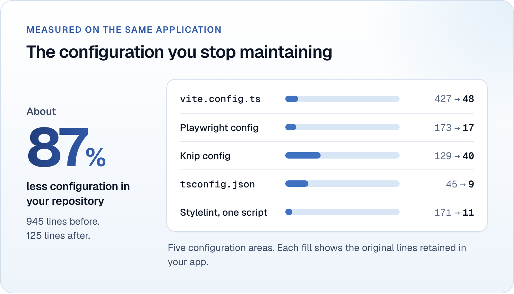
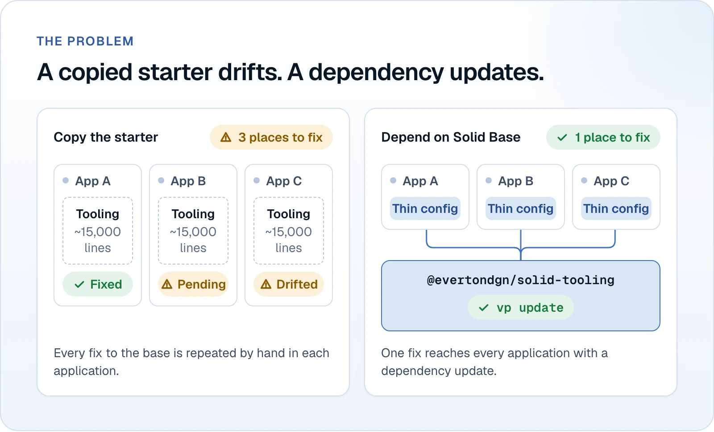
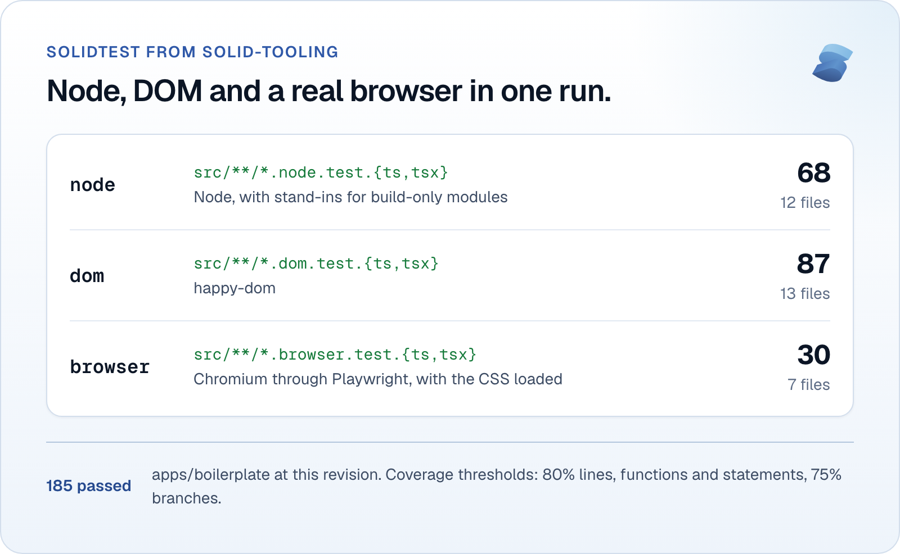
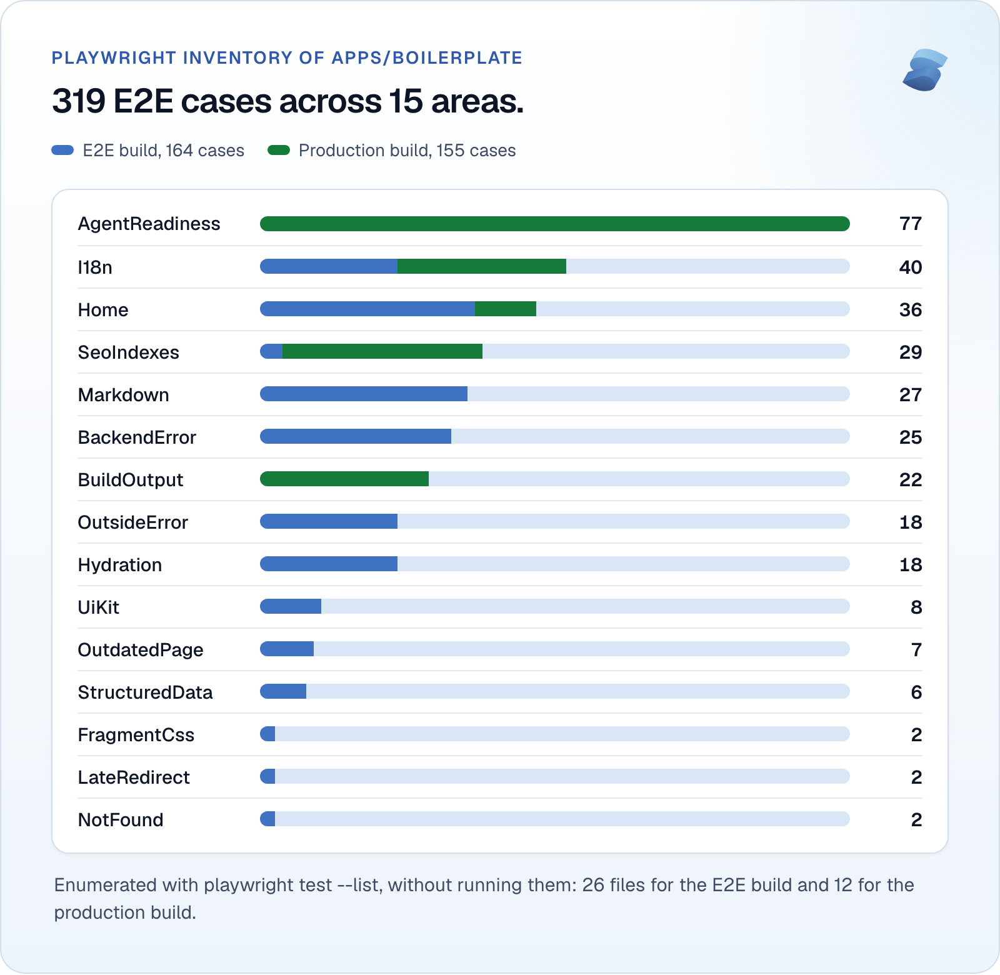
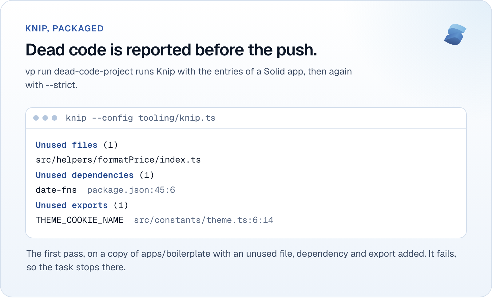
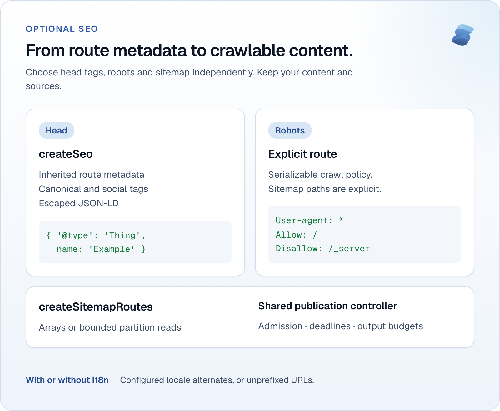

[](https://www.npmjs.com/package/@evertondgn/solid-tooling)
[](https://github.com/everton-dgn/solidjs_base/actions/workflows/ci.yml)
[](https://github.com/everton-dgn/solidjs_base/blob/main/LICENSE)

# @evertondgn/solid-tooling

<picture>
  <source media="(prefers-color-scheme: dark)" srcset="https://raw.githubusercontent.com/everton-dgn/solidjs_base/main/docs/assets/readme/hero-dark.webp" />
  <source media="(prefers-color-scheme: light)" srcset="https://raw.githubusercontent.com/everton-dgn/solidjs_base/main/docs/assets/readme/hero-light.webp" />
  
</picture>

**The lint rules, tests, Git hooks and whole Vite+ config of your SolidJS 2
apps, as one dev dependency.**

Applications copied from a starter carry its tooling with them, and every fix to
the base has to be repeated by hand in each copy. This package holds that
tooling: an Oxlint preset with rules for your project layout, Oxfmt, TypeScript
configs, three Vitest projects, Playwright, Knip, a Stylelint policy,
commitlint, Git hooks and `defineSolidApp`, which returns the whole
`vite.config.ts` of a [Vite+](https://viteplus.dev/guide/) application. The fix
arrives when you update the dependency.

> SolidJS 2 is still a release candidate. The package is tested with
> `2.0.0-rc.22`, and its Solid, Nitro, router and icon plugins are pinned to the
> versions tested together. A new version of one of them needs a package version
> tested with it.

```bash
vp add -D @evertondgn/solid-tooling
```

Built for applications that follow the
[boilerplate_solidjs](https://github.com/everton-dgn/boilerplate_solidjs)
layout. Start with lint and formatting in your existing Vite+ config, and adopt
the full application config when you are ready.

| Package                                                                                                                                   | Role                                                                                   |
| ----------------------------------------------------------------------------------------------------------------------------------------- | -------------------------------------------------------------------------------------- |
| [`@evertondgn/solid-tooling`](https://github.com/everton-dgn/solidjs_base/blob/main/packages/solid-tooling/README.md)                     | Config, lint rules, tests, Git hooks, catalog generation, icons and fonts              |
| [`@evertondgn/solid-runtime`](https://github.com/everton-dgn/solidjs_base/blob/main/packages/solid-runtime/README.md)                     | Security headers, server errors, locale, theme, SEO, sitemaps, Markdown, env and fonts |
| [`@evertondgn/vite-plugin-solid-icons`](https://github.com/everton-dgn/solidjs_base/blob/main/packages/vite-plugin-solid-icons/README.md) | The icons plugin that this package loads                                               |

[Quick start](#quick-start) ·
[Less config](#the-configuration-you-stop-maintaining) ·
[Fewer dependencies](#fewer-tool-versions-in-each-manifest) ·
[App config](#your-application-config-in-one-call) ·
[Lint](#lint-rules-that-know-your-project) ·
[Tests](#tests-in-the-environment-each-one-needs) ·
[E2E](#end-to-end-tests-against-a-real-build) ·
[Knip](#unused-files-exports-and-dependencies) ·
[CSS](#a-css-policy-built-on-tokens) · [Hooks](#commit-messages-and-git-hooks) ·
[Entry points](#entry-points)

## Requirements

Install the exact Vite+ version listed in the package's `peerDependencies`. The
package supplies its build, test, type-check and hook tools. Applications keep
their own direct imports and the Vite+ overrides; see the
[dependency requirements](https://github.com/everton-dgn/solidjs_base/blob/main/docs/tooling/limits.md#requirements).
An application with translations also installs the required version of
`@inlang/paraglide-js` and its message-format plugin.

## Quick start

Add `fmt` and `lint` to your existing Vite+ config. The example shows only those
settings; keep your plugins and other options:

```ts
import { fmt } from '@evertondgn/solid-tooling/fmt'
import { lint } from '@evertondgn/solid-tooling/lint'
import { defineConfig } from 'vite-plus'

export default defineConfig({ fmt, lint })
```

In `tsconfig.json`:

```json
{
  "extends": "@evertondgn/solid-tooling/tsconfig.base.json",
  "compilerOptions": {
    "paths": { "@/*": ["./src/*"] }
  },
  "include": ["src", "vite.config.ts"]
}
```

Check your code and format your files:

```bash
vp check
vp fmt
```

To see a rule of the package fire, create `src/helpers/export-list.ts`:

```ts
const example = 1

export { example }
```

Run `vp lint`. The preset reports the export list:

```text
src/helpers/export-list.ts:3:1: error project(no-export-list): Export on the declaration itself (export function, export const, export type) instead of using export { ... }. An export list is only allowed in a re-export with from.
```

<picture>
  <source media="(prefers-color-scheme: dark)" srcset="https://raw.githubusercontent.com/everton-dgn/solidjs_base/main/docs/assets/readme/first-result-dark.webp" />
  <source media="(prefers-color-scheme: light)" srcset="https://raw.githubusercontent.com/everton-dgn/solidjs_base/main/docs/assets/readme/first-result-light.webp" />
  
</picture>

Replace the list with `export const example = 1` and the rule passes. `fmt` sets
80 columns, single quotes, no semicolons, no trailing commas, wrapped Markdown
prose and sorted imports. See the
[formatter](https://github.com/everton-dgn/solidjs_base/blob/main/docs/tooling/typescript-and-format.md#formatter)
and the
[TypeScript configs](https://github.com/everton-dgn/solidjs_base/blob/main/docs/tooling/typescript-and-format.md#typescript-base).

## The configuration you stop maintaining

<picture>
  <source media="(prefers-color-scheme: dark)" srcset="https://raw.githubusercontent.com/everton-dgn/solidjs_base/main/docs/assets/readme/before-after-dark.webp" />
  <source media="(prefers-color-scheme: light)" srcset="https://raw.githubusercontent.com/everton-dgn/solidjs_base/main/docs/assets/readme/before-after-light.webp" />
  
</picture>

The original starter kept 945 lines of configuration in five areas. The same
application on this package keeps 125, about 87% fewer. The shared
implementation lives in the package, where one fix serves every application.

| Configuration                                                                                                   | Original lines | With the package |
| --------------------------------------------------------------------------------------------------------------- | -------------: | ---------------: |
| [Vite](https://github.com/everton-dgn/solidjs_base/blob/main/apps/boilerplate/vite.config.ts)                   |            427 |               48 |
| [Playwright](https://github.com/everton-dgn/solidjs_base/blob/main/apps/boilerplate/playwright.config.ts)       |            173 |               17 |
| [Knip](https://github.com/everton-dgn/solidjs_base/blob/main/apps/boilerplate/tooling/knip.ts)                  |            129 |               40 |
| [TypeScript](https://github.com/everton-dgn/solidjs_base/blob/main/apps/boilerplate/tsconfig.json)              |             45 |                9 |
| [Stylelint caller](https://github.com/everton-dgn/solidjs_base/blob/main/apps/boilerplate/tooling/css/check.ts) |            171 |               11 |

Counts include blank lines and comments. The baseline is the
[original starter at 6145493](https://github.com/everton-dgn/boilerplate_solidjs/tree/61454937472d0faa1b4fab985fd7c5da968aa9a6),
whose Playwright and Stylelint configs lived in `tooling/playwright.ts` and
`tooling/css/stylelint.config.mjs`. Compare its
[`vite.config.ts`](https://github.com/everton-dgn/boilerplate_solidjs/blob/61454937472d0faa1b4fab985fd7c5da968aa9a6/vite.config.ts)
with the application's. The Stylelint replacement is an application script that
calls the packaged policy.

<picture>
  <source media="(prefers-color-scheme: dark)" srcset="https://raw.githubusercontent.com/everton-dgn/solidjs_base/main/docs/assets/readme/fix-once-dark.webp" />
  <source media="(prefers-color-scheme: light)" srcset="https://raw.githubusercontent.com/everton-dgn/solidjs_base/main/docs/assets/readme/fix-once-light.webp" />
  
</picture>

## Fewer tool versions in each manifest

<picture>
  <source media="(prefers-color-scheme: dark)" srcset="https://raw.githubusercontent.com/everton-dgn/solidjs_base/main/docs/assets/readme/libraries-dark.webp" />
  <source media="(prefers-color-scheme: light)" srcset="https://raw.githubusercontent.com/everton-dgn/solidjs_base/main/docs/assets/readme/libraries-light.webp" />
  
</picture>

The package installs the build, test, type-check and hook tools it calls, at the
versions it tests, and runs them from its own installation, including with Bun's
isolated linker. Your manifest keeps only what your own code imports, plus Vite+
and its Vite alias.

| Application                                                                                                 | Direct declarations before | Now | Fewer |
| ----------------------------------------------------------------------------------------------------------- | -------------------------: | --: | ----: |
| [Boilerplate copy](https://github.com/everton-dgn/solidjs_base/blob/main/apps/boilerplate/package.json)     |                         28 |  14 |    14 |
| [Client-only](https://github.com/everton-dgn/solidjs_base/blob/main/fixtures/apps/client-only/package.json) |                         16 |   6 |    10 |
| [SSR plain](https://github.com/everton-dgn/solidjs_base/blob/main/fixtures/apps/ssr-plain/package.json)     |                         17 |   5 |    12 |
| [SSR i18n](https://github.com/everton-dgn/solidjs_base/blob/main/fixtures/apps/ssr-i18n/package.json)       |                         19 |   7 |    12 |
| [Lint consumer](https://github.com/everton-dgn/solidjs_base/blob/main/fixtures/consumer/package.json)       |                          6 |   3 |     3 |

Counts combine `dependencies` and `devDependencies`, without overrides or
transitive packages. The fixture counts leave out the two package tarballs that
the installed test harness adds. The client-only fixture now declares an Iconify
collection, which the count before did not have.

Fewer declarations do not mean a smaller install. The tooling also installs the
tools of features you may not use: in the
[measurement of that decision](https://github.com/everton-dgn/solidjs_base/blob/main/docs/ADRs/0027-packaged-tool-dependencies.md),
the `node_modules` of a fresh client-only application grew by 8.41% with the
hoisted linker and 8.69% with the isolated one. Build audits check that these
tools stay out of the application bundles.

## Your application config in one call

With the application dependencies installed, `defineSolidApp()` supplies the
plugins, build settings, tasks, lint, format and three Vitest projects:

```ts
import { defineSolidApp } from '@evertondgn/solid-tooling/vite'

import { SECURITY_HEADERS } from './src/middleware/securityHeaders/constants.ts'

export default defineSolidApp({
  root: import.meta.dirname,
  middleware: './src/middleware/index.ts',
  securityHeaders: SECURITY_HEADERS
})
```

That call registers the Solid plugin with SSR and server functions, file-system
routing with route types, icons, Nitro with the Vercel preset, the headers of
the static files, Lightning CSS with content-hashed CSS Modules class names, and
the dev server and preview on the `HOST` and `PORT` of `.env`. You keep your
middleware and header values. The plugins are package dependencies pinned to the
tested versions.

<picture>
  <source media="(prefers-color-scheme: dark)" srcset="https://raw.githubusercontent.com/everton-dgn/solidjs_base/main/docs/assets/readme/only-what-you-use-dark.webp" />
  <source media="(prefers-color-scheme: light)" srcset="https://raw.githubusercontent.com/everton-dgn/solidjs_base/main/docs/assets/readme/only-what-you-use-light.webp" />
  
</picture>

Each feature turns on only when the application uses it:

| Feature             | Selection                                                                                                                                                  |
| ------------------- | ---------------------------------------------------------------------------------------------------------------------------------------------------------- |
| Client-only build   | Set `ssr: false` and omit SSR options such as `middleware` and `securityHeaders`; the build has no Nitro or server bundle and accepts a relative `./` base |
| Publication headers | Set `seo.markdown`, `seo.llms` and `seo.sitemap` one by one; `seo.llmsFull` also needs `seo.llms` and `seo.markdown.static`                                |
| Translations        | `project.inlang/settings.json` enables the generation task and browser test setup; the lint plugin loads only where Paraglide resolves                     |

When the standard does not fit, change it without a fork: `extend` adds plugins
and Nitro modules, `tasks` adds or replaces a `vp run` task, `routeRules`,
`publicAssets` and `staticPaths` adjust Nitro and the static headers,
`workspace` places the app in a monorepo, and `mergeConfig` merges anything else
over the result.

The preset also defines the `vp run` tasks of the boilerplate layout:
`i18n-generate`, `icons-generate`, `lint-css`, `dead-code-project`,
`lint-project`, `check-project`, `typecheck-node` and `test-tooling`. The
`knip`, `tsc`, `playwright`, `lefthook` and `commitlint` tasks run the
package-owned binaries, including with an isolated installation. See
[all options and extension points](https://github.com/everton-dgn/solidjs_base/blob/main/docs/tooling/app-config.md)
and the
[known limits](https://github.com/everton-dgn/solidjs_base/blob/main/docs/tooling/limits.md#known-limits).

## Lint rules that know your project

The preset turns on the Oxlint plugins `import`, `jsx-a11y`, `node`, `oxc`,
`promise`, `typescript`, `unicorn` and `vitest`, the `solid` and `vite-plus`
plugins and three plugins of this package, plus `paraglide` when it resolves.
Type-aware rules and type checking are on. Warnings fail the run, and an unused
disable directive is an error. Every rule is listed by name, so an Oxlint update
does not add rules on its own.

The rules of this package catch what a generic preset cannot see:

| Rule                         | What it enforces                                                                                    |
| ---------------------------- | --------------------------------------------------------------------------------------------------- |
| `project/css-modules-import` | A CSS Module is imported as the default binding `S`                                                 |
| `project/css-filename`       | A CSS file is named `styles.module.css`, or `camelCase.css` inside `src/theme/`                     |
| `project/test-filename`      | A test sits in `__tests__` next to its module, named after it and its environment                   |
| `project/no-export-list`     | Exports sit on the declaration                                                                      |
| `project/seo-module`         | A route `seo.ts` exports only `seo` and imports no route values                                     |
| `architecture/layer-imports` | Lower layers do not import upper ones, and production code does not import tests or `tooling/`      |
| `backend/*`                  | No `console`, `fetch` only in `requestJson`, no Node transports, no `node_modules` paths in imports |

<picture>
  <source media="(prefers-color-scheme: dark)" srcset="https://raw.githubusercontent.com/everton-dgn/solidjs_base/main/docs/assets/readme/layers-dark.webp" />
  <source media="(prefers-color-scheme: light)" srcset="https://raw.githubusercontent.com/everton-dgn/solidjs_base/main/docs/assets/readme/layers-light.webp" />
  
</picture>

The layer rule keeps the dependency direction of the UI. The base layer
(`@types`, `constants`, `helpers`, `data`, `infra`, `theme`, `i18n` and
`paraglide/`) imports no primitives, components, routes or entry files.
Primitives import no components or routes. Atoms do not import molecules or
organisms, and molecules do not import organisms. An import in the wrong
direction fails `vp lint` before review.

The backend rules keep outgoing requests in one module. Inside `src/`, `fetch`,
`XMLHttpRequest`, `WebSocket` and `EventSource` are refused outside
`src/infra/server/requestJson/index.ts`, `console` is refused, and the server
error configurator can only be imported in its setup file. See
[all rules and customization](https://github.com/everton-dgn/solidjs_base/blob/main/docs/tooling/lint.md).

## Tests in the environment each one needs

<picture>
  <source media="(prefers-color-scheme: dark)" srcset="https://raw.githubusercontent.com/everton-dgn/solidjs_base/main/docs/assets/readme/vitest-projects-dark.webp" />
  <source media="(prefers-color-scheme: light)" srcset="https://raw.githubusercontent.com/everton-dgn/solidjs_base/main/docs/assets/readme/vitest-projects-light.webp" />
  
</picture>

The file name picks the environment, so a server test, a component test and a
real-browser test live in the same repository with no extra config. In the
boilerplate, `vp test run` passed 185 tests in 32 files: 68 `node` tests in 12
files, 87 `dom` in 13 and 30 `browser` in 7.

| Project   | Files                            | Environment                                      |
| --------- | -------------------------------- | ------------------------------------------------ |
| `node`    | `src/**/*.node.test.{ts,tsx}`    | Node, with stand-ins for the build-only modules  |
| `dom`     | `src/**/*.dom.test.{ts,tsx}`     | happy-dom, at the URL of `domUrl`                |
| `browser` | `src/**/*.browser.test.{ts,tsx}` | Chromium through Playwright, with the CSS loaded |

The preset sets coverage thresholds of 80% for lines, functions and statements
and 75% for branches, the reporters and the CI workers. It resets the Paraglide
locale before each browser test and resolves packages that ship TypeScript
source, such as the runtime, under the `solid` condition. `defineSolidApp`
already calls `solidTest`; an application with its own Vite config imports it
from `./vitest`. See
[Vitest and Playwright](https://github.com/everton-dgn/solidjs_base/blob/main/docs/tooling/testing.md).

## End-to-end tests against a real build

<picture>
  <source media="(prefers-color-scheme: dark)" srcset="https://raw.githubusercontent.com/everton-dgn/solidjs_base/main/docs/assets/readme/e2e-coverage-dark.webp" />
  <source media="(prefers-color-scheme: light)" srcset="https://raw.githubusercontent.com/everton-dgn/solidjs_base/main/docs/assets/readme/e2e-coverage-light.webp" />
  
</picture>

`definePlaywrightConfig` reads `BASE_URL_TEST` from `.env.test`, builds the
application, starts the preview and runs the suite against it: `e2e` mode for
the fixture routes, or the production build with `TEST_PRODUCTION_ROUTES=true`.
`TEST_PREBUILT=true` reuses an existing production build. Serial suites run in
their own projects: `markdown` with one worker, `publicationLoad` alone against
two servers, and `serverLogs` last, as the teardown of the others.

When the suite ends, `./playwright-teardown` checks the server log for private
markers, so a test run also fails when a server error leaks its details into the
log.

In the boilerplate, `vp run playwright test --list` counts 319 cases in 15 page
areas, 164 in 26 files for the E2E build and 155 in 12 files for the production
build; the figure above breaks them down by area.

```ts
// playwright.config.ts
import { definePlaywrightConfig } from '@evertondgn/solid-tooling/playwright'

export default definePlaywrightConfig({ root: import.meta.dirname })
```

## Unused files, exports and dependencies

<picture>
  <source media="(prefers-color-scheme: dark)" srcset="https://raw.githubusercontent.com/everton-dgn/solidjs_base/main/docs/assets/readme/dead-code-dark.webp" />
  <source media="(prefers-color-scheme: light)" srcset="https://raw.githubusercontent.com/everton-dgn/solidjs_base/main/docs/assets/readme/dead-code-light.webp" />
  
</picture>

A helper nobody calls, an export nobody imports and a dependency nobody uses
stop the push, and the report says where each one is. `defineKnipConfig` from
`./knip` gives Knip the entries of a Solid app: the server and client entries,
the middleware, `env.ts`, the Paraglide runtime, and every page and HTTP handler
that file-system routing finds. It turns off Knip's own routing plugin, which
takes every file of `src/routes/` as an entry, so an unused helper next to a
route is reported. Configuration hints are errors, and
`vp run dead-code-project` runs Knip twice, the second time with `--strict`. The
`pre-push` hook below runs it before the code leaves your machine.

```ts
// tooling/knip.ts
import path from 'node:path'

import { defineKnipConfig } from '@evertondgn/solid-tooling/knip'

export default defineKnipConfig({
  root: path.resolve(import.meta.dirname, '..'),
  ignoreDependencies: ['server-only']
})
```

## A CSS policy built on tokens

<picture>
  <source media="(prefers-color-scheme: dark)" srcset="https://raw.githubusercontent.com/everton-dgn/solidjs_base/main/docs/assets/readme/css-tokens-dark.webp" />
  <source media="(prefers-color-scheme: light)" srcset="https://raw.githubusercontent.com/everton-dgn/solidjs_base/main/docs/assets/readme/css-tokens-light.webp" />
  
</picture>

Outside `src/theme/`, colors, gradients, radii, shadows, font sizes and weights
and `z-index` must come from tokens with `var()`, from the matching token
family. A literal color is an error, so the palette is defined in the theme
files. Inside `src/theme/`, the theme defines the values with `oklch()`,
`oklab()`, `color-mix()` and `light-dark()`.

The policy also requires snake_case classes and at most two levels of nesting,
refuses unknown properties, values, units and selectors, checks that each
`var()` resolves to a token file, and accepts an exception only with a
`stylelint-disable` comment that gives the reason. `checkCss(root)` from
`./stylelint` runs it and checks CSS file names; the boilerplate's caller has 11
lines. The boilerplate's token files define 36 color, 11 font, 7 shadow, 6 grid,
5 radius and 3 z-index custom properties. See
[Knip and CSS](https://github.com/everton-dgn/solidjs_base/blob/main/docs/tooling/knip-and-css.md).

## Commit messages and Git hooks

<picture>
  <source media="(prefers-color-scheme: dark)" srcset="https://raw.githubusercontent.com/everton-dgn/solidjs_base/main/docs/assets/readme/git-hooks-dark.webp" />
  <source media="(prefers-color-scheme: light)" srcset="https://raw.githubusercontent.com/everton-dgn/solidjs_base/main/docs/assets/readme/git-hooks-light.webp" />
  
</picture>

The shared hooks check a change before it reaches the remote:

| Hook         | Jobs                                                                                                                                                 |
| ------------ | ---------------------------------------------------------------------------------------------------------------------------------------------------- |
| `commit-msg` | `commitlint` on the message                                                                                                                          |
| `pre-commit` | `check:fix` on the staged files, staged again after the fix, and `scan:secrets --staged` when `kingfisher` is installed. Skipped in merge and rebase |
| `pre-push`   | `check:ci`, `typecheck:node` and `test:ci` in order, then `test:tooling` and `dead-code` together; the first failure stops                           |

`./commitlint` applies the Conventional Commits rules with the header limited to
100 characters and a blank line before the footer. Lefthook and the commitlint
CLI come with the package, so the application declares neither. Extend the
shared file from `.lefthook.yml`, and override a shared job by name in
`lefthook-local.yml`, committed for everyone or kept on one machine:

```yaml
# .lefthook.yml
extends:
  - node_modules/@evertondgn/solid-tooling/lefthook.yml
```

See
[Commit messages and Git hooks](https://github.com/everton-dgn/solidjs_base/blob/main/docs/tooling/commits-and-hooks.md).

## Translations, icons and fonts as data

<picture>
  <source media="(prefers-color-scheme: dark)" srcset="https://raw.githubusercontent.com/everton-dgn/solidjs_base/main/docs/assets/readme/i18n-dark.webp" />
  <source media="(prefers-color-scheme: light)" srcset="https://raw.githubusercontent.com/everton-dgn/solidjs_base/main/docs/assets/readme/i18n-light.webp" />
  
</picture>

With `project.inlang/settings.json`, the packaged generator reads the catalogs
beside each feature, `src/**/i18n/<locale>.json`, and compiles Paraglide in
development, builds and tests. A missing translation, a duplicate ID or an
invalid message fails with the file and the key. The locales come from your
settings, with no fixed set. Without the file, no generator or i18n plugin
enters the build.

<picture>
  <source media="(prefers-color-scheme: dark)" srcset="https://raw.githubusercontent.com/everton-dgn/solidjs_base/main/docs/assets/readme/icons-dark.webp" />
  <source media="(prefers-color-scheme: light)" srcset="https://raw.githubusercontent.com/everton-dgn/solidjs_base/main/docs/assets/readme/icons-light.webp" />
  
</picture>

Icons from Iconify collections, or your own SVG folders mapped with the `icons`
option, become Solid components through
[`@evertondgn/vite-plugin-solid-icons`](https://github.com/everton-dgn/solidjs_base/blob/main/packages/vite-plugin-solid-icons/README.md),
with `aria-hidden` on every icon. Import an icon as `icon:<collection>/<name>`,
or by its name from `icon:<collection>`. The `icons-generate` task writes the
typed names to `src/icon-collections.d.ts` before the check and the lint; keep
that generated file out of Git. The application does not declare the plugin. An
application that imports `~icons/` follows
[the migration from `~icons/`](https://github.com/everton-dgn/solidjs_base/blob/main/docs/tooling/app-config.md#migrating-from-icons).

<picture>
  <source media="(prefers-color-scheme: dark)" srcset="https://raw.githubusercontent.com/everton-dgn/solidjs_base/main/docs/assets/readme/fonts-dark.webp" />
  <source media="(prefers-color-scheme: light)" srcset="https://raw.githubusercontent.com/everton-dgn/solidjs_base/main/docs/assets/readme/fonts-light.webp" />
  
</picture>

Pass a data-only `fonts` array to `defineSolidApp` to generate external
`@font-face` CSS and matching preloads for application-owned files. SSR uses
`FontLinks` from `@evertondgn/solid-runtime/fonts/font-links` in the Document
head; client-only applications receive both links in `index.html`, also with a
relative `./` base for `file://` and app shells. Leave `fonts` out and nothing
is generated. Typography tokens stay in the app. See the
[font API and migration examples](https://github.com/everton-dgn/solidjs_base/blob/main/docs/tooling/fonts.md).

## SEO configured as data

<picture>
  <source media="(prefers-color-scheme: dark)" srcset="https://raw.githubusercontent.com/everton-dgn/solidjs_base/main/docs/assets/readme/seo-dark.webp" />
  <source media="(prefers-color-scheme: light)" srcset="https://raw.githubusercontent.com/everton-dgn/solidjs_base/main/docs/assets/readme/seo-light.webp" />
  
</picture>

Robots, sitemap headers, Markdown and the llms indexes are options of
`defineSolidApp` written as plain data, validated when the config loads. None of
them turns on another. Only `llmsFull` has prerequisites: the full file is built
from the static Markdown, so it needs `llms` and `markdown: { static: true }`,
and the config fails to load without them. The site URL becomes required once
`seo` is set, as an HTTP(S) origin with no path, query, fragment or credentials;
leave `seo` out and no origin is read.

For SSR,
`seo: { robots: { groups, sitemapPaths, cacheControl }, sitemap: true }`
configures the runtime robots route using serializable data. `originEnv`
defaults to `VITE_SITE_URL`. The preset validates it when SEO is enabled or the
runtime origin entry is imported.

Pass `site` directly to the runtime `createSeo` primitive. A meta/JSON-LD-only
application can omit `seo`, provide its own `site.url` and omit robots entirely.
Client-only applications omit both the option and runtime SEO imports. There are
no `siteModule`, `sourcesModule` or `editorialModule` path options.
`seo.sitemap` controls only the static `/sitemap.xml` and `/sitemaps/pages/**`
header rules. Install the runtime factory in explicit application route files,
and list the root in `robots.sitemapPaths` to advertise it. To remove sitemap,
remove its routes and server binding, omit its array metadata, omit
`sitemapPaths`, and omit or disable `seo.sitemap`. Robots can stay enabled. The
preset does not discover executable source registries or install routes. See the
[runtime SEO API](https://github.com/everton-dgn/solidjs_base/blob/main/packages/solid-runtime/README.md#optional-seo)
for factories, the one-line route and examples with and without translations.

### Publication artifacts

Crawlers get files, not renders. The build writes what you turn on: a `.md` copy
of each opted-in page with `markdown: { static: true }`, `llms.txt` with `llms`,
`llms-full.txt` with `llmsFull`, and the sitemap XML with
`sitemap: { static: true }`. A bad artifact fails the build instead of reaching
production: a `.md` file that is empty, not UTF-8 or still an HTML document, an
index or sitemap file over its byte budget, an `llms.txt` whose link to
`llms-full.txt` disagrees with the files built, a static page that resolves to
another route, or a Markdown list or sitemap inventory from a different build
than the SSR bundle. Your config needs no `extend` callback for this.
`publication/read-llms-index` exposes the compiled index reader for artifact
checks in Node. See
[ADR 0034](https://github.com/everton-dgn/solidjs_base/blob/main/docs/ADRs/0034-runtime-markdown-publication.md)
for the feature options, defaults, disabled-resource behavior and scale.

## Optional environment validation

<picture>
  <source media="(prefers-color-scheme: dark)" srcset="https://raw.githubusercontent.com/everton-dgn/solidjs_base/main/docs/assets/readme/env-dark.webp" />
  <source media="(prefers-color-scheme: light)" srcset="https://raw.githubusercontent.com/everton-dgn/solidjs_base/main/docs/assets/readme/env-light.webp" />
  
</picture>

A missing or malformed value fails where it enters: when the server code that
imports it loads, or at build time for a public value. An SSR application can
add `env.ts` with the preset's optional validators:

```ts
import { serverEnv } from '@evertondgn/solid-runtime/env'

const env = { server: { ...serverEnv } }

export default env
```

`HOST`, `PORT` and `BASE_URL_TEST` are optional; `PORT` produces a number.
Declare the runtime package in `dependencies` and keep the tooling in
`devDependencies`: Knip treats `env.ts` as production code. Extend `server` and
`client` with the application's own Standard Schema validators. The runtime
supplies Valibot for its fragment; declare a validator library in the
application only when its own code imports it. The optional SEO configuration
validates `VITE_SITE_URL` separately. An application without `env.ts` keeps
working, including client-only applications with no site URL.

The Solid plugin generates inferred types and rejects server env imports in the
client graph. The server virtual module bundles the fragment and validator; env
validation adds neither to the client. See the
[environment guide](https://github.com/everton-dgn/solidjs_base/blob/main/docs/tooling/app-config.md#optional-environment-validation)
for extension examples, boot validation and type generation.

## How it is verified

<picture>
  <source media="(prefers-color-scheme: dark)" srcset="https://raw.githubusercontent.com/everton-dgn/solidjs_base/main/docs/assets/readme/verified-dark.webp" />
  <source media="(prefers-color-scheme: light)" srcset="https://raw.githubusercontent.com/everton-dgn/solidjs_base/main/docs/assets/readme/verified-light.webp" />
  
</picture>

At this revision, 1,186 Vitest tests passed: 1,001 in 100 files of the runtime
package and 185 in 32 files of the boilerplate app. `playwright test --list`
counts 319 E2E cases in the app, 164 for the E2E build and 155 for the
production build.

- The package's own tests, `vp run test`, run with `node --test` against
  fixtures in temporary folders: 302 `test` and `it` calls in 43 files, counted
  in source.
- The tarball test packs the package, installs it in a separate application
  outside the workspace and checks that lint applies the plugins, that the
  application extends the shared hooks and commitlint config, and that the
  fixture declares the workspace versions.
- The installed scenarios install the packed tooling, runtime and icons plugin
  in the
  [three fixture applications](https://github.com/everton-dgn/solidjs_base/tree/main/fixtures/apps)
  with Bun's `hoisted` and `isolated` linkers and build them. The matrix
  enumerates 14 application cases: 3 client-only, 9 SSR and 2 translated SSR.
  They fail when a disabled feature leaves its modules in the bundle.
- The runtime package is linted with this package's preset, loaded from its
  sources.

`vp run validate` at the root runs the build, checks, dead code, package tests,
tarball tests and installed scenarios, as the publish job does. CI selects jobs
by changed paths, and a package change runs the packages and the complete
boilerplate app. The workflow publishes to npm through trusted publishing, with
signed provenance and no stored npm token. See the
[CI coverage](https://github.com/everton-dgn/solidjs_base/blob/main/docs/development.md#ci)
and the
[release process](https://github.com/everton-dgn/solidjs_base/blob/main/docs/releasing.md).

## Entry points

| Entry                           | Content                                                                          |
| ------------------------------- | -------------------------------------------------------------------------------- |
| `./vite`                        | `defineSolidApp(options)`, the whole `vite.config.ts` of an application          |
| `./lint`                        | `lint`: the lint preset, with the plugins below registered                       |
| `./fmt`                         | `fmt`: the formatter config                                                      |
| `./tsconfig.base.json`          | Compiler options, without application paths                                      |
| `./tsconfig.app.json`           | The base plus packaged type references and the boilerplate `include`             |
| `./app-env`                     | Type references loaded by `tsconfig.app.json`                                    |
| `./virtual-modules`             | Declarations of the `virtual:solid-app/*` modules, loaded by `tsconfig.app.json` |
| `./icon-modules`                | Declarations of the `icon:` imports, loaded by `tsconfig.app.json`               |
| `./vitest`                      | `solidTest(options)`, the `test` block of `vite.config.ts`                       |
| `./vitest-setup/browser`        | Setup file of the browser project, loaded by `./vitest`                          |
| `./playwright`                  | `definePlaywrightConfig(options)`, the Playwright config                         |
| `./playwright-teardown`         | Server log check, loaded by `./playwright`                                       |
| `./project-plugin`              | The `project` rules                                                              |
| `./backend-plugin`              | The `backend` rules                                                              |
| `./architecture-plugin`         | The `architecture` rule                                                          |
| `./solid-plugin`                | Re-export of `eslint-plugin-solid`, resolved from the package                    |
| `./css-filename`                | `cssFilenameError(path)`, the CSS naming check, for a script outside lint        |
| `./knip`                        | `defineKnipConfig(options)`, the Knip config                                     |
| `./stylelint`                   | `checkCss(root)` and `defineStylelintConfig(root)`, the CSS lint                 |
| `./commitlint`                  | The commitlint config                                                            |
| `./lefthook.yml`                | The Git hooks, extended from the application's `.lefthook.yml`                   |
| `./cli`                         | Command entry for packaged Knip, TypeScript, Playwright, Lefthook and commitlint |
| `./i18n-generate`               | Compiled catalog generator executed by the preset's `i18n-generate` task         |
| `./icons-generate`              | Compiled writer of the icon declarations, executed by the `icons-generate` task  |
| `./publication/read-llms-index` | Compiled reader of the llms index, for artifact checks in Node                   |
| `./package.json`                | The package manifest                                                             |

Your editor and `tsc` know the test globals, the jest-dom matchers, the Solid
plugin and routing modules, every `virtual:solid-app/*` module and the `icon:`
imports with no local `.d.ts`: `tsconfig.app.json` loads `./app-env`, which
references `./virtual-modules` and `./icon-modules`. An application with its own
TypeScript config adds `@evertondgn/solid-tooling/app-env` to `types`.

Your application keeps its pages, components, translations, theme, `App`,
`Document`, entries and middleware. The plugin entries exist because Oxlint
loads plugins by specifier, from the application; the setup and teardown entries
are loaded by the test presets. The
[entry-point reference](https://github.com/everton-dgn/solidjs_base/blob/main/docs/tooling/README.md#entry-points)
describes each one.

## Guides

- [Lint rules and customization](https://github.com/everton-dgn/solidjs_base/blob/main/docs/tooling/lint.md)
- [Application config, plugins and tasks](https://github.com/everton-dgn/solidjs_base/blob/main/docs/tooling/app-config.md)
- [Vitest and Playwright](https://github.com/everton-dgn/solidjs_base/blob/main/docs/tooling/testing.md)
- [Knip and CSS](https://github.com/everton-dgn/solidjs_base/blob/main/docs/tooling/knip-and-css.md)
- [Commit messages and Git hooks](https://github.com/everton-dgn/solidjs_base/blob/main/docs/tooling/commits-and-hooks.md)
- [TypeScript and formatting](https://github.com/everton-dgn/solidjs_base/blob/main/docs/tooling/typescript-and-format.md)
- [Requirements, limits and versions](https://github.com/everton-dgn/solidjs_base/blob/main/docs/tooling/limits.md)

## Versions and license

The package follows semantic versioning. Below 1.0.0, a breaking change raises
the minor version. Read the
[changelog](https://github.com/everton-dgn/solidjs_base/blob/main/packages/solid-tooling/CHANGELOG.md)
for each release, and the
[Solid Base overview](https://github.com/everton-dgn/solidjs_base/blob/main/README.md)
for the packages together.

[MIT](https://github.com/everton-dgn/solidjs_base/blob/main/LICENSE)
