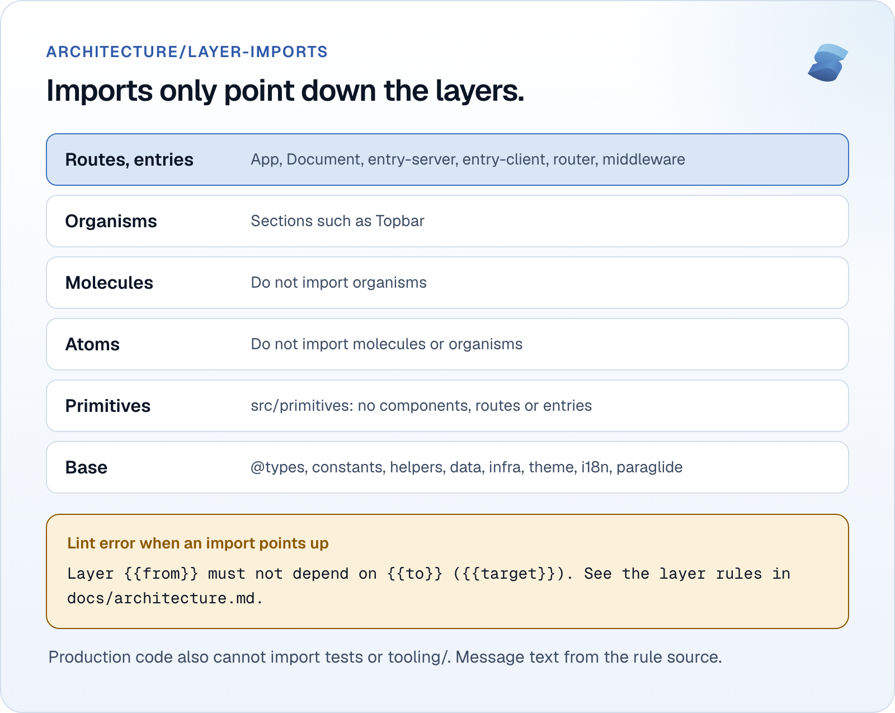

[](https://www.npmjs.com/package/@evertondgn/solid-tooling)
[](https://github.com/everton-dgn/solidjs_base/actions/workflows/ci.yml)
[](https://github.com/everton-dgn/solidjs_base/blob/main/packages/solid-tooling/docs/limits.md#requirements)
[](https://github.com/everton-dgn/solidjs_base/blob/main/LICENSE)

# @evertondgn/solid-tooling

**The whole `vite.config.ts`, lint rules, test projects and Git hooks of a
SolidJS 2 app, as one dev dependency.**

Solid Base started as a starter app,
[boilerplate_solidjs](https://github.com/everton-dgn/boilerplate_solidjs). Each
new SolidJS app copied its Vite config, lint rules, test setup and Git hooks.
Then the copies drifted, and a fix to that tooling had to be made again by hand
in every app.

This package holds the tooling instead. `defineSolidApp` returns the whole
`vite.config.ts` of a [Vite+](https://viteplus.dev/guide/) app, and the presets
around it cover lint, formatting, TypeScript, Vitest, Playwright, Knip,
Stylelint, commit messages and Git hooks. A fix lands once, in a package
version, and each app takes it when it updates. The
[boilerplate app](https://github.com/everton-dgn/solidjs_base/blob/main/apps/boilerplate/README.md)
in this repository runs on the package, and
[the configuration you stop maintaining](#the-configuration-you-stop-maintaining)
compares its config files with the starter's.

The package loads
[`@evertondgn/vite-plugin-solid-icons`](https://github.com/everton-dgn/solidjs_base/blob/main/packages/vite-plugin-solid-icons/README.md)
for icons, so your app does not declare it. The features an app runs in
production, such as security headers, server errors and SEO, come from
[`@evertondgn/solid-runtime`](https://github.com/everton-dgn/solidjs_base/blob/main/packages/solid-runtime/README.md).

## Requirements

| You need           | Solid Base expects                                                                                                                                                                                                                   |
| ------------------ | ------------------------------------------------------------------------------------------------------------------------------------------------------------------------------------------------------------------------------------ |
| Node               | The range in `engines.node` of the [package manifest](https://github.com/everton-dgn/solidjs_base/blob/main/packages/solid-tooling/package.json), shown by the Node badge above                                                      |
| Vite+              | `vite-plus` at the exact version of the `peerDependencies` in the manifest                                                                                                                                                           |
| Solid              | `solid-js`, `@solidjs/web` and `@solidjs/router` in your app, at the version the packages are tested with ([requirements](https://github.com/everton-dgn/solidjs_base/blob/main/packages/solid-tooling/docs/limits.md#requirements)) |
| Translations       | Optional. `@inlang/paraglide-js` at the exact version of its optional peer, and its message-format plugin                                                                                                                            |
| A folder layout    | None for the lint and format presets. The full preset, the test presets, Knip and the CSS policy expect the boilerplate layout ([known limits](#known-limits))                                                                       |
| A host for SSR     | Vercel's output format: Nitro always uses its `vercel` preset. A client-only build (`ssr: false`) writes a static `dist/` ([no server](https://github.com/everton-dgn/solidjs_base/blob/main/docs/tooling/no-server.md))             |
| Room for the tools | The package installs the tools of features you do not use ([measured cost](#fewer-tool-versions-in-each-manifest))                                                                                                                   |

> This package is `0.x`: below 1.0.0, a breaking change raises the minor
> version. Its Solid, Nitro, router and icons plugins are pinned to the versions
> tested together, so a new version of one of them needs a package version
> tested with it.

## Install

```bash
vp add -D @evertondgn/solid-tooling
```

Then choose how much of it your app takes: the
[lint and format presets](#start-with-lint-and-format), two keys in the Vite+
config you already have, or [the whole preset](#use-the-whole-preset), which
writes the whole `vite.config.ts`.

## See it work

In an app with the [lint and format presets](#start-with-lint-and-format),
create `src/helpers/export-list.ts`:

```ts
const example = 1

export { example }
```

Run `vp lint`:

```text
$ vp lint
src/helpers/export-list.ts:3:1: error project(no-export-list): Export on the declaration itself (export function, export const, export type) instead of using export { ... }. An export list is only allowed in a re-export with from.
```

We recorded this output on 2026-11-17 with the 0.8.0 package from npm, in a copy
of the client-only fixture. Replace the list with `export const example = 1` and
the rule passes. `vp check` runs the format check, lint and type check together,
and `vp fmt` writes the formatting.

The same rule is checked before each release. The
[tarball test](https://github.com/everton-dgn/solidjs_base/blob/main/packages/solid-tooling/src/tarball/__tests__/tarball.test.ts)
packs this package, installs it in a copy of the consumer fixture outside the
workspace and runs lint. It fails unless lint reports `project(no-export-list)`
in `src/helpers/export-list.ts`, an error from each of the other two plugins of
the package, one from the Solid plugin and one type error, with nothing in the
control files. Its 3 tests passed in the CI run of the 0.10.0 release pull
request
([Packages job](https://github.com/everton-dgn/solidjs_base/actions/runs/44206537981/job/134474054049)).

## What the preset covers

| Area                  | What your app gets                                                                                                                               | Guide                                                                                                                                                                                                                                                                             |
| --------------------- | ------------------------------------------------------------------------------------------------------------------------------------------------ | --------------------------------------------------------------------------------------------------------------------------------------------------------------------------------------------------------------------------------------------------------------------------------- |
| `vite.config.ts`      | `defineSolidApp`: the Solid, routing, icons and Nitro plugins, the headers of the static files, the build, the dev server and the `vp run` tasks | [Application config](https://github.com/everton-dgn/solidjs_base/blob/main/packages/solid-tooling/docs/app-config.md)                                                                                                                                                             |
| Lint and format       | Oxlint with type-aware rules, the [rules of this package](#lint-rules-that-know-your-project) and the formatter settings                         | [Lint](https://github.com/everton-dgn/solidjs_base/blob/main/packages/solid-tooling/docs/lint.md), [TypeScript and formatting](https://github.com/everton-dgn/solidjs_base/blob/main/packages/solid-tooling/docs/typescript-and-format.md)                                        |
| Tests                 | Node, DOM and browser Vitest projects with coverage thresholds, and a Playwright config that builds the app and checks the server log            | [Testing](https://github.com/everton-dgn/solidjs_base/blob/main/packages/solid-tooling/docs/testing.md)                                                                                                                                                                           |
| Dead code and CSS     | Knip with the entries of a Solid app, and a Stylelint policy built on tokens                                                                     | [Knip and CSS](https://github.com/everton-dgn/solidjs_base/blob/main/packages/solid-tooling/docs/knip-and-css.md)                                                                                                                                                                 |
| Commits and Git hooks | commitlint with Conventional Commits, and shared Lefthook hooks for commit, pre-commit and pre-push                                              | [Commit messages and Git hooks](https://github.com/everton-dgn/solidjs_base/blob/main/packages/solid-tooling/docs/commits-and-hooks.md)                                                                                                                                           |
| Translations          | Catalog validation and Paraglide compilation, only when the app has `project.inlang/settings.json`                                               | [Application config](https://github.com/everton-dgn/solidjs_base/blob/main/packages/solid-tooling/docs/app-config.md)                                                                                                                                                             |
| Icons and fonts       | The icons plugin, and font CSS with matching preloads                                                                                            | [Icons](https://github.com/everton-dgn/solidjs_base/blob/main/packages/solid-tooling/docs/app-config.md#icons), [Application fonts](https://github.com/everton-dgn/solidjs_base/blob/main/packages/solid-tooling/docs/fonts.md)                                                   |
| SEO and environment   | Robots, sitemap, Markdown and `llms.txt` options written as data, and optional env validation                                                    | [SEO](https://github.com/everton-dgn/solidjs_base/blob/main/packages/solid-tooling/docs/app-config.md#optional-seo-configuration), [environment](https://github.com/everton-dgn/solidjs_base/blob/main/packages/solid-tooling/docs/app-config.md#optional-environment-validation) |
| No server             | A client-only build for a static host, a folder or an app shell                                                                                  | [Applications with no server](https://github.com/everton-dgn/solidjs_base/blob/main/docs/tooling/no-server.md)                                                                                                                                                                    |

## Who it fits

- You start SolidJS 2 apps on Vite+ and want the config, lint, tests and hooks
  of the boilerplate_solidjs layout without copying them.
- You maintain several Solid apps and want to fix their tooling once.
- You want only the [lint and format presets](#start-with-lint-and-format) in an
  existing Vite+ config.

## Who it does not fit yet

- Your app needs the full preset with another folder layout. The test presets,
  Knip and the CSS policy expect the boilerplate layout
  ([known limits](https://github.com/everton-dgn/solidjs_base/blob/main/packages/solid-tooling/docs/limits.md#known-limits)).
- Your server build must target a host other than Vercel's output format. Nitro
  always uses the `vercel` preset. A client-only build (`ssr: false`) writes a
  static `dist/` with no server
  ([applications with no server](https://github.com/everton-dgn/solidjs_base/blob/main/docs/tooling/no-server.md)).
- You cannot pin exact versions. `vite-plus` is an exact peer of this package,
  and its plugins are pinned.
- You run Node older than the `engines.node` floor of the package.
- Install size matters more than fewer declarations. The tooling installs the
  tools of features you do not use: 8.41% more `node_modules` with Bun's hoisted
  linker, in the
  [measurement of ADR 0027](#fewer-tool-versions-in-each-manifest).

## Questions before you adopt it

**I do not deploy to Vercel.** Use a client-only build: `ssr: false` writes a
static `dist/` with no server, and the
[no-server guide](https://github.com/everton-dgn/solidjs_base/blob/main/docs/tooling/no-server.md)
covers static hosts, folders and app shells. For SSR, the preset writes only
`.vercel/output` today, through Nitro's `vercel` preset
([known limits](#known-limits)).

**My project has another layout.** Start with the
[lint and format presets](#start-with-lint-and-format) in your Vite+ config.
They need no folder layout, but a few rules follow the boilerplate's
conventions, such as `project/test-filename`, which expects each test in
`__tests__` next to its module. You can turn such a rule off in
`lint.overrides`. The full `defineSolidApp` preset, the test presets, Knip and
the CSS policy expect the boilerplate layout ([known limits](#known-limits)).

**What happens when a new Solid version ships?** The package pins the Solid,
Nitro, router and icons plugins to versions tested together. Wait for a package
version tested with the new release, then
[update the packages together](#update-the-packages). Do not raise Solid alone.

**How heavy is the install?** Heavier than the manifest suggests: 8.41% more
`node_modules` with Bun's hoisted linker and 8.69% with the isolated one, in the
[measurement of ADR 0027](#fewer-tool-versions-in-each-manifest). The installed
scenarios check that none of these tools reach the bundles of the fixture apps.

**How do I leave?** There is no eject command. The lint and format presets are
two keys of your config. For the rest, the starter's original
[427-line `vite.config.ts`](https://github.com/everton-dgn/boilerplate_solidjs/blob/61454937472d0faa1b4fab985fd7c5da968aa9a6/vite.config.ts)
is a reference for what `defineSolidApp` replaces.

**Can I use only part of it?** Yes for the lint and format presets. The
[icons plugin](https://github.com/everton-dgn/solidjs_base/blob/main/packages/vite-plugin-solid-icons/README.md)
also works without this package, in a Vite+ app with SolidJS 2.

## Start with lint and format

The lint and format presets are the cheapest way in: two keys in the Vite+
config you already have, and no other Solid Base package. This is the whole
`vite.config.ts` of the
[lint consumer fixture](https://github.com/everton-dgn/solidjs_base/blob/main/fixtures/consumer/vite.config.ts),
which declares only this package, Vite+ and its Vite alias. In your app, keep
your plugins and other options next to them:

```ts
import { fmt } from '@evertondgn/solid-tooling/fmt'
import { lint } from '@evertondgn/solid-tooling/lint'
import { defineConfig } from 'vite-plus'

export default defineConfig({ fmt, lint })
```

Type-aware rules read your `tsconfig.json`. Extend
`@evertondgn/solid-tooling/tsconfig.base.json` for the compiler options of the
preset, as the fixture's
[`tsconfig.json`](https://github.com/everton-dgn/solidjs_base/blob/main/fixtures/consumer/tsconfig.json)
does. These presets need no folder layout, but a few rules follow the
boilerplate's conventions: `project/test-filename` expects each test in
`__tests__` next to its module, and you turn it off in `lint.overrides` for
other test folders
([known limits](https://github.com/everton-dgn/solidjs_base/blob/main/packages/solid-tooling/docs/limits.md#known-limits)).
See
[TypeScript and formatting](https://github.com/everton-dgn/solidjs_base/blob/main/packages/solid-tooling/docs/typescript-and-format.md).

## Use the whole preset

`defineSolidApp` returns the whole `vite.config.ts` of an app with the
boilerplate layout. The app keeps its own direct imports, such as `solid-js`,
`@solidjs/web` and `@solidjs/router`, plus Vite+ and its overrides. An app with
translations also installs `@inlang/paraglide-js` at the version in this
package's manifest, and its message-format plugin. See the
[dependency requirements](https://github.com/everton-dgn/solidjs_base/blob/main/packages/solid-tooling/docs/limits.md#requirements).

The shortest working setup is a copy of the closest
[fixture app](https://github.com/everton-dgn/solidjs_base/tree/main/fixtures/apps).
This is the
[client-only fixture's `vite.config.ts`](https://github.com/everton-dgn/solidjs_base/blob/main/fixtures/apps/client-only/vite.config.ts)
without its `fonts` block:

```ts
import { defineSolidApp } from '@evertondgn/solid-tooling/vite'

export default defineSolidApp({
  root: import.meta.dirname,
  icons: { scenario: './src/assets/icons' },
  ssr: false
})
```

On 2026-11-17, with the 0.8.0 packages from npm, a copy with this config built
to `dist/index.html` and one JavaScript file, with no Nitro or server bundle. A
copy of a fixture takes three to five changes, including the removal of `fonts`.
[Start a new app from a fixture](https://github.com/everton-dgn/solidjs_base/blob/main/README.md#start-a-new-app-from-a-fixture)
lists them with the build output. For SSR, the
[SSR fixture's `vite.config.ts`](https://github.com/everton-dgn/solidjs_base/blob/main/fixtures/apps/ssr-plain/vite.config.ts)
adds the header policy, the server error setup, the middleware and SEO. The
[application config guide](https://github.com/everton-dgn/solidjs_base/blob/main/packages/solid-tooling/docs/app-config.md)
covers every option, the tasks and how to change the result without a fork.

## Lint rules that know your project

The lint preset turns on the Oxlint plugins, type-aware rules and type checking,
and fails on warnings. Every rule is listed by name, so an Oxlint update does
not add rules on its own. The rules of this package catch what a generic preset
cannot see:

| Rule                         | What it enforces                                                                                    |
| ---------------------------- | --------------------------------------------------------------------------------------------------- |
| `project/css-modules-import` | A CSS Module is imported as the default binding `S`                                                 |
| `project/css-filename`       | A CSS file is named `styles.module.css`, or `camelCase.css` inside `src/theme/`                     |
| `project/test-filename`      | A test sits in `__tests__` next to its module, named after it and its environment                   |
| `project/no-export-list`     | Exports sit on the declaration                                                                      |
| `project/seo-module`         | A route `seo.ts` exports only `seo` and imports no route values                                     |
| `architecture/layer-imports` | Lower layers do not import upper ones, and production code does not import tests or `tooling/`      |
| `backend/*`                  | No `console`, `fetch` only in `requestJson`, no Node transports, no `node_modules` paths in imports |

<picture>
  <source media="(prefers-color-scheme: dark)" srcset="https://raw.githubusercontent.com/everton-dgn/solidjs_base/main/docs/assets/readme/layers-dark.webp" />
  <source media="(prefers-color-scheme: light)" srcset="https://raw.githubusercontent.com/everton-dgn/solidjs_base/main/docs/assets/readme/layers-light.webp" />
  
</picture>

An import in the wrong direction fails `vp lint` before review. See
[all rules and customization](https://github.com/everton-dgn/solidjs_base/blob/main/packages/solid-tooling/docs/lint.md).

## The configuration you stop maintaining

The original starter kept 945 lines of configuration in five areas. The
boilerplate app in this repository keeps 130 with this package, about 86% fewer,
counted at commit `032552d`. The shared code lives in the package, where one fix
serves every app.

| Configuration                                                                                                   | Original lines | With the package |
| --------------------------------------------------------------------------------------------------------------- | -------------: | ---------------: |
| [Vite](https://github.com/everton-dgn/solidjs_base/blob/main/apps/boilerplate/vite.config.ts)                   |            427 |               52 |
| [Playwright](https://github.com/everton-dgn/solidjs_base/blob/main/apps/boilerplate/playwright.config.ts)       |            173 |               17 |
| [Knip](https://github.com/everton-dgn/solidjs_base/blob/main/apps/boilerplate/tooling/knip.ts)                  |            129 |               41 |
| [TypeScript](https://github.com/everton-dgn/solidjs_base/blob/main/apps/boilerplate/tsconfig.json)              |             45 |                9 |
| [Stylelint caller](https://github.com/everton-dgn/solidjs_base/blob/main/apps/boilerplate/tooling/css/check.ts) |            171 |               11 |
| Total                                                                                                           |            945 |              130 |

The counts come from `wc -l`, blank lines and comments included, over the five
files of the app at commit `032552d`. The baseline is the
[original starter at 6145493](https://github.com/everton-dgn/boilerplate_solidjs/tree/61454937472d0faa1b4fab985fd7c5da968aa9a6),
whose Playwright and Stylelint configs lived in `tooling/playwright.ts` and
`tooling/css/stylelint.config.mjs`. Compare its
[`vite.config.ts`](https://github.com/everton-dgn/boilerplate_solidjs/blob/61454937472d0faa1b4fab985fd7c5da968aa9a6/vite.config.ts)
with the app's. The Stylelint replacement is an app script that calls the
packaged policy. The `vite.config.ts` of the
[fixture apps](https://github.com/everton-dgn/solidjs_base/tree/main/fixtures/apps)
has 20 lines in client-only, 30 in SSR and 11 in translated SSR.

### Fewer tool versions in each manifest

The package installs the build, test, type-check and hook tools it calls, at the
versions it tests, and runs them from its own installation, including with Bun's
isolated linker. Your manifest keeps only what your own code imports, plus Vite+
and its Vite alias.

| Application                                                                                                 | Direct declarations before | Now | Fewer |
| ----------------------------------------------------------------------------------------------------------- | -------------------------: | --: | ----: |
| [Boilerplate app](https://github.com/everton-dgn/solidjs_base/blob/main/apps/boilerplate/package.json)      |                         28 |  15 |    13 |
| [Client-only](https://github.com/everton-dgn/solidjs_base/blob/main/fixtures/apps/client-only/package.json) |                         16 |   6 |    10 |
| [SSR](https://github.com/everton-dgn/solidjs_base/blob/main/fixtures/apps/ssr-plain/package.json)           |                         17 |   5 |    12 |
| [Translated SSR](https://github.com/everton-dgn/solidjs_base/blob/main/fixtures/apps/ssr-i18n/package.json) |                         19 |   7 |    12 |
| [Lint consumer](https://github.com/everton-dgn/solidjs_base/blob/main/fixtures/consumer/package.json)       |                          6 |   3 |     3 |

The counts combine `dependencies` and `devDependencies` of each `package.json`,
without overrides or transitive packages. The earlier counts come from the
measurement of
[ADR 0027](https://github.com/everton-dgn/solidjs_base/blob/main/docs/ADRs/0027-packaged-tool-dependencies.md).
The boilerplate app's count includes `@solidjs/diagnostics`, which the Solid
plugin reads to serve its diagnostics in development. The fixture counts leave
out the two package tarballs that the installed test harness adds; with them,
client-only, SSR and translated SSR declare 8, 7 and 9. The client-only fixture
now declares an Iconify collection, which the count before did not have.

Fewer declarations do not mean a smaller install. The tooling also installs the
tools of features you may not use. In the measurement of ADR 0027, made on
2026-11-14 against the base at commit `8b5fd2f` with one paired install per
linker, the `node_modules` of a fresh client-only app grew from 426.55 MiB to
462.41 MiB with Bun's hoisted linker (8.41%) and by 8.69% with the isolated one.
Build audits check that these tools stay out of the app bundles.

## Update the packages

The packages share one version number, and the icons plugin comes with the
tooling at the same version. Raise the tooling and the runtime in one command:

```bash
vp update -L @evertondgn/solid-tooling @evertondgn/solid-runtime
```

`-L` is needed while the packages are `0.x`: a range such as `^0.8.0` stops
below 0.9.0. Then align the versions the packages were tested with: `vite-plus`
to the exact peer of this package, `@inlang/paraglide-js` to its optional exact
peer if your app has translations, and `solid-js`, `@solidjs/web` and the Solid
overrides to the peer of the runtime.
[Update the packages](https://github.com/everton-dgn/solidjs_base/blob/main/README.md#update-the-packages)
lists each step. Do not raise `solid-js` with `-L`: the newest Solid release can
be newer than the one the packages were tested with. Read the
[changelog](https://github.com/everton-dgn/solidjs_base/blob/main/packages/solid-tooling/CHANGELOG.md)
before you update.

## How it is tested

The counts below come from the CI run of the 0.10.0 release pull request
([run 44206537981](https://github.com/everton-dgn/solidjs_base/actions/runs/44206537981)).
Its Packages job ran `vp run validate`, as release verification does
([job 134474054049](https://github.com/everton-dgn/solidjs_base/actions/runs/44206537981/job/134474054049)).

- Package tests: 368 `node --test` tests ran and passed in CI. They come from
  the 45 test files under `src/` at the head of that pull request, a count taken
  from the source tree, and run the presets against fixtures in temporary
  folders.
- Tarball test: 3 tests passed in CI. They pack the package and install it in a
  copy of the
  [lint consumer fixture](https://github.com/everton-dgn/solidjs_base/blob/main/fixtures/consumer/package.json)
  outside the workspace. They check that lint applies the plugins, that the
  shared hooks and commitlint config accept a valid message and refuse an
  invalid one, and that the fixture declares the workspace versions.
- Installed application scenarios: the packed tooling, runtime and icons plugin
  are installed in the
  [three fixture apps](https://github.com/everton-dgn/solidjs_base/tree/main/fixtures/apps)
  with Bun's `hoisted` and `isolated` linkers, then built and tested. All 14
  application cases passed in CI: 3 client-only, 9 SSR and 2 translated SSR.
  Their test file ran 22 tests: the 14 cases, the version alignment check, the
  Node version check of the packages and 6 checks of the no-server guide and its
  local server. A case fails when a disabled feature leaves its modules in the
  bundle, or when a packaged development tool reaches an emitted module.
  Negative probes, run by hand with `SCENARIO_MUTATION`, inject a regression
  into a temporary copy and must make their case fail
  ([ADR 0021](https://github.com/everton-dgn/solidjs_base/blob/main/docs/ADRs/0021-installed-application-scenarios.md)).
- The boilerplate app runs on this preset. In the same CI run, its 185 Vitest
  tests passed
  ([job](https://github.com/everton-dgn/solidjs_base/actions/runs/44206537981/job/134474053995))
  and 164 end-to-end cases passed against its E2E build
  ([job](https://github.com/everton-dgn/solidjs_base/actions/runs/44206537981/job/134474053917));
  the
  [app README](https://github.com/everton-dgn/solidjs_base/blob/main/apps/boilerplate/README.md)
  breaks them down.
- The runtime has its own suite: 1,047 Vitest tests in 104 files passed in the
  same Packages job; the
  [runtime README](https://github.com/everton-dgn/solidjs_base/blob/main/packages/solid-runtime/README.md)
  describes them.
- The runtime package is linted with this preset, loaded from the tooling
  sources by its
  [`vite.config.ts`](https://github.com/everton-dgn/solidjs_base/blob/main/packages/solid-runtime/vite.config.ts).

CI picks jobs by changed paths, and a package change runs the packages and the
complete boilerplate app
([CI coverage](https://github.com/everton-dgn/solidjs_base/blob/main/docs/development.md#ci)).

The release workflow publishes to npm through trusted publishing, with no stored
npm token. Each version it publishes carries npm provenance (an SLSA v1
provenance statement) that names the commit and the workflow run that built it.
The first version of each package was published by hand and has none
([security policy](https://github.com/everton-dgn/solidjs_base/blob/main/SECURITY.md)).
To check the packages you installed, run `npm audit signatures` in your app.

## Known limits

- The test presets, Knip, the CSS policy and `./vite` expect the boilerplate
  layout: tests named by suffix, page tests in `src/tests/pages/`, pages in
  `src/routes/`, the theme in `src/theme/`, and the CSS and Knip scripts in
  `tooling/`.
- Nitro always uses the `vercel` preset. The plugin packages are pinned, so a
  new version of Solid, Nitro, the router or the icons plugin needs a package
  version tested with it.
- The package installs the tools of every feature, including the ones your app
  does not use ([measured cost](#fewer-tool-versions-in-each-manifest)).
- The translation catalogs are limited to 8 MiB in total, by
  `CATALOGS_MAX_BYTES` in the package, and there is no incremental generation.
- An app with no server needs the hash history of the router under `file://`,
  and translations by URL prefix need a server
  ([applications with no server](https://github.com/everton-dgn/solidjs_base/blob/main/docs/tooling/no-server.md)).
- Object spread in `env.ts` can override the keys of the preset; keeping their
  validators is the app's job.
- Some rule messages point to `docs/architecture.md` and `AGENTS.md`, files of
  an app created from boilerplate_solidjs.

The
[known limits](https://github.com/everton-dgn/solidjs_base/blob/main/packages/solid-tooling/docs/limits.md#known-limits)
list the rest.

## Entry points

The package exports 27 entries, counted from `exports` in its `package.json`:

| Entry                           | Content                                                                                                                                                                             |
| ------------------------------- | ----------------------------------------------------------------------------------------------------------------------------------------------------------------------------------- |
| `./vite`                        | `defineSolidApp(options)`, the whole `vite.config.ts` of an app, and the types `SolidAppOptions`, `ServerAppOptions`, `ClientAppOptions`, `SeoOptions`, `FontFamily` and `FontFile` |
| `./lint`                        | `lint`: the lint preset, with the plugins below registered                                                                                                                          |
| `./fmt`                         | `fmt`: the formatter config                                                                                                                                                         |
| `./tsconfig.base.json`          | Compiler options, without app paths                                                                                                                                                 |
| `./tsconfig.app.json`           | The base plus packaged type references and the boilerplate `include`                                                                                                                |
| `./app-env`                     | Type references loaded by `tsconfig.app.json`                                                                                                                                       |
| `./virtual-modules`             | Declarations of the `virtual:solid-app/*` modules, loaded by `tsconfig.app.json`                                                                                                    |
| `./icon-modules`                | Declarations of the `icon:` imports, loaded by `tsconfig.app.json`                                                                                                                  |
| `./vitest`                      | `solidTest(options)`, the `test` block of `vite.config.ts`                                                                                                                          |
| `./vitest-setup/browser`        | Setup file of the browser project, loaded by `./vitest`                                                                                                                             |
| `./playwright`                  | `definePlaywrightConfig(options)`, the Playwright config                                                                                                                            |
| `./playwright-teardown`         | Server log check, loaded by `./playwright`                                                                                                                                          |
| `./project-plugin`              | The `project` rules                                                                                                                                                                 |
| `./backend-plugin`              | The `backend` rules                                                                                                                                                                 |
| `./architecture-plugin`         | The `architecture` rule                                                                                                                                                             |
| `./solid-plugin`                | Re-export of `eslint-plugin-solid`, resolved from the package                                                                                                                       |
| `./css-filename`                | `cssFilenameError(path)`, the CSS naming check for a script outside lint, and `cssFilename`, the rule registered as `project/css-filename`                                          |
| `./knip`                        | `defineKnipConfig(options)`, the Knip config                                                                                                                                        |
| `./stylelint`                   | `checkCss(root)` and `defineStylelintConfig(root)`, the CSS lint                                                                                                                    |
| `./commitlint`                  | The commitlint config                                                                                                                                                               |
| `./lefthook.yml`                | The Git hooks, extended from the app's `.lefthook.yml`                                                                                                                              |
| `./cli`                         | Command entry for packaged Knip, TypeScript, Playwright, Lefthook and commitlint                                                                                                    |
| `./i18n-generate`               | Compiled catalog generator run by the preset's `i18n-generate` task                                                                                                                 |
| `./paraglide`                   | `defineParaglideConfig(locales)`, the Paraglide compiler profile                                                                                                                    |
| `./icons-generate`              | Compiled writer of the icon declarations, run by the `icons-generate` task                                                                                                          |
| `./publication/read-llms-index` | `readLlmsIndex(text)`, which reads a generated `llms.txt` in Node and returns its title, description and links; it throws when the title is missing                                 |
| `./package.json`                | The package manifest                                                                                                                                                                |

Your editor and `tsrs` know the test globals, the jest-dom matchers, the Solid
plugin and routing modules, every `virtual:solid-app/*` module and the `icon:`
imports with no local `.d.ts`: `tsconfig.app.json` loads `./app-env`, which
references `./virtual-modules` and `./icon-modules`. An app with its own
TypeScript config adds `@evertondgn/solid-tooling/app-env` to `types`.

Your app keeps its pages, components, translations, theme, `App`, `Document`,
entries and middleware. The plugin entries exist because Oxlint loads plugins by
specifier, from the app; the setup and teardown entries are loaded by the test
presets.

## Reference

The guides ship in this package, in
[`docs/`](https://github.com/everton-dgn/solidjs_base/blob/main/packages/solid-tooling/docs/README.md),
so `node_modules/@evertondgn/solid-tooling/docs/` holds the guides of the
version your app installed.

- [Tooling guides, by task](https://github.com/everton-dgn/solidjs_base/blob/main/packages/solid-tooling/docs/README.md)
- [Application config, plugins and tasks](https://github.com/everton-dgn/solidjs_base/blob/main/packages/solid-tooling/docs/app-config.md)
- [Lint rules and customization](https://github.com/everton-dgn/solidjs_base/blob/main/packages/solid-tooling/docs/lint.md)
- [Vitest and Playwright](https://github.com/everton-dgn/solidjs_base/blob/main/packages/solid-tooling/docs/testing.md)
- [Knip and CSS](https://github.com/everton-dgn/solidjs_base/blob/main/packages/solid-tooling/docs/knip-and-css.md)
- [Commit messages and Git hooks](https://github.com/everton-dgn/solidjs_base/blob/main/packages/solid-tooling/docs/commits-and-hooks.md)
- [TypeScript and formatting](https://github.com/everton-dgn/solidjs_base/blob/main/packages/solid-tooling/docs/typescript-and-format.md)
- [Application fonts](https://github.com/everton-dgn/solidjs_base/blob/main/packages/solid-tooling/docs/fonts.md)
- [Requirements, limits and versions](https://github.com/everton-dgn/solidjs_base/blob/main/packages/solid-tooling/docs/limits.md)
- [Applications with no server](https://github.com/everton-dgn/solidjs_base/blob/main/docs/tooling/no-server.md),
  which stays in the repository because the installed scenarios read it

## Versions and license

The package follows semantic versioning. Below 1.0.0, a breaking change raises
the minor version. Read the
[changelog](https://github.com/everton-dgn/solidjs_base/blob/main/packages/solid-tooling/CHANGELOG.md)
for each release, and the
[Solid Base overview](https://github.com/everton-dgn/solidjs_base/blob/main/README.md)
for the packages together.

[MIT](https://github.com/everton-dgn/solidjs_base/blob/main/LICENSE)

Read the [installed skill](skills/solid-base-app/SKILL.md) for application rules
and the package reference.

Run `vp run doctor` for installed versions, skill paths and validation commands.
Run `vp run agents` to add the lookup instructions to AGENTS.md. See
[installed package diagnostics](docs/app-config.md#installed-package-diagnostics).
