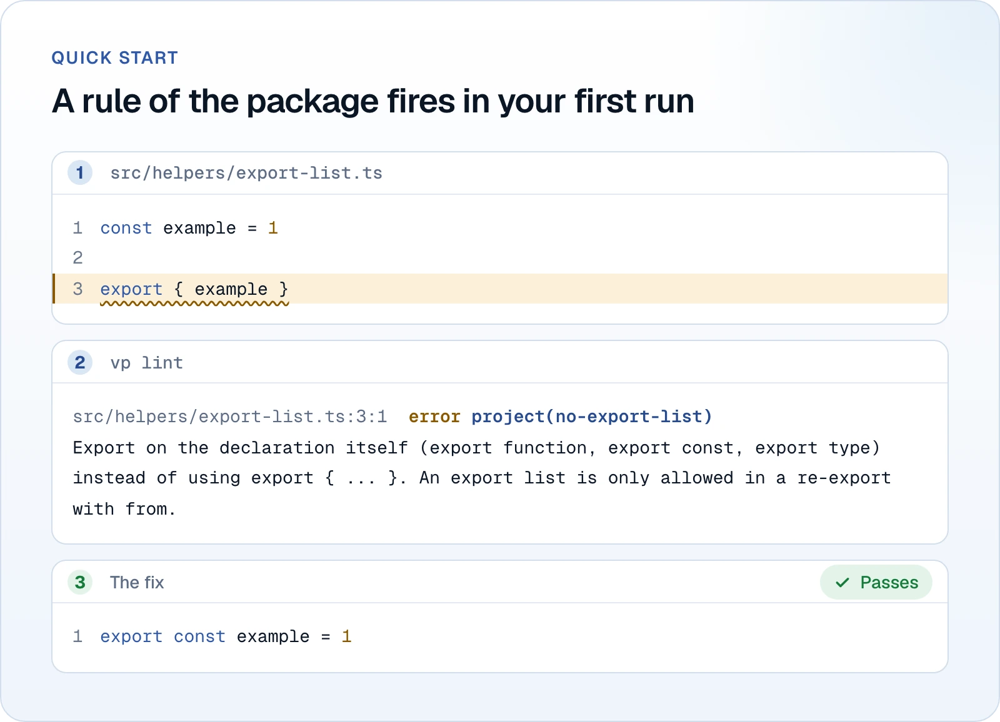

[](https://www.npmjs.com/package/@evertondgn/solid-tooling)
[](https://github.com/everton-dgn/solidjs_base/actions/workflows/ci.yml)
[](https://github.com/everton-dgn/solidjs_base/blob/main/LICENSE)

# @evertondgn/solid-tooling

<picture>
  <source media="(prefers-color-scheme: dark)" srcset="https://raw.githubusercontent.com/everton-dgn/solidjs_base/main/docs/assets/readme/hero-dark.webp" />
  <source media="(prefers-color-scheme: light)" srcset="https://raw.githubusercontent.com/everton-dgn/solidjs_base/main/docs/assets/readme/hero-light.webp" />
  
</picture>

**The whole `vite.config.ts`, lint rules, test projects and Git hooks of a
SolidJS 2 app, as one dev dependency.**

Solid Base started as a starter app,
[boilerplate_solidjs](https://github.com/everton-dgn/boilerplate_solidjs). Each
new SolidJS app copied its Vite config, lint rules, test setup and Git hooks.
Then the copies drifted, and a fix to that tooling had to be made again by hand
in every app.

This package holds the tooling instead. `defineSolidApp` returns the whole
`vite.config.ts` of a [Vite+](https://viteplus.dev/guide/) app, and the presets
around it cover lint, formatting, TypeScript, Vitest, Playwright, Knip,
Stylelint, commit messages and Git hooks. A fix lands once, in a package
version, and each app takes it when it updates. The
[copy of the starter](https://github.com/everton-dgn/solidjs_base/blob/main/apps/boilerplate/README.md)
in this repository keeps
[129 lines of configuration where the starter had 945](#the-configuration-you-stop-maintaining).

> SolidJS 2 is still a release candidate, and this package is `0.x`: below
> 1.0.0, a breaking change raises the minor version. The package is tested with
> `2.0.0-rc.23`, and its Solid, Nitro, router and icons plugins are pinned to
> the versions tested together. A new version of one of them needs a package
> version tested with it.

The package loads
[`@evertondgn/vite-plugin-solid-icons`](https://github.com/everton-dgn/solidjs_base/blob/main/packages/vite-plugin-solid-icons/README.md)
for icons, so your app does not declare it. The features an app runs in
production, such as security headers, server errors and SEO, come from
[`@evertondgn/solid-runtime`](https://github.com/everton-dgn/solidjs_base/blob/main/packages/solid-runtime/README.md).

[Start](#start-with-lint-and-format) ·
[Less config](#the-configuration-you-stop-maintaining) ·
[Who it fits](#who-it-fits) · [Questions](#questions-before-you-adopt-it) ·
[Whole preset](#use-the-whole-preset) · [Update](#update-the-package) ·
[Tests](#how-it-is-tested) · [Limits](#limits) · [Reference](#reference) ·
[Entry points](#entry-points)

## Start with lint and format

The lint and format presets are the cheapest way in: two keys in the Vite+
config you already have, and no other Solid Base package. The package declares
`vite-plus` 1.7.0 as an exact peer and Node `>=26.13.1` in `engines.node`.

```bash
vp add -D @evertondgn/solid-tooling
```

Add the two keys. This is the whole `vite.config.ts` of the
[lint consumer fixture](https://github.com/everton-dgn/solidjs_base/blob/main/fixtures/consumer/vite.config.ts),
which declares only this package, Vite+ and its Vite alias. In your app, keep
your plugins and other options next to them:

```ts
import { fmt } from '@evertondgn/solid-tooling/fmt'
import { lint } from '@evertondgn/solid-tooling/lint'
import { defineConfig } from 'vite-plus'

export default defineConfig({ fmt, lint })
```

Type-aware rules read your `tsconfig.json`. Extend
`@evertondgn/solid-tooling/tsconfig.base.json` for the compiler options of the
preset, as the fixture's
[`tsconfig.json`](https://github.com/everton-dgn/solidjs_base/blob/main/fixtures/consumer/tsconfig.json)
does. These presets need no folder layout, but a few rules follow the
boilerplate's conventions: `project/test-filename` expects each test in
`__tests__` next to its module, and you turn it off in `lint.overrides` for
other test folders
([known limits](https://github.com/everton-dgn/solidjs_base/blob/main/docs/tooling/limits.md#known-limits)).

### See a package rule fire

Create `src/helpers/export-list.ts`:

```ts
const example = 1

export { example }
```

Run `vp lint`:

```text
$ vp lint
src/helpers/export-list.ts:3:1: error project(no-export-list): Export on the declaration itself (export function, export const, export type) instead of using export { ... }. An export list is only allowed in a re-export with from.
```

We recorded this output on 2026-11-17 with the 0.8.0 package from npm, in a copy
of the client-only fixture. Replace the list with `export const example = 1` and
the rule passes. `vp check` runs the format check, lint and type check together,
and `vp fmt` writes the formatting.

<picture>
  <source media="(prefers-color-scheme: dark)" srcset="https://raw.githubusercontent.com/everton-dgn/solidjs_base/main/docs/assets/readme/first-result-dark.webp" />
  <source media="(prefers-color-scheme: light)" srcset="https://raw.githubusercontent.com/everton-dgn/solidjs_base/main/docs/assets/readme/first-result-light.webp" />
  
</picture>

The same rule is checked before each release. The
[tarball test](https://github.com/everton-dgn/solidjs_base/blob/main/packages/solid-tooling/src/tarball/__tests__/tarball.test.ts)
packs this package, installs it in a copy of the consumer fixture outside the
workspace and runs lint. It fails unless lint reports `project(no-export-list)`
in `src/helpers/export-list.ts`, an error from each of the other two plugins of
the package, one from the Solid plugin and one type error, with nothing in the
control files. Its 3 tests passed in the CI run of the 0.8.0 release pull
request
([job 133680118978](https://github.com/everton-dgn/solidjs_base/actions/runs/43975952604/job/133680118978)).

## The configuration you stop maintaining

The original starter kept 945 lines of configuration in five areas. The
boilerplate copy in this repository keeps 129 with this package, about 86%
fewer. The shared code lives in the package, where one fix serves every app.

| Configuration                                                                                                   | Original lines | With the package |
| --------------------------------------------------------------------------------------------------------------- | -------------: | ---------------: |
| [Vite](https://github.com/everton-dgn/solidjs_base/blob/main/apps/boilerplate/vite.config.ts)                   |            427 |               52 |
| [Playwright](https://github.com/everton-dgn/solidjs_base/blob/main/apps/boilerplate/playwright.config.ts)       |            173 |               17 |
| [Knip](https://github.com/everton-dgn/solidjs_base/blob/main/apps/boilerplate/tooling/knip.ts)                  |            129 |               40 |
| [TypeScript](https://github.com/everton-dgn/solidjs_base/blob/main/apps/boilerplate/tsconfig.json)              |             45 |                9 |
| [Stylelint caller](https://github.com/everton-dgn/solidjs_base/blob/main/apps/boilerplate/tooling/css/check.ts) |            171 |               11 |
| Total                                                                                                           |            945 |              129 |

The counts come from `wc -l`, blank lines and comments included. The baseline is
the
[original starter at 6145493](https://github.com/everton-dgn/boilerplate_solidjs/tree/61454937472d0faa1b4fab985fd7c5da968aa9a6),
whose Playwright and Stylelint configs lived in `tooling/playwright.ts` and
`tooling/css/stylelint.config.mjs`. Compare its
[`vite.config.ts`](https://github.com/everton-dgn/boilerplate_solidjs/blob/61454937472d0faa1b4fab985fd7c5da968aa9a6/vite.config.ts)
with the copy's. The Stylelint replacement is an app script that calls the
packaged policy. The `vite.config.ts` of the
[fixture apps](https://github.com/everton-dgn/solidjs_base/tree/main/fixtures/apps)
has 20 lines in client-only, 30 in SSR and 11 in translated SSR.

<picture>
  <source media="(prefers-color-scheme: dark)" srcset="https://raw.githubusercontent.com/everton-dgn/solidjs_base/main/docs/assets/readme/fix-once-dark.webp" />
  <source media="(prefers-color-scheme: light)" srcset="https://raw.githubusercontent.com/everton-dgn/solidjs_base/main/docs/assets/readme/fix-once-light.webp" />
  
</picture>

### Fewer tool versions in each manifest

The package installs the build, test, type-check and hook tools it calls, at the
versions it tests, and runs them from its own installation, including with Bun's
isolated linker. Your manifest keeps only what your own code imports, plus Vite+
and its Vite alias.

| Application                                                                                                 | Direct declarations before | Now | Fewer |
| ----------------------------------------------------------------------------------------------------------- | -------------------------: | --: | ----: |
| [Boilerplate copy](https://github.com/everton-dgn/solidjs_base/blob/main/apps/boilerplate/package.json)     |                         28 |  14 |    14 |
| [Client-only](https://github.com/everton-dgn/solidjs_base/blob/main/fixtures/apps/client-only/package.json) |                         16 |   6 |    10 |
| [SSR](https://github.com/everton-dgn/solidjs_base/blob/main/fixtures/apps/ssr-plain/package.json)           |                         17 |   5 |    12 |
| [Translated SSR](https://github.com/everton-dgn/solidjs_base/blob/main/fixtures/apps/ssr-i18n/package.json) |                         19 |   7 |    12 |
| [Lint consumer](https://github.com/everton-dgn/solidjs_base/blob/main/fixtures/consumer/package.json)       |                          6 |   3 |     3 |

The counts combine `dependencies` and `devDependencies` of each `package.json`,
without overrides or transitive packages. The earlier counts come from the
measurement of
[ADR 0027](https://github.com/everton-dgn/solidjs_base/blob/main/docs/ADRs/0027-packaged-tool-dependencies.md).
The fixture counts leave out the two package tarballs that the installed test
harness adds; with them, client-only, SSR and translated SSR declare 8, 7 and 9.
The client-only fixture now declares an Iconify collection, which the count
before did not have.

Fewer declarations do not mean a smaller install. The tooling also installs the
tools of features you may not use. In the measurement of ADR 0027, made on
2026-11-14 against the base at commit `8b5fd2f` with one paired install per
linker, the `node_modules` of a fresh client-only app grew from 426.55 MiB to
462.41 MiB with Bun's hoisted linker (8.41%) and by 8.69% with the isolated one.
Build audits check that these tools stay out of the app bundles.

## Who it fits

- You start SolidJS 2 apps on Vite+ and want the config, lint, tests and hooks
  of the boilerplate_solidjs layout without copying them.
- You maintain several Solid apps and want to fix their tooling once.
- You want only the [lint and format presets](#start-with-lint-and-format) in an
  existing Vite+ config.

## Who it does not fit yet

- Your app needs the full preset with another folder layout. The test presets,
  Knip and the CSS policy expect the boilerplate layout
  ([known limits](https://github.com/everton-dgn/solidjs_base/blob/main/docs/tooling/limits.md#known-limits)).
- Your server build must target a host other than Vercel's output format. Nitro
  always uses the `vercel` preset. A client-only build (`ssr: false`) writes a
  static `dist/` with no server
  ([applications with no server](https://github.com/everton-dgn/solidjs_base/blob/main/docs/tooling/no-server.md)).
- You cannot pin exact versions. `vite-plus` 1.7.0 is an exact peer of this
  package, its plugins are pinned, and SolidJS 2 is a release candidate.
- You run Node older than 26.13.1, the `engines.node` floor of the package.
- Install size matters more than fewer declarations. The tooling installs the
  tools of features you do not use: 8.41% more `node_modules` with Bun's hoisted
  linker, in the
  [measurement of ADR 0027](#fewer-tool-versions-in-each-manifest).

## Questions before you adopt it

**I do not deploy to Vercel.** Use a client-only build: `ssr: false` writes a
static `dist/` with no server, and the
[no-server guide](https://github.com/everton-dgn/solidjs_base/blob/main/docs/tooling/no-server.md)
covers static hosts, folders and app shells. For SSR, the preset writes only
`.vercel/output` today, through Nitro's `vercel` preset ([limits](#limits)).

**My project has another layout.** Start with the
[lint and format presets](#start-with-lint-and-format) in your Vite+ config.
They need no folder layout, but a few rules follow the boilerplate's
conventions, such as `project/test-filename`, which expects each test in
`__tests__` next to its module. You can turn such a rule off in
`lint.overrides`. The full `defineSolidApp` preset, the test presets, Knip and
the CSS policy expect the boilerplate layout ([limits](#limits)).

**What happens when a new Solid release candidate ships?** The package pins the
Solid, Nitro, router and icons plugins to versions tested together. Wait for a
package version tested with the new release, then
[update the packages together](#update-the-package). Do not raise Solid alone.

**How heavy is the install?** Heavier than the manifest suggests: 8.41% more
`node_modules` with Bun's hoisted linker and 8.69% with the isolated one, in the
[measurement of ADR 0027](#fewer-tool-versions-in-each-manifest). The installed
scenarios check that none of these tools reach the bundles of the fixture apps.

**How do I leave?** There is no eject command. The lint and format presets are
two keys of your config. For the rest, the starter's original
[427-line `vite.config.ts`](https://github.com/everton-dgn/boilerplate_solidjs/blob/61454937472d0faa1b4fab985fd7c5da968aa9a6/vite.config.ts)
is a reference for what `defineSolidApp` replaces.

**Can I use only part of it?** Yes for the lint and format presets. The
[icons plugin](https://github.com/everton-dgn/solidjs_base/blob/main/packages/vite-plugin-solid-icons/README.md)
also works without this package, in a Vite+ app with SolidJS 2.

## Use the whole preset

`defineSolidApp` returns the whole `vite.config.ts` of an app with the
boilerplate layout. The app keeps its own direct imports, such as `solid-js`,
`@solidjs/web` and `@solidjs/router`, plus Vite+ and its overrides. An app with
translations also installs `@inlang/paraglide-js` at the version in this
package's manifest, and its message-format plugin. See the
[dependency requirements](https://github.com/everton-dgn/solidjs_base/blob/main/docs/tooling/limits.md#requirements).

The shortest working setup is a copy of the closest
[fixture app](https://github.com/everton-dgn/solidjs_base/tree/main/fixtures/apps).
This is the
[client-only fixture's `vite.config.ts`](https://github.com/everton-dgn/solidjs_base/blob/main/fixtures/apps/client-only/vite.config.ts)
without its `fonts` block:

```ts
import { defineSolidApp } from '@evertondgn/solid-tooling/vite'

export default defineSolidApp({
  root: import.meta.dirname,
  icons: { scenario: './src/assets/icons' },
  ssr: false
})
```

On 2026-11-17, with the 0.8.0 packages from npm, a copy with this config built
to `dist/index.html` and one JavaScript file, with no Nitro or server bundle. A
copy of a fixture takes three to five changes, including the removal of `fonts`.
[Start a new app from a fixture](https://github.com/everton-dgn/solidjs_base/blob/main/README.md#start-a-new-app-from-a-fixture)
lists them with the build output. For SSR, the
[SSR fixture's `vite.config.ts`](https://github.com/everton-dgn/solidjs_base/blob/main/fixtures/apps/ssr-plain/vite.config.ts)
adds the header policy, the server error setup, the middleware and SEO, as
[the reference](#your-application-config-in-one-call) shows.

## Update the package

The packages share one version number, and the icons plugin comes with the
tooling at the same version. Raise the tooling and the runtime in one command:

```bash
vp update -L @evertondgn/solid-tooling @evertondgn/solid-runtime
```

`-L` is needed while the packages are `0.x`: a range such as `^0.8.0` stops
below 0.9.0. Then align the versions the packages were tested with: `vite-plus`
to the exact peer of this package, `@inlang/paraglide-js` to its optional exact
peer if your app has translations, and `solid-js`, `@solidjs/web` and the Solid
overrides to the peer of the runtime.
[Update the packages](https://github.com/everton-dgn/solidjs_base/blob/main/README.md#update-the-packages)
lists each step. Do not raise `solid-js` with `-L`: the newest release candidate
can be newer than the one the packages were tested with. Read the
[changelog](https://github.com/everton-dgn/solidjs_base/blob/main/packages/solid-tooling/CHANGELOG.md)
before you update.

## How it is tested

The counts below come from the CI run of the 0.8.0 release pull request
([run 43975952604](https://github.com/everton-dgn/solidjs_base/actions/runs/43975952604)).
Its Packages job ran `vp run validate`, as the publish job does
([job 133680118978](https://github.com/everton-dgn/solidjs_base/actions/runs/43975952604/job/133680118978)).

- Package tests: 368 `node --test` tests ran and passed in CI. They come from 43
  test files under `src/`, a count taken from the source tree, and run the
  presets against fixtures in temporary folders.
- Tarball test: 3 tests passed in CI. They pack the package and install it in a
  copy of the
  [lint consumer fixture](https://github.com/everton-dgn/solidjs_base/blob/main/fixtures/consumer/package.json)
  outside the workspace. They check that lint applies the plugins, that the
  shared hooks and commitlint config accept a valid message and refuse an
  invalid one, and that the fixture declares the workspace versions.
- Installed scenarios: the packed tooling, runtime and icons plugin are
  installed in the
  [three fixture apps](https://github.com/everton-dgn/solidjs_base/tree/main/fixtures/apps)
  with Bun's `hoisted` and `isolated` linkers, then built and tested. All 14
  application cases passed in CI: 3 client-only, 9 SSR and 2 translated SSR.
  Their test file ran 22 tests: the 14 cases, the version alignment check, the
  Node version check of the packages and 6 checks of the no-server guide and its
  local server. A case fails when a disabled feature leaves its modules in the
  bundle, or when a packaged development tool reaches an emitted module.
  Negative probes, run by hand with `SCENARIO_MUTATION`, inject a regression
  into a temporary copy and must make their case fail
  ([ADR 0021](https://github.com/everton-dgn/solidjs_base/blob/main/docs/ADRs/0021-installed-application-scenarios.md)).
- The boilerplate app runs on this preset. In the same CI run, its 185 Vitest
  tests passed
  ([job](https://github.com/everton-dgn/solidjs_base/actions/runs/43975952604/job/133680119099))
  and 164 end-to-end cases passed against its E2E build
  ([job](https://github.com/everton-dgn/solidjs_base/actions/runs/43975952604/job/133680119082));
  the
  [app README](https://github.com/everton-dgn/solidjs_base/blob/main/apps/boilerplate/README.md)
  breaks them down.
- The runtime has its own suite: 1,047 Vitest tests in 104 files passed in the
  same Packages job; the
  [runtime README](https://github.com/everton-dgn/solidjs_base/blob/main/packages/solid-runtime/README.md)
  describes them.
- The runtime package is linted with this preset, loaded from the tooling
  sources by its
  [`vite.config.ts`](https://github.com/everton-dgn/solidjs_base/blob/main/packages/solid-runtime/vite.config.ts).

CI picks jobs by changed paths, and a package change runs the packages and the
complete boilerplate app
([CI coverage](https://github.com/everton-dgn/solidjs_base/blob/main/docs/development.md#ci)).

The release workflow publishes to npm through trusted publishing, with no stored
npm token. Each version it publishes carries npm provenance (an SLSA v1
provenance statement) that names the commit and the workflow run that built it.
The first version of each package was published by hand and has none
([security policy](https://github.com/everton-dgn/solidjs_base/blob/main/SECURITY.md)).
To check the packages you installed, run `npm audit signatures` in your app.

## Limits

- The test presets, Knip, the CSS policy and `./vite` expect the boilerplate
  layout: tests named by suffix, page tests in `src/tests/pages/`, pages in
  `src/routes/`, the theme in `src/theme/`, and the CSS and Knip scripts in
  `tooling/`.
- Nitro always uses the `vercel` preset. The plugin packages are pinned, so a
  new version of Solid, Nitro, the router or the icons plugin needs a package
  version tested with it.
- The package installs the tools of every feature, including the ones your app
  does not use ([measured cost](#fewer-tool-versions-in-each-manifest)).
- The translation catalogs are limited to 8 MiB in total, by
  `CATALOGS_MAX_BYTES` in the package, and there is no incremental generation.
- An app with no server needs the hash history of the router under `file://`,
  and translations by URL prefix need a server
  ([applications with no server](https://github.com/everton-dgn/solidjs_base/blob/main/docs/tooling/no-server.md)).
- Object spread in `env.ts` can override the keys of the preset; keeping their
  validators is the app's job.
- Some rule messages point to `docs/architecture.md` and `AGENTS.md`, files of
  an app created from boilerplate_solidjs.

The
[known limits](https://github.com/everton-dgn/solidjs_base/blob/main/docs/tooling/limits.md#known-limits)
list the rest.

## Reference

Each section below covers one part of the preset and links to its guide.

### Your application config in one call

With the app dependencies installed, `defineSolidApp()` supplies the plugins,
build settings, tasks, lint, format and three Vitest projects. This is the whole
`vite.config.ts` of the
[SSR fixture](https://github.com/everton-dgn/solidjs_base/blob/main/fixtures/apps/ssr-plain/vite.config.ts).
Its font file is created by the test harness; in your app, point `fonts` at a
real file:

```ts
import { SECURITY_HEADERS } from '@evertondgn/solid-runtime/middleware/security-headers/constants'
import { defineSolidApp } from '@evertondgn/solid-tooling/vite'

export default defineSolidApp({
  root: import.meta.dirname,
  icons: { scenario: './src/assets/icons' },
  fonts: [
    {
      family: 'Scenario Font',
      files: [
        {
          path: 'src/assets/scenario.woff2',
          weight: 400,
          unicodeRange: 'U+0041',
          preload: true
        }
      ]
    }
  ],
  seo: {
    sitemap: true,
    robots: {
      sitemapPaths: ['/sitemap.xml'],
      groups: [{ userAgents: ['ExampleBot'], disallow: ['/archive'] }]
    }
  },
  serverSetup: './src/infra/server/configureServerErrors/index.ts',
  securityHeaders: SECURITY_HEADERS,
  middleware: './src/middleware.ts'
})
```

That call registers the Solid plugin with SSR and server functions, file-system
routing with route types, icons, Nitro with the Vercel preset, the headers of
the static files, Lightning CSS with content-hashed CSS Modules class names, and
the dev server and preview on the `HOST` and `PORT` of `.env`. You keep your
middleware and header values. The plugins are package dependencies pinned to the
tested versions.

<picture>
  <source media="(prefers-color-scheme: dark)" srcset="https://raw.githubusercontent.com/everton-dgn/solidjs_base/main/docs/assets/readme/only-what-you-use-dark.webp" />
  <source media="(prefers-color-scheme: light)" srcset="https://raw.githubusercontent.com/everton-dgn/solidjs_base/main/docs/assets/readme/only-what-you-use-light.webp" />
  
</picture>

Each feature turns on only when the app uses it:

| Feature             | Selection                                                                                                                                                  |
| ------------------- | ---------------------------------------------------------------------------------------------------------------------------------------------------------- |
| Client-only build   | Set `ssr: false` and omit SSR options such as `middleware` and `securityHeaders`; the build has no Nitro or server bundle and accepts a relative `./` base |
| Publication headers | Set `seo.markdown`, `seo.llms` and `seo.sitemap` one by one; `seo.llmsFull` also needs `seo.llms` and `seo.markdown.static`                                |
| Translations        | `project.inlang/settings.json` enables the generation task and browser test setup; the lint plugin loads only where Paraglide resolves                     |

When the defaults do not fit, change them without a fork: `extend` adds plugins
and Nitro modules, `tasks` adds or replaces a `vp run` task, `routeRules`,
`publicAssets` and `staticPaths` adjust Nitro and the static headers,
`workspace` places the app in a monorepo, and `mergeConfig` merges anything else
over the result.

The preset also defines the `vp run` tasks of the boilerplate layout:
`i18n-generate`, `icons-generate`, `lint-css`, `dead-code-project`,
`lint-project`, `check-project`, `typecheck-node` and `test-tooling`. The
`knip`, `tsrs`, `playwright`, `lefthook` and `commitlint` tasks run the binaries
of the package, including with an isolated installation. See
[all options and extension points](https://github.com/everton-dgn/solidjs_base/blob/main/docs/tooling/app-config.md).

### Lint rules that know your project

The preset turns on the Oxlint plugins `import`, `jsx-a11y`, `node`, `oxc`,
`promise`, `typescript`, `unicorn` and `vitest`, the `solid` and `vite-plus`
plugins and three plugins of this package, plus `paraglide` when it resolves.
Type-aware rules and type checking are on. Warnings fail the run, and an unused
disable directive is an error. Every rule is listed by name, so an Oxlint update
does not add rules on its own.

`fmt` sets 80 columns, single quotes, no semicolons, no trailing commas, wrapped
Markdown prose and sorted imports. See the
[formatter](https://github.com/everton-dgn/solidjs_base/blob/main/docs/tooling/typescript-and-format.md#formatter)
and the
[TypeScript configs](https://github.com/everton-dgn/solidjs_base/blob/main/docs/tooling/typescript-and-format.md#typescript-base).

The rules of this package catch what a generic preset cannot see:

| Rule                         | What it enforces                                                                                    |
| ---------------------------- | --------------------------------------------------------------------------------------------------- |
| `project/css-modules-import` | A CSS Module is imported as the default binding `S`                                                 |
| `project/css-filename`       | A CSS file is named `styles.module.css`, or `camelCase.css` inside `src/theme/`                     |
| `project/test-filename`      | A test sits in `__tests__` next to its module, named after it and its environment                   |
| `project/no-export-list`     | Exports sit on the declaration                                                                      |
| `project/seo-module`         | A route `seo.ts` exports only `seo` and imports no route values                                     |
| `architecture/layer-imports` | Lower layers do not import upper ones, and production code does not import tests or `tooling/`      |
| `backend/*`                  | No `console`, `fetch` only in `requestJson`, no Node transports, no `node_modules` paths in imports |

<picture>
  <source media="(prefers-color-scheme: dark)" srcset="https://raw.githubusercontent.com/everton-dgn/solidjs_base/main/docs/assets/readme/layers-dark.webp" />
  <source media="(prefers-color-scheme: light)" srcset="https://raw.githubusercontent.com/everton-dgn/solidjs_base/main/docs/assets/readme/layers-light.webp" />
  
</picture>

The layer rule keeps the dependency direction of the UI. The base layer
(`@types`, `constants`, `helpers`, `data`, `infra`, `theme`, `i18n` and
`paraglide/`) imports no primitives, components, routes or entry files.
Primitives import no components or routes. Atoms do not import molecules or
organisms, and molecules do not import organisms. An import in the wrong
direction fails `vp lint` before review.

The backend rules keep outgoing requests in one module. Inside `src/`, `fetch`,
`XMLHttpRequest`, `WebSocket` and `EventSource` are refused outside
`src/infra/server/requestJson/index.ts`, `console` is refused, and the server
error configurator can only be imported in its setup file. See
[all rules and customization](https://github.com/everton-dgn/solidjs_base/blob/main/docs/tooling/lint.md).

### Tests in the environment each one needs

<picture>
  <source media="(prefers-color-scheme: dark)" srcset="https://raw.githubusercontent.com/everton-dgn/solidjs_base/main/docs/assets/readme/vitest-projects-dark.webp" />
  <source media="(prefers-color-scheme: light)" srcset="https://raw.githubusercontent.com/everton-dgn/solidjs_base/main/docs/assets/readme/vitest-projects-light.webp" />
  
</picture>

The file name picks the environment, so a server test, a component test and a
real-browser test live in the same repository with no extra config. The
boilerplate app runs all three projects; its 185 tests passed in the CI run of
the 0.8.0 release pull request
([job](https://github.com/everton-dgn/solidjs_base/actions/runs/43975952604/job/133680119099)),
and
[its README](https://github.com/everton-dgn/solidjs_base/blob/main/apps/boilerplate/README.md)
counts them by project.

| Project   | Files                            | Environment                                      |
| --------- | -------------------------------- | ------------------------------------------------ |
| `node`    | `src/**/*.node.test.{ts,tsx}`    | Node, with stand-ins for the build-only modules  |
| `dom`     | `src/**/*.dom.test.{ts,tsx}`     | happy-dom, at the URL of `domUrl`                |
| `browser` | `src/**/*.browser.test.{ts,tsx}` | Chromium through Playwright, with the CSS loaded |

The preset sets coverage thresholds of 80% for lines, functions and statements
and 75% for branches, the reporters and the CI workers. It resets the Paraglide
locale before each browser test and resolves packages that ship TypeScript
source, such as the runtime, under the `solid` condition. `defineSolidApp`
already calls `solidTest`; an app with its own Vite config imports it from
`./vitest`. See
[Vitest and Playwright](https://github.com/everton-dgn/solidjs_base/blob/main/docs/tooling/testing.md).

### End-to-end tests against a real build

<picture>
  <source media="(prefers-color-scheme: dark)" srcset="https://raw.githubusercontent.com/everton-dgn/solidjs_base/main/docs/assets/readme/e2e-coverage-dark.webp" />
  <source media="(prefers-color-scheme: light)" srcset="https://raw.githubusercontent.com/everton-dgn/solidjs_base/main/docs/assets/readme/e2e-coverage-light.webp" />
  
</picture>

`definePlaywrightConfig` from `./playwright` reads `BASE_URL_TEST` from
`.env.test`, builds the app, starts the preview and runs the suite against it:
`e2e` mode for the fixture routes, or the production build with
`TEST_PRODUCTION_ROUTES=true`. `TEST_PREBUILT=true` reuses an existing
production build. Serial suites run in their own projects: `markdown` with one
worker, `publicationLoad` alone against two servers, only when
`TEST_PUBLICATION_LOAD=true` in `e2e` mode, and `serverLogs` last, as the
teardown of the others. `root` is its only required option; the boilerplate's
[`playwright.config.ts`](https://github.com/everton-dgn/solidjs_base/blob/main/apps/boilerplate/playwright.config.ts)
adds a fixture server and its serial suites.

When the suite ends, `./playwright-teardown` checks the server log for private
markers, so a test run also fails when a server error leaks its details into the
log.

The figure counts the cases of the boilerplate app with `playwright test --list`
and does not run them. In the CI run of the 0.8.0 release pull request, the 164
cases of the E2E build ran and passed
([job](https://github.com/everton-dgn/solidjs_base/actions/runs/43975952604/job/133680119082)).
The 155 production cases run only locally, as the
[app README](https://github.com/everton-dgn/solidjs_base/blob/main/apps/boilerplate/README.md)
explains.

### Unused files, exports and dependencies

<picture>
  <source media="(prefers-color-scheme: dark)" srcset="https://raw.githubusercontent.com/everton-dgn/solidjs_base/main/docs/assets/readme/dead-code-dark.webp" />
  <source media="(prefers-color-scheme: light)" srcset="https://raw.githubusercontent.com/everton-dgn/solidjs_base/main/docs/assets/readme/dead-code-light.webp" />
  
</picture>

A helper nobody calls, an export nobody imports and a dependency nobody uses
stop the push, and the report says where each one is. `defineKnipConfig` from
`./knip` gives Knip the entries of a Solid app: the server and client entries,
the middleware, `env.ts`, the Paraglide runtime, and every page and HTTP handler
that file-system routing finds. It turns off Knip's own routing plugin, which
takes every file of `src/routes/` as an entry, so an unused helper next to a
route is reported. Configuration hints are errors, and
`vp run dead-code-project` runs Knip twice, the second time with `--strict`. The
`pre-push` hook below runs it before the code leaves your machine. The
boilerplate's
[`tooling/knip.ts`](https://github.com/everton-dgn/solidjs_base/blob/main/apps/boilerplate/tooling/knip.ts)
passes its `root` and the entries the routing does not find.

### A CSS policy built on tokens

<picture>
  <source media="(prefers-color-scheme: dark)" srcset="https://raw.githubusercontent.com/everton-dgn/solidjs_base/main/docs/assets/readme/css-tokens-dark.webp" />
  <source media="(prefers-color-scheme: light)" srcset="https://raw.githubusercontent.com/everton-dgn/solidjs_base/main/docs/assets/readme/css-tokens-light.webp" />
  
</picture>

Outside `src/theme/`, colors, gradients, radii, shadows, font sizes and weights
and `z-index` must come from tokens with `var()`, from the matching token
family. A literal color is an error, so the palette is defined in the theme
files. Inside `src/theme/`, the theme defines the values with `oklch()`,
`oklab()`, `color-mix()` and `light-dark()`.

The policy also requires snake_case classes and at most two levels of nesting,
refuses unknown properties, values, units and selectors, checks that each
`var()` resolves to a token file, and accepts an exception only with a
`stylelint-disable` comment that gives the reason. `checkCss(root)` from
`./stylelint` runs it and checks CSS file names. This is the whole caller of the
boilerplate,
[`tooling/css/check.ts`](https://github.com/everton-dgn/solidjs_base/blob/main/apps/boilerplate/tooling/css/check.ts):

```ts
import path from 'node:path'
import process from 'node:process'

import { checkCss } from '@evertondgn/solid-tooling/stylelint'

const { report, hasErrors } = await checkCss(
  path.resolve(import.meta.dirname, '../..')
)

process.stdout.write(report)
if (hasErrors) process.exitCode = 1
```

The boilerplate's token files define 36 color, 11 font, 7 shadow, 6 grid, 5
radius and 3 z-index custom properties. See
[Knip and CSS](https://github.com/everton-dgn/solidjs_base/blob/main/docs/tooling/knip-and-css.md).

### Commit messages and Git hooks

<picture>
  <source media="(prefers-color-scheme: dark)" srcset="https://raw.githubusercontent.com/everton-dgn/solidjs_base/main/docs/assets/readme/git-hooks-dark.webp" />
  <source media="(prefers-color-scheme: light)" srcset="https://raw.githubusercontent.com/everton-dgn/solidjs_base/main/docs/assets/readme/git-hooks-light.webp" />
  
</picture>

The shared hooks check a change before it reaches the remote:

| Hook         | Jobs                                                                                                                                                 |
| ------------ | ---------------------------------------------------------------------------------------------------------------------------------------------------- |
| `commit-msg` | `commitlint` on the message                                                                                                                          |
| `pre-commit` | `check:fix` on the staged files, staged again after the fix, and `scan:secrets --staged` when `kingfisher` is installed. Skipped in merge and rebase |
| `pre-push`   | `check:ci`, `typecheck:node` and `test:ci` in order, then `test:tooling` and `dead-code` together; the first failure stops                           |

`./commitlint` applies the Conventional Commits rules with the header limited to
100 characters and a blank line before the footer. Lefthook and the commitlint
CLI come with the package, so the app declares neither. The
[lint consumer fixture](https://github.com/everton-dgn/solidjs_base/tree/main/fixtures/consumer)
extends the shared file from its `.lefthook.yml`:

```yaml
extends:
  - node_modules/@evertondgn/solid-tooling/lefthook.yml
```

Its `.commitlintrc` points to the packaged config:

```json
{ "extends": ["@evertondgn/solid-tooling/commitlint"] }
```

Override a shared job by name in `lefthook-local.yml`, committed for everyone or
kept on one machine. See
[Commit messages and Git hooks](https://github.com/everton-dgn/solidjs_base/blob/main/docs/tooling/commits-and-hooks.md).

### Translations, icons and fonts as data

<picture>
  <source media="(prefers-color-scheme: dark)" srcset="https://raw.githubusercontent.com/everton-dgn/solidjs_base/main/docs/assets/readme/i18n-dark.webp" />
  <source media="(prefers-color-scheme: light)" srcset="https://raw.githubusercontent.com/everton-dgn/solidjs_base/main/docs/assets/readme/i18n-light.webp" />
  
</picture>

With `project.inlang/settings.json`, the packaged generator reads the catalogs
beside each feature, `src/**/i18n/<locale>.json`, and compiles Paraglide in
development, builds and tests. A missing translation, a duplicate ID or an
invalid message fails with the file and the key. The locales come from your
settings, with no fixed set. Without the file, no generator or i18n plugin
enters the build.

Icons from Iconify collections, or your own SVG folders mapped with the `icons`
option, become Solid components through
[`@evertondgn/vite-plugin-solid-icons`](https://github.com/everton-dgn/solidjs_base/blob/main/packages/vite-plugin-solid-icons/README.md),
with `aria-hidden` on every icon. Import an icon as `icon:<collection>/<name>`,
or by its name from `icon:<collection>`. The `icons-generate` task writes the
typed names to `src/icon-collections.d.ts` before the check and the lint; keep
that generated file out of Git. The app does not declare the plugin. An app that
imports `~icons/` follows
[the migration from `~icons/`](https://github.com/everton-dgn/solidjs_base/blob/main/docs/tooling/app-config.md#migrating-from-icons).

<picture>
  <source media="(prefers-color-scheme: dark)" srcset="https://raw.githubusercontent.com/everton-dgn/solidjs_base/main/docs/assets/readme/fonts-dark.webp" />
  <source media="(prefers-color-scheme: light)" srcset="https://raw.githubusercontent.com/everton-dgn/solidjs_base/main/docs/assets/readme/fonts-light.webp" />
  
</picture>

Pass a data-only `fonts` array to `defineSolidApp` to generate external
`@font-face` CSS and matching preloads for files the app owns. SSR uses
`FontLinks` from `@evertondgn/solid-runtime/fonts/font-links` in the Document
head; client-only apps receive both links in `index.html`, also with a relative
`./` base for `file://` and app shells. Leave `fonts` out and nothing is
generated. Typography tokens stay in the app. See the
[font API and migration examples](https://github.com/everton-dgn/solidjs_base/blob/main/docs/tooling/fonts.md).

### SEO configured as data

<picture>
  <source media="(prefers-color-scheme: dark)" srcset="https://raw.githubusercontent.com/everton-dgn/solidjs_base/main/docs/assets/readme/seo-dark.webp" />
  <source media="(prefers-color-scheme: light)" srcset="https://raw.githubusercontent.com/everton-dgn/solidjs_base/main/docs/assets/readme/seo-light.webp" />
  
</picture>

Robots, sitemap headers, Markdown and the llms indexes are options of
`defineSolidApp` written as plain data, validated when the config loads. None of
them turns on another. Only `llmsFull` has prerequisites: the full file is built
from the static Markdown, so it needs `llms` and `markdown: { static: true }`,
and the config fails to load without them. The site URL becomes required once
`seo` is set, as an HTTP(S) origin with no path, query, fragment or credentials;
leave `seo` out and no origin is read.

For SSR,
`seo: { robots: { groups, sitemapPaths, cacheControl }, sitemap: true }`
configures the runtime robots route with serializable data. `originEnv` defaults
to `VITE_SITE_URL`. The preset validates it when SEO is enabled or the runtime
origin entry is imported.

Pass `site` directly to the runtime `createSeo` primitive. An app with only meta
tags and JSON-LD can omit `seo`, provide its own `site.url` and omit robots
entirely. Client-only apps cannot use the option, which the preset refuses with
`ssr: false`; no installed scenario runs the runtime SEO imports in that
profile. There are no `siteModule`, `sourcesModule` or `editorialModule` path
options. `seo.sitemap` controls only the static `/sitemap.xml` and
`/sitemaps/pages/**` header rules. Install the runtime factory in explicit app
route files, and list the root in `robots.sitemapPaths` to advertise it. To
remove the sitemap, remove its routes and server binding, omit its array
metadata, omit `sitemapPaths`, and omit or disable `seo.sitemap`. Robots can
stay enabled. The preset does not discover executable source registries or
install routes. See the
[runtime SEO API](https://github.com/everton-dgn/solidjs_base/blob/main/packages/solid-runtime/README.md#optional-seo)
for factories, the one-line route and examples with and without translations.

#### Publication artifacts

The build writes files for crawlers, for what you turn on: a `.md` copy of each
opted-in page with `markdown: { static: true }`, `llms.txt` with `llms`,
`llms-full.txt` with `llmsFull`, and the sitemap XML with
`sitemap: { static: true }`. A bad artifact fails the build before it reaches
production: a `.md` file that is empty, not UTF-8 or still an HTML document, an
index or sitemap file over its byte budget, an `llms.txt` whose link to
`llms-full.txt` disagrees with the files built, a static page that resolves to
another route, or a Markdown list or sitemap inventory from a different build
than the SSR bundle. Your config needs no `extend` callback for this.
`publication/read-llms-index` exposes the compiled index reader for artifact
checks in Node. See
[ADR 0034](https://github.com/everton-dgn/solidjs_base/blob/main/docs/ADRs/0034-runtime-markdown-publication.md)
for the feature options, defaults, disabled-resource behavior and scale.

### Optional environment validation

<picture>
  <source media="(prefers-color-scheme: dark)" srcset="https://raw.githubusercontent.com/everton-dgn/solidjs_base/main/docs/assets/readme/env-dark.webp" />
  <source media="(prefers-color-scheme: light)" srcset="https://raw.githubusercontent.com/everton-dgn/solidjs_base/main/docs/assets/readme/env-light.webp" />
  
</picture>

A missing or malformed value fails where it enters: when the server code that
imports it loads, or at build time for a public value. An SSR app can add
`env.ts` with the preset's optional validators. This is the boilerplate's
[`env.ts`](https://github.com/everton-dgn/solidjs_base/blob/main/apps/boilerplate/env.ts):

```ts
import { serverEnv } from '@evertondgn/solid-runtime/env'

const env = { server: { ...serverEnv } }

export default env
```

`HOST`, `PORT` and `BASE_URL_TEST` are optional; `PORT` produces a number.
Declare the runtime package in `dependencies` and keep the tooling in
`devDependencies`: Knip treats `env.ts` as production code. Extend `server` and
`client` with the app's own Standard Schema validators. The runtime supplies
Valibot for its fragment; declare a validator library in the app only when its
own code imports it. The optional SEO configuration validates `VITE_SITE_URL`
separately. An app without `env.ts` keeps working, including client-only apps
with no site URL.

The Solid plugin generates inferred types and rejects server env imports in the
client graph. The server virtual module bundles the fragment and validator; env
validation adds neither to the client. See the
[environment guide](https://github.com/everton-dgn/solidjs_base/blob/main/docs/tooling/app-config.md#optional-environment-validation)
for extension examples, boot validation and type generation.

### Entry points

The package exports 26 entries, counted from `exports` in its `package.json`:

| Entry                           | Content                                                                          |
| ------------------------------- | -------------------------------------------------------------------------------- |
| `./vite`                        | `defineSolidApp(options)`, the whole `vite.config.ts` of an app                  |
| `./lint`                        | `lint`: the lint preset, with the plugins below registered                       |
| `./fmt`                         | `fmt`: the formatter config                                                      |
| `./tsconfig.base.json`          | Compiler options, without app paths                                              |
| `./tsconfig.app.json`           | The base plus packaged type references and the boilerplate `include`             |
| `./app-env`                     | Type references loaded by `tsconfig.app.json`                                    |
| `./virtual-modules`             | Declarations of the `virtual:solid-app/*` modules, loaded by `tsconfig.app.json` |
| `./icon-modules`                | Declarations of the `icon:` imports, loaded by `tsconfig.app.json`               |
| `./vitest`                      | `solidTest(options)`, the `test` block of `vite.config.ts`                       |
| `./vitest-setup/browser`        | Setup file of the browser project, loaded by `./vitest`                          |
| `./playwright`                  | `definePlaywrightConfig(options)`, the Playwright config                         |
| `./playwright-teardown`         | Server log check, loaded by `./playwright`                                       |
| `./project-plugin`              | The `project` rules                                                              |
| `./backend-plugin`              | The `backend` rules                                                              |
| `./architecture-plugin`         | The `architecture` rule                                                          |
| `./solid-plugin`                | Re-export of `eslint-plugin-solid`, resolved from the package                    |
| `./css-filename`                | `cssFilenameError(path)`, the CSS naming check, for a script outside lint        |
| `./knip`                        | `defineKnipConfig(options)`, the Knip config                                     |
| `./stylelint`                   | `checkCss(root)` and `defineStylelintConfig(root)`, the CSS lint                 |
| `./commitlint`                  | The commitlint config                                                            |
| `./lefthook.yml`                | The Git hooks, extended from the app's `.lefthook.yml`                           |
| `./cli`                         | Command entry for packaged Knip, TypeScript, Playwright, Lefthook and commitlint |
| `./i18n-generate`               | Compiled catalog generator run by the preset's `i18n-generate` task              |
| `./icons-generate`              | Compiled writer of the icon declarations, run by the `icons-generate` task       |
| `./publication/read-llms-index` | Compiled reader of the llms index, for artifact checks in Node                   |
| `./package.json`                | The package manifest                                                             |

Your editor and `tsrs` know the test globals, the jest-dom matchers, the Solid
plugin and routing modules, every `virtual:solid-app/*` module and the `icon:`
imports with no local `.d.ts`: `tsconfig.app.json` loads `./app-env`, which
references `./virtual-modules` and `./icon-modules`. An app with its own
TypeScript config adds `@evertondgn/solid-tooling/app-env` to `types`.

Your app keeps its pages, components, translations, theme, `App`, `Document`,
entries and middleware. The plugin entries exist because Oxlint loads plugins by
specifier, from the app; the setup and teardown entries are loaded by the test
presets.

## Guides

- [Tooling guides, by task](https://github.com/everton-dgn/solidjs_base/blob/main/docs/tooling/README.md)
- [Lint rules and customization](https://github.com/everton-dgn/solidjs_base/blob/main/docs/tooling/lint.md)
- [Application config, plugins and tasks](https://github.com/everton-dgn/solidjs_base/blob/main/docs/tooling/app-config.md)
- [Vitest and Playwright](https://github.com/everton-dgn/solidjs_base/blob/main/docs/tooling/testing.md)
- [Knip and CSS](https://github.com/everton-dgn/solidjs_base/blob/main/docs/tooling/knip-and-css.md)
- [Commit messages and Git hooks](https://github.com/everton-dgn/solidjs_base/blob/main/docs/tooling/commits-and-hooks.md)
- [TypeScript and formatting](https://github.com/everton-dgn/solidjs_base/blob/main/docs/tooling/typescript-and-format.md)
- [Application fonts](https://github.com/everton-dgn/solidjs_base/blob/main/docs/tooling/fonts.md)
- [Applications with no server](https://github.com/everton-dgn/solidjs_base/blob/main/docs/tooling/no-server.md)
- [Requirements, limits and versions](https://github.com/everton-dgn/solidjs_base/blob/main/docs/tooling/limits.md)

## Versions and license

The package follows semantic versioning. Below 1.0.0, a breaking change raises
the minor version. Read the
[changelog](https://github.com/everton-dgn/solidjs_base/blob/main/packages/solid-tooling/CHANGELOG.md)
for each release, and the
[Solid Base overview](https://github.com/everton-dgn/solidjs_base/blob/main/README.md)
for the packages together.

[MIT](https://github.com/everton-dgn/solidjs_base/blob/main/LICENSE)
