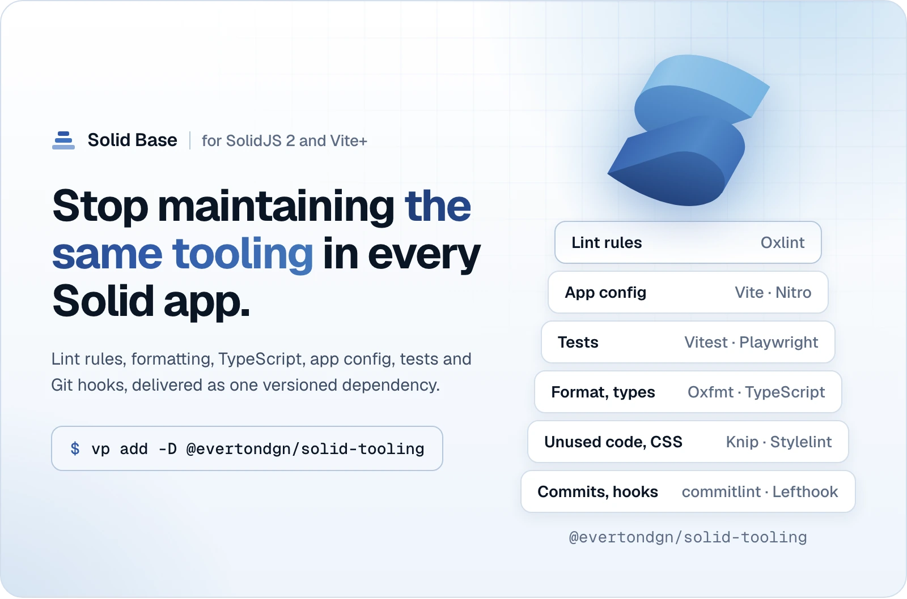
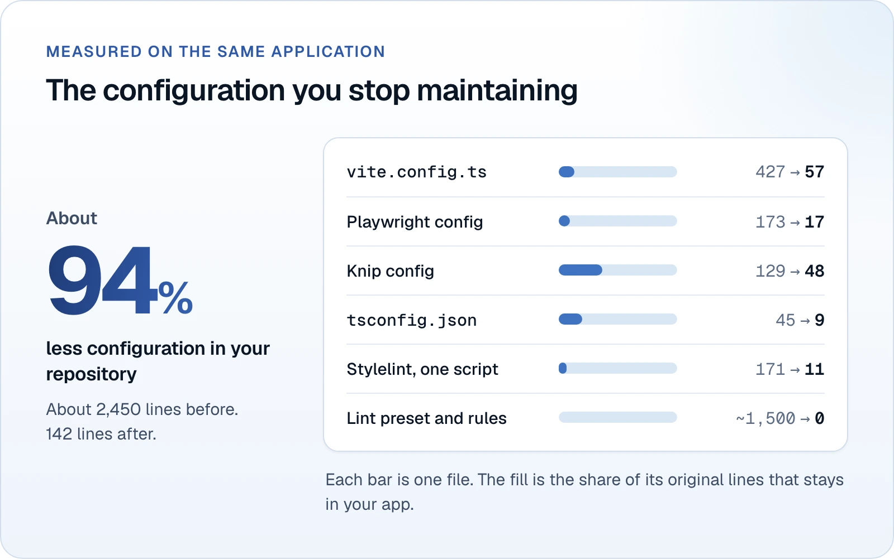
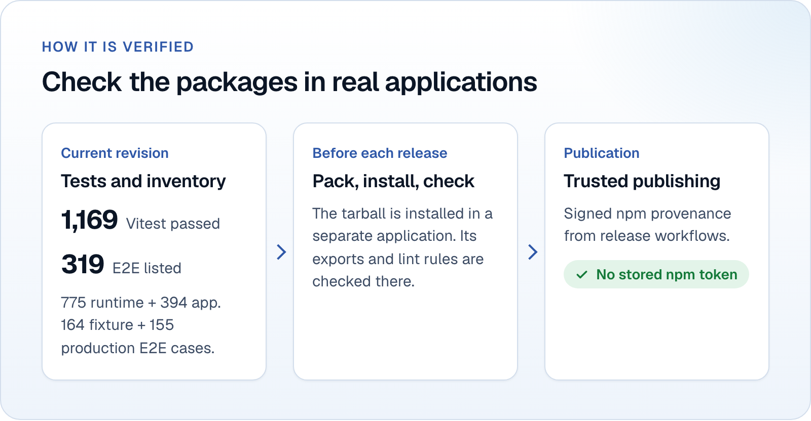

[](https://www.npmjs.com/package/@evertondgn/solid-tooling)
[](https://github.com/everton-dgn/solidjs_base/actions/workflows/ci.yml)
[](https://github.com/everton-dgn/solidjs_base/blob/main/LICENSE)

# @evertondgn/solid-tooling

<picture>
  <source media="(prefers-color-scheme: dark)" srcset="https://raw.githubusercontent.com/everton-dgn/solidjs_base/main/docs/assets/readme/hero-dark.webp" />
  <source media="(prefers-color-scheme: light)" srcset="https://raw.githubusercontent.com/everton-dgn/solidjs_base/main/docs/assets/readme/hero-light.webp" />
  
</picture>

Solid Base supplies lint rules, application config, test setups and Git hooks
for SolidJS 2 with [Vite+](https://viteplus.dev/guide/) as one versioned
dependency, so you stop maintaining the same tooling in every Solid app. In an
application that already uses Vite+:

```bash
vp add -D @evertondgn/solid-tooling
```

Built for applications that follow the
[boilerplate_solidjs](https://github.com/everton-dgn/boilerplate_solidjs)
layout. SolidJS 2 is still a release candidate, and the package is tested with
it. Start with lint and formatting, and adopt the full application config when
you are ready.

## Requirements

Install the exact Vite+ version listed in the package's `peerDependencies`. The
package supplies its build, test, type-check and hook tools. Applications keep
their own direct imports and the Vite+ overrides; see the
[dependency requirements](https://github.com/everton-dgn/solidjs_base/blob/main/docs/tooling/limits.md#requirements).
An application with translations also installs the required version of
`@inlang/paraglide-js` and its message-format plugin.

## Quick start

Add `fmt` and `lint` to your existing Vite+ config. The example shows only those
settings; keep your plugins and other options:

```ts
import { fmt } from '@evertondgn/solid-tooling/fmt'
import { lint } from '@evertondgn/solid-tooling/lint'
import { defineConfig } from 'vite-plus'

export default defineConfig({ fmt, lint })
```

In `tsconfig.json`:

```json
{
  "extends": "@evertondgn/solid-tooling/tsconfig.base.json",
  "compilerOptions": {
    "paths": { "@/*": ["./src/*"] }
  },
  "include": ["src", "vite.config.ts"]
}
```

Check your code and format your files:

```bash
vp check
vp fmt
```

To see a rule of the package fire, create `src/helpers/export-list.ts`:

```ts
const example = 1

export { example }
```

Run `vp lint`. The preset reports the export list:

```text
src/helpers/export-list.ts:3:1: error project(no-export-list): Export on the declaration itself (export function, export const, export type) instead of using export { ... }. An export list is only allowed in a re-export with from.
```

## Why

Applications copied from a starter carry its tooling with them, and every fix to
the base has to be repeated by hand in each copy. With this package, the fix
arrives when you update a dependency.

<picture>
  <source media="(prefers-color-scheme: dark)" srcset="https://raw.githubusercontent.com/everton-dgn/solidjs_base/main/docs/assets/readme/before-after-dark.webp" />
  <source media="(prefers-color-scheme: light)" srcset="https://raw.githubusercontent.com/everton-dgn/solidjs_base/main/docs/assets/readme/before-after-light.webp" />
  
</picture>

Measured on the original starter and the same application using this package.
Compare the
[original config](https://github.com/everton-dgn/boilerplate_solidjs/blob/61454937472d0faa1b4fab985fd7c5da968aa9a6/vite.config.ts)
with the
[application config](https://github.com/everton-dgn/solidjs_base/blob/main/apps/boilerplate/vite.config.ts),
or read the
[full comparison](https://github.com/everton-dgn/solidjs_base/blob/main/README.md#before-and-after).

## What you get

| Area                            | Entry                                         | Guide                                                                                                                     |
| ------------------------------- | --------------------------------------------- | ------------------------------------------------------------------------------------------------------------------------- |
| Oxlint preset and project rules | `./lint`                                      | [Lint](https://github.com/everton-dgn/solidjs_base/blob/main/docs/tooling/lint.md)                                        |
| Oxfmt settings                  | `./fmt`                                       | [Formatting](https://github.com/everton-dgn/solidjs_base/blob/main/docs/tooling/typescript-and-format.md#formatter)       |
| TypeScript configs              | `./tsconfig.base.json`, `./tsconfig.app.json` | [TypeScript](https://github.com/everton-dgn/solidjs_base/blob/main/docs/tooling/typescript-and-format.md#typescript-base) |
| Whole application config        | `./vite`                                      | [Application config](https://github.com/everton-dgn/solidjs_base/blob/main/docs/tooling/app-config.md)                    |
| Vitest and Playwright           | `./vitest`, `./playwright`                    | [Testing](https://github.com/everton-dgn/solidjs_base/blob/main/docs/tooling/testing.md)                                  |
| Unused code and CSS policy      | `./knip`, `./stylelint`                       | [Knip and CSS](https://github.com/everton-dgn/solidjs_base/blob/main/docs/tooling/knip-and-css.md)                        |
| Commit messages and Git hooks   | `./commitlint`, `./lefthook.yml`              | [Commits and hooks](https://github.com/everton-dgn/solidjs_base/blob/main/docs/tooling/commits-and-hooks.md)              |

Your application keeps its pages, components, translations, theme, `App`,
`Document`, entries and middleware. The
[entry-point reference](https://github.com/everton-dgn/solidjs_base/blob/main/docs/tooling/README.md#entry-points)
also lists the plugins and test setup exports.

## Your application config in one call

With the application dependencies installed, `defineSolidApp()` supplies the
plugins, build settings, tasks, lint, format and three Vitest projects:

```ts
import { defineSolidApp } from '@evertondgn/solid-tooling/vite'

import { SECURITY_HEADERS } from './src/middleware/securityHeaders/constants.ts'

export default defineSolidApp({
  root: import.meta.dirname,
  middleware: './src/middleware/index.ts',
  securityHeaders: SECURITY_HEADERS
})
```

You keep your middleware and header values. SSR uses Nitro with the Vercel
preset. Its plugins are package dependencies pinned to the tested versions. The
`knip`, `tsc`, `playwright`, `lefthook` and `commitlint` tasks run the
package-owned binaries, including with an isolated installation.

| Feature             | Selection                                                                                                                              |
| ------------------- | -------------------------------------------------------------------------------------------------------------------------------------- |
| Client-only build   | Set `ssr: false` and omit SSR options such as `middleware` and `securityHeaders`; the build has no Nitro or server bundle              |
| Publication headers | Set `publication: true` for the rules of published files such as the sitemap, `robots.txt`, `llms.txt` and Markdown pages              |
| Translations        | `project.inlang/settings.json` enables the generation task and browser test setup; the lint plugin loads only where Paraglide resolves |

See
[all options and extension points](https://github.com/everton-dgn/solidjs_base/blob/main/docs/tooling/app-config.md)
and the
[known limits](https://github.com/everton-dgn/solidjs_base/blob/main/docs/tooling/limits.md#known-limits).

## How it is verified

<picture>
  <source media="(prefers-color-scheme: dark)" srcset="https://raw.githubusercontent.com/everton-dgn/solidjs_base/main/docs/assets/readme/verified-dark.webp" />
  <source media="(prefers-color-scheme: light)" srcset="https://raw.githubusercontent.com/everton-dgn/solidjs_base/main/docs/assets/readme/verified-light.webp" />
  
</picture>

Package changes run against the complete boilerplate and the runtime package in
CI, with more than 1,000 Vitest tests and more than 300 end-to-end tests. Before
each release, the tarball test installs the packed package in a separate
application outside the workspace and checks its exports and lint rules.

The workflow publishes to npm with signed provenance through trusted publishing,
without a stored npm token. See the
[CI coverage](https://github.com/everton-dgn/solidjs_base/blob/main/docs/development.md#ci)
and the
[release process](https://github.com/everton-dgn/solidjs_base/blob/main/docs/releasing.md).

## Reference

- [Lint rules and customization](https://github.com/everton-dgn/solidjs_base/blob/main/docs/tooling/lint.md)
- [Application config, plugins and tasks](https://github.com/everton-dgn/solidjs_base/blob/main/docs/tooling/app-config.md)
- [Vitest and Playwright](https://github.com/everton-dgn/solidjs_base/blob/main/docs/tooling/testing.md)
- [Knip and CSS](https://github.com/everton-dgn/solidjs_base/blob/main/docs/tooling/knip-and-css.md)
- [Commit messages and Git hooks](https://github.com/everton-dgn/solidjs_base/blob/main/docs/tooling/commits-and-hooks.md)
- [TypeScript and formatting](https://github.com/everton-dgn/solidjs_base/blob/main/docs/tooling/typescript-and-format.md)
- [Requirements, limits and versions](https://github.com/everton-dgn/solidjs_base/blob/main/docs/tooling/limits.md)

## Versions and license

The package follows semantic versioning. Below 1.0.0, a breaking change raises
the minor version. Read the
[changelog](https://github.com/everton-dgn/solidjs_base/blob/main/packages/solid-tooling/CHANGELOG.md)
for each release.

[MIT](https://github.com/everton-dgn/solidjs_base/blob/main/LICENSE)
